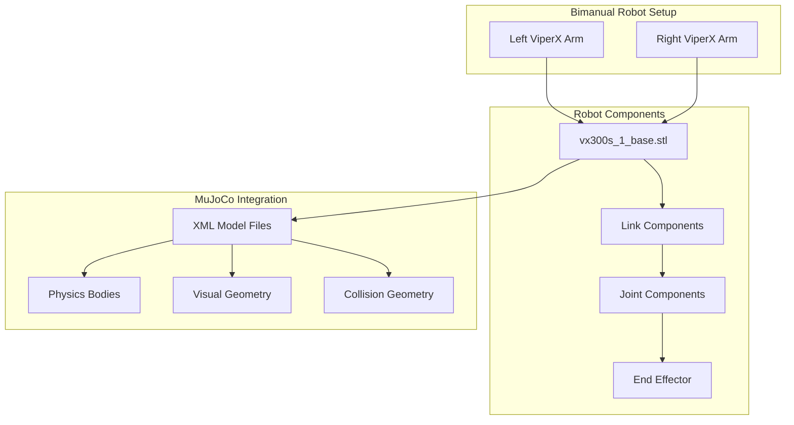
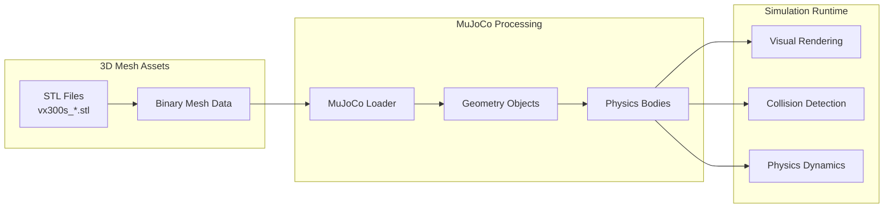
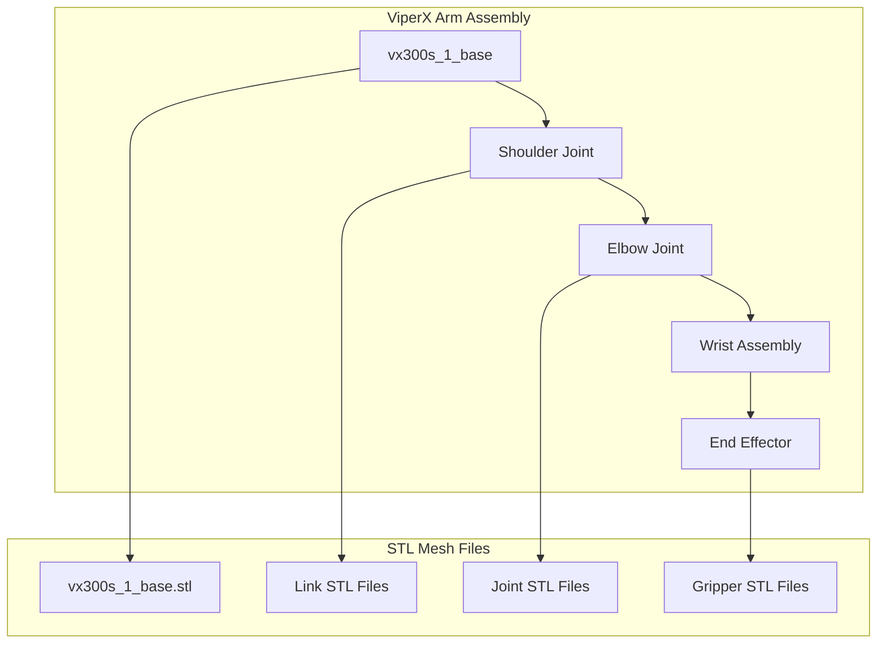
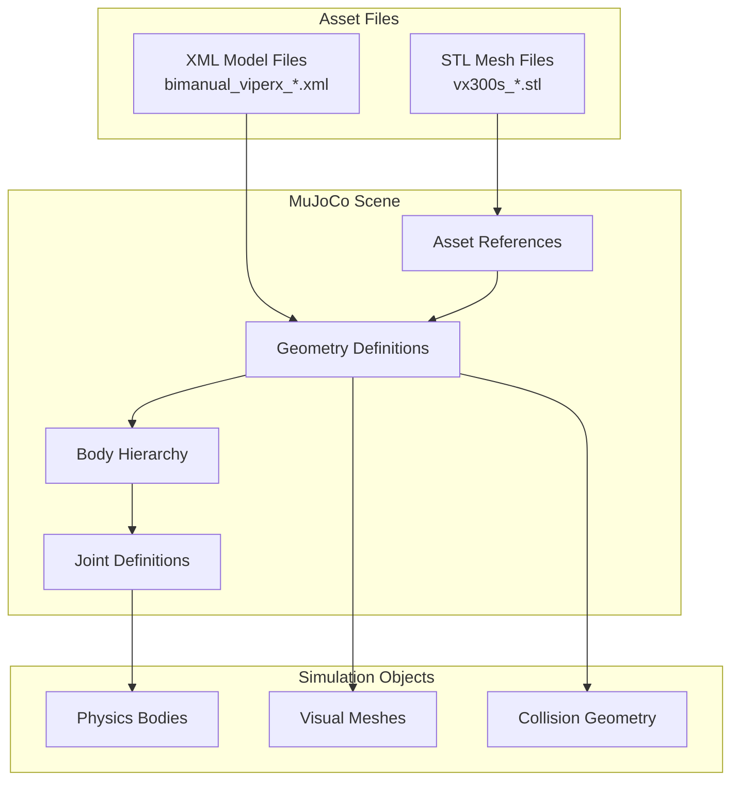
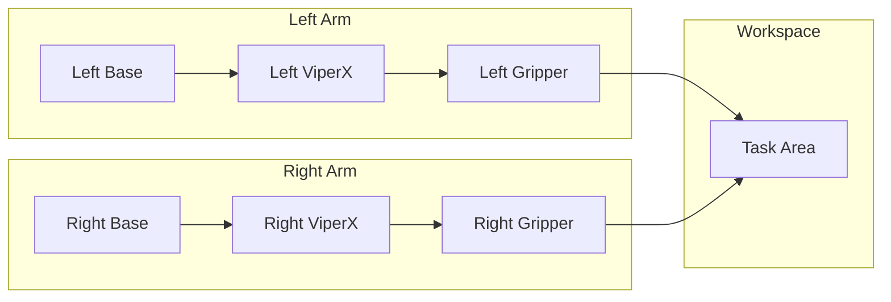

<!-- source: DeepWiki mcp.deepwiki.com · repo huggingface/gym-aloha · page 4.2 Robot Models · fetched 2026-10-26 -->

# Robot Models

Relevant source files

The following files were used as context for generating this wiki page:

- [gym_aloha/assets/vx300s_1_base.stl](gym_aloha/assets/vx300s_1_base.stl)
- [gym_aloha/assets/vx300s_2_shoulder.stl](gym_aloha/assets/vx300s_2_shoulder.stl)
- [gym_aloha/assets/vx300s_7_gripper.stl](gym_aloha/assets/vx300s_7_gripper.stl)

This document describes the 3D robot models and mesh assets used in the gym-aloha simulation environment. It covers the ViperX robot components, their STL mesh representations, and how they integrate with the MuJoCo physics simulation.

For information about the overall scene setup and environment configuration, see [Scene Configuration](#4.1).

## ViperX Robot Overview

The gym-aloha environment simulates bimanual robotic manipulation using two ViperX 300s robot arms. These robots are represented through detailed 3D mesh models that provide both visual fidelity and accurate collision geometry for physics simulation.

**ViperX Robot Architecture**

Sources: [gym_aloha/assets/vx300s_1_base.stl:1-1]()

## 3D Asset Pipeline

The robot models follow a structured asset pipeline that converts STL mesh files into MuJoCo-compatible representations.

**Asset Loading and Processing**

## Robot Component Structure

The ViperX robot is decomposed into multiple STL mesh files, each representing different mechanical components.

| Component Type | File Pattern | Description |
|----------------|--------------|-------------|
| Base Assembly | `vx300s_1_base.stl` | Robot base and mounting platform |
| Link Segments | `vx300s_*_link*.stl` | Individual arm link segments |
| Joint Housings | `vx300s_*_joint*.stl` | Motor and joint assemblies |
| End Effector | `vx300s_*_gripper*.stl` | Gripper and tool components |

**Component Hierarchy**

Sources: [gym_aloha/assets/vx300s_1_base.stl:1-1]()

## STL Mesh Format

The robot components use binary STL format for efficient storage and loading. The STL files contain triangular mesh data with vertex coordinates and surface normals.

**STL Data Structure**

The `vx300s_1_base.stl` file demonstrates the binary STL format used throughout the asset pipeline:

- **Header**: 80-byte header with format identification
- **Triangle Count**: 32-bit integer specifying number of triangles  
- **Triangle Data**: For each triangle:
  - Surface normal vector (3 × 32-bit floats)
  - Vertex coordinates (3 vertices × 3 × 32-bit floats)
  - Attribute byte count (16-bit integer)

## Integration with MuJoCo

The robot models integrate with MuJoCo through XML scene definitions that reference the STL mesh assets.

**MuJoCo Robot Definition Pipeline**

## Bimanual Configuration

The gym-aloha environment uses a bimanual setup with two ViperX arms working in coordination.

**Bimanual Robot Layout**

Each arm uses the same base STL mesh files but with different positioning and orientation in the MuJoCo scene to create the bimanual workspace configuration.

Sources: [gym_aloha/assets/vx300s_1_base.stl:1-1]()

---

