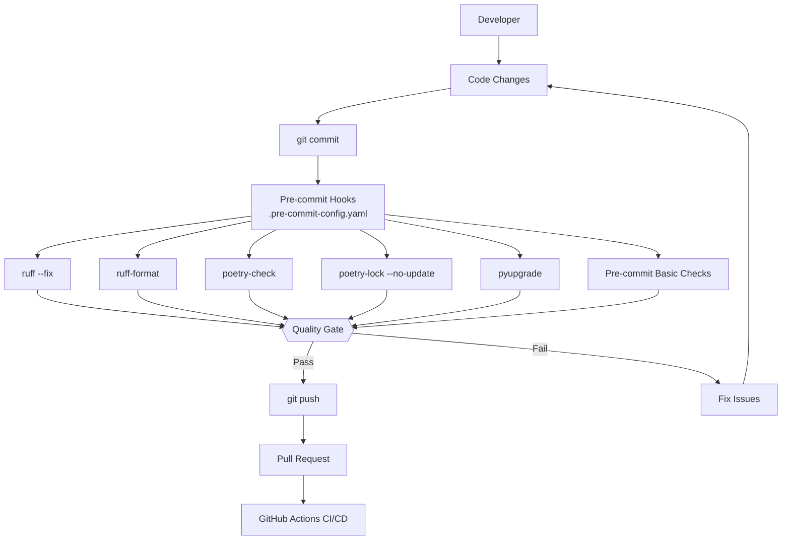
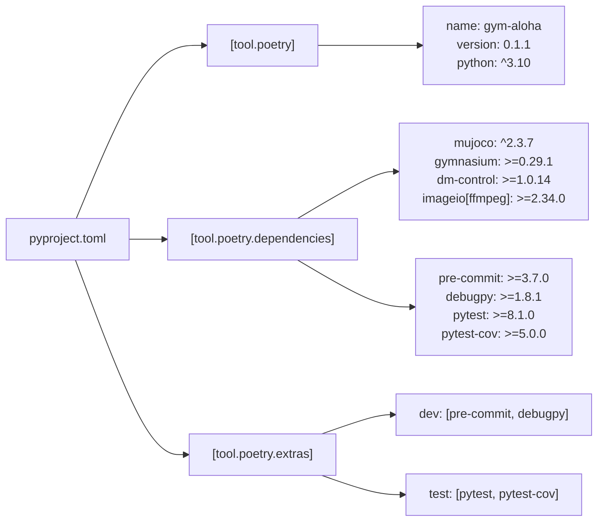
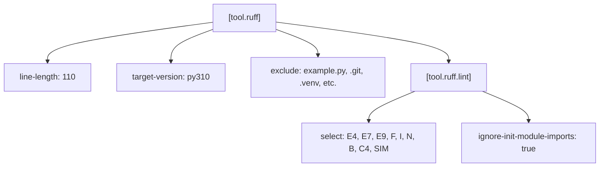
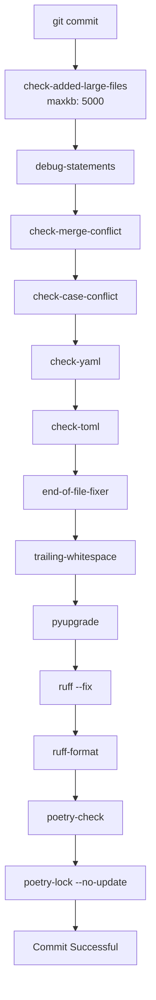
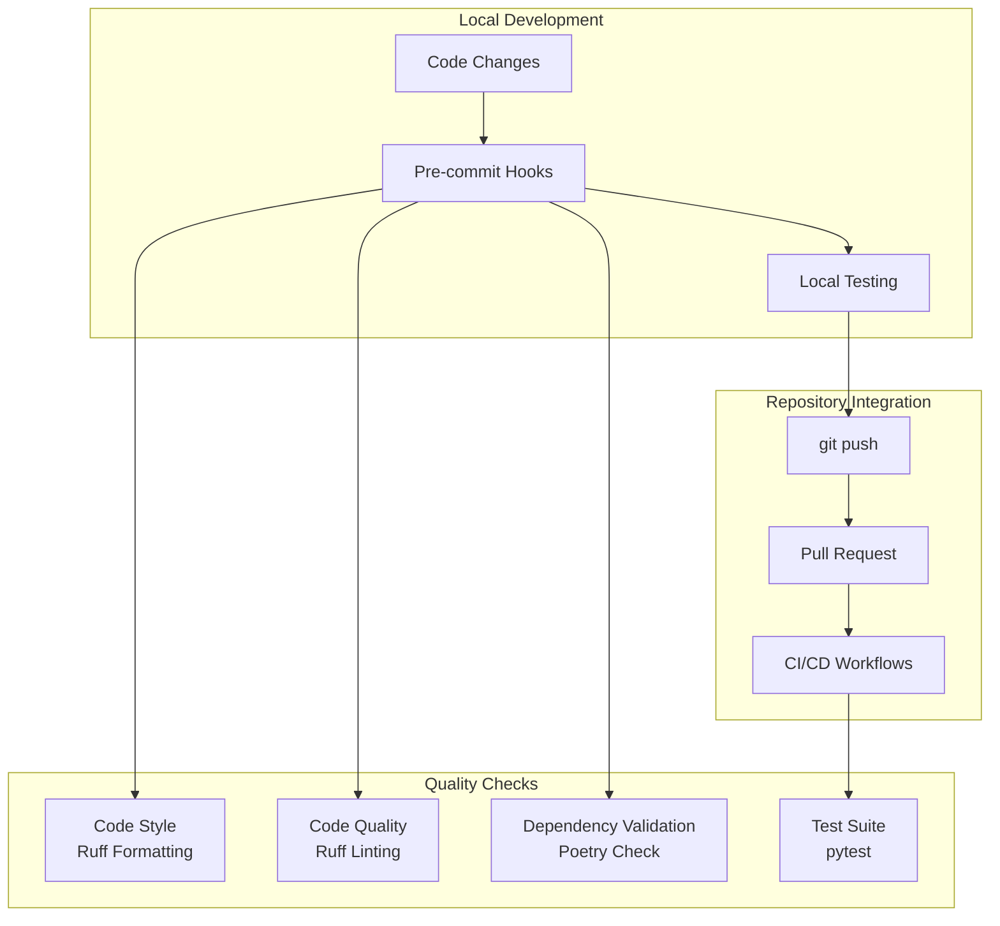

<!-- source: DeepWiki mcp.deepwiki.com · repo huggingface/gym-aloha · page 5 Development Workflow · fetched 2026-10-26 -->

# Development Workflow

Relevant source files

The following files were used as context for generating this wiki page:

- [.pre-commit-config.yaml](.pre-commit-config.yaml)
- [pyproject.toml](pyproject.toml)

This document describes the development workflow, tooling, and quality assurance processes for the gym-aloha repository. It covers the technical setup required for contributors, including dependency management, code quality enforcement, and automated testing procedures.

For information about setting up the development environment and installing dependencies, see [Development Environment Setup](#5.1). For details about testing frameworks and continuous integration processes, see [Testing and CI/CD](#5.2).

## Overview

The gym-aloha project implements a comprehensive development workflow that emphasizes code quality, reproducibility, and automated validation. The workflow integrates Poetry for dependency management, pre-commit hooks for immediate quality checks, Ruff for code formatting and linting, and pytest for testing.

### Development Workflow Architecture

Sources: [.pre-commit-config.yaml:1-34](), [pyproject.toml:41-77]()

## Development Tools Configuration

The project uses several interconnected tools for maintaining code quality and managing dependencies:

### Core Development Stack

| Tool | Purpose | Configuration File |
|------|---------|-------------------|
| Poetry | Dependency management and packaging | `pyproject.toml` |
| Ruff | Code linting and formatting | `pyproject.toml` [tool.ruff] |
| Pre-commit | Git hook automation | `.pre-commit-config.yaml` |
| pytest | Testing framework | `pyproject.toml` [tool.poetry.extras] |

### Poetry Configuration

Sources: [pyproject.toml:1-38]()

The Poetry configuration defines three dependency categories:
- **Core dependencies**: Required for runtime functionality
- **Optional dependencies**: Development and testing tools marked as optional
- **Extras**: Grouped optional dependencies for specific use cases

### Ruff Configuration

The project uses Ruff for both linting and formatting with specific configuration:

Sources: [pyproject.toml:41-73]()

Key Ruff configuration details:
- Line length limit: 110 characters
- Target Python version: 3.10
- Selected rule categories: Error detection (E), Flake8 compatibility (F), Import sorting (I), Naming conventions (N), Bugbear rules (B), Comprehension rules (C4), Simplification rules (SIM)
- Excludes `example.py` from linting to allow flexible demonstration code

## Pre-commit Hook Workflow

The pre-commit configuration enforces quality standards before code is committed:

### Pre-commit Hook Chain

Sources: [.pre-commit-config.yaml:1-34]()

The pre-commit workflow includes:
1. **File validation**: Checks for large files, YAML/TOML syntax, merge conflicts
2. **Code cleanup**: Fixes trailing whitespace, end-of-file issues, upgrades Python syntax
3. **Code quality**: Applies Ruff linting and formatting
4. **Dependency validation**: Verifies Poetry configuration and lockfile consistency

### Pre-commit Repository Sources

The configuration pulls hooks from multiple repositories:

| Repository | Version | Hooks Used |
|------------|---------|------------|
| `pre-commit/pre-commit-hooks` | v4.6.0 | File validation, cleanup |
| `asottile/pyupgrade` | v3.15.2 | Python syntax modernization |
| `astral-sh/ruff-pre-commit` | v0.4.3 | Linting and formatting |
| `python-poetry/poetry` | 1.8.0 | Dependency management validation |

Sources: [.pre-commit-config.yaml:5-33]()

## Quality Assurance Process

The development workflow implements multiple layers of quality assurance:

### Quality Gate Architecture

Sources: [.pre-commit-config.yaml:1-34](), [pyproject.toml:32-38]()

### Code Quality Standards

The project enforces the following quality standards:

**Formatting Standards**:
- Line length: 110 characters maximum
- Python 3.10+ syntax requirements
- Automatic import sorting and organization
- Consistent code formatting via Ruff

**Linting Rules**:
- Error detection for syntax and runtime issues
- Import organization and unused import removal
- Naming convention enforcement
- Code simplification suggestions
- Bugbear pattern detection

**Dependency Management**:
- Locked dependency versions via `poetry.lock`
- Validation of `pyproject.toml` configuration
- Automatic dependency conflict resolution
- Optional dependency grouping for different use cases

Sources: [pyproject.toml:41-73](), [.pre-commit-config.yaml:21-33]()

This comprehensive development workflow ensures code quality, maintainability, and consistent development practices across all contributors to the gym-aloha project.

---

