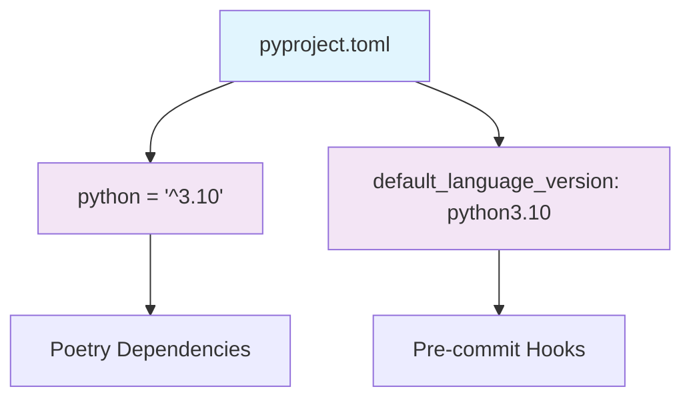
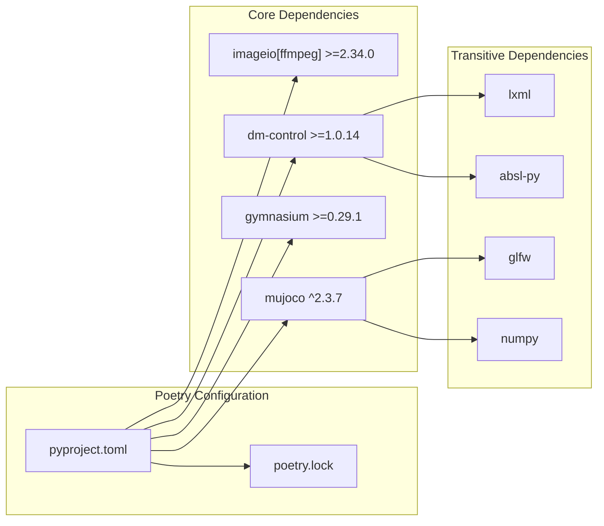
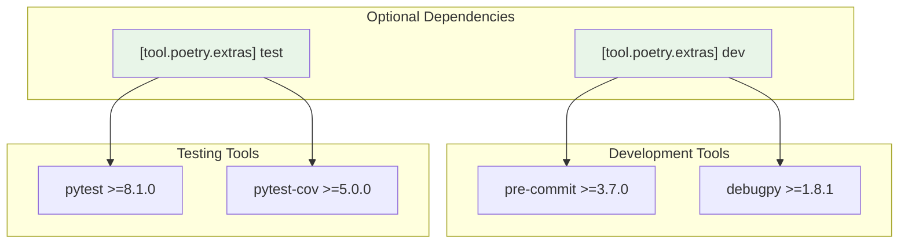
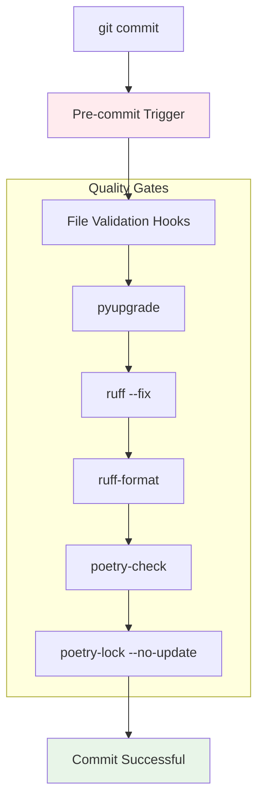
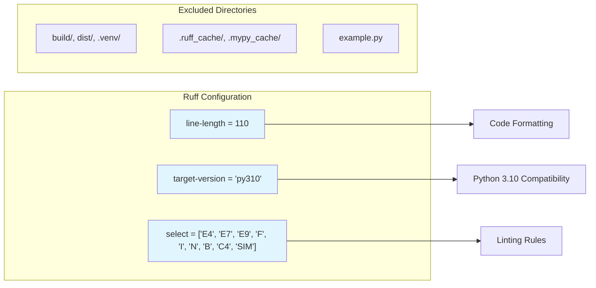
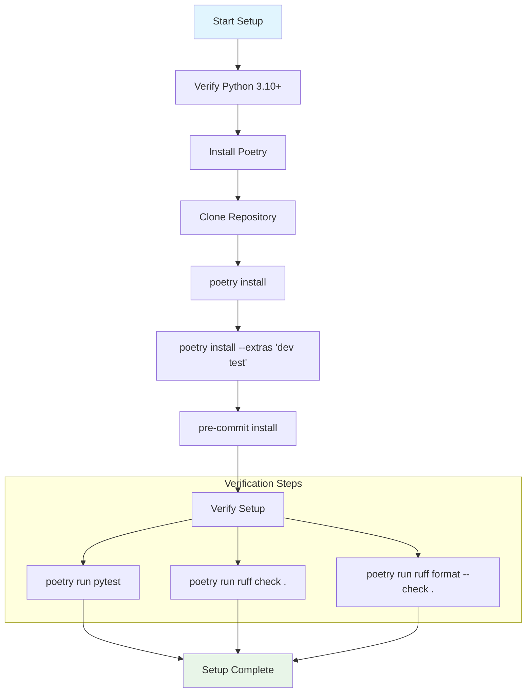
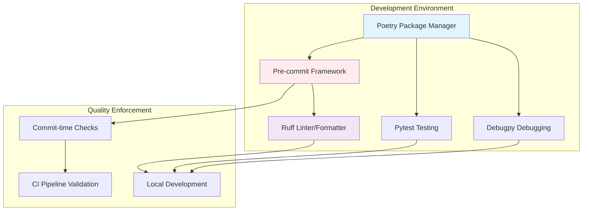

<!-- source: DeepWiki mcp.deepwiki.com · repo huggingface/gym-aloha · page 5.1 Development Environment Setup · fetched 2026-10-26 -->

# Development Environment Setup

Relevant source files

The following files were used as context for generating this wiki page:

- [.pre-commit-config.yaml](.pre-commit-config.yaml)
- [poetry.lock](poetry.lock)
- [pyproject.toml](pyproject.toml)

This document covers setting up a development environment for the gym-aloha project, including dependency management with Poetry, code quality tools, and pre-commit hooks. For information about testing frameworks and CI/CD pipelines, see [Testing and CI/CD](#5.2). For details about code formatting standards, see [Code Quality and Standards](#5.3).

## Python Version Requirements

The gym-aloha project requires Python 3.10 or higher. This requirement is defined in the Poetry configuration and enforced across all development tools.

**Python Version Configuration:**

Sources: [pyproject.toml:25](), [.pre-commit-config.yaml:3]()

## Poetry Dependency Management

The project uses Poetry for deterministic dependency management with separate dependency groups for runtime and development needs.

### Core Dependencies

The runtime dependencies are managed through Poetry's main dependency section:

| Dependency | Version Constraint | Purpose |
|------------|-------------------|---------|
| `mujoco` | `^2.3.7` | Physics simulation engine |
| `gymnasium` | `>=0.29.1` | RL environment interface |
| `dm-control` | `>=1.0.14` | Robotics control utilities |
| `imageio` | `>=2.34.0` (with ffmpeg) | Video recording capabilities |

**Dependency Resolution Flow:**

Sources: [pyproject.toml:24-29](), [poetry.lock:1-2]()

### Development Dependencies

Development dependencies are organized into optional extras groups:

**Development Extras Structure:**

Sources: [pyproject.toml:30-33](), [pyproject.toml:36-38]()

## Pre-commit Hooks Configuration

The project enforces code quality through pre-commit hooks that run automated checks before each commit.

### Hook Categories

The pre-commit configuration includes several categories of quality checks:

| Hook Repository | Purpose | Specific Hooks |
|----------------|---------|----------------|
| `pre-commit/pre-commit-hooks` | Basic file validation | `check-added-large-files`, `debug-statements`, `check-merge-conflict` |
| `asottile/pyupgrade` | Python syntax modernization | `pyupgrade` |
| `astral-sh/ruff-pre-commit` | Linting and formatting | `ruff`, `ruff-format` |
| `python-poetry/poetry` | Dependency validation | `poetry-check`, `poetry-lock` |

**Pre-commit Workflow:**

Sources: [.pre-commit-config.yaml:4-34]()

### File Exclusions

The pre-commit configuration excludes certain files from quality checks:

- `example.py` is excluded from all hooks to allow for demonstration code that may not follow strict standards

Sources: [.pre-commit-config.yaml:1]()

## Code Quality Tools

### Ruff Configuration

Ruff serves as both linter and formatter with project-specific configuration:

**Ruff Settings:**

Sources: [pyproject.toml:41-77]()

## Environment Setup Workflow

The complete development environment setup follows this sequence:

**Setup Process:**

Sources: [pyproject.toml:1-77](), [.pre-commit-config.yaml:1-34]()

## Development Dependencies Integration

The development tools integrate to provide a comprehensive quality assurance pipeline:

**Tool Integration Map:**

Sources: [pyproject.toml:30-38](), [.pre-commit-config.yaml:21-33]()

---

