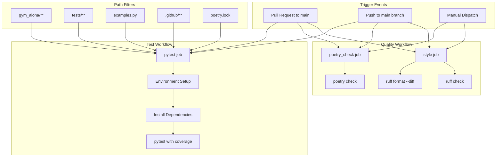
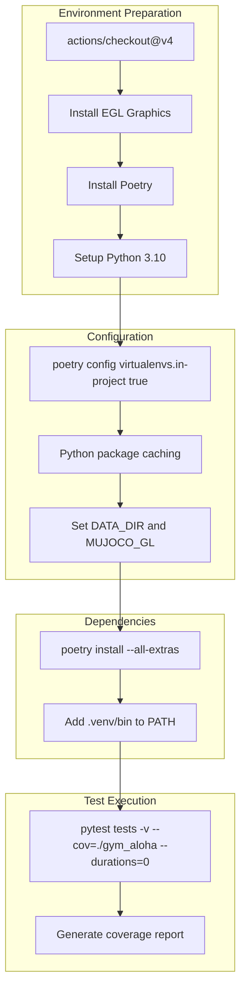
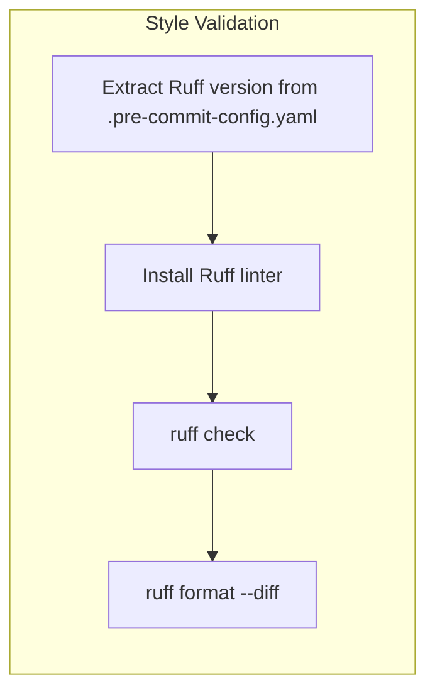
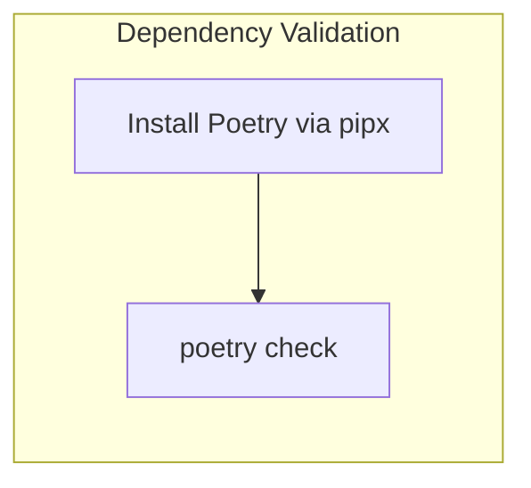
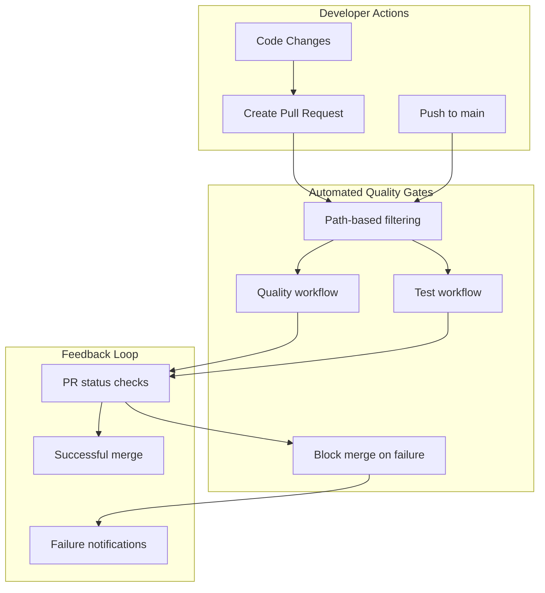

<!-- source: DeepWiki mcp.deepwiki.com · repo huggingface/gym-aloha · page 5.2 Testing and CI/CD · fetched 2026-10-26 -->

# Testing and CI/CD

<details>
<summary>Relevant source files</summary>

The following files were used as context for generating this wiki page:

- [.github/workflows/quality.yml](.github/workflows/quality.yml)
- [.github/workflows/test.yml](.github/workflows/test.yml)

</details>


This document covers the automated testing framework and continuous integration/continuous deployment (CI/CD) infrastructure for the gym-aloha repository. It explains how code quality is maintained through automated testing, linting, and validation processes that run on every code change.

For information about setting up the development environment locally, see [Development Environment Setup](#5.1). For details about code quality standards and pre-commit hooks, see [Code Quality and Standards](#5.3).

## Testing Framework

The project uses `pytest` as its primary testing framework with code coverage reporting. Tests are located in the `tests/` directory and run automatically through GitHub Actions on code changes.

### Test Configuration

The testing environment is configured with specific requirements for the robotics simulation:

| Configuration | Value | Purpose |
|---------------|-------|---------|
| `DATA_DIR` | `tests/data` | Test data directory |
| `MUJOCO_GL` | `egl` | Headless graphics rendering |
| Python Version | 3.10 | Consistent runtime environment |
| Coverage Target | `gym_aloha` module | Code coverage tracking |

**Sources:** [.github/workflows/test.yml:28-29]()

## CI/CD Pipeline Overview

The CI/CD infrastructure consists of two main GitHub Actions workflows that ensure code quality and functionality:



**Sources:** [.github/workflows/test.yml:3-21](), [.github/workflows/quality.yml:3-10]()

## Test Workflow Details

The test workflow (`pytest` job) performs comprehensive testing with the following steps:



### Key Testing Components

The test workflow includes several critical setup steps for the robotics environment:

- **EGL Graphics Installation**: Required for headless MuJoCo rendering in CI environment
- **Poetry Configuration**: Virtual environment setup with `virtualenvs.in-project true`
- **Dependency Installation**: All extras included with `--all-extras` flag
- **Environment Variables**: `MUJOCO_GL=egl` for headless graphics, `DATA_DIR=tests/data` for test resources

**Sources:** [.github/workflows/test.yml:30-53]()

## Quality Assurance Workflow

The quality workflow runs two parallel jobs to ensure code standards:

### Style Job

The style job enforces code formatting and linting standards:



The Ruff version is dynamically extracted using this command:
```bash
awk '/repo: https:\/\/github.com\/astral-sh\/ruff-pre-commit/{flag=1;next}/rev:/{if(flag){print $2;exit}}' .pre-commit-config.yaml
```

### Poetry Check Job

The poetry check job validates project configuration:



**Sources:** [.github/workflows/quality.yml:16-55]()

## Integration with Development Process

The CI/CD pipeline integrates with the development workflow through path-based filtering and automated triggers:

### Path-Based Triggering

Tests only run when relevant files change:

| Path Pattern | Purpose |
|-------------|---------|
| `gym_aloha/**` | Core package changes |
| `tests/**` | Test suite modifications |
| `examples.py` | Example code updates |
| `.github/**` | CI/CD configuration changes |
| `poetry.lock` | Dependency updates |

### Workflow Coordination



**Sources:** [.github/workflows/test.yml:7-21](), [.github/workflows/quality.yml:5-10]()

## Coverage and Reporting

The test suite includes comprehensive coverage reporting:

### Coverage Configuration

- **Target Module**: Coverage tracked for `gym_aloha` package
- **Verbose Output**: Tests run with `-v` flag for detailed output
- **Duration Tracking**: `--durations=0` shows timing for all tests
- **Coverage Report**: Automatically generated during test execution

### Test Command Structure

```bash
pytest tests -v --cov=./gym_aloha --durations=0
```

This command structure provides:
- Full test directory scanning (`tests`)
- Verbose output for debugging (`-v`)
- Coverage metrics for the main package (`--cov=./gym_aloha`)
- Performance profiling (`--durations=0`)

**Sources:** [.github/workflows/test.yml:53]()

---

