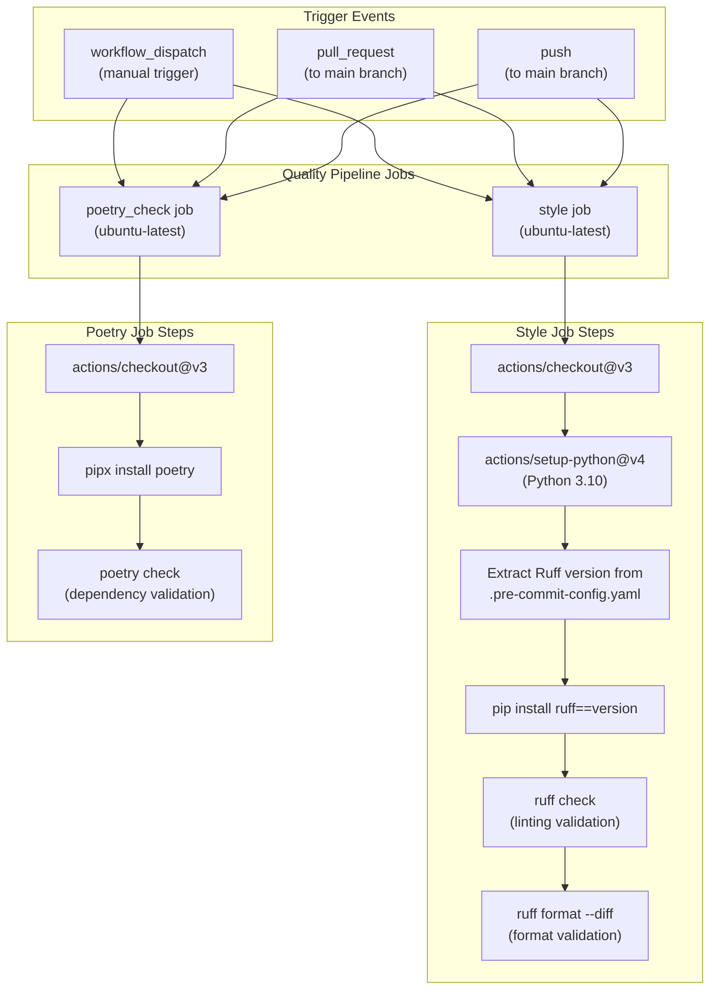
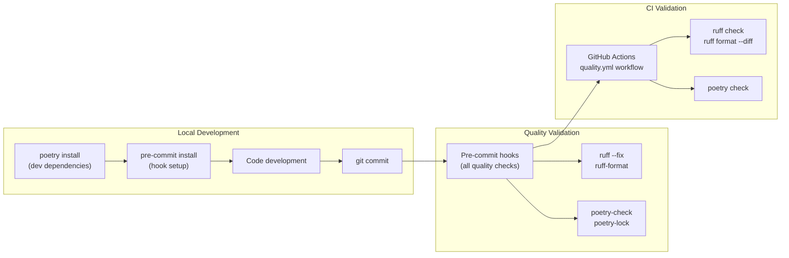

<!-- source: DeepWiki mcp.deepwiki.com · repo huggingface/gym-aloha · page 5.3 Code Quality and Standards · fetched 2026-10-26 -->

# Code Quality and Standards

Relevant source files

The following files were used as context for generating this wiki page:

- [.github/workflows/quality.yml](.github/workflows/quality.yml)
- [.pre-commit-config.yaml](.pre-commit-config.yaml)

This document covers the code quality assurance mechanisms, formatting standards, and automated quality enforcement processes used in the gym-aloha repository. It details the configuration and workflow of linting tools, pre-commit hooks, and continuous integration quality gates.

For information about the broader development environment setup, see [Development Environment Setup](#5.1). For details about testing and CI/CD pipelines, see [Testing and CI/CD](#5.2).

## Code Formatting and Linting

The project uses **Ruff** as the primary tool for both code linting and formatting. Ruff is configured through the pre-commit system and enforced in CI/CD pipelines.

### Ruff Configuration

The Ruff linter and formatter are integrated through the pre-commit configuration at [.pre-commit-config.yaml:21-26](). The configuration specifies version `v0.4.3` and includes two hooks:

- `ruff` hook with `--fix` argument for automatic fixes
- `ruff-format` hook for code formatting

### Python Version Standards

The project enforces **Python 3.10** as the standard version, specified in [.pre-commit-config.yaml:3]() as the default language version. This ensures consistency across development environments and CI/CD pipelines.

**Sources:** [.pre-commit-config.yaml:1-34](), [.github/workflows/quality.yml:13]()

## Pre-commit Hook System

The pre-commit system provides immediate quality feedback during the development process before code is committed to version control.

### Pre-commit Hook Workflow

```mermaid
graph TD
    DEV_COMMIT["Developer runs git commit"]
    PRE_COMMIT_TRIGGER["Pre-commit hooks triggered"]
    
    subgraph "File Validation Hooks"
        CHECK_LARGE["check-added-large-files<br/>(max 5MB)"]
        DEBUG_STMT["debug-statements"]
        MERGE_CONFLICT["check-merge-conflict"]
        CASE_CONFLICT["check-case-conflict"]
        CHECK_YAML["check-yaml"]
        CHECK_TOML["check-toml"]
        EOF_FIXER["end-of-file-fixer"]
        TRAILING_WS["trailing-whitespace"]
    end
    
    subgraph "Code Quality Hooks"
        PYUPGRADE["pyupgrade<br/>(Python version upgrade)"]
        RUFF_CHECK["ruff --fix<br/>(linting with auto-fix)"]
        RUFF_FORMAT["ruff-format<br/>(code formatting)"]
    end
    
    subgraph "Dependency Validation"
        POETRY_CHECK["poetry-check<br/>(validate pyproject.toml)"]
        POETRY_LOCK["poetry-lock --no-update<br/>(validate lock file)"]
    end
    
    COMMIT_SUCCESS["Commit allowed"]
    COMMIT_BLOCKED["Commit blocked<br/>Fix issues and retry"]
    
    DEV_COMMIT --> PRE_COMMIT_TRIGGER
    PRE_COMMIT_TRIGGER --> CHECK_LARGE
    PRE_COMMIT_TRIGGER --> DEBUG_STMT
    PRE_COMMIT_TRIGGER --> MERGE_CONFLICT
    PRE_COMMIT_TRIGGER --> CASE_CONFLICT
    PRE_COMMIT_TRIGGER --> CHECK_YAML
    PRE_COMMIT_TRIGGER --> CHECK_TOML
    PRE_COMMIT_TRIGGER --> EOF_FIXER
    PRE_COMMIT_TRIGGER --> TRAILING_WS
    PRE_COMMIT_TRIGGER --> PYUPGRADE
    PRE_COMMIT_TRIGGER --> RUFF_CHECK
    PRE_COMMIT_TRIGGER --> RUFF_FORMAT
    PRE_COMMIT_TRIGGER --> POETRY_CHECK
    PRE_COMMIT_TRIGGER --> POETRY_LOCK
    
    CHECK_LARGE --> COMMIT_SUCCESS
    DEBUG_STMT --> COMMIT_SUCCESS
    MERGE_CONFLICT --> COMMIT_SUCCESS
    CASE_CONFLICT --> COMMIT_SUCCESS
    CHECK_YAML --> COMMIT_SUCCESS
    CHECK_TOML --> COMMIT_SUCCESS
    EOF_FIXER --> COMMIT_SUCCESS
    TRAILING_WS --> COMMIT_SUCCESS
    PYUPGRADE --> COMMIT_SUCCESS
    RUFF_CHECK --> COMMIT_SUCCESS
    RUFF_FORMAT --> COMMIT_SUCCESS
    POETRY_CHECK --> COMMIT_SUCCESS
    POETRY_LOCK --> COMMIT_SUCCESS
    
    CHECK_LARGE --> COMMIT_BLOCKED
    DEBUG_STMT --> COMMIT_BLOCKED
    MERGE_CONFLICT --> COMMIT_BLOCKED
    CASE_CONFLICT --> COMMIT_BLOCKED
    CHECK_YAML --> COMMIT_BLOCKED
    CHECK_TOML --> COMMIT_BLOCKED
    RUFF_CHECK --> COMMIT_BLOCKED
    RUFF_FORMAT --> COMMIT_BLOCKED
    POETRY_CHECK --> COMMIT_BLOCKED
    POETRY_LOCK --> COMMIT_BLOCKED
```

### File Exclusions

The pre-commit configuration excludes `example.py` from all quality checks via [.pre-commit-config.yaml:1](). This allows the example file to have more relaxed formatting for demonstration purposes.

### Hook Categories

| Category | Hook ID | Purpose | Auto-fix |
|----------|---------|---------|----------|
| File Size | `check-added-large-files` | Prevent files >5MB | No |
| Code Safety | `debug-statements` | Block debug statements | No |
| Merge Safety | `check-merge-conflict` | Detect merge conflicts | No |
| File System | `check-case-conflict` | Check filename conflicts | No |
| File Format | `check-yaml`, `check-toml` | Validate config files | No |
| File Cleanup | `end-of-file-fixer`, `trailing-whitespace` | Clean file endings | Yes |
| Python Upgrade | `pyupgrade` | Modernize Python syntax | Yes |
| Code Quality | `ruff`, `ruff-format` | Lint and format code | Yes |
| Dependencies | `poetry-check`, `poetry-lock` | Validate dependencies | No |

**Sources:** [.pre-commit-config.yaml:1-34]()

## CI/CD Quality Pipeline

The continuous integration system enforces quality standards through the `quality.yml` workflow that runs on pull requests and pushes to the main branch.

### Quality Workflow Architecture

### Dynamic Version Management

The CI pipeline dynamically extracts the Ruff version from the pre-commit configuration to ensure version consistency between local development and CI environments. This is accomplished through an AWK command at [.github/workflows/quality.yml:28-33]() that parses the `.pre-commit-config.yaml` file.

**Sources:** [.github/workflows/quality.yml:1-56]()

## Quality Enforcement Levels

The quality system operates at multiple enforcement levels to catch issues early and maintain consistency.

### Quality Gate Comparison

| Level | Tool | Trigger | Scope | Blocking |
|-------|------|---------|-------|----------|
| Local Development | Pre-commit hooks | `git commit` | All configured checks | Yes |
| Pull Request | GitHub Actions | PR creation/update | Style + Dependencies | Yes |
| Main Branch | GitHub Actions | Push to main | Style + Dependencies | Yes |
| Manual | GitHub Actions | `workflow_dispatch` | Style + Dependencies | No |

### Ruff Command Comparison

| Context | Command | Purpose | Behavior |
|---------|---------|---------|----------|
| Pre-commit | `ruff --fix` | Local linting with auto-fix | Modifies files |
| Pre-commit | `ruff-format` | Local formatting | Modifies files |
| CI Style Job | `ruff check` | Validation only | Read-only check |
| CI Style Job | `ruff format --diff` | Format validation | Shows differences |

**Sources:** [.pre-commit-config.yaml:24-26](), [.github/workflows/quality.yml:38-41]()

## Integration with Development Workflow

The quality standards integrate seamlessly with the Poetry-based development workflow, ensuring that dependency management and code quality work together.

### Quality and Dependency Integration

This integration ensures that both code style and dependency integrity are maintained throughout the development lifecycle, from local development to production deployment.

**Sources:** [.pre-commit-config.yaml:1-34](), [.github/workflows/quality.yml:1-56]()

---

