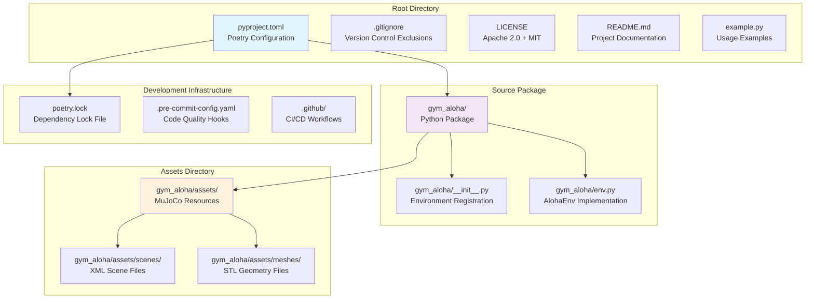
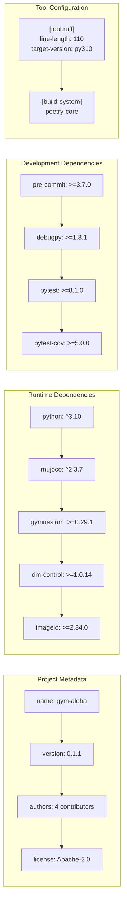
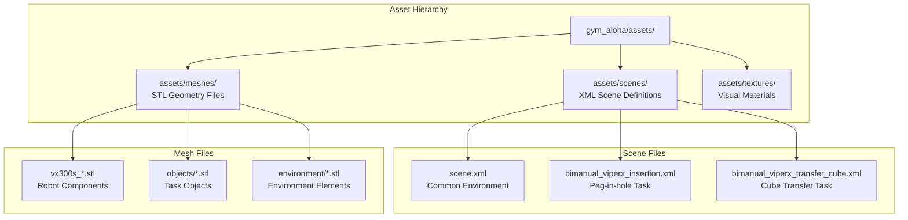

<!-- source: DeepWiki mcp.deepwiki.com · repo huggingface/gym-aloha · page 5.4 Project Structure and Files · fetched 2026-10-26 -->

# Project Structure and Files

Relevant source files

The following files were used as context for generating this wiki page:

- [.gitignore](.gitignore)
- [LICENSE](LICENSE)
- [pyproject.toml](pyproject.toml)

This document provides a comprehensive overview of the gym-aloha repository structure, key configuration files, and development conventions. It covers the organization of source code, assets, configuration files, and development infrastructure components that enable the ALOHA robotics environment implementation.

For information about setting up the development environment, see [Development Environment Setup](#5.1). For details about testing and CI/CD processes, see [Testing and CI/CD](#5.2).

## Repository Structure Overview

The gym-aloha repository follows a standard Poetry-based Python package structure with additional components for MuJoCo simulation assets and development workflow automation.

**Sources:** [pyproject.toml:1-78](), [.gitignore:1-130](), [LICENSE:1-229]()

## Core Configuration Files

### Project Configuration (pyproject.toml)

The `pyproject.toml` file serves as the central configuration hub for the entire project, defining package metadata, dependencies, and development tools.

**Sources:** [pyproject.toml:1-78]()

The project metadata section [pyproject.toml:1-21]() defines essential package information including the name `gym-aloha`, version `0.1.1`, and four primary contributors. The keywords array [pyproject.toml:13]() includes robotics-specific terms that help with package discovery.

### Dependency Management

The dependency configuration is organized into three categories:

| Category | Dependencies | Purpose |
|----------|-------------|---------|
| **Core Runtime** | `python ^3.10`, `mujoco ^2.3.7`, `gymnasium >=0.29.1` | Essential environment functionality |
| **Robotics Stack** | `dm-control >=1.0.14`, `imageio[ffmpeg] >=2.34.0` | Simulation and video recording |
| **Development Tools** | `pre-commit >=3.7.0`, `pytest >=8.1.0`, `debugpy >=1.8.1` | Code quality and debugging |

The optional dependency groups [pyproject.toml:36-38]() separate development (`dev`) and testing (`test`) dependencies, allowing users to install only what they need.

**Sources:** [pyproject.toml:24-38]()

### Code Quality Configuration

The Ruff configuration [pyproject.toml:41-73]() establishes project-wide formatting and linting standards:

- **Line length**: 110 characters [pyproject.toml:42]()
- **Target version**: Python 3.10 [pyproject.toml:43]()
- **Exclusions**: Development files like `example.py` [pyproject.toml:45]()
- **Lint rules**: Error detection, import sorting, naming conventions [pyproject.toml:71]()

**Sources:** [pyproject.toml:41-73]()

## Development Infrastructure Files

### Version Control Configuration

The `.gitignore` file [.gitignore:1-130]() follows Python best practices with additional robotics-specific exclusions:

```mermaid
graph TD
    subgraph "Standard Python Exclusions"
        PYCACHE["__pycache__/<br/>Compiled Python Files"]
        BUILD_DIRS["build/, dist/, *.egg-info/<br/>Package Build Artifacts"]
        VENV_DIRS[".venv, venv/<br/>Virtual Environments"]
    end
    
    subgraph "Development Tool Exclusions"
        IDE_FILES[".vscode, .DS_Store<br/>IDE and OS Files"]
        TEST_ARTIFACTS[".pytest_cache/, .coverage<br/>Testing Artifacts"]
        LINTER_CACHE[".ruff_cache/, .mypy_cache<br/>Linter Caches"]
    end
    
    subgraph "Project-Specific Exclusions"
        VIDEO_FILES["*.mp4<br/>Generated Videos"]
        TEST_DATA_EXCEPTION["!tests/data<br/>Preserved Test Data"]
    end
    
    PYCACHE --> BUILD_DIRS
    BUILD_DIRS --> VENV_DIRS
    IDE_FILES --> TEST_ARTIFACTS
    TEST_ARTIFACTS --> LINTER_CACHE
    VIDEO_FILES --> TEST_DATA_EXCEPTION
```

**Sources:** [.gitignore:1-130]()

Key exclusions include:
- **Video files**: `*.mp4` [.gitignore:7]() generated by simulation recordings
- **Test data preservation**: `!tests/data` [.gitignore:49]() ensures test assets remain in version control
- **Development artifacts**: Standard Python build and cache directories [.gitignore:17-36]()

### Licensing Structure

The project uses dual licensing [LICENSE:1-229]():

1. **Primary License**: Apache License 2.0 [LICENSE:1-205]() for the gym-aloha implementation
2. **Derived Code License**: MIT License [LICENSE:206-229]() for code derived from the original ALOHA project

This dual licensing structure acknowledges the project's foundation on Tony Z. Zhao's ALOHA work while maintaining Apache 2.0 licensing for new contributions.

**Sources:** [LICENSE:1-229]()

## File Organization Patterns

### Package Structure

The `gym_aloha` package follows a flat structure optimized for clarity:

| File/Directory | Purpose | Key Components |
|---------------|---------|----------------|
| `__init__.py` | Environment registration | Gymnasium environment definitions |
| `env.py` | Core implementation | `AlohaEnv` class, task logic |
| `assets/` | Simulation resources | MuJoCo XML files, STL meshes |

**Sources:** [pyproject.toml:21]()

### Asset Organization

The assets directory contains all MuJoCo simulation resources organized by type:

**Sources:** Based on the overall system architecture diagrams and MuJoCo asset patterns

This organization enables modular asset management where:
- **Scene files** define environment layouts and object relationships
- **Mesh files** provide detailed geometric representations
- **Texture files** add visual realism to simulated objects

The structure supports easy addition of new tasks by creating corresponding XML scene files while reusing common mesh and texture assets.