# Page: Overview

# Overview

<details>
<summary>Relevant source files</summary>

The following files were used as context for generating this wiki page:

- [README.md](README.md)
- [pyproject.toml](pyproject.toml)

</details>


This document provides a comprehensive introduction to the gym-aloha repository, explaining its purpose as a Gymnasium environment for ALOHA bimanual robotics simulation, key architectural components, and available features. For detailed installation instructions, see [Installation and Setup](#1.1). For hands-on usage examples, see [Quick Start Guide](#1.2).

## Purpose and Scope

The `gym-aloha` repository implements a Gymnasium-compatible reinforcement learning environment for simulating ALOHA bimanual robot manipulation tasks. This environment enables researchers and developers to train and evaluate robotic policies on complex bimanual manipulation scenarios using MuJoCo physics simulation.

**Sources:** [README.md:1-3](), [pyproject.toml:2-4]()

## System Overview

gym-aloha is designed as a modular robotics simulation environment that integrates multiple open-source components to provide a comprehensive bimanual manipulation platform. The system serves as a bridge between high-level reinforcement learning frameworks and detailed physics simulation.

### Primary Components

The system consists of several key components:

- **Environment Interface**: Gymnasium-compatible API for reinforcement learning integration
- **Physics Simulation**: MuJoCo-based realistic physics and rendering
- **Robot Models**: Detailed ViperX 300S bimanual robot configurations  
- **Task Definitions**: Structured manipulation tasks with reward systems
- **Asset Management**: 3D models, textures, and scene configurations

**Sources:** [README.md:48-66](), [pyproject.toml:24-29]()

## High-Level Architecture

The following diagram illustrates the system's main architectural components and their relationships:

### System Architecture Overview

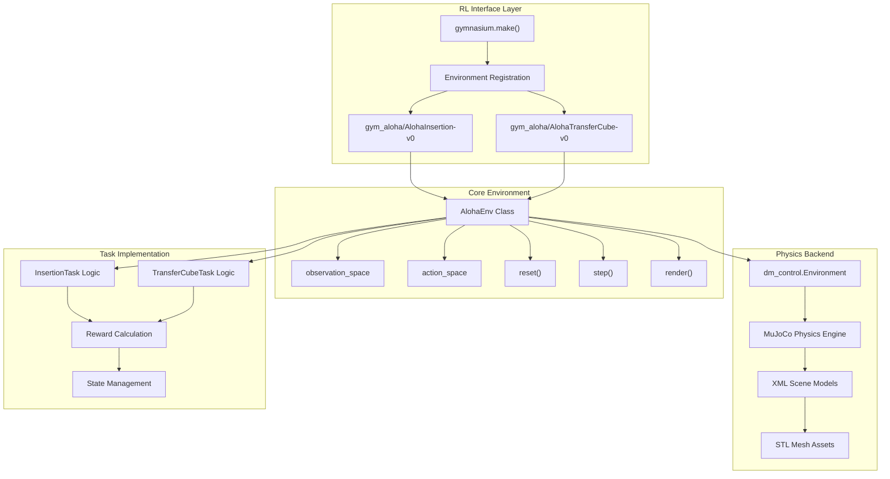

**Sources:** [README.md:23-45](), [pyproject.toml:24-29]()

### Core Implementation Structure

The following diagram shows the specific code entities and their relationships within the implementation:

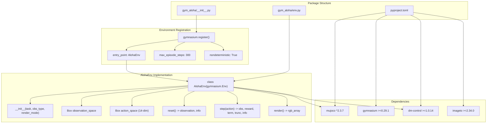

**Sources:** [pyproject.toml:21-38](), [README.md:87-93]()

## Available Tasks

The environment provides two primary bimanual manipulation tasks:

| Task Name | Environment ID | Description | Max Reward |
|-----------|---------------|-------------|------------|
| **Insertion Task** | `gym_aloha/AlohaInsertion-v0` | Insert peg into socket using coordinated bimanual manipulation | 4 points |
| **Transfer Cube Task** | `gym_aloha/AlohaTransferCube-v0` | Transfer cube from right gripper to left gripper | 4 points |

### Task Characteristics

Both tasks feature:
- **Randomized initial states** for arms and objects
- **Progressive reward structure** encouraging proper manipulation sequences  
- **Success criteria** based on achieving maximum reward
- **300-step episode limit** with early termination on success

For detailed task mechanics and reward structures, see [Tasks and Simulations](#3).

**Sources:** [README.md:51-84]()

## Key Features

The gym-aloha environment provides several important capabilities:

### Observation Modes
- **`pixels`**: RGB camera observations from multiple viewpoints
- **`pixels_agent_pos`**: Combined visual and proprioceptive observations
- **Configurable resolution**: Customizable observation and visualization dimensions

### Action Interface  
- **14-dimensional continuous action space**: 12 joint positions + 2 gripper controls
- **Absolute joint positioning**: Direct joint angle control for precise manipulation
- **Normalized gripper control**: 0 (closed) to 1 (open) gripper positions

### Rendering Capabilities
- **RGB array output**: Compatible with video recording and visualization
- **Multiple camera angles**: Various viewpoints for comprehensive observation
- **GPU acceleration support**: EGL-based GPU rendering for performance

**Sources:** [README.md:55-66](), [README.md:87-106]()

## Technical Dependencies

The system is built on a foundation of established robotics and machine learning libraries:

### Core Dependencies
- **Python 3.10+**: Modern Python features and performance
- **MuJoCo 2.3.7+**: Physics simulation and rendering engine  
- **Gymnasium 0.29.1+**: Standard RL environment interface
- **dm-control 1.0.14+**: DeepMind's control suite utilities
- **ImageIO 2.34.0+**: Video recording and image processing

### Development Infrastructure
- **Poetry**: Dependency management and packaging
- **Ruff**: Code formatting and linting  
- **Pre-commit hooks**: Automated code quality checks
- **pytest**: Testing framework with coverage reporting

**Sources:** [pyproject.toml:24-33](), [pyproject.toml:41-77]()

## Next Steps

- For installation instructions and environment setup, see [Installation and Setup](#1.1)
- For basic usage examples and API introduction, see [Quick Start Guide](#1.2)  
- For detailed environment implementation, see [Core Environment Implementation](#2)
- For task-specific information, see [Tasks and Simulations](#3)
- For contributing guidelines, see [Development Workflow](#5)

---

# Page: Installation and Setup

# Installation and Setup

<details>
<summary>Relevant source files</summary>

The following files were used as context for generating this wiki page:

- [README.md](README.md)
- [poetry.lock](poetry.lock)
- [pyproject.toml](pyproject.toml)

</details>


This document covers the installation procedures, dependency requirements, and environment setup for the gym-aloha project. It provides detailed instructions for both end users and developers, with specific guidance on using Poetry for dependency management.

For information about basic usage and quick start examples, see [Quick Start Guide](#1.2). For development-specific setup including testing and code quality tools, see [Development Environment Setup](#5.1).

## System Requirements

The gym-aloha project requires Python 3.10 or higher and is compatible with modern operating systems. The core system dependencies are managed through Poetry and include several heavyweight packages for robotics simulation.

**Minimum Requirements:**
- Python 3.10+
- 4GB RAM (8GB+ recommended for MuJoCo rendering)
- GPU support recommended for hardware-accelerated rendering

Sources: [pyproject.toml:19](), [pyproject.toml:25]()

## Installation Methods

### Method 1: Pip Installation (End Users)

For users who want to use gym-aloha in their projects without contributing to development:

```bash
# Create and activate virtual environment
conda create -y -n aloha python=3.10 && conda activate aloha

# Install gym-aloha
pip install gym-aloha
```

This method installs the package from PyPI with all required runtime dependencies.

Sources: [README.md:10-18]()

### Method 2: Poetry Installation (Development)

For developers contributing to the project or requiring development tools:

```bash
# Install Poetry (if not already installed)
# Follow instructions at https://python-poetry.org/docs/#installation

# Clone repository and install with all extras
poetry install --all-extras
```

The `--all-extras` flag includes optional dependency groups for development and testing.

Sources: [README.md:166-169](), [pyproject.toml:36-38]()

## Dependency Architecture

The project uses a hierarchical dependency structure managed through Poetry's extras system:

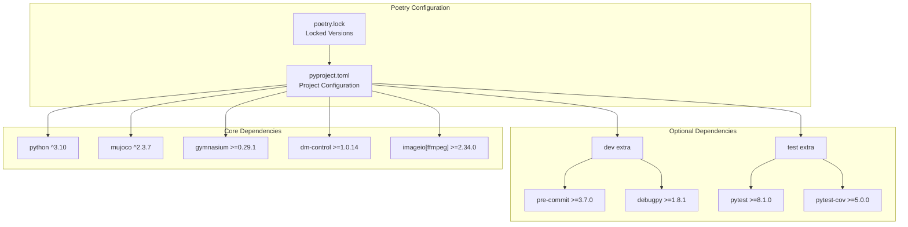

**Dependency Groups:**

| Group | Purpose | Key Packages |
|-------|---------|--------------|
| Core | Runtime execution | `mujoco`, `gymnasium`, `dm-control`, `imageio` |
| dev | Development tools | `pre-commit`, `debugpy` |
| test | Testing framework | `pytest`, `pytest-cov` |

Sources: [pyproject.toml:24-38]()

## Installation Workflow

The installation process varies depending on the chosen method and involves different dependency resolution paths:

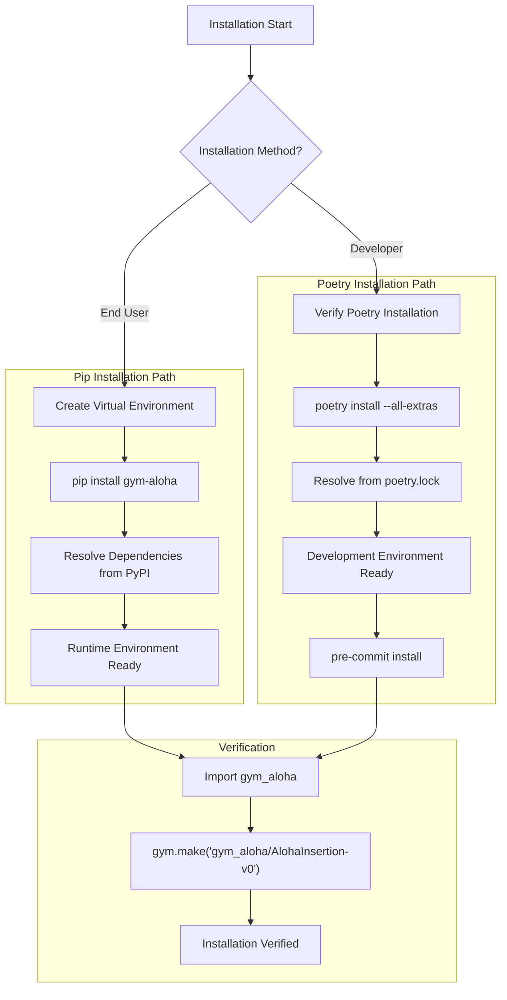

Sources: [README.md:10-18](), [README.md:166-169](), [README.md:175-176]()

## Core Dependency Details

### MuJoCo Physics Engine

The project depends on MuJoCo 2.3.7+ for physics simulation:

```bash
mujoco = "^2.3.7"
```

MuJoCo provides the underlying physics simulation and rendering capabilities. The package includes:
- Physics simulation engine
- OpenGL rendering support
- Python bindings for control

Sources: [pyproject.toml:26]()

### Gymnasium Interface

Gymnasium provides the reinforcement learning environment interface:

```bash
gymnasium = ">=0.29.1"
```

This ensures compatibility with the latest Gymnasium API standards for environment registration and interaction.

Sources: [pyproject.toml:27]()

### dm-control Integration

The DeepMind Control Suite provides robotics-specific abstractions:

```bash
dm-control = ">=1.0.14"
```

dm-control offers high-level robotics primitives and utilities built on top of MuJoCo.

Sources: [pyproject.toml:28]()

## Environment Setup and Verification

After installation, verify the setup works correctly:

### Basic Import Test

```python
import gymnasium as gym
import gym_aloha

# This should work without errors
env = gym.make("gym_aloha/AlohaInsertion-v0")
print("Installation successful!")
```

### Full Environment Test

```python
import imageio
import gymnasium as gym
import numpy as np
import gym_aloha

env = gym.make("gym_aloha/AlohaInsertion-v0")
observation, info = env.reset()

# Test basic environment interaction
action = env.action_space.sample()
observation, reward, terminated, truncated, info = env.step(action)
image = env.render()

env.close()
print("Environment test successful!")
```

Sources: [README.md:23-45]()

## Troubleshooting Common Issues

### GPU Rendering Setup

For optimal performance, configure GPU rendering with EGL support. This requires additional system-level configuration on some platforms.

### Dependency Conflicts

If experiencing dependency conflicts, ensure you're using a clean virtual environment and the correct Python version (3.10+).

### Poetry Cache Issues

Clear Poetry cache if encountering installation problems:

```bash
poetry cache clear pypi --all
poetry install --all-extras
```

Sources: [README.md:108-158](), [pyproject.toml:25]()

---

# Page: Quick Start Guide

# Quick Start Guide

<details>
<summary>Relevant source files</summary>

The following files were used as context for generating this wiki page:

- [README.md](README.md)
- [example.py](example.py)
- [gym_aloha/__init__.py](gym_aloha/__init__.py)

</details>


This guide provides the essential steps to get started with gym-aloha, demonstrating how to create environments, run simulations, and understand the basic workflow. It covers the minimal code needed to begin working with ALOHA robotic tasks.

For detailed installation instructions, see [Installation and Setup](#1.1). For comprehensive information about task-specific configurations and reward systems, see [Tasks and Simulations](#3).

## Creating Your First Environment

The gym-aloha package provides two main robotic tasks through Gymnasium-compatible environments. The basic pattern follows the standard Gymnasium interface:

```python
import gymnasium as gym
import gym_aloha

env = gym.make("gym_aloha/AlohaInsertion-v0")
observation, info = env.reset()
```

The environment creation process follows this workflow:

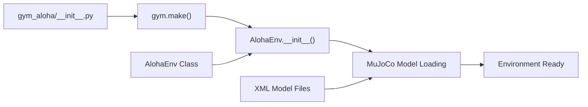

**Environment Registration Flow**

Sources: [gym_aloha/__init__.py:1-22](), [README.md:23-45]()

## Available Environments

Two pre-registered environments are available for immediate use:

| Environment ID | Task | Description | Max Steps |
|----------------|------|-------------|-----------|
| `gym_aloha/AlohaInsertion-v0` | Insertion | Peg-in-hole insertion task | 300 |
| `gym_aloha/AlohaTransferCube-v0` | Transfer Cube | Bimanual cube transfer | 300 |

Both environments use the same `AlohaEnv` class with different task parameters configured during registration.

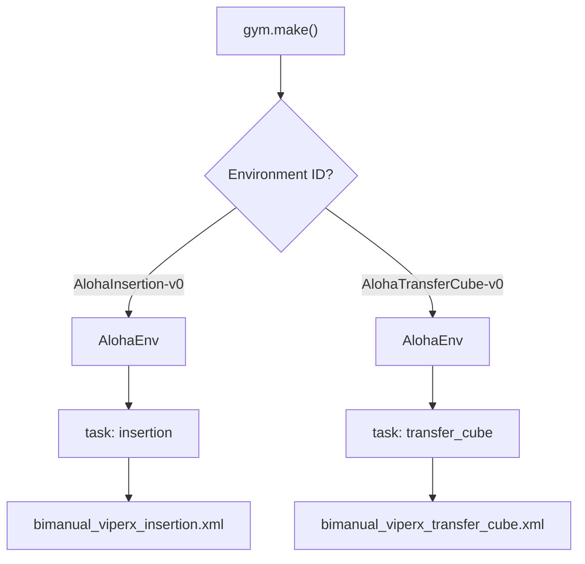

**Environment Selection and Configuration**

Sources: [gym_aloha/__init__.py:3-21]()

## Basic Simulation Loop

The core simulation follows the standard Gymnasium pattern of reset, step, and render:

```python
env = gym.make("gym_aloha/AlohaInsertion-v0")
observation, info = env.reset()

for _ in range(1000):
    action = env.action_space.sample()  # Random action
    observation, reward, terminated, truncated, info = env.step(action)
    
    if terminated or truncated:
        observation, info = env.reset()

env.close()
```

The simulation loop involves these key components:

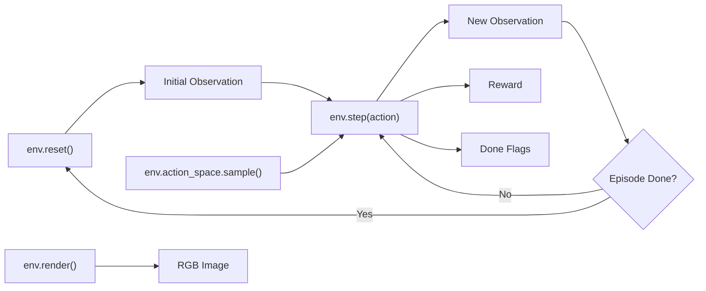

**Core Simulation Components**

Sources: [example.py:6-17](), [README.md:30-42]()

## Action and Observation Spaces

The environment provides a 14-dimensional continuous action space controlling both robot arms and grippers:

- **Action Space**: 14D continuous vector
  - 6 joint positions per arm (12 total)
  - 1 gripper position per arm (2 total)
  - Gripper values normalized between 0 (closed) and 1 (open)

- **Observation Space**: Dictionary containing:
  - `pixels`: Camera images from multiple viewpoints
  - `agent_pos`: Robot joint positions and velocities
  - `env_state`: Task-specific state information

```python
# Check action and observation spaces
print(f"Action space: {env.action_space}")
print(f"Observation space: {env.observation_space}")

# Sample random action
action = env.action_space.sample()
print(f"Action shape: {action.shape}")  # (14,)
```

Sources: [README.md:55-66]()

## Video Recording

A common workflow includes recording simulation videos for analysis or demonstration:

```python
import imageio
import numpy as np

env = gym.make("gym_aloha/AlohaInsertion-v0")
observation, info = env.reset()
frames = []

for _ in range(100):
    action = env.action_space.sample()
    observation, reward, terminated, truncated, info = env.step(action)
    image = env.render()  # Returns RGB array
    frames.append(image)
    
    if terminated or truncated:
        break

# Save as MP4 video
imageio.mimsave("simulation.mp4", np.stack(frames), fps=25)
```

The rendering pipeline works as follows:

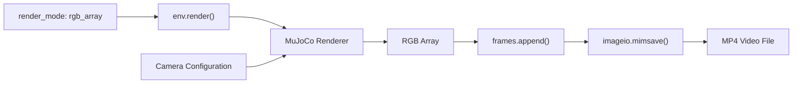

**Video Recording Workflow**

Sources: [example.py:8-20](), [README.md:32-44]()

## Environment Configuration

Environments accept several configuration parameters during creation:

```python
env = gym.make(
    "gym_aloha/AlohaInsertion-v0",
    obs_type="pixels",           # or "pixels_agent_pos"
    render_mode="rgb_array",     # Required for rendering
    observation_width=640,       # Image width
    observation_height=480,      # Image height
    visualization_width=640,     # Render width
    visualization_height=480     # Render height
)
```

| Parameter | Default | Description |
|-----------|---------|-------------|
| `obs_type` | `"pixels"` | Observation format |
| `render_mode` | `None` | Must be `"rgb_array"` for rendering |
| `observation_width` | `640` | Observation image width |
| `observation_height` | `480` | Observation image height |
| `visualization_width` | `640` | Render image width |
| `visualization_height` | `480` | Render image height |

Sources: [README.md:87-106]()

## Next Steps

With the basic simulation running, you can:

1. **Explore different tasks**: Try both `AlohaInsertion-v0` and `AlohaTransferCube-v0`
2. **Understand observations**: Learn about the observation dictionary structure in [Observation and Action Spaces](#2.2)
3. **Implement custom policies**: Replace `env.action_space.sample()` with your own control logic
4. **Analyze rewards**: Study the reward systems described in [Tasks and Simulations](#3)
5. **GPU acceleration**: Set up EGL rendering for faster simulation as shown in the README

The environment is now ready for reinforcement learning experiments, policy development, or robotic task analysis.

Sources: [README.md:48-81](), [example.py:1-21]()

---

# Page: Core Environment Implementation

# Core Environment Implementation

<details>
<summary>Relevant source files</summary>

The following files were used as context for generating this wiki page:

- [gym_aloha/env.py](gym_aloha/env.py)

</details>


This document covers the implementation of the `AlohaEnv` class, which serves as the primary Gymnasium-compatible environment interface for ALOHA bimanual robotics simulations. The `AlohaEnv` class integrates MuJoCo physics simulation through dm-control with the standard Gymnasium API, providing a unified interface for reinforcement learning applications.

For information about environment registration and available variants, see [Environment Registration](#2.1). For details about observation and action space configurations, see [Observation and Action Spaces](#2.2). For specific task implementations, see [Tasks and Simulations](#3).

## Architecture Overview

The `AlohaEnv` class follows a layered architecture that bridges the Gymnasium RL interface with MuJoCo physics simulation through dm-control middleware.

### Core Class Structure

```mermaid
classDiagram
    class AlohaEnv {
        +task: str
        +obs_type: str
        +render_mode: str
        +observation_width: int
        +observation_height: int
        +_env: control.Environment
        +observation_space: spaces.Space
        +action_space: spaces.Box
        +__init__(task, obs_type, render_mode, ...)
        +reset(seed, options) tuple
        +step(action) tuple
        +render() ndarray
        +_make_env_task(task_name) control.Environment
        +_format_raw_obs(raw_obs) dict
        +_render(visualize) ndarray
    }
    
    class Environment {
        +physics: mujoco.Physics
        +task: Task
        +reset() TimeStep
        +step(action) TimeStep
    }
    
    class Task {
        +get_observation(physics) dict
        +get_reward(physics) float
        +initialize_episode(physics) void
    }
    
    class Physics {
        +render(height, width, camera_id) ndarray
        +from_xml_path(xml_path) Physics
    }
    
    AlohaEnv --> Environment : "_env"
    Environment --> Physics : "physics"
    Environment --> Task : "task"
    AlohaEnv --|> "gym.Env" : inherits
```

Sources: [gym_aloha/env.py:21-191]()

### System Integration Architecture

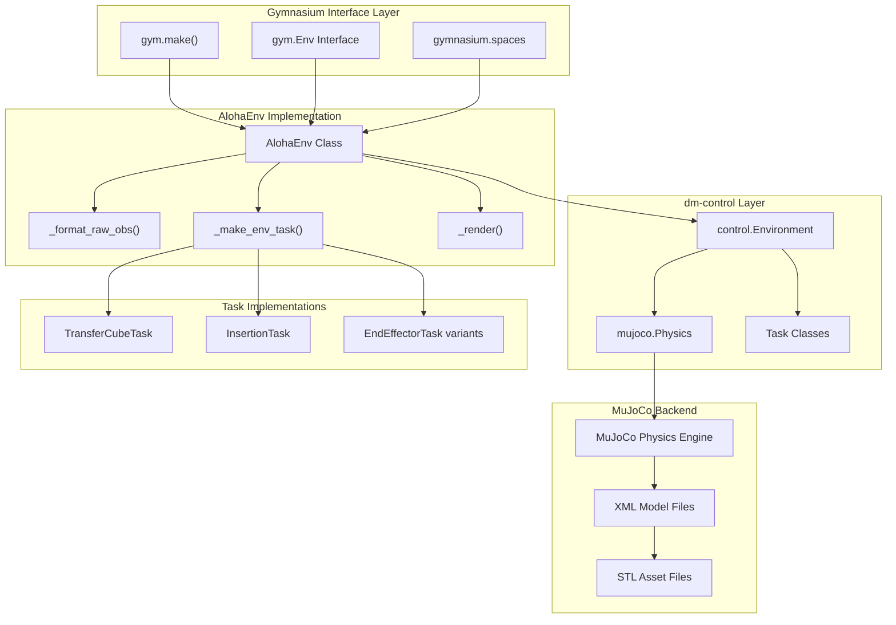

Sources: [gym_aloha/env.py:1-19](), [gym_aloha/env.py:108-136]()

## Core Components

### AlohaEnv Class Initialization

The `AlohaEnv` constructor configures the environment based on the specified task and observation type. The class accepts several key parameters that determine the simulation behavior:

| Parameter | Type | Default | Description |
|-----------|------|---------|-------------|
| `task` | str | Required | Task variant ("transfer_cube", "insertion", etc.) |
| `obs_type` | str | "pixels" | Observation format ("pixels", "pixels_agent_pos", "state") |
| `render_mode` | str | "rgb_array" | Rendering output format |
| `observation_width` | int | 640 | Width for observation images |
| `observation_height` | int | 480 | Height for observation images |

The initialization process follows this sequence:

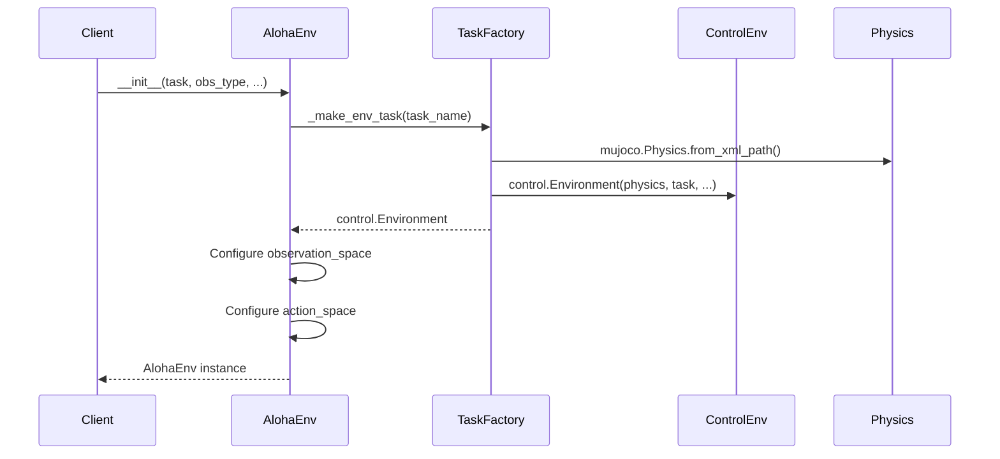

Sources: [gym_aloha/env.py:25-44](), [gym_aloha/env.py:108-136]()

### Task Integration System

The `_make_env_task` method serves as a factory for creating task-specific environments. It maps task names to their corresponding XML models and task implementations:

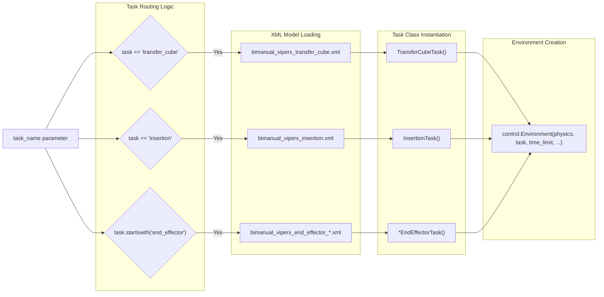

Sources: [gym_aloha/env.py:108-136]()

### Observation Space Configuration

The environment supports three observation types, each with different space configurations:

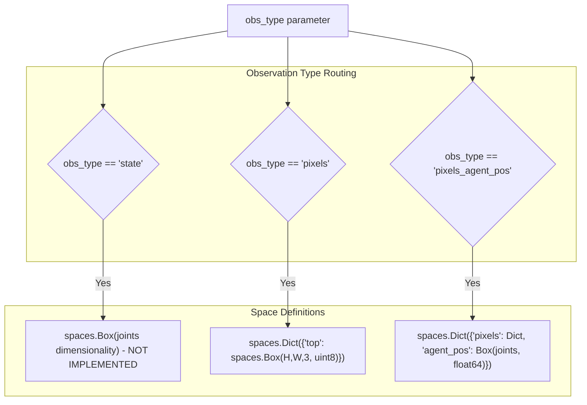

The action space is consistently defined as a 14-dimensional continuous space with bounds [-1, 1], corresponding to the joints defined in `ACTIONS`:

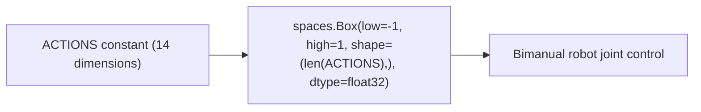

Sources: [gym_aloha/env.py:46-86]()

### Environment Lifecycle

The environment follows the standard Gymnasium lifecycle with custom implementations for reset and step operations:

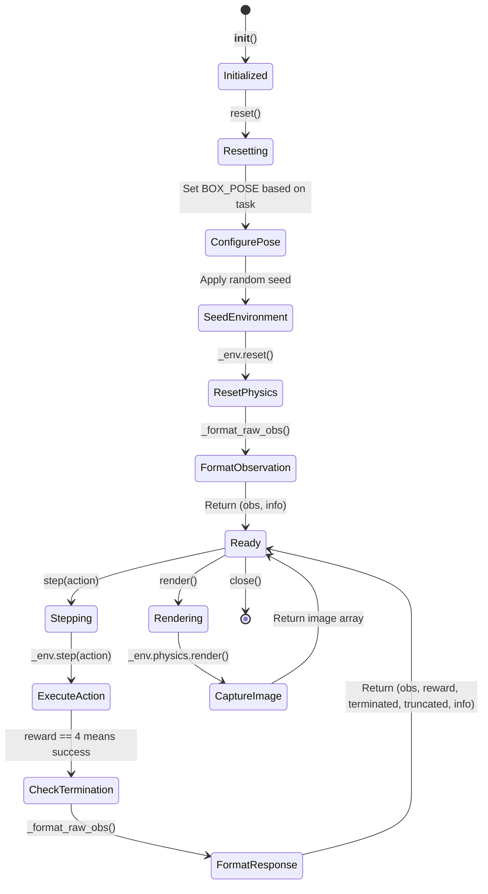

Key implementation details:

- **Reset Process**: [gym_aloha/env.py:150-171]() handles seeding, pose sampling, and observation formatting
- **Step Process**: [gym_aloha/env.py:173-187]() processes actions, determines termination, and formats responses  
- **Termination Logic**: Success is determined by `reward == 4`, setting both `terminated` and `is_success` flags
- **Pose Sampling**: Task-specific pose sampling using `sample_box_pose()` or `sample_insertion_pose()` functions

Sources: [gym_aloha/env.py:150-191]()

### Rendering System

The rendering system provides RGB array output through MuJoCo's physics engine:

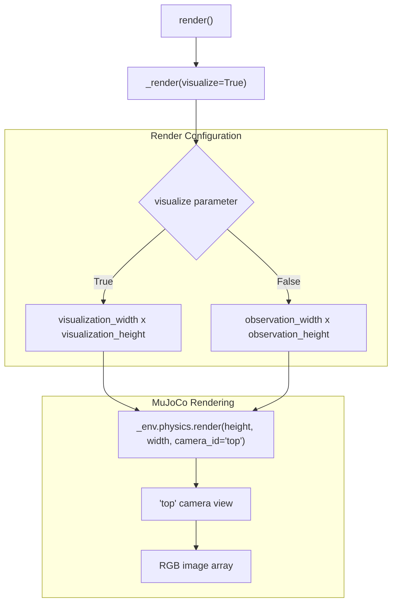

The system currently supports only the "top" camera view, with plans for additional camera angles noted in the code comments.

Sources: [gym_aloha/env.py:88-106]()

---

# Page: Environment Registration

# Environment Registration

<details>
<summary>Relevant source files</summary>

The following files were used as context for generating this wiki page:

- [gym_aloha/__init__.py](gym_aloha/__init__.py)
- [gym_aloha/env.py](gym_aloha/env.py)

</details>


This document explains how environments are registered with the Gymnasium framework in the gym-aloha repository. It covers the registration mechanism, available environment variants, and how registration parameters map to the underlying `AlohaEnv` implementation.

For details about the `AlohaEnv` class implementation itself, see [Core Environment Implementation](#2). For information about specific tasks and their configurations, see [Tasks and Simulations](#3).

## Registration Overview

Environment registration in gym-aloha follows the standard Gymnasium pattern using the `register()` function. All registration logic is centralized in the package's `__init__.py` file, which automatically executes when the package is imported.

```mermaid
graph TD
    IMPORT["`Package Import`<br/>`import gym_aloha`"]
    INIT["`__init__.py`<br/>`Registration Logic`"]
    REGISTER["`gymnasium.envs.registration.register()`<br/>`Gymnasium Registration`"]
    REGISTRY["`Gymnasium Environment Registry`<br/>`Global Registry`"]
    
    IMPORT --> INIT
    INIT --> REGISTER
    REGISTER --> REGISTRY
    
    subgraph "Registered Environments"
        INS_ENV["`gym_aloha/AlohaInsertion-v0`"]
        TRANS_ENV["`gym_aloha/AlohaTransferCube-v0`"]
    end
    
    REGISTRY --> INS_ENV
    REGISTRY --> TRANS_ENV
```

**Registration Flow from Import to Available Environments**

Sources: [gym_aloha/__init__.py:1-21]()

## Available Environments

The gym-aloha package registers two primary environment variants, each configured for a specific robotic task:

| Environment ID | Task Type | Max Episodes | Observation Type |
|---|---|---|---|
| `gym_aloha/AlohaInsertion-v0` | Peg-in-hole insertion | 300 | pixels |
| `gym_aloha/AlohaTransferCube-v0` | Bimanual cube transfer | 300 | pixels |

Both environments share the same entry point (`gym_aloha.env:AlohaEnv`) but differ in their `task` parameter, which determines the specific robotic task implementation.

```mermaid
graph TD
    subgraph "Environment Registration"
        REG_INS["`register()`<br/>`AlohaInsertion-v0`"]
        REG_TRANS["`register()`<br/>`AlohaTransferCube-v0`"]
    end
    
    subgraph "Entry Point"
        ENTRY["`gym_aloha.env:AlohaEnv`<br/>`Common Entry Point`"]
    end
    
    subgraph "Task Configuration"
        TASK_INS["`kwargs: {'task': 'insertion'}`"]
        TASK_TRANS["`kwargs: {'task': 'transfer_cube'}`"]
    end
    
    subgraph "Task Implementation"
        XML_INS["`bimanual_viperx_insertion.xml`"]
        XML_TRANS["`bimanual_viperx_transfer_cube.xml`"]
        TASK_CLASS_INS["`InsertionTask`"]
        TASK_CLASS_TRANS["`TransferCubeTask`"]
    end
    
    REG_INS --> ENTRY
    REG_TRANS --> ENTRY
    REG_INS --> TASK_INS
    REG_TRANS --> TASK_TRANS
    
    TASK_INS --> XML_INS
    TASK_INS --> TASK_CLASS_INS
    TASK_TRANS --> XML_TRANS
    TASK_TRANS --> TASK_CLASS_TRANS
```

**Environment Registration to Task Implementation Mapping**

Sources: [gym_aloha/__init__.py:3-21](), [gym_aloha/env.py:112-131]()

## Registration Parameters

Each environment registration includes several common configuration parameters:

### Common Parameters

- **`entry_point`**: `"gym_aloha.env:AlohaEnv"` - Points to the `AlohaEnv` class constructor
- **`max_episode_steps`**: `300` - Enforces episode termination after 300 steps
- **`nondeterministic`**: `True` - Required for Gymnasium compliance testing due to slight rendering variations

### Task-Specific Parameters

The `kwargs` parameter passes task-specific configuration to the `AlohaEnv` constructor:

- **`obs_type`**: `"pixels"` - Configures pixel-based observations
- **`task`**: Task identifier (`"insertion"` or `"transfer_cube"`)

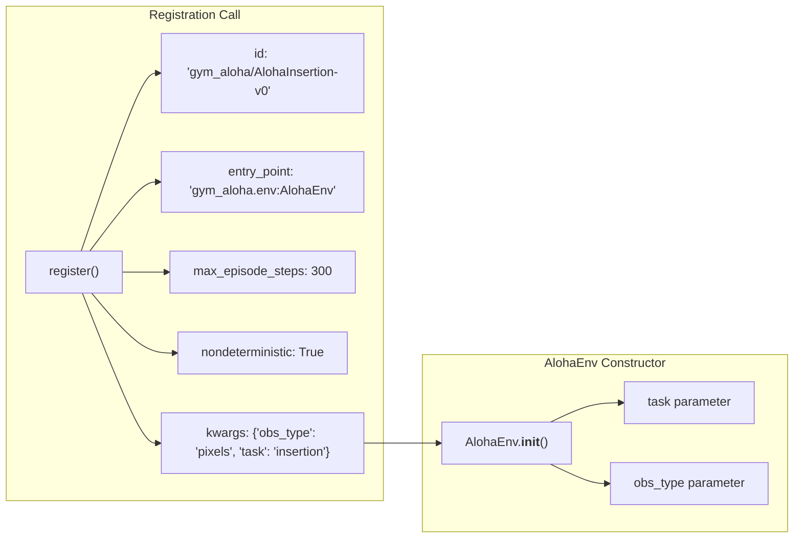

**Registration Parameter Flow to Constructor**

Sources: [gym_aloha/__init__.py:3-11](), [gym_aloha/env.py:25-44]()

## Task Routing Mechanism

The `task` parameter passed through registration `kwargs` determines which MuJoCo XML file and task class implementation are loaded. This routing is handled by the `_make_env_task()` method in the `AlohaEnv` class.

### Task Resolution Process

1. **Parameter Reception**: The `task` parameter is passed from registration `kwargs` to `AlohaEnv.__init__()`
2. **Environment Creation**: `_make_env_task()` method maps task names to specific implementations
3. **XML Loading**: Appropriate MuJoCo XML model file is loaded based on task type
4. **Task Class Instantiation**: Corresponding task class is instantiated for reward and logic handling

```mermaid
graph TD
    subgraph "Registration Layer"
        KWARGS["`registration kwargs`<br/>`{'task': 'insertion'}`"]
    end
    
    subgraph "AlohaEnv.__init__()"
        INIT_TASK["`self.task = task`"]
        MAKE_ENV["`self._make_env_task(self.task)`"]
    end
    
    subgraph "_make_env_task() Logic"
        TASK_SWITCH{"`task_name switch`"}
        INS_BRANCH["`task_name == 'insertion'`"]
        TRANS_BRANCH["`task_name == 'transfer_cube'`"]
    end
    
    subgraph "Insertion Task Setup"
        INS_XML["`xml_path = bimanual_viperx_insertion.xml`"]
        INS_PHYSICS["`mujoco.Physics.from_xml_path()`"]
        INS_TASK["`task = InsertionTask()`"]
    end
    
    subgraph "Transfer Cube Task Setup"
        TRANS_XML["`xml_path = bimanual_viperx_transfer_cube.xml`"]
        TRANS_PHYSICS["`mujoco.Physics.from_xml_path()`"]
        TRANS_TASK["`task = TransferCubeTask()`"]
    end
    
    subgraph "Environment Assembly"
        CONTROL_ENV["`control.Environment(physics, task, ...)`"]
    end
    
    KWARGS --> INIT_TASK
    INIT_TASK --> MAKE_ENV
    MAKE_ENV --> TASK_SWITCH
    
    TASK_SWITCH --> INS_BRANCH
    TASK_SWITCH --> TRANS_BRANCH
    
    INS_BRANCH --> INS_XML
    INS_XML --> INS_PHYSICS
    INS_BRANCH --> INS_TASK
    INS_PHYSICS --> CONTROL_ENV
    INS_TASK --> CONTROL_ENV
    
    TRANS_BRANCH --> TRANS_XML
    TRANS_XML --> TRANS_PHYSICS
    TRANS_BRANCH --> TRANS_TASK
    TRANS_PHYSICS --> CONTROL_ENV
    TRANS_TASK --> CONTROL_ENV
```

**Task Parameter Routing from Registration to Implementation**

### End-Effector Task Variants

The codebase also includes placeholder registrations for end-effector control variants, though these are currently marked as `NotImplementedError`:

- `end_effector_transfer_cube` → `TransferCubeEndEffectorTask`
- `end_effector_insertion` → `InsertionEndEffectorTask`

These variants would use different XML models (`bimanual_viperx_end_effector_*.xml`) and specialized end-effector control task classes.

Sources: [gym_aloha/env.py:108-136](), [gym_aloha/env.py:120-129]()

## Usage with Gymnasium

Once registered, environments can be instantiated using the standard Gymnasium `make()` interface:

```python
import gym_aloha  # Triggers registration
import gymnasium as gym

env = gym.make("gym_aloha/AlohaInsertion-v0")
```

The registration system ensures that all configuration parameters are automatically applied when the environment is created, providing a clean interface that hides the complexity of task-specific setup.

Sources: [gym_aloha/__init__.py:1-21](), [gym_aloha/env.py:21-44]()

---

# Page: Observation and Action Spaces

# Observation and Action Spaces

<details>
<summary>Relevant source files</summary>

The following files were used as context for generating this wiki page:

- [README.md](README.md)
- [gym_aloha/env.py](gym_aloha/env.py)

</details>


This document describes the observation and action spaces implemented in the `AlohaEnv` class, including the different observation types, data formats, and how they map to the underlying MuJoCo simulation. This covers the interface between reinforcement learning agents and the ALOHA robotics simulation.

For information about environment registration and available variants, see [Environment Registration](#2.1). For details about specific tasks and their reward structures, see [Tasks and Simulations](#3).

## Action Space

The ALOHA environment uses a continuous action space representing joint-level control commands for both robot arms and their grippers.

### Action Space Structure

```mermaid
graph TB
    ActionSpace["Action Space<br/>Box(-1, 1, shape=(14,))"]
    
    LeftArm["Left Arm Joints<br/>6 dimensions"]
    RightArm["Right Arm Joints<br/>6 dimensions"]
    LeftGripper["Left Gripper<br/>1 dimension"]
    RightGripper["Right Gripper<br/>1 dimension"]
    
    ActionSpace --> LeftArm
    ActionSpace --> RightArm
    ActionSpace --> LeftGripper
    ActionSpace --> RightGripper
    
    LeftArm --> J1L["Joint 1 Left<br/>[-1, 1]"]
    LeftArm --> J2L["Joint 2 Left<br/>[-1, 1]"]
    LeftArm --> J3L["Joint 3 Left<br/>[-1, 1]"]
    LeftArm --> J4L["Joint 4 Left<br/>[-1, 1]"]
    LeftArm --> J5L["Joint 5 Left<br/>[-1, 1]"]
    LeftArm --> J6L["Joint 6 Left<br/>[-1, 1]"]
    
    RightArm --> J1R["Joint 1 Right<br/>[-1, 1]"]
    RightArm --> J2R["Joint 2 Right<br/>[-1, 1]"]
    RightArm --> J3R["Joint 3 Right<br/>[-1, 1]"]
    RightArm --> J4R["Joint 4 Right<br/>[-1, 1]"]
    RightArm --> J5R["Joint 5 Right<br/>[-1, 1]"]
    RightArm --> J6R["Joint 6 Right<br/>[-1, 1]"]
    
    LeftGripper --> GL["Gripper Position<br/>0=closed, 1=open"]
    RightGripper --> GR["Gripper Position<br/>0=closed, 1=open"]
```

The action space is defined as a 14-dimensional continuous Box space with values normalized between -1 and 1. The action vector contains absolute joint position commands for both arms plus gripper positions.

| Component | Dimensions | Range | Description |
|-----------|------------|-------|-------------|
| Left Arm | 6 | [-1, 1] | Joint positions for left ViperX arm |
| Right Arm | 6 | [-1, 1] | Joint positions for right ViperX arm |
| Left Gripper | 1 | [0, 1] | Gripper position (0=closed, 1=open) |
| Right Gripper | 1 | [0, 1] | Gripper position (0=closed, 1=open) |

**Sources:** [gym_aloha/env.py:86](), [README.md:55-58]()

## Observation Space Types

The ALOHA environment supports multiple observation types that can be configured when creating the environment. The observation type determines what data is included in the observation dictionary returned by `reset()` and `step()`.

### Observation Type Configuration

```mermaid
graph TB
    ObsType["obs_type parameter"]
    
    ObsType --> State["state<br/>(Not Implemented)"]
    ObsType --> Pixels["pixels"]
    ObsType --> PixelsAgentPos["pixels_agent_pos"]
    
    State --> StateSpace["Box space with joint data<br/>(NotImplementedError)"]
    
    Pixels --> PixelsSpace["Dict space with top camera"]
    PixelsSpace --> TopCamera["top: Box(0, 255, (H, W, 3), uint8)"]
    
    PixelsAgentPos --> PixelsAgentSpace["Dict space with pixels + agent_pos"]
    PixelsAgentSpace --> PixelsDict["pixels: Dict with top camera"]
    PixelsAgentSpace --> AgentPos["agent_pos: Box(-1000, 1000, (14,), float64)"]
    
    PixelsDict --> TopCamera2["top: Box(0, 255, (H, W, 3), uint8)"]
```

**Sources:** [gym_aloha/env.py:46-84]()

### Pixels Observation Type

When `obs_type="pixels"`, observations contain only visual data from the top-down camera:

```python
observation_space = spaces.Dict({
    "top": spaces.Box(
        low=0, high=255,
        shape=(observation_height, observation_width, 3),
        dtype=np.uint8
    )
})
```

The observation dictionary contains:
- `"top"`: RGB image from the top-down camera view

**Sources:** [gym_aloha/env.py:53-63](), [gym_aloha/env.py:142]()

### Pixels + Agent Position Observation Type

When `obs_type="pixels_agent_pos"`, observations include both visual and proprioceptive data:

```python
observation_space = spaces.Dict({
    "pixels": spaces.Dict({
        "top": spaces.Box(
            low=0, high=255,
            shape=(observation_height, observation_width, 3),
            dtype=np.uint8
        )
    }),
    "agent_pos": spaces.Box(
        low=-1000.0, high=1000.0,
        shape=(len(JOINTS),),
        dtype=np.float64
    )
})
```

The observation dictionary contains:
- `"pixels"`: Dictionary with `"top"` camera image
- `"agent_pos"`: Joint positions (`qpos`) for all robot joints

**Sources:** [gym_aloha/env.py:64-84](), [gym_aloha/env.py:144-147]()

## Observation Data Flow

The following diagram shows how raw observations from the MuJoCo simulation are processed and formatted based on the selected observation type:

```mermaid
graph TB
    RawObs["Raw Observation from dm_control.Environment"]
    FormatObs["_format_raw_obs()"]
    
    RawObs --> FormatObs
    
    RawObs --> Images["raw_obs['images']['top']"]
    RawObs --> Qpos["raw_obs['qpos']"]
    
    FormatObs --> ObsTypeCheck["Check obs_type"]
    
    ObsTypeCheck --> StateCase["obs_type == 'state'<br/>NotImplementedError"]
    ObsTypeCheck --> PixelsCase["obs_type == 'pixels'"]
    ObsTypeCheck --> PixelsAgentCase["obs_type == 'pixels_agent_pos'"]
    
    PixelsCase --> PixelsResult["{'top': image.copy()}"]
    
    PixelsAgentCase --> PixelsAgentResult["{'pixels': {'top': image.copy()},<br/>'agent_pos': qpos}"]
    
    Images --> PixelsResult
    Images --> PixelsAgentResult
    Qpos --> PixelsAgentResult
```

**Sources:** [gym_aloha/env.py:138-148]()

## Image Rendering Configuration

The environment supports separate resolution settings for observations and visualization:

| Parameter | Default | Description |
|-----------|---------|-------------|
| `observation_width` | 640 | Width of observation images |
| `observation_height` | 480 | Height of observation images |
| `visualization_width` | 640 | Width of rendered images for display |
| `visualization_height` | 480 | Height of rendered images for display |

The `_render()` method uses different resolutions depending on whether the image is for observation or visualization purposes.

**Sources:** [gym_aloha/env.py:30-42](), [gym_aloha/env.py:91-106]()

## State Observation Type

The `"state"` observation type is declared but not implemented. If implemented, it would provide direct access to joint positions and velocities without visual data:

```python
# Placeholder implementation (raises NotImplementedError)
self.observation_space = spaces.Box(
    low=np.array([0] * len(JOINTS)),
    high=np.array([255] * len(JOINTS)),
    dtype=np.float64,
)
```

This observation type would be useful for training policies that don't require visual input, potentially enabling faster training and smaller neural network architectures.

**Sources:** [gym_aloha/env.py:46-52]()

---

# Page: Tasks and Simulations

# Tasks and Simulations

<details>
<summary>Relevant source files</summary>

The following files were used as context for generating this wiki page:

- [README.md](README.md)
- [gym_aloha/env.py](gym_aloha/env.py)

</details>


This document provides an overview of the robotic tasks and simulation environments available in the gym-aloha system. It covers the task architecture, available task types, and their integration with the MuJoCo physics simulation. For detailed implementation of specific tasks, see [Insertion Task](#3.1), [Transfer Cube Task](#3.2), and [End-Effector Control Tasks](#3.3). For information about the core environment implementation that executes these tasks, see [Core Environment Implementation](#2).

## Task System Architecture

The gym-aloha system implements a modular task architecture where different robotic manipulation tasks are defined as separate classes that integrate with the main `AlohaEnv` environment. Each task defines its own objectives, reward structure, and simulation setup while sharing common infrastructure.

### Task Selection and Creation

The task system uses a string-based identifier to select and instantiate the appropriate task class. The `AlohaEnv` class routes task creation through the `_make_env_task` method:

```mermaid
graph TD
    AlohaEnv["AlohaEnv.__init__()"] --> TaskParam["task parameter"]
    TaskParam --> MakeEnvTask["_make_env_task()"]
    MakeEnvTask --> TaskRouter{"Task Router"}
    
    TaskRouter -->|"transfer_cube"| TransferXML["bimanual_viperx_transfer_cube.xml"]
    TaskRouter -->|"insertion"| InsertionXML["bimanual_viperx_insertion.xml"]
    TaskRouter -->|"end_effector_*"| EndEffectorXML["end_effector XML files"]
    
    TransferXML --> TransferTask["TransferCubeTask()"]
    InsertionXML --> InsertionTask["InsertionTask()"]
    EndEffectorXML --> EndEffectorTasks["End-Effector Tasks"]
    
    TransferTask --> DMControlEnv["dm_control.Environment"]
    InsertionTask --> DMControlEnv
    EndEffectorTasks --> DMControlEnv
```

*Sources: [gym_aloha/env.py:108-136]()*

### Available Task Types

The system currently supports four task categories, though not all are fully implemented:

| Task Name | Status | XML Model | Task Class | Description |
|-----------|--------|-----------|------------|-------------|
| `transfer_cube` | ✅ Implemented | `bimanual_viperx_transfer_cube.xml` | `TransferCubeTask` | Bimanual cube handoff |
| `insertion` | ✅ Implemented | `bimanual_viperx_insertion.xml` | `InsertionTask` | Peg-in-hole insertion |
| `end_effector_transfer_cube` | ❌ Not Implemented | `bimanual_viperx_end_effector_transfer_cube.xml` | `TransferCubeEndEffectorTask` | End-effector cube transfer |
| `end_effector_insertion` | ❌ Not Implemented | `bimanual_viperx_end_effector_insertion.xml` | `InsertionEndEffectorTask` | End-effector insertion |

*Sources: [gym_aloha/env.py:112-131](), [gym_aloha/env.py:13-17]()*

## Task Implementation Framework

### Task Class Structure

All tasks inherit from a common base structure provided by the dm-control framework. Each task implements specific methods for:

- Environment initialization and reset
- Reward calculation
- Success criteria evaluation
- Object pose sampling

```mermaid
graph TB
    subgraph "dm_control Framework"
        ControlEnv["control.Environment"]
        Physics["mujoco.Physics"]
        TaskBase["Task Base Class"]
    end
    
    subgraph "Implemented Tasks"
        TransferCubeTask["TransferCubeTask"]
        InsertionTask["InsertionTask"]
    end
    
    subgraph "Planned Tasks" 
        TransferCubeEndEffectorTask["TransferCubeEndEffectorTask"]
        InsertionEndEffectorTask["InsertionEndEffectorTask"]
    end
    
    ControlEnv --> Physics
    ControlEnv --> TaskBase
    
    TaskBase --> TransferCubeTask
    TaskBase --> InsertionTask
    TaskBase --> TransferCubeEndEffectorTask
    TaskBase --> InsertionEndEffectorTask
    
    TransferCubeTask --> Implemented["status: implemented"]
    InsertionTask --> Implemented
    TransferCubeEndEffectorTask --> NotImplemented["status: not implemented"]
    InsertionEndEffectorTask --> NotImplemented
```

*Sources: [gym_aloha/env.py:133-135](), [gym_aloha/tasks/sim.py](), [gym_aloha/tasks/sim_end_effector.py]()*

### Environment Reset and Pose Sampling

Tasks utilize randomized initial conditions through pose sampling functions. The environment reset process coordinates between task-specific setup and global pose variables:

```mermaid
sequenceDiagram
    participant AlohaEnv
    participant BOX_POSE
    participant SampleFunctions
    participant DMControlEnv
    participant Task
    
    AlohaEnv->>AlohaEnv: reset(seed)
    AlohaEnv->>SampleFunctions: sample_box_pose(seed) or sample_insertion_pose(seed)
    SampleFunctions-->>BOX_POSE: Update global pose
    BOX_POSE-->>Task: Used in task reset
    AlohaEnv->>DMControlEnv: reset()
    DMControlEnv->>Task: task.reset()
    Task-->>AlohaEnv: raw_obs
```

*Sources: [gym_aloha/env.py:158-165](), [gym_aloha/utils.py]()*

## Reward Structure Overview

Both implemented tasks use a progressive 4-point reward structure that encourages step-by-step task completion:

### Common Reward Pattern

| Reward Level | Meaning | Transfer Cube Criteria | Insertion Criteria |
|--------------|---------|------------------------|-------------------|
| 1 | Initial Contact | Holding cube with right gripper | Touching peg and socket |
| 2 | Secure Grasp | Cube lifted by right gripper | Grasping both objects |
| 3 | Progress Toward Goal | Cube transferred to left gripper | Peg aligned with socket |
| 4 | Task Success | Successful transfer without table contact | Successful peg insertion |

*Sources: [README.md:67-77]()*

### Success Detection

The environment determines task completion when the reward reaches the maximum value of 4:

```mermaid
graph LR
    StepAction["env.step(action)"] --> TaskReward["task.reward()"]
    TaskReward --> RewardValue["reward value"]
    RewardValue --> SuccessCheck{"reward == 4?"}
    SuccessCheck -->|Yes| Success["terminated = True<br/>is_success = True"]
    SuccessCheck -->|No| Continue["continue episode"]
```

*Sources: [gym_aloha/env.py:177-182]()*

## Task-Specific XML Models

Each task requires a specific MuJoCo XML model file that defines the scene layout, object positions, and physical properties:

### Model File Organization

```mermaid
graph TB
    subgraph "MuJoCo XML Models"
        TransferXML["bimanual_viperx_transfer_cube.xml"]
        InsertionXML["bimanual_viperx_insertion.xml"]
        EndEffectorTransferXML["bimanual_viperx_end_effector_transfer_cube.xml"]
        EndEffectorInsertionXML["bimanual_viperx_end_effector_insertion.xml"]
    end
    
    subgraph "Task Objects"
        Cube["Red Cube<br/>(transfer task)"]
        Peg["Peg Object<br/>(insertion task)"]
        Socket["Socket Object<br/>(insertion task)"]
    end
    
    subgraph "Common Elements"
        Scene["scene.xml<br/>(base environment)"]
        RobotModels["ViperX Robot Models<br/>(left & right arms)"]
    end
    
    TransferXML --> Cube
    InsertionXML --> Peg
    InsertionXML --> Socket
    
    TransferXML --> Scene
    InsertionXML --> Scene
    EndEffectorTransferXML --> Scene
    EndEffectorInsertionXML --> Scene
    
    Scene --> RobotModels
```

*Sources: [gym_aloha/env.py:113-129](), [gym_aloha/constants.py]()*

The XML model files are loaded from the `ASSETS_DIR` and used to create the MuJoCo physics simulation that underlies each task environment.

*Sources: [gym_aloha/env.py:113-118](), [gym_aloha/constants.py:ASSETS_DIR]()*

---

# Page: Insertion Task

# Insertion Task

<details>
<summary>Relevant source files</summary>

The following files were used as context for generating this wiki page:

- [README.md](README.md)
- [gym_aloha/assets/bimanual_viperx_insertion.xml](gym_aloha/assets/bimanual_viperx_insertion.xml)

</details>


This document describes the insertion task implementation in gym-aloha, which simulates a bimanual peg-in-hole operation using two ViperX robot arms. The task requires coordinated manipulation to grasp, align, and insert a peg into a socket in mid-air. For information about the cube transfer task, see [Transfer Cube Task](#3.2). For details about the overall environment architecture, see [Core Environment Implementation](#2).

## Task Overview

The insertion task (`AlohaInsertion-v0`) presents a classic robotics challenge where dual robot arms must perform a coordinated manipulation sequence. The left arm manipulates a blue socket while the right arm controls a red peg, with the objective of achieving precise insertion in mid-air without table support.

### Objective

The primary goal is to insert the red peg into the blue socket such that the peg makes contact with the internal pins. This requires:

- **Grasping**: Both arms must successfully grasp their respective objects
- **Coordination**: Arms must work together to align the objects in 3D space  
- **Precision**: Final insertion requires millimeter-level accuracy
- **Stability**: Maintain control throughout the manipulation sequence

Sources: [README.md:52-54](), [README.md:73-78]()

## Physical Setup and Components

The insertion task environment consists of several key physical components defined in the MuJoCo simulation model.

### Object Configuration

```mermaid
graph TB
    subgraph "Insertion Task Objects"
        PEG["red_peg<br/>pos: 0.2 0.5 0.05"]
        SOCKET["blue_socket<br/>pos: -0.2 0.5 0.05"]
        PIN["pin<br/>Internal component"]
    end
    
    subgraph "Robot Arms"
        LEFT_ARM["vx300s_left<br/>Socket manipulation"]
        RIGHT_ARM["vx300s_right<br/>Peg manipulation"]
    end
    
    subgraph "Physics Properties"
        MASS["mass: 0.05"]
        FRICTION["friction: 1 0.005 0.0001"]
        JOINT["free joint<br/>6-DOF movement"]
    end
    
    PEG --> RIGHT_ARM
    SOCKET --> LEFT_ARM
    SOCKET --> PIN
    
    PEG --> MASS
    SOCKET --> MASS
    PEG --> FRICTION
    SOCKET --> FRICTION
    PEG --> JOINT
    SOCKET --> JOINT
```

**Peg Specifications**: The red peg is defined as a rectangular box with dimensions 0.06 × 0.01 × 0.01 meters, positioned initially at coordinates (0.2, 0.5, 0.05) in the workspace.

**Socket Specifications**: The blue socket consists of four wall components (`socket-1` through `socket-4`) forming a hollow rectangular structure, with an internal red pin that serves as the insertion target.

Sources: [gym_aloha/assets/bimanual_viperx_insertion.xml:8-23]()

### Robot Configuration

Both robot arms use identical actuator configurations with position control for six joints plus gripper control:

| Joint | Control Range | Proportional Gain | Force Limit |
|-------|---------------|-------------------|-------------|
| `waist` | -3.14 to 3.14 | 800 | ±150 N |
| `shoulder` | -1.85 to 1.26 | 1600 | ±300 N |
| `elbow` | -1.76 to 1.61 | 800 | ±100 N |
| `forearm_roll` | -3.14 to 3.14 | 10 | ±100 N |
| `wrist_angle` | -1.87 to 2.23 | 50 | N/A |
| `wrist_rotate` | -3.14 to 3.14 | 20 | N/A |
| `left_finger` | 0.021 to 0.057 | 200 | N/A |
| `right_finger` | -0.057 to -0.021 | 200 | N/A |

Sources: [gym_aloha/assets/bimanual_viperx_insertion.xml:27-45]()

## Reward Structure and Success Criteria

The insertion task implements a four-level progressive reward system that guides the learning process from basic object interaction to successful insertion.

### Reward Levels

```mermaid
graph TD
    START["Task Start<br/>Reward: 0"] --> TOUCH["Touch Objects<br/>Reward: 1"]
    TOUCH --> GRASP["Grasp Both Objects<br/>Reward: 2"]
    GRASP --> ALIGN["Peg Aligned & Touching<br/>Reward: 3"]
    ALIGN --> INSERT["Successful Insertion<br/>Reward: 4"]
    
    INSERT --> SUCCESS["Task Success<br/>Max Reward Achieved"]
```

**Level 1 (1 point)**: Contact detection between grippers and target objects. Achieved when both the peg and socket are touched by their respective robot grippers.

**Level 2 (2 points)**: Stable grasping of both objects without dropping. This requires maintaining sufficient grip force and stable contact.

**Level 3 (3 points)**: Spatial alignment where the peg is positioned correctly relative to the socket opening and makes initial contact.

**Level 4 (4 points)**: Complete insertion where the peg successfully enters the socket and makes contact with the internal pins.

**Success Criteria**: The task is considered successfully completed when the maximum reward of 4 points is achieved, indicating full peg insertion.

Sources: [README.md:73-78](), [README.md:79-80]()

## Environment Configuration

The insertion task is registered as `gym_aloha/AlohaInsertion-v0` with specific configuration parameters that define the simulation behavior.

### Registration Parameters

```mermaid
graph LR
    subgraph "Environment Registration"
        ENV_ID["AlohaInsertion-v0"]
        ENTRY_POINT["gym_aloha.env:AlohaEnv"]
        TASK_PARAM["task: insertion"]
    end
    
    subgraph "Episode Configuration"
        MAX_STEPS["max_episode_steps: 300"]
        NONDETERMINISTIC["nondeterministic: True"]
    end
    
    subgraph "Observation Configuration"
        OBS_TYPE["obs_type: pixels"]
        IMG_WIDTH["observation_width: 640"]
        IMG_HEIGHT["observation_height: 480"]
    end
    
    ENV_ID --> ENTRY_POINT
    ENV_ID --> TASK_PARAM
    ENV_ID --> MAX_STEPS
    ENV_ID --> NONDETERMINISTIC
    ENV_ID --> OBS_TYPE
    ENV_ID --> IMG_WIDTH
    ENV_ID --> IMG_HEIGHT
```

### Action Space

The action space consists of a 14-dimensional continuous vector controlling both robot arms:

- **Joints 0-5**: Left arm joint positions (absolute values)
- **Joint 6**: Left gripper position (0=closed, 1=open)  
- **Joints 7-12**: Right arm joint positions (absolute values)
- **Joint 13**: Right gripper position (0=closed, 1=open)

### Observation Space

Observations are provided as a dictionary containing:

- **`qpos` and `qvel`**: Joint positions and velocities for both arms and grippers
- **`images`**: Multi-camera visual feeds from different viewpoints
- **`env_state`**: Environment state information including peg and socket positions

Sources: [README.md:55-66](), [README.md:87-106]()

### Initial State Configuration

The environment uses a predefined keyframe for consistent initialization, with both arms positioned in a neutral configuration and objects placed at their starting locations. The `nondeterministic: True` setting introduces randomization in object placement and orientation to increase task diversity.

Default keyframe joint positions: `[0 -0.96 1.16 0 -0.3 0 0.024 -0.024 0 -0.96 1.16 0 -0.3 0 0.024 -0.024 0.2 0.5 0.05 1 0 0 0 -0.2 0.5 0.05 1 0 0 0]`

Sources: [gym_aloha/assets/bimanual_viperx_insertion.xml:48-50](), [README.md:82-83]()

---

# Page: Transfer Cube Task

# Transfer Cube Task

<details>
<summary>Relevant source files</summary>

The following files were used as context for generating this wiki page:

- [README.md](README.md)
- [gym_aloha/assets/bimanual_viperx_transfer_cube.xml](gym_aloha/assets/bimanual_viperx_transfer_cube.xml)

</details>


This document covers the Transfer Cube Task implementation in gym-aloha, focusing on task mechanics, reward structure, and MuJoCo model configuration. This is one of the two primary robotic manipulation tasks available in the environment.

For information about the Insertion Task, see [Insertion Task](#3.1). For details about environment registration and task routing, see [Environment Registration](#2.1). For MuJoCo model assets and scene configuration, see [MuJoCo Models and Assets](#4).

## Task Overview and Objectives

The Transfer Cube Task is a bimanual manipulation challenge where two robot arms must coordinate to transfer a red cube from one arm to the other. The task requires the right arm to pick up a cube from the table and successfully hand it off to the left arm's gripper.

```mermaid
graph TD
    START["Task Start<br/>Random Positions"] --> APPROACH["Right Arm<br/>Approaches Cube"]
    APPROACH --> GRASP["Right Gripper<br/>Grasps Cube"]
    GRASP --> LIFT["Right Arm<br/>Lifts Cube"]
    LIFT --> POSITION["Arms Position<br/>for Transfer"]
    POSITION --> TRANSFER["Cube Transferred<br/>to Left Gripper"]
    TRANSFER --> SUCCESS["Task Complete<br/>Max Reward"]
    
    GRASP --> DROP1["Cube Dropped<br/>Partial Reward"]
    LIFT --> DROP2["Cube Dropped<br/>Partial Reward"]
    POSITION --> DROP3["Transfer Failed<br/>Partial Reward"]
```

**Transfer Cube Task State Flow**

The primary objective is achieving coordinated bimanual manipulation where both arms work together to complete the handoff without dropping the cube or touching the table surface during transfer.

Sources: [README.md:52-53](), [README.md:68-72]()

## MuJoCo Model Configuration

The Transfer Cube Task uses a dedicated MuJoCo XML model that defines the scene, robot arms, and the target cube object.

```mermaid
graph TB
    XML["bimanual_viperx_transfer_cube.xml"] --> SCENE["scene.xml<br/>Environment Setup"]
    XML --> DEPS["vx300s_dependencies.xml<br/>Robot Dependencies"]
    XML --> LEFT["vx300s_left.xml<br/>Left Arm Model"]
    XML --> RIGHT["vx300s_right.xml<br/>Right Arm Model"]
    XML --> CUBE["red_box<br/>Target Object"]
    
    CUBE --> JOINT["red_box_joint<br/>Free Joint"]
    CUBE --> PROPS["Physical Properties<br/>Mass: 0.05kg"]
    CUBE --> GEOM["Box Geometry<br/>0.02x0.02x0.02m"]
    
    LEFT --> ACTUATORS["Position Actuators<br/>14 Total DOF"]
    RIGHT --> ACTUATORS
    
    ACTUATORS --> JOINTS["Joint Controls<br/>Waist, Shoulder, Elbow, etc."]
    ACTUATORS --> GRIPPERS["Gripper Controls<br/>Left/Right Fingers"]
```

**MuJoCo Model Structure for Transfer Cube Task**

The model file defines a complete bimanual setup with specific control parameters and physical properties optimized for cube manipulation tasks.

Sources: [gym_aloha/assets/bimanual_viperx_transfer_cube.xml:1-14]()

## Physical Object Properties

The red cube object has carefully tuned physical properties to provide realistic manipulation dynamics while maintaining task feasibility.

| Property | Value | Purpose |
|----------|-------|---------|
| Position | `(0.2, 0.5, 0.05)` | Initial spawn location on table |
| Mass | `0.05 kg` | Lightweight for easy manipulation |
| Size | `0.02 × 0.02 × 0.02 m` | Grippable cube dimensions |
| Joint Type | `free` | 6-DOF movement capability |
| Friction Loss | `0.01` | Minimal joint friction |
| Material Friction | `1 0.005 0.0001` | Surface interaction properties |
| Color | `rgba="1 0 0 1"` | Red color for visual identification |

The cube uses a `free` joint type, allowing full 6-DOF movement in the simulation environment. The collision detection system uses `condim="4"` for accurate contact modeling between the cube and robot grippers.

Sources: [gym_aloha/assets/bimanual_viperx_transfer_cube.xml:8-12]()

## Robot Arm Configuration

Both arms use identical actuator configurations with position control and force limiting for safe manipulation.

```mermaid
graph LR
    subgraph "Left Arm Actuators"
        L_WAIST["waist<br/>±180°"]
        L_SHOULDER["shoulder<br/>-106° to 72°"]
        L_ELBOW["elbow<br/>-101° to 92°"]
        L_FOREARM["forearm_roll<br/>±180°"]
        L_WRIST_A["wrist_angle<br/>-107° to 128°"]
        L_WRIST_R["wrist_rotate<br/>±180°"]
        L_GRIPPER["gripper<br/>0.021 to 0.057"]
    end
    
    subgraph "Right Arm Actuators"
        R_WAIST["waist<br/>±180°"]
        R_SHOULDER["shoulder<br/>-106° to 72°"]
        R_ELBOW["elbow<br/>-101° to 92°"]
        R_FOREARM["forearm_roll<br/>±180°"]
        R_WRIST_A["wrist_angle<br/>-107° to 128°"]
        R_WRIST_R["wrist_rotate<br/>±180°"]
        R_GRIPPER["gripper<br/>0.021 to 0.057"]
    end
```

**Actuator Configuration for Both Arms**

Each arm has 7 degrees of freedom: 6 joint positions plus 1 gripper control. The actuators use position control with proportional gains (`kp`) ranging from 10 to 1600, and force limits to prevent damage.

Sources: [gym_aloha/assets/bimanual_viperx_transfer_cube.xml:16-35]()

## Reward Structure

The Transfer Cube Task implements a progressive reward system that encourages proper task execution through intermediate milestones.

```mermaid
graph LR
    R1["Reward 1<br/>Holding Cube<br/>Right Gripper"] --> R2["Reward 2<br/>Cube Lifted<br/>Above Table"]
    R2 --> R3["Reward 3<br/>Cube in<br/>Left Gripper"]
    R3 --> R4["Reward 4<br/>Successful Transfer<br/>No Table Contact"]
    
    R1 -.-> FAIL1["Task Reset<br/>Partial Success"]
    R2 -.-> FAIL2["Task Reset<br/>Partial Success"]
    R3 -.-> FAIL3["Task Reset<br/>Partial Success"]
```

**Progressive Reward Structure**

| Reward Level | Points | Criteria | Description |
|-------------|--------|----------|-------------|
| Level 1 | 1 point | Cube grasped | Right gripper successfully holds the cube |
| Level 2 | 2 points | Cube lifted | Cube elevated above table surface |
| Level 3 | 3 points | Transfer initiated | Cube moved to left gripper |
| Level 4 | 4 points | Transfer completed | Successful handoff without table contact |

The maximum reward of 4 points indicates complete task success and serves as the primary success criterion for evaluation.

Sources: [README.md:68-72](), [README.md:79-80]()

## Initial State Configuration

The task uses randomized initial conditions to ensure robust policy learning and prevent overfitting to specific configurations.

The keyframe in the MuJoCo model defines a reference starting position:

```
qpos="0 -0.96 1.16 0 -0.3 0 0.024 -0.024  0 -0.96 1.16 0 -0.3 0 0.024 -0.024  0.2 0.5 0.05 1 0 0 0"
```

This represents:
- Left arm: 6 joint positions + 2 gripper values
- Right arm: 6 joint positions + 2 gripper values  
- Cube position: `(0.2, 0.5, 0.05)` with quaternion `(1, 0, 0, 0)`

The environment applies randomization around these reference values to create varied starting conditions for each episode.

Sources: [gym_aloha/assets/bimanual_viperx_transfer_cube.xml:37-39](), [README.md:82-83]()

## Implementation Integration

The Transfer Cube Task integrates with the broader gym-aloha environment system through task-specific routing and model loading.

```mermaid
graph TB
    GYM["gym.make()<br/>AlohaTransferCube-v0"] --> ENV["AlohaEnv<br/>task='transfer_cube'"]
    ENV --> MODEL["Load XML Model<br/>bimanual_viperx_transfer_cube.xml"]
    MODEL --> PHYSICS["MuJoCo Physics<br/>Simulation Engine"]
    PHYSICS --> OBS["Observation Generation<br/>Images + State"]
    PHYSICS --> REWARD["Reward Calculation<br/>Progressive Scoring"]
    
    ENV --> ACTION["Action Processing<br/>14-dim Continuous"]
    ACTION --> PHYSICS
```

**Task Integration Architecture**

The task is registered as `AlohaTransferCube-v0` in the Gymnasium environment registry and automatically loads the appropriate MuJoCo model file when instantiated.

Sources: [README.md:52-53](), [gym_aloha/assets/bimanual_viperx_transfer_cube.xml:1-42]()

---

# Page: End-Effector Control Tasks

# End-Effector Control Tasks

<details>
<summary>Relevant source files</summary>

The following files were used as context for generating this wiki page:

- [gym_aloha/assets/bimanual_viperx_end_effector_insertion.xml](gym_aloha/assets/bimanual_viperx_end_effector_insertion.xml)
- [gym_aloha/assets/bimanual_viperx_end_effector_transfer_cube.xml](gym_aloha/assets/bimanual_viperx_end_effector_transfer_cube.xml)

</details>


This section describes the end-effector control variants of the robotic manipulation tasks in the gym-aloha environment. These tasks use Cartesian position control of the robot end-effectors instead of direct joint angle control, providing an alternative control interface for manipulation research.

For information about the underlying task objectives and reward structures, see [Insertion Task](#3.1) and [Transfer Cube Task](#3.2). For details about the core environment implementation, see [Core Environment Implementation](#2).

## Overview

End-effector control tasks provide a higher-level control interface compared to the standard joint-controlled variants. Instead of specifying target joint angles, these tasks accept 6-DOF Cartesian pose commands (position and orientation) for each robot arm's end-effector. The MuJoCo simulation handles the inverse kinematics and low-level control internally using mocap (motion capture) bodies and equality constraints.

### Available Task Variants

The gym-aloha environment provides end-effector control variants for both primary manipulation tasks:

| Task Variant | Environment ID | Control Type | Task Objects |
|--------------|----------------|--------------|--------------|
| End-Effector Insertion | `AlohaInsertionEndEffector-v0` | 6-DOF Cartesian | Peg and Socket |
| End-Effector Transfer Cube | `AlohaTransferCubeEndEffector-v0` | 6-DOF Cartesian | Red Cube |

*Sources: [gym_aloha/assets/bimanual_viperx_end_effector_insertion.xml:1-59](), [gym_aloha/assets/bimanual_viperx_end_effector_transfer_cube.xml:1-48]()*

## Control Mechanism Architecture

End-effector control tasks utilize MuJoCo's mocap body system to implement Cartesian control. The following diagram illustrates the control flow from action commands to robot motion:

```mermaid
graph TD
    ACTION_SPACE["Action Space"] --> MOCAP_COMMANDS["Mocap Commands"]
    MOCAP_COMMANDS --> MOCAP_LEFT["mocap_left Body"]
    MOCAP_COMMANDS --> MOCAP_RIGHT["mocap_right Body"]
    
    MOCAP_LEFT --> WELD_LEFT["Weld Constraint Left"]
    MOCAP_RIGHT --> WELD_RIGHT["Weld Constraint Right"]
    
    WELD_LEFT --> GRIPPER_LEFT["vx300s_left/gripper_link"]
    WELD_RIGHT --> GRIPPER_RIGHT["vx300s_right/gripper_link"]
    
    GRIPPER_LEFT --> ARM_MOTION_LEFT["Left Arm Motion"]
    GRIPPER_RIGHT --> ARM_MOTION_RIGHT["Right Arm Motion"]
    
    FINGER_ACTUATORS["Finger Actuators"] --> GRIPPER_CONTROL["Gripper Control"]
    GRIPPER_CONTROL --> FINGER_LEFT["vx300s_left Fingers"]
    GRIPPER_CONTROL --> FINGER_RIGHT["vx300s_right Fingers"]
```

*Sources: [gym_aloha/assets/bimanual_viperx_end_effector_insertion.xml:5-8](), [gym_aloha/assets/bimanual_viperx_end_effector_insertion.xml:15-24]()*

## MuJoCo Model Configuration

### Mocap Body Setup

Each end-effector control model defines two mocap bodies that serve as control targets for the robot end-effectors:

```mermaid
graph LR
    subgraph "Left Arm Control"
        MOCAP_LEFT_BODY["mocap_left"]
        MOCAP_LEFT_POS["pos: 0.095 0.50 0.425"]
        MOCAP_LEFT_SITES["Visual Sites (3 axes)"]
        
        MOCAP_LEFT_BODY --> MOCAP_LEFT_POS
        MOCAP_LEFT_BODY --> MOCAP_LEFT_SITES
    end
    
    subgraph "Right Arm Control"
        MOCAP_RIGHT_BODY["mocap_right"]
        MOCAP_RIGHT_POS["pos: -0.095 0.50 0.425"]
        MOCAP_RIGHT_SITES["Visual Sites (3 axes)"]
        
        MOCAP_RIGHT_BODY --> MOCAP_RIGHT_POS
        MOCAP_RIGHT_BODY --> MOCAP_RIGHT_SITES
    end
    
    subgraph "Equality Constraints"
        WELD_LEFT_CONSTRAINT["weld: mocap_left -> vx300s_left/gripper_link"]
        WELD_RIGHT_CONSTRAINT["weld: mocap_right -> vx300s_right/gripper_link"]
    end
    
    MOCAP_LEFT_BODY --> WELD_LEFT_CONSTRAINT
    MOCAP_RIGHT_BODY --> WELD_RIGHT_CONSTRAINT
```

The mocap bodies include visual sites for debugging and visualization, with each site representing one axis of the coordinate frame (red markers in the simulation).

*Sources: [gym_aloha/assets/bimanual_viperx_end_effector_insertion.xml:15-24](), [gym_aloha/assets/bimanual_viperx_end_effector_transfer_cube.xml:15-24]()*

### Equality Constraints

The end-effector control is implemented through MuJoCo's weld equality constraints that rigidly connect the mocap bodies to the robot gripper links:

```xml
<equality>
    <weld body1="mocap_left" body2="vx300s_left/gripper_link" solref="0.01 1" solimp=".25 .25 0.001" />
    <weld body1="mocap_right" body2="vx300s_right/gripper_link" solref="0.01 1" solimp=".25 .25 0.001" />
</equality>
```

The `solref` and `solimp` parameters control the constraint solver behavior, balancing stability and responsiveness.

*Sources: [gym_aloha/assets/bimanual_viperx_end_effector_insertion.xml:5-8](), [gym_aloha/assets/bimanual_viperx_end_effector_transfer_cube.xml:5-8]()*

### Actuator Configuration

End-effector control models only include actuators for the gripper fingers, as the arm joints are controlled implicitly through the mocap constraint system:

| Actuator | Joint | Control Range | Gain |
|----------|-------|---------------|------|
| Left Gripper (Open) | `vx300s_left/left_finger` | 0.021 to 0.057 | 200 |
| Left Gripper (Close) | `vx300s_left/right_finger` | -0.057 to -0.021 | 200 |
| Right Gripper (Open) | `vx300s_right/left_finger` | 0.021 to 0.057 | 200 |
| Right Gripper (Close) | `vx300s_right/right_finger` | -0.057 to -0.021 | 200 |

*Sources: [gym_aloha/assets/bimanual_viperx_end_effector_insertion.xml:45-51](), [gym_aloha/assets/bimanual_viperx_end_effector_transfer_cube.xml:34-40]()*

## Task-Specific Configurations

### End-Effector Insertion Task

The end-effector insertion task model includes the same peg-in-hole setup as the joint-controlled version, with a red peg object and blue socket assembly:

- **Peg Object**: `red_peg` geometry at position (0.2, 0.5, 0.05)
- **Socket Assembly**: Four-sided socket with internal pin at position (-0.2, 0.5, 0.05)
- **Initial State**: Keyframe with arms in neutral position and objects at starting locations

*Sources: [gym_aloha/assets/bimanual_viperx_end_effector_insertion.xml:26-41](), [gym_aloha/assets/bimanual_viperx_end_effector_insertion.xml:54-56]()*

### End-Effector Transfer Cube Task

The end-effector transfer cube task model contains a single red cube object for bimanual manipulation:

- **Cube Object**: `red_box` geometry (0.02 × 0.02 × 0.02) at position (0.2, 0.5, 0.05)
- **Material Properties**: Mass 0.05 kg, moderate friction for grasping
- **Initial State**: Cube positioned for pickup by right arm

*Sources: [gym_aloha/assets/bimanual_viperx_end_effector_transfer_cube.xml:26-30](), [gym_aloha/assets/bimanual_viperx_end_effector_transfer_cube.xml:43-45]()*

## Action Space and Control Interface

End-effector control tasks modify the standard action space to accept Cartesian pose commands instead of joint angle targets. The action space typically includes:

- **Left End-Effector Pose**: 6-DOF (position + orientation)
- **Right End-Effector Pose**: 6-DOF (position + orientation)  
- **Gripper Commands**: Binary or continuous gripper control for both arms

This control interface abstracts away the complexity of inverse kinematics and joint-level control, making it easier to implement high-level manipulation policies that reason about end-effector trajectories and contact interactions.

*Sources: [gym_aloha/assets/bimanual_viperx_end_effector_insertion.xml:1-59](), [gym_aloha/assets/bimanual_viperx_end_effector_transfer_cube.xml:1-48]()*

---

# Page: MuJoCo Models and Assets

# MuJoCo Models and Assets

<details>
<summary>Relevant source files</summary>

The following files were used as context for generating this wiki page:

- [gym_aloha/assets/bimanual_viperx_insertion.xml](gym_aloha/assets/bimanual_viperx_insertion.xml)
- [gym_aloha/assets/scene.xml](gym_aloha/assets/scene.xml)

</details>


This document covers the MuJoCo simulation models, XML scene definitions, and 3D assets that define the physical environments for ALOHA robotic tasks. The MuJoCo models specify robot configurations, task objects, scene lighting, cameras, and physics parameters used in the gym-aloha environments.

For information about how these models are used within the environment implementation, see [Core Environment Implementation](#2). For details about specific task configurations, see [Tasks and Simulations](#3).

## MuJoCo Model Architecture

The MuJoCo models follow a hierarchical inclusion structure where task-specific XML files build upon common scene components and robot definitions.

### XML File Inclusion Hierarchy

```mermaid
graph TD
    subgraph "Task Models"
        INSERTION["bimanual_viperx_insertion.xml"]
        TRANSFER["bimanual_viperx_transfer_cube.xml"]
    end
    
    subgraph "Common Components"
        SCENE["scene.xml"]
        DEPS["vx300s_dependencies.xml"]
        LEFT["vx300s_left.xml"]
        RIGHT["vx300s_right.xml"]
    end
    
    subgraph "Assets"
        TABLETOP["tabletop.stl"]
        ROBOT_MESHES["Robot STL files"]
    end
    
    INSERTION --> SCENE
    INSERTION --> DEPS
    INSERTION --> LEFT
    INSERTION --> RIGHT
    
    TRANSFER --> SCENE
    TRANSFER --> DEPS
    TRANSFER --> LEFT
    TRANSFER --> RIGHT
    
    SCENE --> TABLETOP
    DEPS --> ROBOT_MESHES
    LEFT --> ROBOT_MESHES
    RIGHT --> ROBOT_MESHES
```

**Sources:** [gym_aloha/assets/bimanual_viperx_insertion.xml:1-6](), [gym_aloha/assets/scene.xml:1-38]()

### Task-Specific Models

Each robotic task has its own MuJoCo XML file that defines the specific objects and scenario configuration:

| Task | XML File | Key Objects | Description |
|------|----------|-------------|-------------|
| Insertion | `bimanual_viperx_insertion.xml` | `peg`, `socket` | Peg-in-hole task with red peg and blue socket |
| Transfer Cube | `bimanual_viperx_transfer_cube.xml` | `cube` | Cube transfer between robot arms |

#### Insertion Task Objects

The insertion task defines two main objects with specific physics properties:

```mermaid
graph TB
    subgraph "Insertion Objects"
        PEG["peg body"]
        SOCKET["socket body"]
    end
    
    subgraph "Peg Components"
        PEG_JOINT["red_peg_joint (free)"]
        PEG_GEOM["red_peg geom (box)"]
        PEG_INERTIAL["inertial (mass: 0.05)"]
    end
    
    subgraph "Socket Components"
        SOCKET_JOINT["blue_socket_joint (free)"]
        SOCKET_GEOMS["socket-1,2,3,4 geoms"]
        PIN_GEOM["pin geom"]
        SOCKET_INERTIAL["inertial (mass: 0.05)"]
    end
    
    PEG --> PEG_JOINT
    PEG --> PEG_GEOM
    PEG --> PEG_INERTIAL
    
    SOCKET --> SOCKET_JOINT
    SOCKET --> SOCKET_GEOMS
    SOCKET --> PIN_GEOM
    SOCKET --> SOCKET_INERTIAL
```

**Sources:** [gym_aloha/assets/bimanual_viperx_insertion.xml:8-23]()

The `peg` body is positioned at `"0.2 0.5 0.05"` with a red color (`rgba="1 0 0 1"`), while the `socket` body is positioned at `"-0.2 0.5 0.05"` with blue components. The socket consists of four wall geoms (`socket-1` through `socket-4`) forming a rectangular receptacle, plus a red `pin` geom for visual reference.

## Common Scene Configuration

The `scene.xml` file defines shared environment elements used across all tasks:

### Visual and Lighting Setup

The scene includes comprehensive lighting and visual quality settings:

- **Fog settings**: `fogstart="1.5"` and `fogend="5"` for depth perception
- **Shadow quality**: `shadowsize="4096"` with `offsamples="4"` for high-quality shadows  
- **Ambient lighting**: `headlight ambient="0.4 0.4 0.4"`
- **Directional lights**: Three directional lights positioned at different angles

**Sources:** [gym_aloha/assets/scene.xml:8-19]()

### Environment Objects

```mermaid
graph LR
    subgraph "Scene Bodies"
        TABLE["table body"]
        MIDAIR["midair body"]
    end
    
    subgraph "Table Components"
        TABLETOP_GEOM["tabletop geom (mesh)"]
        TABLETOP_MESH["tabletop.stl"]
    end
    
    subgraph "Reference Points"
        MIDAIR_SITE["midair site (sphere)"]
    end
    
    TABLE --> TABLETOP_GEOM
    TABLETOP_GEOM --> TABLETOP_MESH
    MIDAIR --> MIDAIR_SITE
```

**Sources:** [gym_aloha/assets/scene.xml:21-26]()

The `table` body uses a mesh geometry referencing `tabletop.stl` scaled to `"0.001 0.001 0.001"`. The `midair` body provides a reference site for spatial calculations.

### Camera Configuration

The scene defines five camera viewpoints for observation and rendering:

| Camera Name | Position | Target | Field of View |
|-------------|----------|--------|---------------|
| `left_pillar` | `"-0.5 0.2 0.6"` | `table` | 78° |
| `right_pillar` | `"0.5 0.2 0.6"` | `table` | 78° |
| `top` | `"0 0.6 0.8"` | `table` | 78° |
| `angle` | `"0 0 0.6"` | `table` | 78° |
| `front_close` | `"0 0.2 0.4"` | `vx300s_left/camera_focus` | 78° |

**Sources:** [gym_aloha/assets/scene.xml:28-32]()

## Robot Actuator Configuration

The MuJoCo models define detailed actuator specifications for bimanual control:

### Actuator Parameters

Each robot arm has 8 actuators with specific control ranges and gains:

```mermaid
graph TB
    subgraph "Left Arm Actuators"
        L_WAIST["waist (kp=800)"]
        L_SHOULDER["shoulder (kp=1600)"]
        L_ELBOW["elbow (kp=800)"]
        L_FOREARM["forearm_roll (kp=10)"]
        L_WRIST_A["wrist_angle (kp=50)"]
        L_WRIST_R["wrist_rotate (kp=20)"]
        L_LEFT_F["left_finger (kp=200)"]
        L_RIGHT_F["right_finger (kp=200)"]
    end
    
    subgraph "Right Arm Actuators"
        R_WAIST["waist (kp=800)"]
        R_SHOULDER["shoulder (kp=1600)"]  
        R_ELBOW["elbow (kp=800)"]
        R_FOREARM["forearm_roll (kp=10)"]
        R_WRIST_A["wrist_angle (kp=50)"]
        R_WRIST_R["wrist_rotate (kp=20)"]
        R_LEFT_F["left_finger (kp=200)"]
        R_RIGHT_F["right_finger (kp=200)"]
    end
```

**Sources:** [gym_aloha/assets/bimanual_viperx_insertion.xml:27-44]()

Key actuator characteristics:
- **Position control**: All actuators use `position` type with `ctrllimited="true"`
- **Force limits**: Major joints have `forcelimited="true"` with specific `forcerange` values
- **Control gains**: Higher `kp` values for shoulder (1600) and major joints (800), lower for fine control (10-200)

## Initial Configuration

Task models include `keyframe` definitions specifying initial joint positions:

```xml
<key qpos="0 -0.96 1.16 0 -0.3 0 0.024 -0.024  0 -0.96 1.16 0 -0.3 0 0.024 -0.024  0.2 0.5 0.05 1 0 0 0  -0.2 0.5 0.05 1 0 0 0"/>
```

This 30-element vector specifies:
- Positions 0-7: Left arm joint angles and gripper positions
- Positions 8-15: Right arm joint angles and gripper positions  
- Positions 16-22: Peg object pose (position + quaternion)
- Positions 23-29: Socket object pose (position + quaternion)

**Sources:** [gym_aloha/assets/bimanual_viperx_insertion.xml:49]()

---

# Page: Scene Configuration

# Scene Configuration

<details>
<summary>Relevant source files</summary>

The following files were used as context for generating this wiki page:

- [gym_aloha/assets/scene.xml](gym_aloha/assets/scene.xml)
- [gym_aloha/assets/tabletop.stl](gym_aloha/assets/tabletop.stl)

</details>


This document describes the common scene elements, lighting, cameras, and environment setup defined in the MuJoCo simulation environment. The scene configuration provides the shared foundation that all ALOHA robotic tasks build upon, including visual settings, lighting, workspace elements, and camera perspectives.

For information about task-specific models and objects, see [Robot Models](#4.2). For details about individual robotic tasks, see [Tasks and Simulations](#3).

## Scene Structure Overview

The scene configuration in `gym-aloha/assets/scene.xml` defines the common simulation environment that serves as the foundation for all ALOHA tasks.

```mermaid
graph TD
    subgraph "scene.xml Structure"
        SCENE["scene.xml"]
        ASSETS["asset definitions"]
        VISUAL["visual settings"]
        WORLDBODY["worldbody elements"]
    end
    
    subgraph "Asset References"
        TABLETOP_MESH["tabletop.stl mesh"]
        SCALE["scale: 0.001x"]
    end
    
    subgraph "Visual Configuration"
        FOG["fog settings"]
        SHADOWS["shadow quality"]
        HEADLIGHT["ambient headlight"]
    end
    
    subgraph "World Elements"
        LIGHTS["directional lights"]
        TABLE["table body"]
        MIDAIR["midair reference"]
        CAMERAS["camera positions"]
    end
    
    SCENE --> ASSETS
    SCENE --> VISUAL
    SCENE --> WORLDBODY
    
    ASSETS --> TABLETOP_MESH
    ASSETS --> SCALE
    
    VISUAL --> FOG
    VISUAL --> SHADOWS
    VISUAL --> HEADLIGHT
    
    WORLDBODY --> LIGHTS
    WORLDBODY --> TABLE
    WORLDBODY --> MIDAIR
    WORLDBODY --> CAMERAS
```

Sources: [gym_aloha/assets/scene.xml:1-38]()

## Asset Definitions

The scene defines 3D mesh assets that are used throughout the simulation environment.

| Asset | File | Scale | Purpose |
|-------|------|-------|---------|
| `tabletop` | `tabletop.stl` | `0.001 0.001 0.001` | Workspace table surface |

The tabletop mesh is scaled down by a factor of 1000 to convert from millimeters to meters, which is the standard unit system used in MuJoCo physics simulations.

Sources: [gym_aloha/assets/scene.xml:4-6]()

## Visual Settings

The scene configures visual rendering parameters to optimize simulation appearance and performance.

```mermaid
graph LR
    subgraph "Visual Configuration"
        MAP["map settings"]
        QUALITY["quality settings"]
        HEADLIGHT["headlight settings"]
    end
    
    subgraph "Map Settings"
        FOGSTART["fogstart: 1.5"]
        FOGEND["fogend: 5"]
        FORCE["force: 0.1"]
        ZNEAR["znear: 0.1"]
    end
    
    subgraph "Quality Settings"
        SHADOWSIZE["shadowsize: 4096"]
        OFFSAMPLES["offsamples: 4"]
    end
    
    subgraph "Headlight Settings"
        AMBIENT["ambient: 0.4 0.4 0.4"]
    end
    
    MAP --> FOGSTART
    MAP --> FOGEND
    MAP --> FORCE
    MAP --> ZNEAR
    
    QUALITY --> SHADOWSIZE
    QUALITY --> OFFSAMPLES
    
    HEADLIGHT --> AMBIENT
```

The visual settings include:
- **Fog rendering**: Creates depth perception with fog starting at 1.5 units and ending at 5 units
- **Shadow quality**: High-resolution shadows with 4096x4096 shadow maps and 4x anti-aliasing
- **Ambient lighting**: Soft headlight with RGB values of 0.4 for balanced illumination

Sources: [gym_aloha/assets/scene.xml:8-12]()

## Lighting Configuration

The scene establishes a three-point lighting setup using directional lights positioned around the workspace.

```mermaid
graph TD
    subgraph "Lighting System"
        LIGHT1["Light 1"]
        LIGHT2["Light 2"] 
        LIGHT3["Light 3"]
    end
    
    subgraph "Light 1 Properties"
        L1_POS["pos: -1 -1 1"]
        L1_DIR["dir: 1 1 -1"]
        L1_SHADOW["castshadow: false"]
        L1_DIFFUSE["diffuse: 0.3 0.3 0.3"]
    end
    
    subgraph "Light 2 Properties"
        L2_POS["pos: 1 -1 1"]
        L2_DIR["dir: -1 1 -1"]
        L2_DIFFUSE["diffuse: 0.3 0.3 0.3"]
    end
    
    subgraph "Light 3 Properties"
        L3_POS["pos: 0 1 1"]
        L3_DIR["dir: 0 -1 -1"]
        L3_SHADOW["castshadow: false"]
        L3_DIFFUSE["diffuse: 0.3 0.3 0.3"]
    end
    
    LIGHT1 --> L1_POS
    LIGHT1 --> L1_DIR
    LIGHT1 --> L1_SHADOW
    LIGHT1 --> L1_DIFFUSE
    
    LIGHT2 --> L2_POS
    LIGHT2 --> L2_DIR
    LIGHT2 --> L2_DIFFUSE
    
    LIGHT3 --> L3_POS
    LIGHT3 --> L3_DIR
    LIGHT3 --> L3_SHADOW
    LIGHT3 --> L3_DIFFUSE
```

All lights use identical diffuse and specular values of `0.3 0.3 0.3` for consistent illumination. Light 1 and Light 3 have `castshadow="false"` to reduce computational overhead while maintaining adequate lighting coverage.

Sources: [gym_aloha/assets/scene.xml:15-19]()

## World Body Elements

The scene defines essential physical elements within the simulation world.

### Table Body

The primary workspace is defined by a table body positioned at `0 0.6 0` in world coordinates:

```xml
<body name="table" pos="0 .6 0">
    <geom group="1" mesh="tabletop" pos="0 0 0" type="mesh" 
          conaffinity="1" contype="1" name="table" rgba="0.2 0.2 0.2 1" />
</body>
```

The table geometry uses:
- **Collision properties**: `conaffinity="1"` and `contype="1"` for interaction with other objects
- **Visual appearance**: Dark gray color with `rgba="0.2 0.2 0.2 1"`
- **Collision group**: `group="1"` for organized collision detection

### Reference Points

A `midair` body at position `0 0.6 0.2` provides a spatial reference point above the table surface. This invisible site (`rgba="1 0 0 0"`) serves as a reference for positioning objects and calculating spatial relationships.

Sources: [gym_aloha/assets/scene.xml:21-26]()

## Camera Setup

The scene configures five camera positions to provide comprehensive viewing angles of the robotic workspace.

| Camera | Position | Target | FOV | Purpose |
|--------|----------|---------|-----|---------|
| `left_pillar` | `-0.5 0.2 0.6` | `table` | 78° | Left side perspective |
| `right_pillar` | `0.5 0.2 0.6` | `table` | 78° | Right side perspective |
| `top` | `0 0.6 0.8` | `table` | 78° | Overhead view |
| `angle` | `0 0 0.6` | `table` | 78° | Angled front view |
| `front_close` | `0 0.2 0.4` | `vx300s_left/camera_focus` | 78° | Close-up robot view |

All cameras use `mode="targetbody"` to automatically orient toward their specified target, ensuring consistent framing. The `front_close` camera specifically targets the left robot arm's focus point for detailed end-effector observations.

Sources: [gym_aloha/assets/scene.xml:28-32]()

## Integration with Robot Models

The scene configuration serves as the foundation that robot models and task-specific objects are added to. The `vx300s_left/camera_focus` target referenced by the `front_close` camera demonstrates how the scene integrates with robot components defined in separate model files.

The standardized lighting, table workspace, and camera positions ensure consistent environmental conditions across all ALOHA robotic tasks, enabling reliable performance comparisons and reproducible experiments.

Sources: [gym_aloha/assets/scene.xml:32]()

---

# Page: Robot Models

# Robot Models

<details>
<summary>Relevant source files</summary>

The following files were used as context for generating this wiki page:

- [gym_aloha/assets/vx300s_1_base.stl](gym_aloha/assets/vx300s_1_base.stl)
- [gym_aloha/assets/vx300s_2_shoulder.stl](gym_aloha/assets/vx300s_2_shoulder.stl)
- [gym_aloha/assets/vx300s_7_gripper.stl](gym_aloha/assets/vx300s_7_gripper.stl)

</details>


This document describes the 3D robot models and mesh assets used in the gym-aloha simulation environment. It covers the ViperX robot components, their STL mesh representations, and how they integrate with the MuJoCo physics simulation.

For information about the overall scene setup and environment configuration, see [Scene Configuration](#4.1).

## ViperX Robot Overview

The gym-aloha environment simulates bimanual robotic manipulation using two ViperX 300s robot arms. These robots are represented through detailed 3D mesh models that provide both visual fidelity and accurate collision geometry for physics simulation.

**ViperX Robot Architecture**

```mermaid
graph TB
    subgraph "Bimanual Robot Setup"
        LEFT["Left ViperX Arm"]
        RIGHT["Right ViperX Arm"]
    end
    
    subgraph "Robot Components"
        BASE["vx300s_1_base.stl"]
        LINK1["Link Components"]
        LINK2["Joint Components"] 
        EEF["End Effector"]
    end
    
    subgraph "MuJoCo Integration"
        XML["XML Model Files"]
        PHYSICS["Physics Bodies"]
        VISUAL["Visual Geometry"]
        COLLISION["Collision Geometry"]
    end
    
    LEFT --> BASE
    RIGHT --> BASE
    BASE --> LINK1
    LINK1 --> LINK2
    LINK2 --> EEF
    
    BASE --> XML
    XML --> PHYSICS
    XML --> VISUAL
    XML --> COLLISION
```

Sources: [gym_aloha/assets/vx300s_1_base.stl:1-1]()

## 3D Asset Pipeline

The robot models follow a structured asset pipeline that converts STL mesh files into MuJoCo-compatible representations.

**Asset Loading and Processing**

```mermaid
graph LR
    subgraph "3D Mesh Assets"
        STL["STL Files<br/>vx300s_*.stl"]
        BINARY["Binary Mesh Data"]
    end
    
    subgraph "MuJoCo Processing"
        LOADER["MuJoCo Loader"]
        GEOM["Geometry Objects"]
        BODY["Physics Bodies"]
    end
    
    subgraph "Simulation Runtime"
        RENDER["Visual Rendering"]
        COLLISION["Collision Detection"]
        DYNAMICS["Physics Dynamics"]
    end
    
    STL --> BINARY
    BINARY --> LOADER
    LOADER --> GEOM
    GEOM --> BODY
    
    BODY --> RENDER
    BODY --> COLLISION
    BODY --> DYNAMICS
```

## Robot Component Structure

The ViperX robot is decomposed into multiple STL mesh files, each representing different mechanical components.

| Component Type | File Pattern | Description |
|----------------|--------------|-------------|
| Base Assembly | `vx300s_1_base.stl` | Robot base and mounting platform |
| Link Segments | `vx300s_*_link*.stl` | Individual arm link segments |
| Joint Housings | `vx300s_*_joint*.stl` | Motor and joint assemblies |
| End Effector | `vx300s_*_gripper*.stl` | Gripper and tool components |

**Component Hierarchy**

```mermaid
graph TD
    subgraph "ViperX Arm Assembly"
        BASE[vx300s_1_base]
        SHOULDER["Shoulder Joint"]
        ELBOW["Elbow Joint"] 
        WRIST["Wrist Assembly"]
        GRIPPER["End Effector"]
    end
    
    subgraph "STL Mesh Files"
        BASE_STL["vx300s_1_base.stl"]
        LINK_STL["Link STL Files"]
        JOINT_STL["Joint STL Files"]
        GRIPPER_STL["Gripper STL Files"]
    end
    
    BASE --> SHOULDER
    SHOULDER --> ELBOW
    ELBOW --> WRIST
    WRIST --> GRIPPER
    
    BASE --> BASE_STL
    SHOULDER --> LINK_STL
    ELBOW --> JOINT_STL
    GRIPPER --> GRIPPER_STL
```

Sources: [gym_aloha/assets/vx300s_1_base.stl:1-1]()

## STL Mesh Format

The robot components use binary STL format for efficient storage and loading. The STL files contain triangular mesh data with vertex coordinates and surface normals.

**STL Data Structure**

The `vx300s_1_base.stl` file demonstrates the binary STL format used throughout the asset pipeline:

- **Header**: 80-byte header with format identification
- **Triangle Count**: 32-bit integer specifying number of triangles  
- **Triangle Data**: For each triangle:
  - Surface normal vector (3 × 32-bit floats)
  - Vertex coordinates (3 vertices × 3 × 32-bit floats)
  - Attribute byte count (16-bit integer)

## Integration with MuJoCo

The robot models integrate with MuJoCo through XML scene definitions that reference the STL mesh assets.

**MuJoCo Robot Definition Pipeline**

```mermaid
graph TB
    subgraph "Asset Files"
        STL_FILES["STL Mesh Files<br/>vx300s_*.stl"]
        XML_MODELS["XML Model Files<br/>bimanual_viperx_*.xml"]
    end
    
    subgraph "MuJoCo Scene"
        ASSET_REFS["Asset References"]
        GEOM_DEFS["Geometry Definitions"]
        BODY_TREE["Body Hierarchy"]
        JOINT_DEFS["Joint Definitions"]
    end
    
    subgraph "Simulation Objects"
        PHYSICS_BODIES["Physics Bodies"]
        VISUAL_MESHES["Visual Meshes"]
        COLLISION_GEOM["Collision Geometry"]
    end
    
    STL_FILES --> ASSET_REFS
    XML_MODELS --> GEOM_DEFS
    ASSET_REFS --> GEOM_DEFS
    GEOM_DEFS --> BODY_TREE
    BODY_TREE --> JOINT_DEFS
    
    JOINT_DEFS --> PHYSICS_BODIES
    GEOM_DEFS --> VISUAL_MESHES
    GEOM_DEFS --> COLLISION_GEOM
```

## Bimanual Configuration

The gym-aloha environment uses a bimanual setup with two ViperX arms working in coordination.

**Bimanual Robot Layout**

```mermaid
graph LR
    subgraph "Workspace"
        TASK_AREA["Task Area"]
    end
    
    subgraph "Left Arm"
        LEFT_BASE["Left Base"]
        LEFT_ARM["Left ViperX"]
        LEFT_EEF["Left Gripper"]
    end
    
    subgraph "Right Arm"  
        RIGHT_BASE["Right Base"]
        RIGHT_ARM["Right ViperX"]
        RIGHT_EEF["Right Gripper"]
    end
    
    LEFT_BASE --> LEFT_ARM
    LEFT_ARM --> LEFT_EEF
    LEFT_EEF --> TASK_AREA
    
    RIGHT_BASE --> RIGHT_ARM
    RIGHT_ARM --> RIGHT_EEF
    RIGHT_EEF --> TASK_AREA
```

Each arm uses the same base STL mesh files but with different positioning and orientation in the MuJoCo scene to create the bimanual workspace configuration.

Sources: [gym_aloha/assets/vx300s_1_base.stl:1-1]()

---

# Page: Development Workflow

# Development Workflow

<details>
<summary>Relevant source files</summary>

The following files were used as context for generating this wiki page:

- [.pre-commit-config.yaml](.pre-commit-config.yaml)
- [pyproject.toml](pyproject.toml)

</details>


This document describes the development workflow, tooling, and quality assurance processes for the gym-aloha repository. It covers the technical setup required for contributors, including dependency management, code quality enforcement, and automated testing procedures.

For information about setting up the development environment and installing dependencies, see [Development Environment Setup](#5.1). For details about testing frameworks and continuous integration processes, see [Testing and CI/CD](#5.2).

## Overview

The gym-aloha project implements a comprehensive development workflow that emphasizes code quality, reproducibility, and automated validation. The workflow integrates Poetry for dependency management, pre-commit hooks for immediate quality checks, Ruff for code formatting and linting, and pytest for testing.

### Development Workflow Architecture

```mermaid
graph TD
    Dev["Developer"] --> CodeChange["Code Changes"]
    CodeChange --> GitCommit["git commit"]
    
    GitCommit --> PreCommitHooks["Pre-commit Hooks<br/>.pre-commit-config.yaml"]
    PreCommitHooks --> RuffLint["ruff --fix"]
    PreCommitHooks --> RuffFormat["ruff-format"]
    PreCommitHooks --> PoetryCheck["poetry-check"]
    PreCommitHooks --> PoetryLock["poetry-lock --no-update"]
    PreCommitHooks --> PyUpgrade["pyupgrade"]
    PreCommitHooks --> BasicChecks["Pre-commit Basic Checks"]
    
    RuffLint --> QualityGate{{"Quality Gate"}}
    RuffFormat --> QualityGate
    PoetryCheck --> QualityGate
    PoetryLock --> QualityGate
    PyUpgrade --> QualityGate
    BasicChecks --> QualityGate
    
    QualityGate -->|Pass| GitPush["git push"]
    QualityGate -->|Fail| FixIssues["Fix Issues"]
    FixIssues --> CodeChange
    
    GitPush --> PullRequest["Pull Request"]
    PullRequest --> CIWorkflows["GitHub Actions CI/CD"]
```

Sources: [.pre-commit-config.yaml:1-34](), [pyproject.toml:41-77]()

## Development Tools Configuration

The project uses several interconnected tools for maintaining code quality and managing dependencies:

### Core Development Stack

| Tool | Purpose | Configuration File |
|------|---------|-------------------|
| Poetry | Dependency management and packaging | `pyproject.toml` |
| Ruff | Code linting and formatting | `pyproject.toml` [tool.ruff] |
| Pre-commit | Git hook automation | `.pre-commit-config.yaml` |
| pytest | Testing framework | `pyproject.toml` [tool.poetry.extras] |

### Poetry Configuration

```mermaid
graph LR
    PyprojectToml["pyproject.toml"] --> PoetrySection["[tool.poetry]"]
    PyprojectToml --> Dependencies["[tool.poetry.dependencies]"]
    PyprojectToml --> Extras["[tool.poetry.extras]"]
    
    PoetrySection --> ProjectMeta["name: gym-aloha<br/>version: 0.1.1<br/>python: ^3.10"]
    
    Dependencies --> CoreDeps["mujoco: ^2.3.7<br/>gymnasium: >=0.29.1<br/>dm-control: >=1.0.14<br/>imageio[ffmpeg]: >=2.34.0"]
    Dependencies --> OptionalDeps["pre-commit: >=3.7.0<br/>debugpy: >=1.8.1<br/>pytest: >=8.1.0<br/>pytest-cov: >=5.0.0"]
    
    Extras --> DevExtras["dev: [pre-commit, debugpy]"]
    Extras --> TestExtras["test: [pytest, pytest-cov]"]
```

Sources: [pyproject.toml:1-38]()

The Poetry configuration defines three dependency categories:
- **Core dependencies**: Required for runtime functionality
- **Optional dependencies**: Development and testing tools marked as optional
- **Extras**: Grouped optional dependencies for specific use cases

### Ruff Configuration

The project uses Ruff for both linting and formatting with specific configuration:

```mermaid
graph TD
    RuffConfig["[tool.ruff]"] --> LineLength["line-length: 110"]
    RuffConfig --> TargetVersion["target-version: py310"]
    RuffConfig --> ExcludePatterns["exclude: example.py, .git, .venv, etc."]
    
    RuffLint["[tool.ruff.lint]"] --> SelectRules["select: E4, E7, E9, F, I, N, B, C4, SIM"]
    RuffLint --> IgnoreModules["ignore-init-module-imports: true"]
    
    RuffConfig --> RuffLint
```

Sources: [pyproject.toml:41-73]()

Key Ruff configuration details:
- Line length limit: 110 characters
- Target Python version: 3.10
- Selected rule categories: Error detection (E), Flake8 compatibility (F), Import sorting (I), Naming conventions (N), Bugbear rules (B), Comprehension rules (C4), Simplification rules (SIM)
- Excludes `example.py` from linting to allow flexible demonstration code

## Pre-commit Hook Workflow

The pre-commit configuration enforces quality standards before code is committed:

### Pre-commit Hook Chain

```mermaid
graph TD
    PreCommitTrigger["git commit"] --> CheckLargeFiles["check-added-large-files<br/>maxkb: 5000"]
    CheckLargeFiles --> DebugStatements["debug-statements"]
    DebugStatements --> MergeConflict["check-merge-conflict"]
    MergeConflict --> CaseConflict["check-case-conflict"]
    CaseConflict --> CheckYaml["check-yaml"]
    CheckYaml --> CheckToml["check-toml"]
    CheckToml --> EndOfFile["end-of-file-fixer"]
    EndOfFile --> TrailingWhitespace["trailing-whitespace"]
    
    TrailingWhitespace --> PyUpgrade["pyupgrade"]
    PyUpgrade --> RuffFix["ruff --fix"]
    RuffFix --> RuffFormat["ruff-format"]
    
    RuffFormat --> PoetryCheck["poetry-check"]
    PoetryCheck --> PoetryLock["poetry-lock --no-update"]
    
    PoetryLock --> CommitSuccess["Commit Successful"]
```

Sources: [.pre-commit-config.yaml:1-34]()

The pre-commit workflow includes:
1. **File validation**: Checks for large files, YAML/TOML syntax, merge conflicts
2. **Code cleanup**: Fixes trailing whitespace, end-of-file issues, upgrades Python syntax
3. **Code quality**: Applies Ruff linting and formatting
4. **Dependency validation**: Verifies Poetry configuration and lockfile consistency

### Pre-commit Repository Sources

The configuration pulls hooks from multiple repositories:

| Repository | Version | Hooks Used |
|------------|---------|------------|
| `pre-commit/pre-commit-hooks` | v4.6.0 | File validation, cleanup |
| `asottile/pyupgrade` | v3.15.2 | Python syntax modernization |
| `astral-sh/ruff-pre-commit` | v0.4.3 | Linting and formatting |
| `python-poetry/poetry` | 1.8.0 | Dependency management validation |

Sources: [.pre-commit-config.yaml:5-33]()

## Quality Assurance Process

The development workflow implements multiple layers of quality assurance:

### Quality Gate Architecture

```mermaid
graph TB
    subgraph "Local Development"
        LocalChanges["Code Changes"]
        PreCommitLocal["Pre-commit Hooks"]
        LocalTesting["Local Testing"]
    end
    
    subgraph "Repository Integration"
        GitPush["git push"]
        PullRequest["Pull Request"]
        CIWorkflows["CI/CD Workflows"]
    end
    
    subgraph "Quality Checks"
        StyleCheck["Code Style<br/>Ruff Formatting"]
        LintCheck["Code Quality<br/>Ruff Linting"]
        DependencyCheck["Dependency Validation<br/>Poetry Check"]
        TestSuite["Test Suite<br/>pytest"]
    end
    
    LocalChanges --> PreCommitLocal
    PreCommitLocal --> StyleCheck
    PreCommitLocal --> LintCheck
    PreCommitLocal --> DependencyCheck
    PreCommitLocal --> LocalTesting
    
    LocalTesting --> GitPush
    GitPush --> PullRequest
    PullRequest --> CIWorkflows
    CIWorkflows --> TestSuite
```

Sources: [.pre-commit-config.yaml:1-34](), [pyproject.toml:32-38]()

### Code Quality Standards

The project enforces the following quality standards:

**Formatting Standards**:
- Line length: 110 characters maximum
- Python 3.10+ syntax requirements
- Automatic import sorting and organization
- Consistent code formatting via Ruff

**Linting Rules**:
- Error detection for syntax and runtime issues
- Import organization and unused import removal
- Naming convention enforcement
- Code simplification suggestions
- Bugbear pattern detection

**Dependency Management**:
- Locked dependency versions via `poetry.lock`
- Validation of `pyproject.toml` configuration
- Automatic dependency conflict resolution
- Optional dependency grouping for different use cases

Sources: [pyproject.toml:41-73](), [.pre-commit-config.yaml:21-33]()

This comprehensive development workflow ensures code quality, maintainability, and consistent development practices across all contributors to the gym-aloha project.

---

# Page: Development Environment Setup

# Development Environment Setup

<details>
<summary>Relevant source files</summary>

The following files were used as context for generating this wiki page:

- [.pre-commit-config.yaml](.pre-commit-config.yaml)
- [poetry.lock](poetry.lock)
- [pyproject.toml](pyproject.toml)

</details>


This document covers setting up a development environment for the gym-aloha project, including dependency management with Poetry, code quality tools, and pre-commit hooks. For information about testing frameworks and CI/CD pipelines, see [Testing and CI/CD](#5.2). For details about code formatting standards, see [Code Quality and Standards](#5.3).

## Python Version Requirements

The gym-aloha project requires Python 3.10 or higher. This requirement is defined in the Poetry configuration and enforced across all development tools.

**Python Version Configuration:**
```mermaid
graph TB
    pyproject["pyproject.toml"] --> python_req["python = '^3.10'"]
    pyproject --> precommit_lang["default_language_version: python3.10"]
    python_req --> poetry_deps["Poetry Dependencies"]
    precommit_lang --> precommit_hooks["Pre-commit Hooks"]
    
    style pyproject fill:#e1f5fe
    style python_req fill:#f3e5f5
    style precommit_lang fill:#f3e5f5
```

Sources: [pyproject.toml:25](), [.pre-commit-config.yaml:3]()

## Poetry Dependency Management

The project uses Poetry for deterministic dependency management with separate dependency groups for runtime and development needs.

### Core Dependencies

The runtime dependencies are managed through Poetry's main dependency section:

| Dependency | Version Constraint | Purpose |
|------------|-------------------|---------|
| `mujoco` | `^2.3.7` | Physics simulation engine |
| `gymnasium` | `>=0.29.1` | RL environment interface |
| `dm-control` | `>=1.0.14` | Robotics control utilities |
| `imageio` | `>=2.34.0` (with ffmpeg) | Video recording capabilities |

**Dependency Resolution Flow:**
```mermaid
graph LR
    subgraph "Poetry Configuration"
        pyproject_toml["pyproject.toml"]
        poetry_lock["poetry.lock"]
    end
    
    subgraph "Core Dependencies"
        mujoco["mujoco ^2.3.7"]
        gymnasium["gymnasium >=0.29.1"]
        dm_control["dm-control >=1.0.14"]
        imageio["imageio[ffmpeg] >=2.34.0"]
    end
    
    subgraph "Transitive Dependencies"
        numpy["numpy"]
        absl_py["absl-py"]
        glfw["glfw"]
        lxml["lxml"]
    end
    
    pyproject_toml --> poetry_lock
    pyproject_toml --> mujoco
    pyproject_toml --> gymnasium
    pyproject_toml --> dm_control
    pyproject_toml --> imageio
    
    mujoco --> numpy
    mujoco --> glfw
    dm_control --> absl_py
    dm_control --> lxml
```

Sources: [pyproject.toml:24-29](), [poetry.lock:1-2]()

### Development Dependencies

Development dependencies are organized into optional extras groups:

**Development Extras Structure:**
```mermaid
graph TB
    subgraph "Optional Dependencies"
        dev_extra["[tool.poetry.extras] dev"]
        test_extra["[tool.poetry.extras] test"]
    end
    
    subgraph "Development Tools"
        precommit["pre-commit >=3.7.0"]
        debugpy["debugpy >=1.8.1"]
    end
    
    subgraph "Testing Tools"
        pytest["pytest >=8.1.0"]
        pytest_cov["pytest-cov >=5.0.0"]
    end
    
    dev_extra --> precommit
    dev_extra --> debugpy
    test_extra --> pytest
    test_extra --> pytest_cov
    
    style dev_extra fill:#e8f5e8
    style test_extra fill:#e8f5e8
```

Sources: [pyproject.toml:30-33](), [pyproject.toml:36-38]()

## Pre-commit Hooks Configuration

The project enforces code quality through pre-commit hooks that run automated checks before each commit.

### Hook Categories

The pre-commit configuration includes several categories of quality checks:

| Hook Repository | Purpose | Specific Hooks |
|----------------|---------|----------------|
| `pre-commit/pre-commit-hooks` | Basic file validation | `check-added-large-files`, `debug-statements`, `check-merge-conflict` |
| `asottile/pyupgrade` | Python syntax modernization | `pyupgrade` |
| `astral-sh/ruff-pre-commit` | Linting and formatting | `ruff`, `ruff-format` |
| `python-poetry/poetry` | Dependency validation | `poetry-check`, `poetry-lock` |

**Pre-commit Workflow:**
```mermaid
graph TD
    commit["git commit"] --> precommit_trigger["Pre-commit Trigger"]
    
    subgraph "Quality Gates"
        file_checks["File Validation Hooks"]
        syntax_upgrade["pyupgrade"]
        ruff_lint["ruff --fix"]
        ruff_format["ruff-format"]
        poetry_check["poetry-check"]
        poetry_lock["poetry-lock --no-update"]
    end
    
    precommit_trigger --> file_checks
    file_checks --> syntax_upgrade
    syntax_upgrade --> ruff_lint
    ruff_lint --> ruff_format
    ruff_format --> poetry_check
    poetry_check --> poetry_lock
    
    poetry_lock --> commit_success["Commit Successful"]
    
    style precommit_trigger fill:#ffebee
    style commit_success fill:#e8f5e8
```

Sources: [.pre-commit-config.yaml:4-34]()

### File Exclusions

The pre-commit configuration excludes certain files from quality checks:

- `example.py` is excluded from all hooks to allow for demonstration code that may not follow strict standards

Sources: [.pre-commit-config.yaml:1]()

## Code Quality Tools

### Ruff Configuration

Ruff serves as both linter and formatter with project-specific configuration:

**Ruff Settings:**
```mermaid
graph LR
    subgraph "Ruff Configuration"
        line_length["line-length = 110"]
        target_version["target-version = 'py310'"]
        select_rules["select = ['E4', 'E7', 'E9', 'F', 'I', 'N', 'B', 'C4', 'SIM']"]
    end
    
    subgraph "Excluded Directories"
        build_dirs["build/, dist/, .venv/"]
        cache_dirs[".ruff_cache/, .mypy_cache/"]
        example_file["example.py"]
    end
    
    line_length --> formatting["Code Formatting"]
    target_version --> compatibility["Python 3.10 Compatibility"]
    select_rules --> linting["Linting Rules"]
    
    style line_length fill:#e1f5fe
    style target_version fill:#e1f5fe
    style select_rules fill:#e1f5fe
```

Sources: [pyproject.toml:41-77]()

## Environment Setup Workflow

The complete development environment setup follows this sequence:

**Setup Process:**
```mermaid
graph TD
    start["Start Setup"] --> python_check["Verify Python 3.10+"]
    python_check --> poetry_install["Install Poetry"]
    poetry_install --> clone_repo["Clone Repository"]
    clone_repo --> install_deps["poetry install"]
    install_deps --> install_extras["poetry install --extras 'dev test'"]
    install_extras --> setup_precommit["pre-commit install"]
    setup_precommit --> verify_setup["Verify Setup"]
    
    subgraph "Verification Steps"
        verify_setup --> run_tests["poetry run pytest"]
        verify_setup --> check_lint["poetry run ruff check ."]
        verify_setup --> check_format["poetry run ruff format --check ."]
    end
    
    run_tests --> setup_complete["Setup Complete"]
    check_lint --> setup_complete
    check_format --> setup_complete
    
    style start fill:#e1f5fe
    style setup_complete fill:#e8f5e8
```

Sources: [pyproject.toml:1-77](), [.pre-commit-config.yaml:1-34]()

## Development Dependencies Integration

The development tools integrate to provide a comprehensive quality assurance pipeline:

**Tool Integration Map:**
```mermaid
graph TB
    subgraph "Development Environment"
        poetry["Poetry Package Manager"]
        precommit["Pre-commit Framework"]
        ruff["Ruff Linter/Formatter"]
        pytest["Pytest Testing"]
        debugpy["Debugpy Debugging"]
    end
    
    subgraph "Quality Enforcement"
        commit_hooks["Commit-time Checks"]
        ci_pipeline["CI Pipeline Validation"]
        local_dev["Local Development"]
    end
    
    poetry --> precommit
    poetry --> pytest
    poetry --> debugpy
    precommit --> ruff
    precommit --> commit_hooks
    
    commit_hooks --> ci_pipeline
    ruff --> local_dev
    pytest --> local_dev
    debugpy --> local_dev
    
    style poetry fill:#e1f5fe
    style precommit fill:#ffebee
    style ruff fill:#f3e5f5
```

Sources: [pyproject.toml:30-38](), [.pre-commit-config.yaml:21-33]()

---

# Page: Testing and CI/CD

# Testing and CI/CD

<details>
<summary>Relevant source files</summary>

The following files were used as context for generating this wiki page:

- [.github/workflows/quality.yml](.github/workflows/quality.yml)
- [.github/workflows/test.yml](.github/workflows/test.yml)

</details>


This document covers the automated testing framework and continuous integration/continuous deployment (CI/CD) infrastructure for the gym-aloha repository. It explains how code quality is maintained through automated testing, linting, and validation processes that run on every code change.

For information about setting up the development environment locally, see [Development Environment Setup](#5.1). For details about code quality standards and pre-commit hooks, see [Code Quality and Standards](#5.3).

## Testing Framework

The project uses `pytest` as its primary testing framework with code coverage reporting. Tests are located in the `tests/` directory and run automatically through GitHub Actions on code changes.

### Test Configuration

The testing environment is configured with specific requirements for the robotics simulation:

| Configuration | Value | Purpose |
|---------------|-------|---------|
| `DATA_DIR` | `tests/data` | Test data directory |
| `MUJOCO_GL` | `egl` | Headless graphics rendering |
| Python Version | 3.10 | Consistent runtime environment |
| Coverage Target | `gym_aloha` module | Code coverage tracking |

**Sources:** [.github/workflows/test.yml:28-29]()

## CI/CD Pipeline Overview

The CI/CD infrastructure consists of two main GitHub Actions workflows that ensure code quality and functionality:

```mermaid
graph TD
    subgraph "Trigger Events"
        PR["Pull Request to main"]
        PUSH["Push to main branch"]
        MANUAL["Manual Dispatch"]
    end
    
    subgraph "Quality Workflow"
        STYLE_JOB["style job"]
        POETRY_JOB["poetry_check job"]
        RUFF_CHECK["ruff check"]
        RUFF_FORMAT["ruff format --diff"]
        POETRY_CHECK["poetry check"]
    end
    
    subgraph "Test Workflow"
        PYTEST_JOB["pytest job"]
        SETUP_ENV["Environment Setup"]
        INSTALL_DEPS["Install Dependencies"]
        RUN_TESTS["pytest with coverage"]
    end
    
    subgraph "Path Filters"
        GYM_ALOHA["gym_aloha/**"]
        TESTS_DIR["tests/**"]
        EXAMPLES["examples.py"]
        GITHUB_DIR[".github/**"]
        POETRY_LOCK["poetry.lock"]
    end
    
    PR --> STYLE_JOB
    PR --> POETRY_JOB
    PR --> PYTEST_JOB
    PUSH --> STYLE_JOB
    PUSH --> POETRY_JOB
    PUSH --> PYTEST_JOB
    MANUAL --> STYLE_JOB
    MANUAL --> POETRY_JOB
    
    STYLE_JOB --> RUFF_CHECK
    STYLE_JOB --> RUFF_FORMAT
    POETRY_JOB --> POETRY_CHECK
    
    PYTEST_JOB --> SETUP_ENV
    SETUP_ENV --> INSTALL_DEPS
    INSTALL_DEPS --> RUN_TESTS
    
    GYM_ALOHA --> PYTEST_JOB
    TESTS_DIR --> PYTEST_JOB
    EXAMPLES --> PYTEST_JOB
    GITHUB_DIR --> PYTEST_JOB
    POETRY_LOCK --> PYTEST_JOB
```

**Sources:** [.github/workflows/test.yml:3-21](), [.github/workflows/quality.yml:3-10]()

## Test Workflow Details

The test workflow (`pytest` job) performs comprehensive testing with the following steps:

```mermaid
graph TD
    subgraph "Environment Preparation"
        CHECKOUT["actions/checkout@v4"]
        INSTALL_EGL["Install EGL Graphics"]
        INSTALL_POETRY["Install Poetry"]
        SETUP_PYTHON["Setup Python 3.10"]
    end
    
    subgraph "Configuration"
        POETRY_CONFIG["poetry config virtualenvs.in-project true"]
        CACHE_SETUP["Python package caching"]
        ENV_VARS["Set DATA_DIR and MUJOCO_GL"]
    end
    
    subgraph "Dependencies"
        POETRY_INSTALL["poetry install --all-extras"]
        VENV_PATH["Add .venv/bin to PATH"]
    end
    
    subgraph "Test Execution"
        PYTEST_RUN["pytest tests -v --cov=./gym_aloha --durations=0"]
        COVERAGE_REPORT["Generate coverage report"]
    end
    
    CHECKOUT --> INSTALL_EGL
    INSTALL_EGL --> INSTALL_POETRY
    INSTALL_POETRY --> SETUP_PYTHON
    SETUP_PYTHON --> POETRY_CONFIG
    POETRY_CONFIG --> CACHE_SETUP
    CACHE_SETUP --> ENV_VARS
    ENV_VARS --> POETRY_INSTALL
    POETRY_INSTALL --> VENV_PATH
    VENV_PATH --> PYTEST_RUN
    PYTEST_RUN --> COVERAGE_REPORT
```

### Key Testing Components

The test workflow includes several critical setup steps for the robotics environment:

- **EGL Graphics Installation**: Required for headless MuJoCo rendering in CI environment
- **Poetry Configuration**: Virtual environment setup with `virtualenvs.in-project true`
- **Dependency Installation**: All extras included with `--all-extras` flag
- **Environment Variables**: `MUJOCO_GL=egl` for headless graphics, `DATA_DIR=tests/data` for test resources

**Sources:** [.github/workflows/test.yml:30-53]()

## Quality Assurance Workflow

The quality workflow runs two parallel jobs to ensure code standards:

### Style Job

The style job enforces code formatting and linting standards:

```mermaid
graph LR
    subgraph "Style Validation"
        GET_VERSION["Extract Ruff version from .pre-commit-config.yaml"]
        INSTALL_RUFF["Install Ruff linter"]
        RUFF_CHECK["ruff check"]
        RUFF_FORMAT["ruff format --diff"]
    end
    
    GET_VERSION --> INSTALL_RUFF
    INSTALL_RUFF --> RUFF_CHECK
    RUFF_CHECK --> RUFF_FORMAT
```

The Ruff version is dynamically extracted using this command:
```bash
awk '/repo: https:\/\/github.com\/astral-sh\/ruff-pre-commit/{flag=1;next}/rev:/{if(flag){print $2;exit}}' .pre-commit-config.yaml
```

### Poetry Check Job

The poetry check job validates project configuration:

```mermaid
graph LR
    subgraph "Dependency Validation"
        INSTALL_POETRY_CI["Install Poetry via pipx"]
        POETRY_CHECK_CMD["poetry check"]
    end
    
    INSTALL_POETRY_CI --> POETRY_CHECK_CMD
```

**Sources:** [.github/workflows/quality.yml:16-55]()

## Integration with Development Process

The CI/CD pipeline integrates with the development workflow through path-based filtering and automated triggers:

### Path-Based Triggering

Tests only run when relevant files change:

| Path Pattern | Purpose |
|-------------|---------|
| `gym_aloha/**` | Core package changes |
| `tests/**` | Test suite modifications |
| `examples.py` | Example code updates |
| `.github/**` | CI/CD configuration changes |
| `poetry.lock` | Dependency updates |

### Workflow Coordination

```mermaid
graph TB
    subgraph "Developer Actions"
        CODE_CHANGE["Code Changes"]
        CREATE_PR["Create Pull Request"]
        PUSH_MAIN["Push to main"]
    end
    
    subgraph "Automated Quality Gates"
        PATH_FILTER["Path-based filtering"]
        QUALITY_CHECK["Quality workflow"]
        TEST_SUITE["Test workflow"]
        MERGE_BLOCK["Block merge on failure"]
    end
    
    subgraph "Feedback Loop"
        PR_STATUS["PR status checks"]
        FAILURE_NOTIFY["Failure notifications"]
        SUCCESS_MERGE["Successful merge"]
    end
    
    CODE_CHANGE --> CREATE_PR
    CREATE_PR --> PATH_FILTER
    PATH_FILTER --> QUALITY_CHECK
    PATH_FILTER --> TEST_SUITE
    QUALITY_CHECK --> PR_STATUS
    TEST_SUITE --> PR_STATUS
    PR_STATUS --> MERGE_BLOCK
    MERGE_BLOCK --> FAILURE_NOTIFY
    PR_STATUS --> SUCCESS_MERGE
    
    PUSH_MAIN --> PATH_FILTER
```

**Sources:** [.github/workflows/test.yml:7-21](), [.github/workflows/quality.yml:5-10]()

## Coverage and Reporting

The test suite includes comprehensive coverage reporting:

### Coverage Configuration

- **Target Module**: Coverage tracked for `gym_aloha` package
- **Verbose Output**: Tests run with `-v` flag for detailed output
- **Duration Tracking**: `--durations=0` shows timing for all tests
- **Coverage Report**: Automatically generated during test execution

### Test Command Structure

```bash
pytest tests -v --cov=./gym_aloha --durations=0
```

This command structure provides:
- Full test directory scanning (`tests`)
- Verbose output for debugging (`-v`)
- Coverage metrics for the main package (`--cov=./gym_aloha`)
- Performance profiling (`--durations=0`)

**Sources:** [.github/workflows/test.yml:53]()

---

# Page: Code Quality and Standards

# Code Quality and Standards

<details>
<summary>Relevant source files</summary>

The following files were used as context for generating this wiki page:

- [.github/workflows/quality.yml](.github/workflows/quality.yml)
- [.pre-commit-config.yaml](.pre-commit-config.yaml)

</details>


This document covers the code quality assurance mechanisms, formatting standards, and automated quality enforcement processes used in the gym-aloha repository. It details the configuration and workflow of linting tools, pre-commit hooks, and continuous integration quality gates.

For information about the broader development environment setup, see [Development Environment Setup](#5.1). For details about testing and CI/CD pipelines, see [Testing and CI/CD](#5.2).

## Code Formatting and Linting

The project uses **Ruff** as the primary tool for both code linting and formatting. Ruff is configured through the pre-commit system and enforced in CI/CD pipelines.

### Ruff Configuration

The Ruff linter and formatter are integrated through the pre-commit configuration at [.pre-commit-config.yaml:21-26](). The configuration specifies version `v0.4.3` and includes two hooks:

- `ruff` hook with `--fix` argument for automatic fixes
- `ruff-format` hook for code formatting

### Python Version Standards

The project enforces **Python 3.10** as the standard version, specified in [.pre-commit-config.yaml:3]() as the default language version. This ensures consistency across development environments and CI/CD pipelines.

**Sources:** [.pre-commit-config.yaml:1-34](), [.github/workflows/quality.yml:13]()

## Pre-commit Hook System

The pre-commit system provides immediate quality feedback during the development process before code is committed to version control.

### Pre-commit Hook Workflow

```mermaid
graph TD
    DEV_COMMIT["Developer runs git commit"]
    PRE_COMMIT_TRIGGER["Pre-commit hooks triggered"]
    
    subgraph "File Validation Hooks"
        CHECK_LARGE["check-added-large-files<br/>(max 5MB)"]
        DEBUG_STMT["debug-statements"]
        MERGE_CONFLICT["check-merge-conflict"]
        CASE_CONFLICT["check-case-conflict"]
        CHECK_YAML["check-yaml"]
        CHECK_TOML["check-toml"]
        EOF_FIXER["end-of-file-fixer"]
        TRAILING_WS["trailing-whitespace"]
    end
    
    subgraph "Code Quality Hooks"
        PYUPGRADE["pyupgrade<br/>(Python version upgrade)"]
        RUFF_CHECK["ruff --fix<br/>(linting with auto-fix)"]
        RUFF_FORMAT["ruff-format<br/>(code formatting)"]
    end
    
    subgraph "Dependency Validation"
        POETRY_CHECK["poetry-check<br/>(validate pyproject.toml)"]
        POETRY_LOCK["poetry-lock --no-update<br/>(validate lock file)"]
    end
    
    COMMIT_SUCCESS["Commit allowed"]
    COMMIT_BLOCKED["Commit blocked<br/>Fix issues and retry"]
    
    DEV_COMMIT --> PRE_COMMIT_TRIGGER
    PRE_COMMIT_TRIGGER --> CHECK_LARGE
    PRE_COMMIT_TRIGGER --> DEBUG_STMT
    PRE_COMMIT_TRIGGER --> MERGE_CONFLICT
    PRE_COMMIT_TRIGGER --> CASE_CONFLICT
    PRE_COMMIT_TRIGGER --> CHECK_YAML
    PRE_COMMIT_TRIGGER --> CHECK_TOML
    PRE_COMMIT_TRIGGER --> EOF_FIXER
    PRE_COMMIT_TRIGGER --> TRAILING_WS
    PRE_COMMIT_TRIGGER --> PYUPGRADE
    PRE_COMMIT_TRIGGER --> RUFF_CHECK
    PRE_COMMIT_TRIGGER --> RUFF_FORMAT
    PRE_COMMIT_TRIGGER --> POETRY_CHECK
    PRE_COMMIT_TRIGGER --> POETRY_LOCK
    
    CHECK_LARGE --> COMMIT_SUCCESS
    DEBUG_STMT --> COMMIT_SUCCESS
    MERGE_CONFLICT --> COMMIT_SUCCESS
    CASE_CONFLICT --> COMMIT_SUCCESS
    CHECK_YAML --> COMMIT_SUCCESS
    CHECK_TOML --> COMMIT_SUCCESS
    EOF_FIXER --> COMMIT_SUCCESS
    TRAILING_WS --> COMMIT_SUCCESS
    PYUPGRADE --> COMMIT_SUCCESS
    RUFF_CHECK --> COMMIT_SUCCESS
    RUFF_FORMAT --> COMMIT_SUCCESS
    POETRY_CHECK --> COMMIT_SUCCESS
    POETRY_LOCK --> COMMIT_SUCCESS
    
    CHECK_LARGE --> COMMIT_BLOCKED
    DEBUG_STMT --> COMMIT_BLOCKED
    MERGE_CONFLICT --> COMMIT_BLOCKED
    CASE_CONFLICT --> COMMIT_BLOCKED
    CHECK_YAML --> COMMIT_BLOCKED
    CHECK_TOML --> COMMIT_BLOCKED
    RUFF_CHECK --> COMMIT_BLOCKED
    RUFF_FORMAT --> COMMIT_BLOCKED
    POETRY_CHECK --> COMMIT_BLOCKED
    POETRY_LOCK --> COMMIT_BLOCKED
```

### File Exclusions

The pre-commit configuration excludes `example.py` from all quality checks via [.pre-commit-config.yaml:1](). This allows the example file to have more relaxed formatting for demonstration purposes.

### Hook Categories

| Category | Hook ID | Purpose | Auto-fix |
|----------|---------|---------|----------|
| File Size | `check-added-large-files` | Prevent files >5MB | No |
| Code Safety | `debug-statements` | Block debug statements | No |
| Merge Safety | `check-merge-conflict` | Detect merge conflicts | No |
| File System | `check-case-conflict` | Check filename conflicts | No |
| File Format | `check-yaml`, `check-toml` | Validate config files | No |
| File Cleanup | `end-of-file-fixer`, `trailing-whitespace` | Clean file endings | Yes |
| Python Upgrade | `pyupgrade` | Modernize Python syntax | Yes |
| Code Quality | `ruff`, `ruff-format` | Lint and format code | Yes |
| Dependencies | `poetry-check`, `poetry-lock` | Validate dependencies | No |

**Sources:** [.pre-commit-config.yaml:1-34]()

## CI/CD Quality Pipeline

The continuous integration system enforces quality standards through the `quality.yml` workflow that runs on pull requests and pushes to the main branch.

### Quality Workflow Architecture

```mermaid
graph TD
    subgraph "Trigger Events"
        WORKFLOW_DISPATCH["workflow_dispatch<br/>(manual trigger)"]
        PULL_REQUEST["pull_request<br/>(to main branch)"]
        PUSH_MAIN["push<br/>(to main branch)"]
    end
    
    subgraph "Quality Pipeline Jobs"
        STYLE_JOB["style job<br/>(ubuntu-latest)"]
        POETRY_JOB["poetry_check job<br/>(ubuntu-latest)"]
    end
    
    subgraph "Style Job Steps"
        CHECKOUT_STYLE["actions/checkout@v3"]
        SETUP_PYTHON_STYLE["actions/setup-python@v4<br/>(Python 3.10)"]
        GET_RUFF_VERSION["Extract Ruff version from<br/>.pre-commit-config.yaml"]
        INSTALL_RUFF["pip install ruff==version"]
        RUFF_CHECK_CI["ruff check<br/>(linting validation)"]
        RUFF_FORMAT_CI["ruff format --diff<br/>(format validation)"]
    end
    
    subgraph "Poetry Job Steps"
        CHECKOUT_POETRY["actions/checkout@v3"]
        INSTALL_POETRY["pipx install poetry"]
        POETRY_CHECK_CI["poetry check<br/>(dependency validation)"]
    end
    
    WORKFLOW_DISPATCH --> STYLE_JOB
    PULL_REQUEST --> STYLE_JOB
    PUSH_MAIN --> STYLE_JOB
    
    WORKFLOW_DISPATCH --> POETRY_JOB
    PULL_REQUEST --> POETRY_JOB
    PUSH_MAIN --> POETRY_JOB
    
    STYLE_JOB --> CHECKOUT_STYLE
    CHECKOUT_STYLE --> SETUP_PYTHON_STYLE
    SETUP_PYTHON_STYLE --> GET_RUFF_VERSION
    GET_RUFF_VERSION --> INSTALL_RUFF
    INSTALL_RUFF --> RUFF_CHECK_CI
    RUFF_CHECK_CI --> RUFF_FORMAT_CI
    
    POETRY_JOB --> CHECKOUT_POETRY
    CHECKOUT_POETRY --> INSTALL_POETRY
    INSTALL_POETRY --> POETRY_CHECK_CI
```

### Dynamic Version Management

The CI pipeline dynamically extracts the Ruff version from the pre-commit configuration to ensure version consistency between local development and CI environments. This is accomplished through an AWK command at [.github/workflows/quality.yml:28-33]() that parses the `.pre-commit-config.yaml` file.

**Sources:** [.github/workflows/quality.yml:1-56]()

## Quality Enforcement Levels

The quality system operates at multiple enforcement levels to catch issues early and maintain consistency.

### Quality Gate Comparison

| Level | Tool | Trigger | Scope | Blocking |
|-------|------|---------|-------|----------|
| Local Development | Pre-commit hooks | `git commit` | All configured checks | Yes |
| Pull Request | GitHub Actions | PR creation/update | Style + Dependencies | Yes |
| Main Branch | GitHub Actions | Push to main | Style + Dependencies | Yes |
| Manual | GitHub Actions | `workflow_dispatch` | Style + Dependencies | No |

### Ruff Command Comparison

| Context | Command | Purpose | Behavior |
|---------|---------|---------|----------|
| Pre-commit | `ruff --fix` | Local linting with auto-fix | Modifies files |
| Pre-commit | `ruff-format` | Local formatting | Modifies files |
| CI Style Job | `ruff check` | Validation only | Read-only check |
| CI Style Job | `ruff format --diff` | Format validation | Shows differences |

**Sources:** [.pre-commit-config.yaml:24-26](), [.github/workflows/quality.yml:38-41]()

## Integration with Development Workflow

The quality standards integrate seamlessly with the Poetry-based development workflow, ensuring that dependency management and code quality work together.

### Quality and Dependency Integration

```mermaid
graph LR
    subgraph "Local Development"
        POETRY_INSTALL["poetry install<br/>(dev dependencies)"]
        PRE_COMMIT_INSTALL["pre-commit install<br/>(hook setup)"]
        DEV_CODE["Code development"]
        GIT_COMMIT["git commit"]
    end
    
    subgraph "Quality Validation"
        PRE_COMMIT_HOOKS["Pre-commit hooks<br/>(all quality checks)"]
        RUFF_LOCAL["ruff --fix<br/>ruff-format"]
        POETRY_VALIDATE["poetry-check<br/>poetry-lock"]
    end
    
    subgraph "CI Validation"
        GITHUB_ACTIONS["GitHub Actions<br/>quality.yml workflow"]
        RUFF_CI["ruff check<br/>ruff format --diff"]
        POETRY_CI["poetry check"]
    end
    
    POETRY_INSTALL --> PRE_COMMIT_INSTALL
    PRE_COMMIT_INSTALL --> DEV_CODE
    DEV_CODE --> GIT_COMMIT
    GIT_COMMIT --> PRE_COMMIT_HOOKS
    
    PRE_COMMIT_HOOKS --> RUFF_LOCAL
    PRE_COMMIT_HOOKS --> POETRY_VALIDATE
    
    PRE_COMMIT_HOOKS --> GITHUB_ACTIONS
    GITHUB_ACTIONS --> RUFF_CI
    GITHUB_ACTIONS --> POETRY_CI
```

This integration ensures that both code style and dependency integrity are maintained throughout the development lifecycle, from local development to production deployment.

**Sources:** [.pre-commit-config.yaml:1-34](), [.github/workflows/quality.yml:1-56]()

---

# Page: Project Structure and Files

# Project Structure and Files

<details>
<summary>Relevant source files</summary>

The following files were used as context for generating this wiki page:

- [.gitignore](.gitignore)
- [LICENSE](LICENSE)
- [pyproject.toml](pyproject.toml)

</details>


This document provides a comprehensive overview of the gym-aloha repository structure, key configuration files, and development conventions. It covers the organization of source code, assets, configuration files, and development infrastructure components that enable the ALOHA robotics environment implementation.

For information about setting up the development environment, see [Development Environment Setup](#5.1). For details about testing and CI/CD processes, see [Testing and CI/CD](#5.2).

## Repository Structure Overview

The gym-aloha repository follows a standard Poetry-based Python package structure with additional components for MuJoCo simulation assets and development workflow automation.

```mermaid
graph TB
    subgraph "Root Directory"
        PYPROJECT["pyproject.toml<br/>Poetry Configuration"]
        GITIGNORE[".gitignore<br/>Version Control Exclusions"]
        LICENSE["LICENSE<br/>Apache 2.0 + MIT"]
        README["README.md<br/>Project Documentation"]
        EXAMPLE["example.py<br/>Usage Examples"]
    end
    
    subgraph "Source Package"
        PACKAGE["gym_aloha/<br/>Python Package"]
        INIT["gym_aloha/__init__.py<br/>Environment Registration"]
        ENV["gym_aloha/env.py<br/>AlohaEnv Implementation"]
    end
    
    subgraph "Assets Directory"
        ASSETS["gym_aloha/assets/<br/>MuJoCo Resources"]
        SCENES["gym_aloha/assets/scenes/<br/>XML Scene Files"]
        MESHES["gym_aloha/assets/meshes/<br/>STL Geometry Files"]
    end
    
    subgraph "Development Infrastructure"
        POETRY_LOCK["poetry.lock<br/>Dependency Lock File"]
        PRECOMMIT[".pre-commit-config.yaml<br/>Code Quality Hooks"]
        GITHUB[".github/<br/>CI/CD Workflows"]
    end
    
    PYPROJECT --> POETRY_LOCK
    PYPROJECT --> PACKAGE
    PACKAGE --> INIT
    PACKAGE --> ENV
    PACKAGE --> ASSETS
    ASSETS --> SCENES
    ASSETS --> MESHES
    
    style PYPROJECT fill:#e1f5fe
    style PACKAGE fill:#f3e5f5
    style ASSETS fill:#fff3e0
```

**Sources:** [pyproject.toml:1-78](), [.gitignore:1-130](), [LICENSE:1-229]()

## Core Configuration Files

### Project Configuration (pyproject.toml)

The `pyproject.toml` file serves as the central configuration hub for the entire project, defining package metadata, dependencies, and development tools.

```mermaid
graph LR
    subgraph "Project Metadata"
        NAME["name: gym-aloha"]
        VERSION["version: 0.1.1"]
        AUTHORS["authors: 4 contributors"]
        LICENSE_TYPE["license: Apache-2.0"]
    end
    
    subgraph "Runtime Dependencies"
        PYTHON["python: ^3.10"]
        MUJOCO["mujoco: ^2.3.7"]
        GYMNASIUM["gymnasium: >=0.29.1"]
        DMCONTROL["dm-control: >=1.0.14"]
        IMAGEIO["imageio: >=2.34.0"]
    end
    
    subgraph "Development Dependencies"
        PRECOMMIT_DEP["pre-commit: >=3.7.0"]
        DEBUGPY["debugpy: >=1.8.1"]
        PYTEST["pytest: >=8.1.0"]
        PYTEST_COV["pytest-cov: >=5.0.0"]
    end
    
    subgraph "Tool Configuration"
        RUFF_CONFIG["[tool.ruff]<br/>line-length: 110<br/>target-version: py310"]
        BUILD_SYSTEM["[build-system]<br/>poetry-core"]
    end
    
    NAME --> VERSION
    VERSION --> AUTHORS
    AUTHORS --> LICENSE_TYPE
    
    PYTHON --> MUJOCO
    MUJOCO --> GYMNASIUM
    GYMNASIUM --> DMCONTROL
    DMCONTROL --> IMAGEIO
    
    PRECOMMIT_DEP --> DEBUGPY
    DEBUGPY --> PYTEST
    PYTEST --> PYTEST_COV
    
    RUFF_CONFIG --> BUILD_SYSTEM
```

**Sources:** [pyproject.toml:1-78]()

The project metadata section [pyproject.toml:1-21]() defines essential package information including the name `gym-aloha`, version `0.1.1`, and four primary contributors. The keywords array [pyproject.toml:13]() includes robotics-specific terms that help with package discovery.

### Dependency Management

The dependency configuration is organized into three categories:

| Category | Dependencies | Purpose |
|----------|-------------|---------|
| **Core Runtime** | `python ^3.10`, `mujoco ^2.3.7`, `gymnasium >=0.29.1` | Essential environment functionality |
| **Robotics Stack** | `dm-control >=1.0.14`, `imageio[ffmpeg] >=2.34.0` | Simulation and video recording |
| **Development Tools** | `pre-commit >=3.7.0`, `pytest >=8.1.0`, `debugpy >=1.8.1` | Code quality and debugging |

The optional dependency groups [pyproject.toml:36-38]() separate development (`dev`) and testing (`test`) dependencies, allowing users to install only what they need.

**Sources:** [pyproject.toml:24-38]()

### Code Quality Configuration

The Ruff configuration [pyproject.toml:41-73]() establishes project-wide formatting and linting standards:

- **Line length**: 110 characters [pyproject.toml:42]()
- **Target version**: Python 3.10 [pyproject.toml:43]()
- **Exclusions**: Development files like `example.py` [pyproject.toml:45]()
- **Lint rules**: Error detection, import sorting, naming conventions [pyproject.toml:71]()

**Sources:** [pyproject.toml:41-73]()

## Development Infrastructure Files

### Version Control Configuration

The `.gitignore` file [.gitignore:1-130]() follows Python best practices with additional robotics-specific exclusions:

```mermaid
graph TD
    subgraph "Standard Python Exclusions"
        PYCACHE["__pycache__/<br/>Compiled Python Files"]
        BUILD_DIRS["build/, dist/, *.egg-info/<br/>Package Build Artifacts"]
        VENV_DIRS[".venv, venv/<br/>Virtual Environments"]
    end
    
    subgraph "Development Tool Exclusions"
        IDE_FILES[".vscode, .DS_Store<br/>IDE and OS Files"]
        TEST_ARTIFACTS[".pytest_cache/, .coverage<br/>Testing Artifacts"]
        LINTER_CACHE[".ruff_cache/, .mypy_cache<br/>Linter Caches"]
    end
    
    subgraph "Project-Specific Exclusions"
        VIDEO_FILES["*.mp4<br/>Generated Videos"]
        TEST_DATA_EXCEPTION["!tests/data<br/>Preserved Test Data"]
    end
    
    PYCACHE --> BUILD_DIRS
    BUILD_DIRS --> VENV_DIRS
    IDE_FILES --> TEST_ARTIFACTS
    TEST_ARTIFACTS --> LINTER_CACHE
    VIDEO_FILES --> TEST_DATA_EXCEPTION
```

**Sources:** [.gitignore:1-130]()

Key exclusions include:
- **Video files**: `*.mp4` [.gitignore:7]() generated by simulation recordings
- **Test data preservation**: `!tests/data` [.gitignore:49]() ensures test assets remain in version control
- **Development artifacts**: Standard Python build and cache directories [.gitignore:17-36]()

### Licensing Structure

The project uses dual licensing [LICENSE:1-229]():

1. **Primary License**: Apache License 2.0 [LICENSE:1-205]() for the gym-aloha implementation
2. **Derived Code License**: MIT License [LICENSE:206-229]() for code derived from the original ALOHA project

This dual licensing structure acknowledges the project's foundation on Tony Z. Zhao's ALOHA work while maintaining Apache 2.0 licensing for new contributions.

**Sources:** [LICENSE:1-229]()

## File Organization Patterns

### Package Structure

The `gym_aloha` package follows a flat structure optimized for clarity:

| File/Directory | Purpose | Key Components |
|---------------|---------|----------------|
| `__init__.py` | Environment registration | Gymnasium environment definitions |
| `env.py` | Core implementation | `AlohaEnv` class, task logic |
| `assets/` | Simulation resources | MuJoCo XML files, STL meshes |

**Sources:** [pyproject.toml:21]()

### Asset Organization

The assets directory contains all MuJoCo simulation resources organized by type:

```mermaid
graph TB
    subgraph "Asset Hierarchy"
        ASSETS_ROOT["gym_aloha/assets/"]
        SCENES_DIR["assets/scenes/<br/>XML Scene Definitions"]
        MESHES_DIR["assets/meshes/<br/>STL Geometry Files"]
        TEXTURES_DIR["assets/textures/<br/>Visual Materials"]
    end
    
    subgraph "Scene Files"
        SCENE_XML["scene.xml<br/>Common Environment"]
        INSERTION_XML["bimanual_viperx_insertion.xml<br/>Peg-in-hole Task"]
        TRANSFER_XML["bimanual_viperx_transfer_cube.xml<br/>Cube Transfer Task"]
    end
    
    subgraph "Mesh Files"
        ROBOT_STL["vx300s_*.stl<br/>Robot Components"]
        OBJECT_STL["objects/*.stl<br/>Task Objects"]
        ENV_STL["environment/*.stl<br/>Environment Elements"]
    end
    
    ASSETS_ROOT --> SCENES_DIR
    ASSETS_ROOT --> MESHES_DIR
    ASSETS_ROOT --> TEXTURES_DIR
    
    SCENES_DIR --> SCENE_XML
    SCENES_DIR --> INSERTION_XML
    SCENES_DIR --> TRANSFER_XML
    
    MESHES_DIR --> ROBOT_STL
    MESHES_DIR --> OBJECT_STL
    MESHES_DIR --> ENV_STL
```

**Sources:** Based on the overall system architecture diagrams and MuJoCo asset patterns

This organization enables modular asset management where:
- **Scene files** define environment layouts and object relationships
- **Mesh files** provide detailed geometric representations
- **Texture files** add visual realism to simulated objects

The structure supports easy addition of new tasks by creating corresponding XML scene files while reusing common mesh and texture assets.