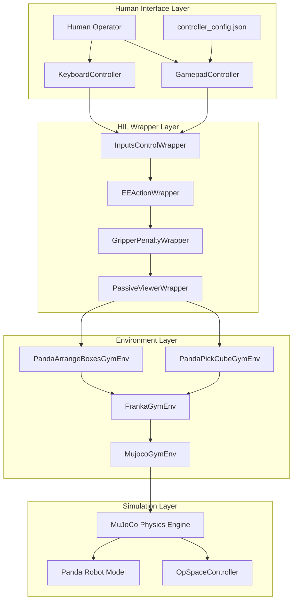
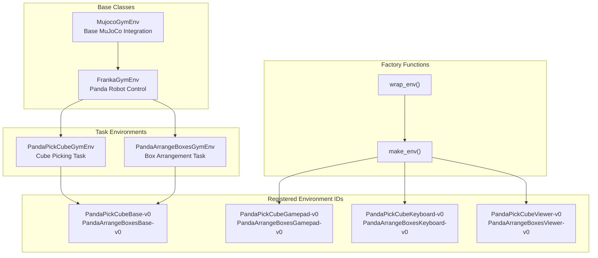
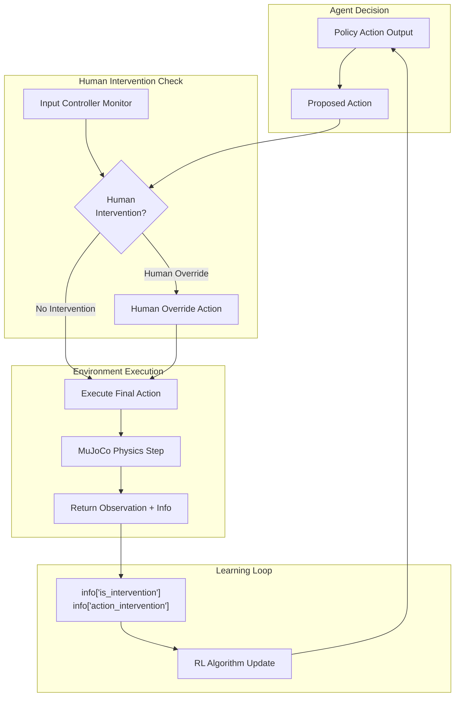

<!-- source: DeepWiki mcp.deepwiki.com · repo huggingface/gym-hil · page 1 Overview · fetched 2026-10-26 -->

# Overview

Relevant source files

The following files were used as context for generating this wiki page:

- [README.md](README.md)
- [images/hil-rl-schema.png](images/hil-rl-schema.png)
- [pyproject.toml](pyproject.toml)

## Purpose and Scope

The `gym-hil` package provides a collection of Gymnasium environments specifically designed for Human-in-the-Loop (HIL) reinforcement learning with robotic manipulation tasks. The framework enables real-time human intervention during agent training, allowing operators to override policy actions using gamepad or keyboard controllers. This approach improves sample efficiency, promotes safer exploration, and enables intuitive demonstration collection for robotic learning systems.

This document covers the high-level architecture, core components, and integration patterns of the gym-hil framework. For detailed information about specific environments, see [Task Environments](#6). For human input handling details, see [Human Input System](#4). For development setup and testing, see [Development](#8).

## System Architecture

The gym-hil framework consists of four main layers that work together to enable human-in-the-loop reinforcement learning:

Sources: [README.md:1-202](), [pyproject.toml:19-46]()

## Environment Hierarchy

The framework uses a hierarchical class structure where specialized task environments inherit from base classes that provide MuJoCo integration and robot control:

Sources: [README.md:82-89](), [pyproject.toml:1-91]()

## Human-in-the-Loop Workflow

The HIL workflow allows seamless switching between agent and human control during environment execution:

Sources: [README.md:12-18](), [README.md:68-76]()

## Technology Stack

The framework integrates multiple external libraries to provide comprehensive HIL functionality:

| Component | Library | Version | Purpose |
|-----------|---------|---------|---------|
| Physics Engine | MuJoCo | ≥2.3.7 | Robot simulation and physics |
| RL Interface | Gymnasium | 0.29.1 | Standard RL environment API |
| Human Input | Pygame | ≥2.5.1 | Gamepad input handling |
| Input Monitoring | Pynput | ≥1.7.7 | Keyboard input capture |
| HID Devices | HIDAPI | ≥0.14.0 | Low-level device communication |
| Video Recording | ImageIO | ≥2.34.0 | Frame capture and video export |

Sources: [pyproject.toml:39-46]()

## Key Features

### Environment Variants
The framework provides multiple variants of each task environment:
- **Base**: Core environment without human input capability
- **Gamepad**: Includes gamepad controller integration via `InputsControlWrapper`
- **Keyboard**: Includes keyboard controller integration
- **Viewer**: Adds passive visualization without input handling

### HIL Wrapper System
The wrapper architecture provides modular HIL functionality:
- `InputsControlWrapper`: Captures and processes human input
- `EEActionWrapper`: Transforms actions to end-effector coordinate space
- `GripperPenaltyWrapper`: Adds optional penalties for excessive gripper usage
- `PassiveViewerWrapper`: Provides visualization capabilities

### Controller Configuration
Human input mapping is configurable through JSON files, supporting multiple controller types with customizable button and axis mappings.

Sources: [README.md:100-108](), [README.md:110-175]()

## Integration with External Frameworks

### LeRobot Compatibility
All gym-hil environments are designed for seamless integration with Hugging Face's LeRobot framework, specifically supporting the HIL-SERL algorithm for human-in-the-loop reinforcement learning.

### Gymnasium Registration
Environments are automatically registered with Gymnasium's environment registry, enabling standard `gym.make()` instantiation patterns.

Sources: [README.md:177-184](), [README.md:30-33]()

## Target Use Cases

1. **Human Demonstration Collection**: Teleoperation for generating expert demonstrations
2. **Interactive Training**: Real-time human intervention during agent training
3. **Safety-Critical Learning**: Human oversight for dangerous or delicate manipulation tasks
4. **Sample-Efficient RL**: Leveraging human expertise to guide exploration and improve learning efficiency

Sources: [README.md:12-18](), [README.md:90-99]()

---

