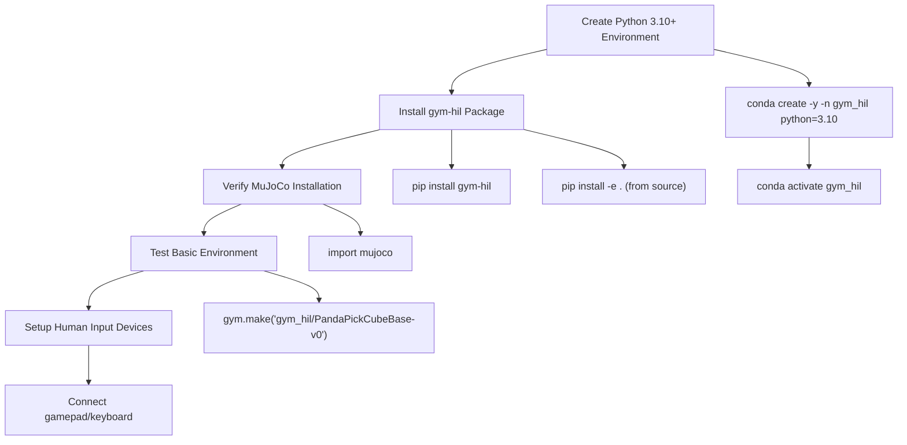
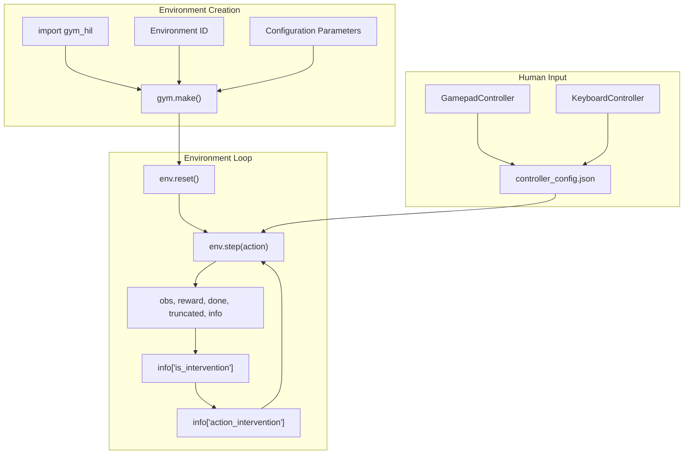
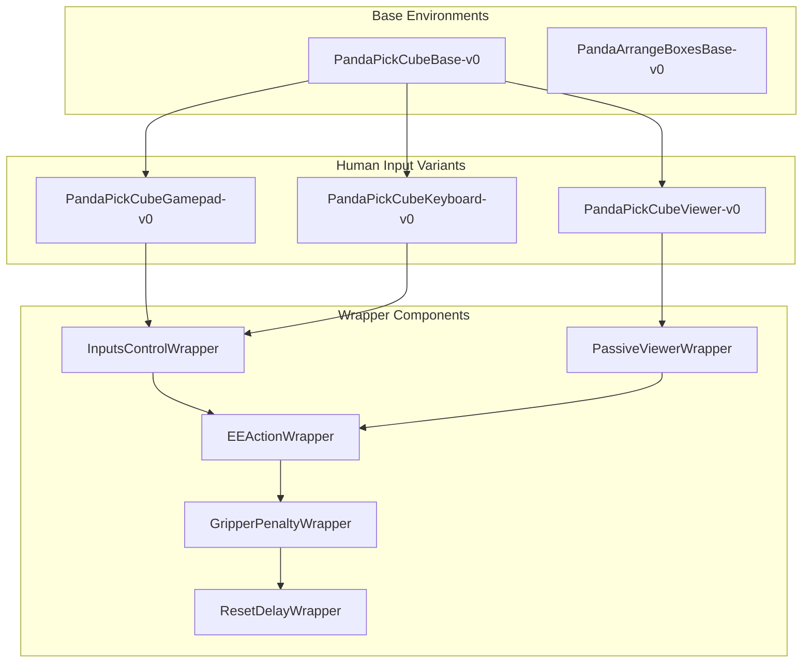

<!-- source: DeepWiki mcp.deepwiki.com · repo huggingface/gym-hil · page 2 Getting Started · fetched 2026-10-26 -->

# Getting Started

<details>
<summary>Relevant source files</summary>

The following files were used as context for generating this wiki page:

- [README.md](README.md)
- [examples/test_teleoperation.py](examples/test_teleoperation.py)
- [images/hil-rl-schema.png](images/hil-rl-schema.png)
- [pyproject.toml](pyproject.toml)

</details>


This document provides installation instructions and basic usage examples for the gym-hil package. It covers the essential setup steps and demonstrates how to create and interact with Human-in-the-Loop reinforcement learning environments. For detailed information about the architecture and components, see [Core Architecture](#3). For specific task environments, see [Task Environments](#6).

## Installation Requirements

The gym-hil package requires Python 3.10 or higher and has several key dependencies for physics simulation, human input handling, and visualization.

### System Requirements

| Component | Version | Purpose |
|-----------|---------|---------|
| Python | ≥3.10 | Core runtime |
| MuJoCo | ≥2.3.7, <3.0.0 | Physics simulation |
| Gymnasium | 0.29.1 | RL environment interface |
| Pygame | ≥2.5.1 | Game controller input |
| Pynput | ≥1.7.7 | Keyboard input monitoring |
| HIDAPI | ≥0.14.0 | Human interface device access |
| ImageIO | ≥2.34.0 | Video recording support |

### Installation Steps



**Create virtual environment:**
```bash
conda create -y -n gym_hil python=3.10 && conda activate gym_hil
```

**Install from PyPI:**
```bash
pip install gym-hil
```

**Install from source:**
```bash
git clone https://github.com/HuggingFace/gym-hil.git && cd gym-hil
pip install -e .
```

Sources: [pyproject.toml:31-46](), [README.md:34-49]()

## Basic Usage Workflow

The gym-hil package follows the standard Gymnasium interface with additional HIL-specific features. The core workflow involves creating environments, handling human input, and processing intervention signals.



**Basic environment creation:**
```python
import gymnasium as gym
import gym_hil

env = gym.make("gym_hil/PandaPickCubeBase-v0", render_mode="human", image_obs=True)
```

**Standard gymnasium loop with HIL features:**
```python
obs, info = env.reset()
for i in range(200):
    obs, reward, done, truncated, info = env.step(env.action_space.sample())
    
    # Check for human intervention
    if info.get("is_intervention", False):
        executed_action = info["action_intervention"]
        print(f"Human intervened with action: {executed_action}")
    
    if done:
        obs, info = env.reset()
```

Sources: [README.md:53-80](), [examples/test_teleoperation.py:44-49](), [examples/test_teleoperation.py:78-96]()

## Available Environments

The gym-hil package provides multiple environment variants for different use cases, organized by base functionality and input modalities.

### Environment Hierarchy



### Environment Specifications

| Environment ID | Description | Input Method | Wrappers Applied |
|---------------|-------------|--------------|------------------|
| `PandaPickCubeBase-v0` | Core cube picking task | None | Minimal |
| `PandaPickCubeGamepad-v0` | Gamepad-controlled teleoperation | Gamepad | `InputsControlWrapper`, `EEActionWrapper` |
| `PandaPickCubeKeyboard-v0` | Keyboard-controlled teleoperation | Keyboard | `InputsControlWrapper`, `EEActionWrapper` |
| `PandaPickCubeViewer-v0` | Passive viewing mode | None | `PassiveViewerWrapper` |
| `PandaArrangeBoxesBase-v0` | Multi-box arrangement task | None | Minimal |

**Environment creation examples:**
```python
# Base environment for algorithmic training
env = gym.make("gym_hil/PandaPickCubeBase-v0", render_mode="human")

# Gamepad teleoperation environment
env = gym.make("gym_hil/PandaPickCubeGamepad-v0", 
               render_mode="human", 
               use_gamepad=True,
               max_episode_steps=1000)

# Keyboard teleoperation environment
env = gym.make("gym_hil/PandaPickCubeKeyboard-v0", 
               render_mode="human", 
               use_keyboard=True)
```

Sources: [README.md:82-89](), [examples/test_teleoperation.py:44-69]()

## Your First Example

The `test_teleoperation.py` script demonstrates the complete workflow for human-in-the-loop interaction with the Panda robot.

### Running the Teleoperation Example

**Basic gamepad control:**
```bash
python examples/test_teleoperation.py
```

**Keyboard control:**
```bash
python examples/test_teleoperation.py --use-keyboard
```

**With custom controller configuration:**
```bash
python examples/test_teleoperation.py --controller-config path/to/config.json
```

### Key Components of the Example

The teleoperation script demonstrates several important patterns:

1. **Environment Configuration**: Setting up render modes, observation types, and episode limits
2. **Human Input Integration**: Handling both gamepad and keyboard input modalities
3. **Intervention Detection**: Monitoring and responding to human override signals
4. **Episode Management**: Handling resets and episode boundaries

```python
# Create environment with HIL wrappers
env_id = "gym_hil/PandaPickCubeKeyboard-v0" if args.use_keyboard else "gym_hil/PandaPickCubeGamepad-v0"
env = gym.make(env_id, render_mode=args.render_mode, image_obs=True, use_gamepad=not args.use_keyboard)

# Initialize dummy action for non-intervention states
dummy_action = np.zeros(4, dtype=np.float32)
dummy_action[-1] = 1  # Keep gripper in current state

# Main control loop
while True:
    obs, reward, terminated, truncated, info = env.step(dummy_action)
    
    if info.get("succeed", False):
        print("Success! Block has been picked up.")
    
    if terminated or truncated:
        obs, _ = env.reset()
```

Sources: [examples/test_teleoperation.py:26-110]()

## Default Controller Configuration

The package includes a default controller configuration that maps gamepad inputs to robot actions:

| Input | Action | Description |
|-------|--------|-------------|
| Left analog stick | X-Y movement | End-effector position in horizontal plane |
| Right analog stick (vertical) | Z movement | End-effector height adjustment |
| RB button | Intervention toggle | Enable/disable human control |
| LT button | Gripper close | Close robot gripper |
| RT button | Gripper open | Open robot gripper |
| Y/Triangle button | Success signal | Mark episode as successful |
| A/Cross button | Failure signal | Mark episode as failed |

The controller configuration is stored in `controller_config.json` and can be customized for different gamepad types.

Sources: [README.md:110-175](), [pyproject.toml:54]()

## Next Steps

After completing this getting started guide, explore these advanced topics:

- **[Core Architecture](#3)**: Understand the base classes and wrapper system
- **[Human Input System](#4)**: Learn about controller configuration and input handling
- **[Task Environments](#6)**: Explore specific robotic manipulation tasks
- **[Teleoperation](#7.1)**: Master human control techniques
- **[Development](#8)**: Set up development environment and contribute

For immediate experimentation, try modifying the teleoperation example to:
1. Adjust movement step sizes and control sensitivity
2. Add custom controller mappings
3. Record and analyze intervention patterns
4. Integrate with LeRobot for policy training

Sources: [README.md:177-184]()

---

