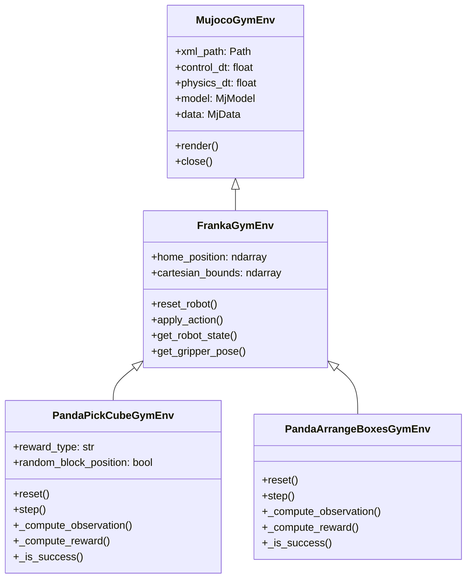
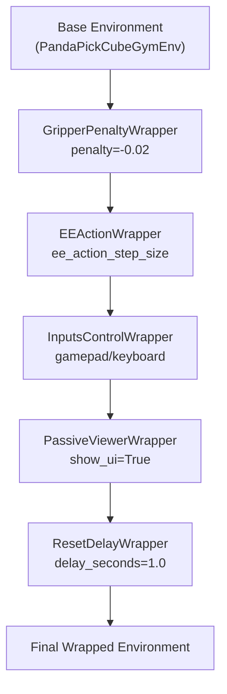
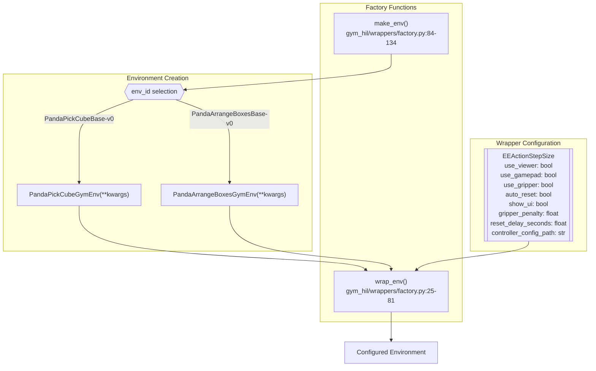
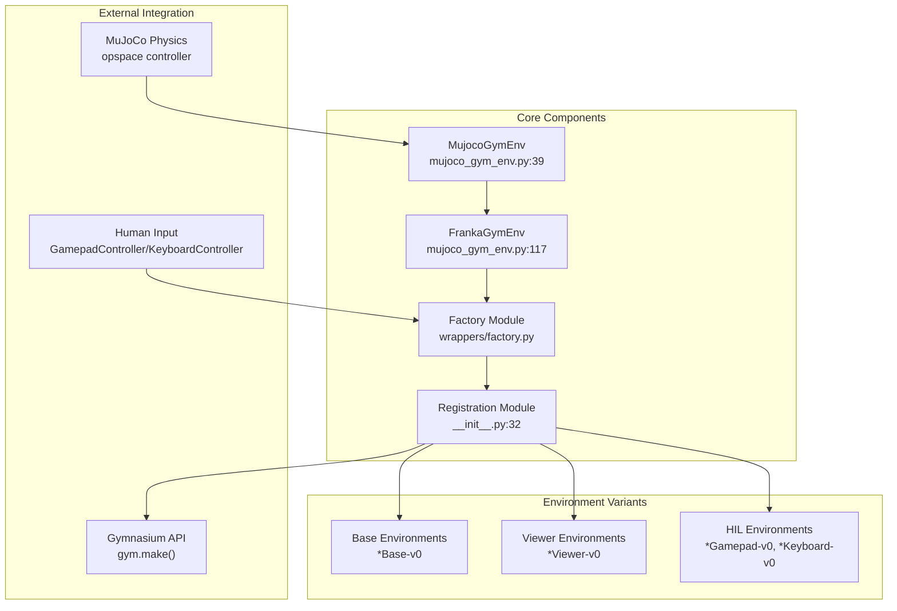

<!-- source: DeepWiki mcp.deepwiki.com · repo huggingface/gym-hil · page 3 Core Architecture · fetched 2026-10-26 -->

# Core Architecture

Relevant source files

The following files were used as context for generating this wiki page:

- [gym_hil/__init__.py](gym_hil/__init__.py)
- [gym_hil/envs/panda_pick_gym_env.py](gym_hil/envs/panda_pick_gym_env.py)
- [gym_hil/mujoco_gym_env.py](gym_hil/mujoco_gym_env.py)
- [gym_hil/wrappers/factory.py](gym_hil/wrappers/factory.py)
- [gym_hil/wrappers/viewer_wrapper.py](gym_hil/wrappers/viewer_wrapper.py)

The gym-hil core architecture provides a modular system for creating Human-in-the-Loop reinforcement learning environments built on MuJoCo physics simulation. The architecture consists of base environment classes, a flexible wrapper system, and a factory pattern for environment creation and configuration.

For detailed information about specific task implementations, see [Task Environments](#6). For human input handling mechanisms, see [Human Input System](#4).

## Base Environment Hierarchy

The foundation of gym-hil is built on a three-tier inheritance hierarchy that progressively adds functionality from basic MuJoCo integration to task-specific robotic manipulation environments.

### Class Inheritance Structure

**Sources:** [gym_hil/mujoco_gym_env.py:39-116](), [gym_hil/mujoco_gym_env.py:117-283](), [gym_hil/envs/panda_pick_gym_env.py:30-199]()

The `MujocoGymEnv` class handles basic MuJoCo physics simulation integration, providing XML model loading, rendering capabilities, and timestep management. The `FrankaGymEnv` class extends this with Panda robot-specific functionality including operational space control and gripper management. Task-specific environments like `PandaPickCubeGymEnv` implement concrete manipulation tasks with custom observation spaces, reward functions, and success criteria.

## Wrapper System Architecture

The wrapper system provides modular functionality that can be composed around base environments to add HIL capabilities, rendering, and behavioral modifications.

### Wrapper Composition Flow

**Sources:** [gym_hil/wrappers/factory.py:25-81](), [gym_hil/wrappers/hil_wrappers.py](), [gym_hil/wrappers/viewer_wrapper.py:24-120]()

The wrapper system applies transformations in a specific order managed by the `wrap_env` function. Each wrapper adds distinct functionality: `GripperPenaltyWrapper` modifies rewards, `EEActionWrapper` converts end-effector commands, `InputsControlWrapper` handles human input, `PassiveViewerWrapper` provides visualization, and `ResetDelayWrapper` manages episode transitions.

## Environment Registration System

gym-hil uses Gymnasium's registration system to create multiple environment variants with different configurations and wrapper combinations.

### Registration Hierarchy

```mermaid
graph TD
    subgraph "Base Environments"
        PandaPickBase["gym_hil/PandaPickCubeBase-v0<br/>PandaPickCubeGymEnv"]
        PandaArrangeBase["gym_hil/PandaArrangeBoxesBase-v0<br/>PandaArrangeBoxesGymEnv"]
    end
    
    subgraph "Viewer Variants"
        PandaPickViewer["gym_hil/PandaPickCubeViewer-v0<br/>+ PassiveViewerWrapper"]
        PandaArrangeViewer["gym_hil/PandaArrangeBoxesViewer-v0<br/>+ PassiveViewerWrapper"]
    end
    
    subgraph "Factory Variants"
        PandaPickDefault["gym_hil/PandaPickCube-v0<br/>make_env()"]
        PandaPickGamepad["gym_hil/PandaPickCubeGamepad-v0<br/>make_env(use_gamepad=True)"]
        PandaPickKeyboard["gym_hil/PandaPickCubeKeyboard-v0<br/>make_env(use_viewer=True)"]
        PandaArrangeDefault["gym_hil/PandaArrangeBoxes-v0<br/>make_env()"]
        PandaArrangeGamepad["gym_hil/PandaArrangeBoxesGamepad-v0<br/>make_env(use_gamepad=True)"]
        PandaArrangeKeyboard["gym_hil/PandaArrangeBoxesKeyboard-v0<br/>make_env(use_viewer=True)"]
    end
    
    PandaPickBase --> PandaPickViewer
    PandaArrangeBase --> PandaArrangeViewer
    
    PandaPickBase --> PandaPickDefault
    PandaPickBase --> PandaPickGamepad
    PandaPickBase --> PandaPickKeyboard
    PandaArrangeBase --> PandaArrangeDefault
    PandaArrangeBase --> PandaArrangeGamepad
    PandaArrangeBase --> PandaArrangeKeyboard
```

**Sources:** [gym_hil/__init__.py:34-117]()

The registration system creates a three-tier structure: base environments provide core functionality, viewer variants add visualization, and factory variants use `make_env` to create fully configured HIL environments with specific input methods and wrapper combinations.

## Factory Pattern Implementation

The factory system provides a clean interface for creating and configuring environments with appropriate wrapper combinations.

### Factory Function Architecture

**Sources:** [gym_hil/wrappers/factory.py:84-134](), [gym_hil/wrappers/factory.py:25-81](), [gym_hil/wrappers/factory.py:19-23]()

The factory pattern separates environment creation from wrapper configuration. The `make_env` function handles base environment instantiation based on `env_id`, while `wrap_env` applies wrapper combinations based on configuration parameters. The `EEActionStepSize` TypedDict provides type safety for end-effector movement parameters.

## Component Integration

The architecture integrates multiple subsystems to create a cohesive HIL environment system.

### System Integration Flow

**Sources:** [gym_hil/__init__.py:17-30](), [gym_hil/mujoco_gym_env.py:26](), [gym_hil/wrappers/factory.py:3-16]()

The system integrates base environment classes with the factory pattern and registration system to provide a unified interface through the Gymnasium API. The MuJoCo physics engine and operational space control provide the simulation foundation, while human input controllers enable interactive control. The modular architecture allows for flexible configuration of environment variants suitable for different use cases.

---

