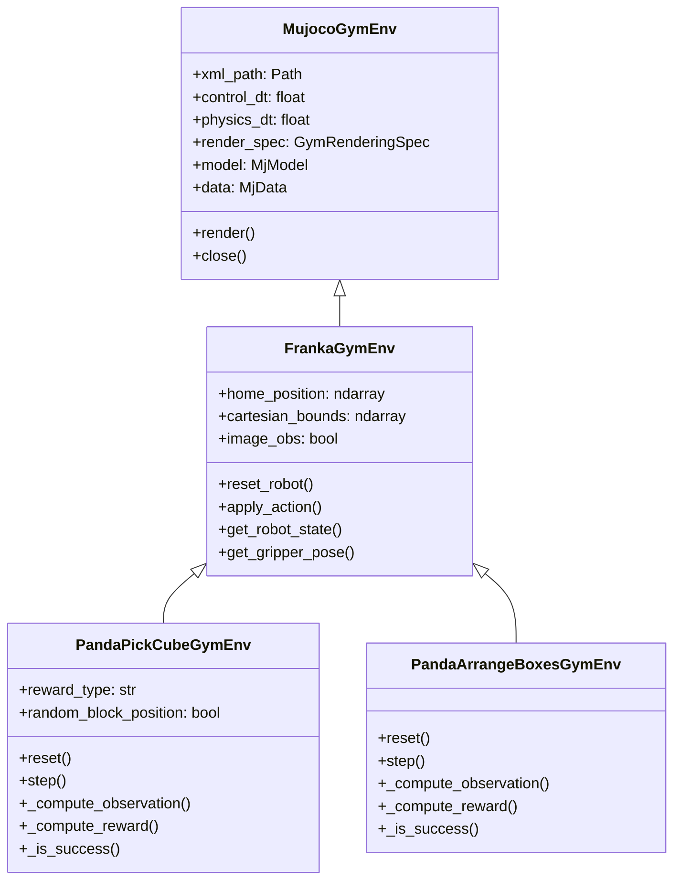
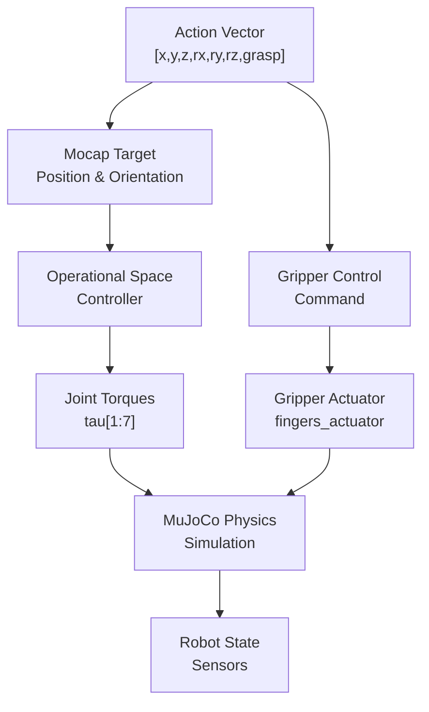
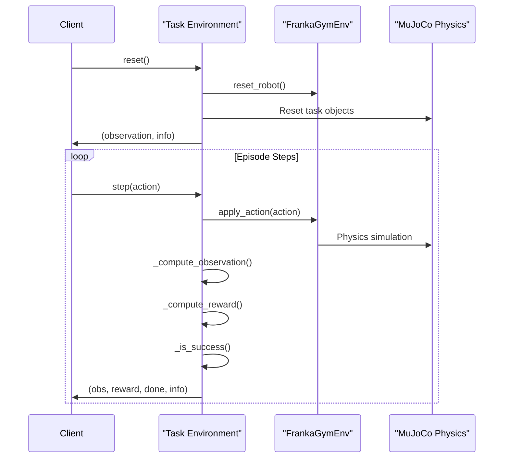

<!-- source: DeepWiki mcp.deepwiki.com · repo huggingface/gym-hil · page 3.1 Base Environments · fetched 2026-10-26 -->

# Base Environments

<details>
<summary>Relevant source files</summary>

The following files were used as context for generating this wiki page:

- [gym_hil/envs/__init__.py](gym_hil/envs/__init__.py)
- [gym_hil/envs/panda_pick_gym_env.py](gym_hil/envs/panda_pick_gym_env.py)
- [gym_hil/mujoco_gym_env.py](gym_hil/mujoco_gym_env.py)
- [gym_hil/wrappers/viewer_wrapper.py](gym_hil/wrappers/viewer_wrapper.py)

</details>


This section covers the foundational environment classes that provide MuJoCo physics simulation and Franka Panda robot control capabilities. These base classes form the inheritance hierarchy that all task-specific environments build upon.

For information about the wrapper system that adds Human-in-the-Loop functionality to these environments, see [HIL Wrappers](#3.2). For details about specific task implementations, see [Task Environments](#6).

## Class Hierarchy

The base environment system follows a clear inheritance structure that separates concerns between physics simulation, robot control, and task-specific logic:



**Sources:** [gym_hil/mujoco_gym_env.py:39-116](), [gym_hil/mujoco_gym_env.py:117-283](), [gym_hil/envs/panda_pick_gym_env.py:30-199](), [gym_hil/envs/__init__.py:17-18]()

## MujocoGymEnv - Base MuJoCo Integration

The `MujocoGymEnv` class provides the fundamental integration between MuJoCo physics simulation and the Gymnasium API. It handles low-level physics simulation, rendering, and resource management.

### Core Components

| Component | Purpose | Configuration |
|-----------|---------|---------------|
| `MjModel` | Physics model loaded from XML | Via `xml_path` parameter |
| `MjData` | Simulation state data | Initialized with model |
| `MjRenderer` | Rendering pipeline | Configured via `GymRenderingSpec` |
| Control Loop | Physics timestep management | `control_dt` and `physics_dt` |

### Key Methods

- **`render()`**: Generates visual frames using MuJoCo's rendering system
- **`close()`**: Safely releases graphics resources with version compatibility
- **Property accessors**: Provide access to `model`, `data`, timing parameters, and random state

### Rendering Configuration

The `GymRenderingSpec` dataclass controls rendering parameters:

```python
@dataclass(frozen=True)
class GymRenderingSpec:
    height: int = 128
    width: int = 128
    camera_id: str | int = -1
    mode: Literal["rgb_array", "human"] = "rgb_array"
```

**Sources:** [gym_hil/mujoco_gym_env.py:39-116](), [gym_hil/mujoco_gym_env.py:31-37]()

## FrankaGymEnv - Franka Panda Robot Control

The `FrankaGymEnv` class extends `MujocoGymEnv` to provide Franka Panda robot-specific functionality, including operational space control, multi-camera rendering, and standardized robot state management.

### Robot Configuration

The environment is initialized with robot-specific parameters:

| Parameter | Purpose | Default Value |
|-----------|---------|---------------|
| `home_position` | 7-DOF joint configuration | `(0, -0.785, 0, -2.35, 0, 1.57, π/4)` |
| `cartesian_bounds` | Workspace limits (x,y,z) | `[[0.2, -0.3, 0], [0.6, 0.3, 0.5]]` |
| `image_obs` | Enable visual observations | `False` |

### Control System Architecture



**Sources:** [gym_hil/mujoco_gym_env.py:117-283](), [gym_hil/mujoco_gym_env.py:230-259]()

### Action Space

The action space is a 7-dimensional continuous vector:

```python
action_space = spaces.Box(
    low=np.array([-1.0, -1.0, -1.0, -1.0, -1.0, -1.0, -1.0]),
    high=np.array([1.0, 1.0, 1.0, 1.0, 1.0, 1.0, 1.0]),
    dtype=np.float32
)
```

Components: `[x_delta, y_delta, z_delta, rx_delta, ry_delta, rz_delta, grasp_command]`

### Observation Space

The observation space structure depends on the `image_obs` parameter:

#### State-Only Observations
```python
observation_space = spaces.Dict({
    "agent_pos": spaces.Dict({
        "tcp_pose": spaces.Box(-np.inf, np.inf, shape=(7,)),
        "tcp_vel": spaces.Box(-np.inf, np.inf, shape=(6,)),
        "gripper_pose": spaces.Box(-1, 1, shape=(1,))
    })
})
```

#### Image + State Observations
When `image_obs=True`, additional pixel observations are included from two cameras:
- `"front"`: External view camera
- `"wrist"`: Hand-mounted camera (`handcam_rgb`)

### Key Methods

- **`reset_robot()`**: Resets robot to home position and synchronizes mocap target
- **`apply_action()`**: Converts action vector to robot commands using operational space control
- **`get_robot_state()`**: Returns concatenated robot state vector
- **`render()`**: Generates multi-camera visual observations

**Sources:** [gym_hil/mujoco_gym_env.py:117-283](), [gym_hil/mujoco_gym_env.py:212-219](), [gym_hil/mujoco_gym_env.py:175-211]()

## Task-Specific Environment Interface

Task environments inherit from `FrankaGymEnv` and implement the standard Gymnasium interface methods:

### Required Methods

| Method | Purpose | Returns |
|--------|---------|---------|
| `reset()` | Initialize episode state | `(observation, info)` |
| `step()` | Execute one environment step | `(obs, reward, terminated, truncated, info)` |
| `_compute_observation()` | Generate observation dict | `Dict[str, np.ndarray]` |
| `_compute_reward()` | Calculate step reward | `float` |
| `_is_success()` | Check task completion | `bool` |

### Common Implementation Pattern

Task environments typically follow this structure:



**Sources:** [gym_hil/envs/panda_pick_gym_env.py:101-149](), [gym_hil/envs/panda_pick_gym_env.py:150-199]()

## Environment Registration

The base environments are registered with specific naming conventions through the environment factory system. Each task environment is available in multiple variants:

- `*Base-v0`: Raw environment without wrappers
- `*Gamepad-v0`: Configured for gamepad control
- `*Keyboard-v0`: Configured for keyboard control  
- `*Viewer-v0`: Includes passive viewer

The inheritance chain ensures that all registered environments inherit the robust physics simulation and robot control capabilities provided by the base classes.

**Sources:** [gym_hil/envs/__init__.py:17-20]()

---

