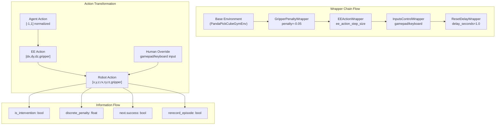
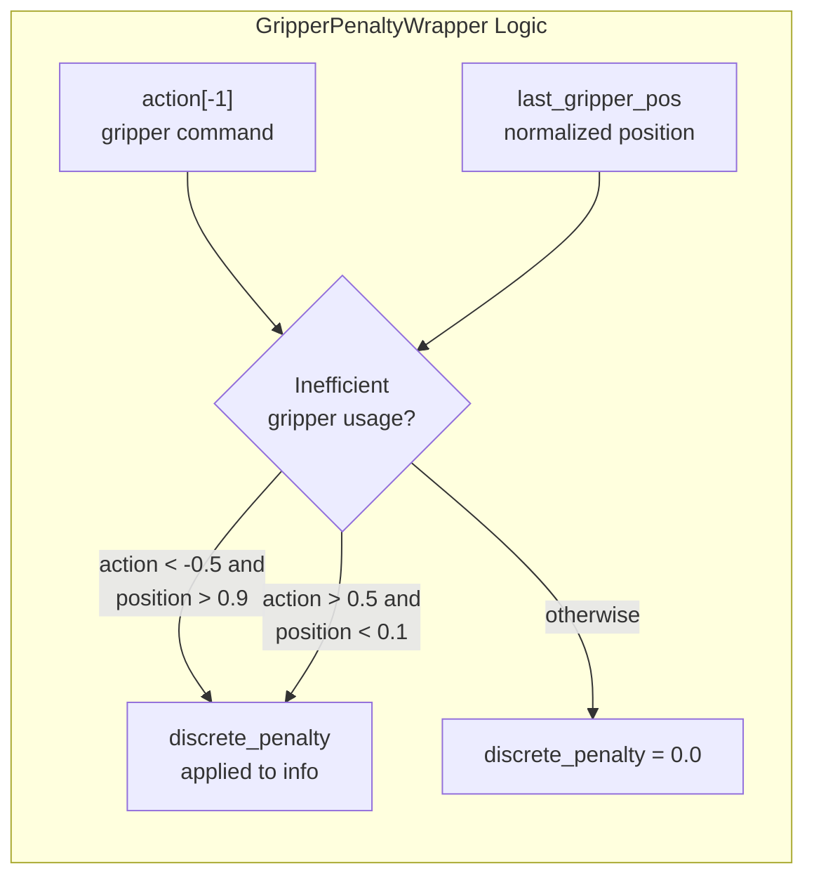
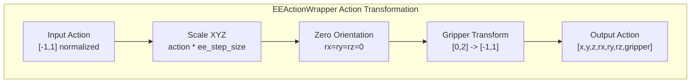
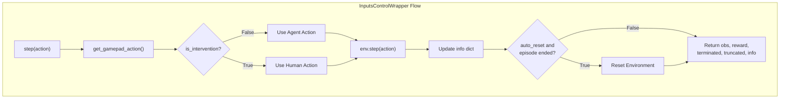

<!-- source: DeepWiki mcp.deepwiki.com · repo huggingface/gym-hil · page 3.2 HIL Wrappers · fetched 2026-10-26 -->

# HIL Wrappers

<details>
<summary>Relevant source files</summary>

The following files were used as context for generating this wiki page:

- [gym_hil/wrappers/hil_wrappers.py](gym_hil/wrappers/hil_wrappers.py)
- [tests/test_ee_action_wrapper.py](tests/test_ee_action_wrapper.py)

</details>


## Purpose and Scope

The HIL Wrappers system provides a collection of Gymnasium wrapper classes that add Human-in-the-Loop (HIL) functionality to base robotic environments. These wrappers transform action spaces, handle human input intervention, apply task-specific penalties, and manage episode timing. They form a key component of the gym-hil framework by bridging the gap between standard RL environments and human-guided robotic control.

For information about the base environment classes that these wrappers extend, see [Base Environments](#3.1). For details about the environment factory system that assembles these wrappers, see [Environment Factory](#3.3).

## Wrapper Architecture Overview

The HIL wrapper system follows a chain-of-responsibility pattern where each wrapper adds specific functionality while maintaining the Gymnasium interface. The wrappers are typically applied in a specific order to ensure proper action transformation and human input handling.



Sources: [gym_hil/wrappers/hil_wrappers.py:29-311]()

## Wrapper Classes

### GripperPenaltyWrapper

The `GripperPenaltyWrapper` applies penalties for inefficient gripper usage by detecting rapid open/close cycles. It tracks gripper state changes and applies a configurable penalty when the gripper command contradicts the current gripper position.

| Parameter | Type | Default | Description |
|-----------|------|---------|-------------|
| `penalty` | float | -0.05 | Penalty value applied for inefficient gripper usage |

**Penalty Logic:**
- Penalty applied when closing gripper (action < -0.5) while already closed (position < 0.1)
- Penalty applied when opening gripper (action > 0.5) while already open (position > 0.9)
- Gripper position normalized by `MAX_GRIPPER_COMMAND` constant



Sources: [gym_hil/wrappers/hil_wrappers.py:29-51]()

### EEActionWrapper

The `EEActionWrapper` transforms high-level end-effector commands into the 7-dimensional action space expected by the underlying MuJoCo environment. It handles coordinate system scaling and optional gripper control.

| Parameter | Type | Description |
|-----------|------|-------------|
| `ee_action_step_size` | dict | Step sizes for x, y, z movements in meters |
| `use_gripper` | bool | Whether to include gripper control in action space |

**Action Space Transformation:**
- Input: 3D or 4D action space (x, y, z, optional gripper)
- Output: 7D MuJoCo action space (x, y, z, rx, ry, rz, gripper)
- Orientation control (rx, ry, rz) currently set to zeros
- Gripper command normalized from [0, 2] to [-1, 1] range



Sources: [gym_hil/wrappers/hil_wrappers.py:53-104](), [tests/test_ee_action_wrapper.py:39-99]()

### InputsControlWrapper

The `InputsControlWrapper` enables human intervention through gamepad or keyboard input. It creates controller instances, monitors for human input, and overrides agent actions when intervention is detected.

| Parameter | Type | Default | Description |
|-----------|------|---------|-------------|
| `x_step_size` | float | 1.0 | Movement step size for X axis |
| `y_step_size` | float | 1.0 | Movement step size for Y axis |
| `z_step_size` | float | 1.0 | Movement step size for Z axis |
| `use_gripper` | bool | False | Enable gripper control |
| `auto_reset` | bool | False | Auto-reset environment on episode end |
| `input_threshold` | float | 0.001 | Minimum input delta for intervention |
| `use_gamepad` | bool | True | Use gamepad instead of keyboard |
| `controller_config_path` | str | None | Path to controller configuration |

**Controller Selection Logic:**
- macOS: `GamepadControllerHID` (uses HID API)
- Other platforms: `GamepadController` (uses Pygame)
- Keyboard: `KeyboardController` (uses pynput)



**Information Dictionary Updates:**
- `is_intervention`: Boolean indicating if human overrode the action
- `action_intervention`: The actual action used (agent or human)
- `rerecord_episode`: Boolean for episode rerecording requests
- `next.success`: Success status when episode ends

Sources: [gym_hil/wrappers/hil_wrappers.py:106-283]()

### ResetDelayWrapper

The `ResetDelayWrapper` adds a configurable time delay during environment reset operations. This provides a pause between episodes to allow human observation and preparation.

| Parameter | Type | Default | Description |
|-----------|------|---------|-------------|
| `delay_seconds` | float | 1.0 | Number of seconds to delay during reset |

The wrapper uses Python's `time.sleep()` to implement the delay and logs the delay duration for debugging purposes.

Sources: [gym_hil/wrappers/hil_wrappers.py:285-311]()

## Configuration and Integration

### Default Configuration

The HIL wrappers use several default configurations defined as module-level constants:

```python
DEFAULT_EE_STEP_SIZE = {"x": 0.025, "y": 0.025, "z": 0.025}
MAX_GRIPPER_COMMAND = 0.04  # From mujoco_gym_env.py
```

### Wrapper Chain Assembly

The wrappers are typically assembled in the following order through the environment factory system:

1. **GripperPenaltyWrapper** - Applied first to track gripper state
2. **EEActionWrapper** - Transforms action space for end-effector control
3. **InputsControlWrapper** - Enables human input intervention
4. **ResetDelayWrapper** - Applied last to manage episode timing

This order ensures proper action transformation flow and maintains the Gymnasium interface at each level.

Sources: [gym_hil/wrappers/hil_wrappers.py:26-27](), [gym_hil/mujoco_gym_env.py:24]()

---

