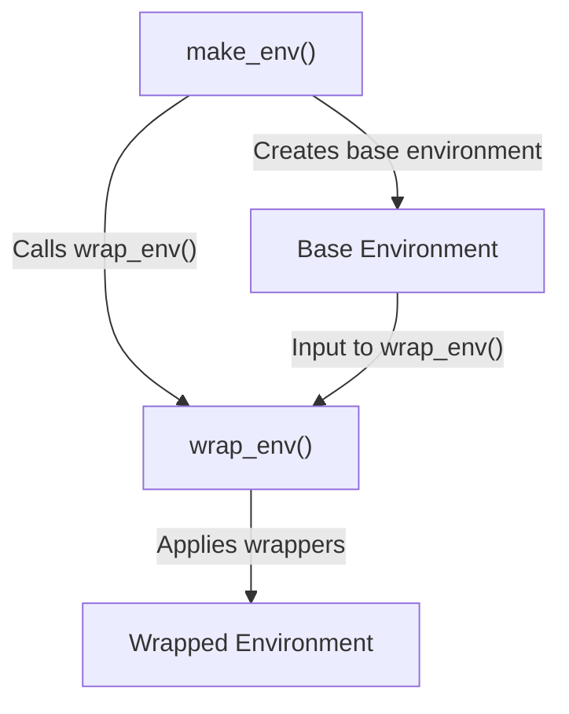
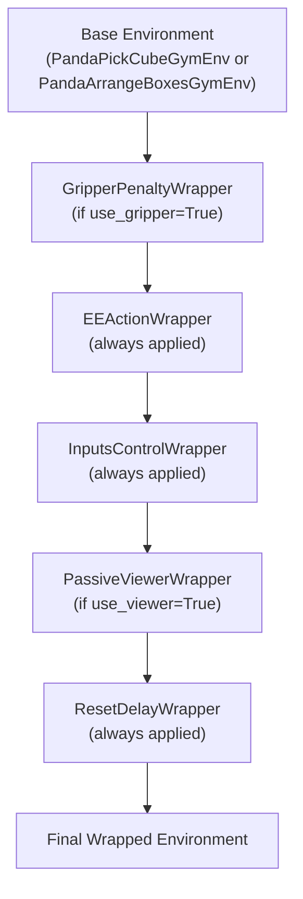
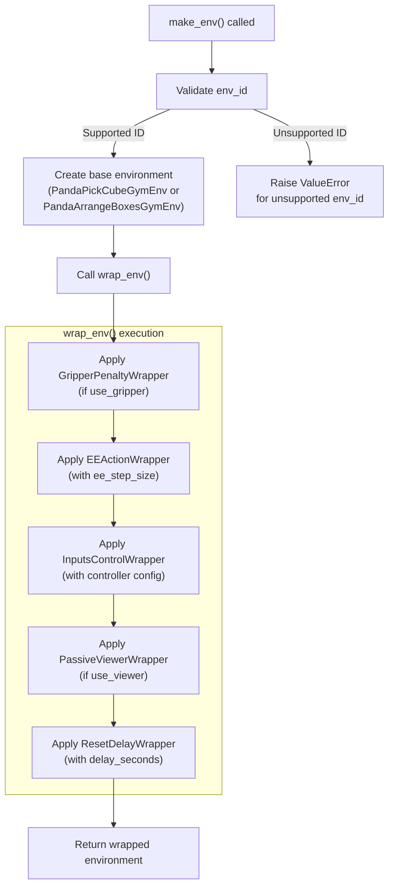

<!-- source: DeepWiki mcp.deepwiki.com · repo huggingface/gym-hil · page 3.3 Environment Factory · fetched 2026-10-26 -->

# Environment Factory

<details>
<summary>Relevant source files</summary>

The following files were used as context for generating this wiki page:

- [gym_hil/wrappers/factory.py](gym_hil/wrappers/factory.py)

</details>


## Purpose and Scope

The Environment Factory provides a centralized interface for creating and configuring gym-hil environments with specific wrapper combinations. It serves as the main entry point for instantiating environments with Human-in-the-Loop (HIL) functionality, handling the complex process of applying wrappers in the correct order and with appropriate configurations.

This factory system simplifies environment creation by encapsulating the wrapper application logic and providing sensible defaults for common use cases. For information about the individual wrapper components applied by the factory, see [HIL Wrappers](#3.2). For details about the base environment classes that the factory instantiates, see [Base Environments](#3.1).

## Factory Functions

The environment factory exposes two primary functions that work together to create configured environments:

### Core Factory Functions



The `make_env()` function at [gym_hil/wrappers/factory.py:84-134]() serves as the primary entry point, creating a base environment and then applying wrappers through `wrap_env()`. The `wrap_env()` function at [gym_hil/wrappers/factory.py:25-81]() focuses specifically on wrapper application logic.

Sources: [gym_hil/wrappers/factory.py:84-134]()

### Base Environment Creation

The factory currently supports two base environment types:

| Environment ID | Class | Purpose |
|---|---|---|
| `gym_hil/PandaPickCubeBase-v0` | `PandaPickCubeGymEnv` | Cube picking manipulation task |
| `gym_hil/PandaArrangeBoxesBase-v0` | `PandaArrangeBoxesGymEnv` | Multi-object arrangement task |

The environment creation logic at [gym_hil/wrappers/factory.py:116-121]() directly instantiates these environment classes rather than using Gymnasium's registration system for the base variants.

Sources: [gym_hil/wrappers/factory.py:116-121]()

## Wrapper Application Order

The factory applies wrappers in a specific sequence to ensure proper functionality:

### Wrapper Chain Diagram



The wrapper application follows this order at [gym_hil/wrappers/factory.py:55-79]():

1. **GripperPenaltyWrapper** - Applied first if `use_gripper=True`, adds penalty for gripper actions
2. **EEActionWrapper** - Converts end-effector actions to joint space, always applied
3. **InputsControlWrapper** - Handles human input integration, always applied
4. **PassiveViewerWrapper** - Adds visualization capability if `use_viewer=True`
5. **ResetDelayWrapper** - Adds delay during environment reset, always applied last

Sources: [gym_hil/wrappers/factory.py:55-79]()

## Configuration Options

The factory functions accept comprehensive configuration parameters to customize environment behavior:

### Configuration Parameters

| Parameter | Type | Default | Purpose |
|---|---|---|---|
| `ee_step_size` | `EEActionStepSize` | `DEFAULT_EE_STEP_SIZE` | Step size for end-effector movement |
| `use_viewer` | `bool` | `False` | Enable passive viewer for visualization |
| `use_gamepad` | `bool` | `False` | Use gamepad instead of keyboard input |
| `use_gripper` | `bool` | `True` | Enable gripper control |
| `auto_reset` | `bool` | `False` | Automatically reset on episode end |
| `show_ui` | `bool` | `True` | Show UI panels in viewer |
| `gripper_penalty` | `float` | `-0.02` | Penalty value for gripper actions |
| `reset_delay_seconds` | `float` | `1.0` | Delay duration during reset |
| `controller_config_path` | `str` | `None` | Path to controller configuration JSON |

### EEActionStepSize Configuration

The `EEActionStepSize` TypedDict at [gym_hil/wrappers/factory.py:19-23]() defines movement step sizes for each axis:

```python
class EEActionStepSize(TypedDict):
    x: float
    y: float
    z: float
```

This configuration allows fine-grained control over end-effector movement sensitivity in each spatial dimension.

Sources: [gym_hil/wrappers/factory.py:19-23](), [gym_hil/wrappers/factory.py:25-49]()

## Environment Creation Flow

The complete environment creation process follows a structured flow:

### Creation Flow Diagram



The factory ensures consistent wrapper application order and proper configuration propagation throughout the wrapper chain. Error handling occurs at [gym_hil/wrappers/factory.py:120-121]() for unsupported environment IDs.

Sources: [gym_hil/wrappers/factory.py:84-134](), [gym_hil/wrappers/factory.py:25-81]()

---

