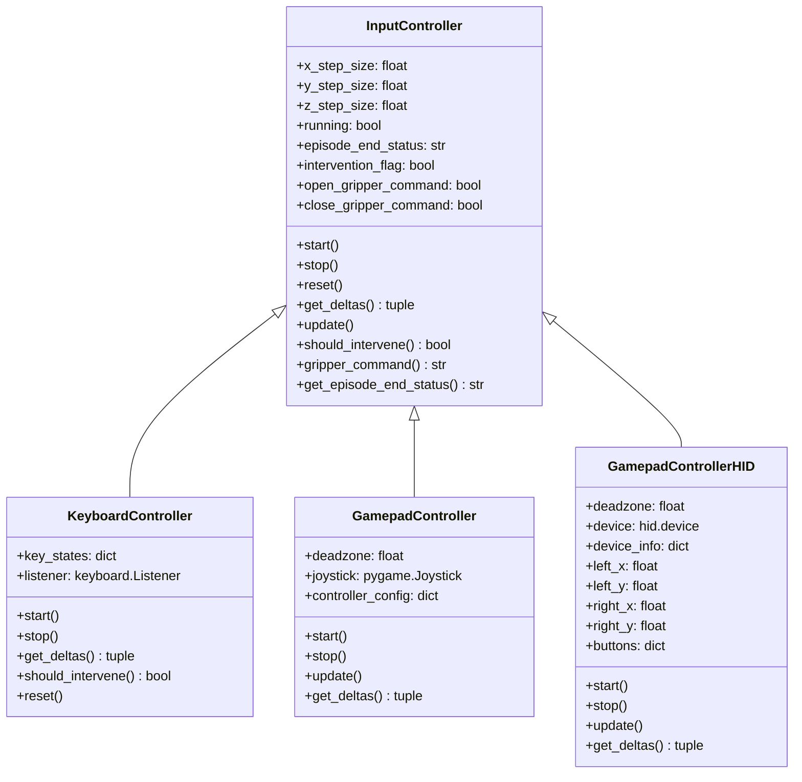
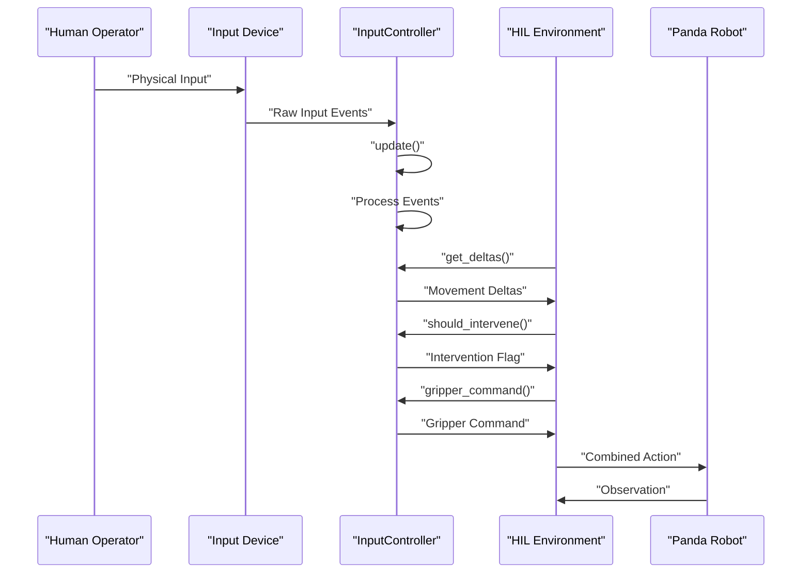
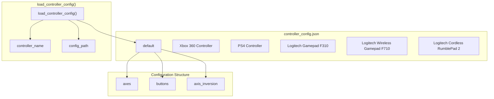
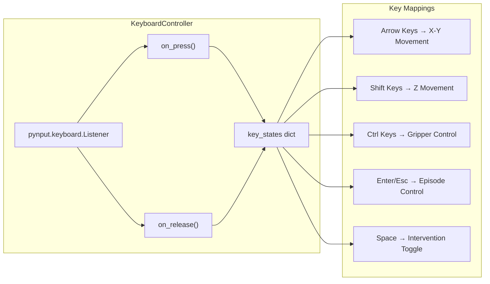
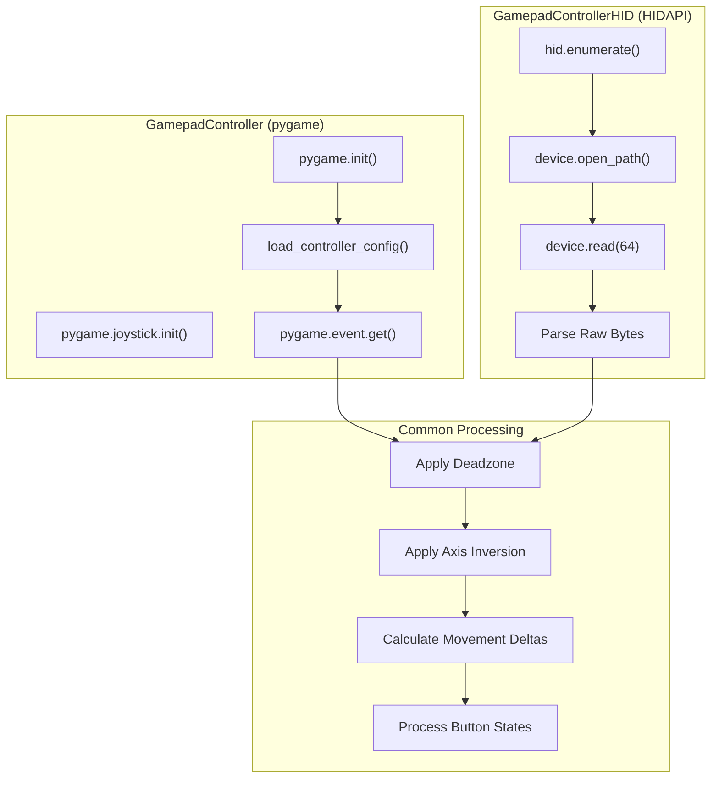
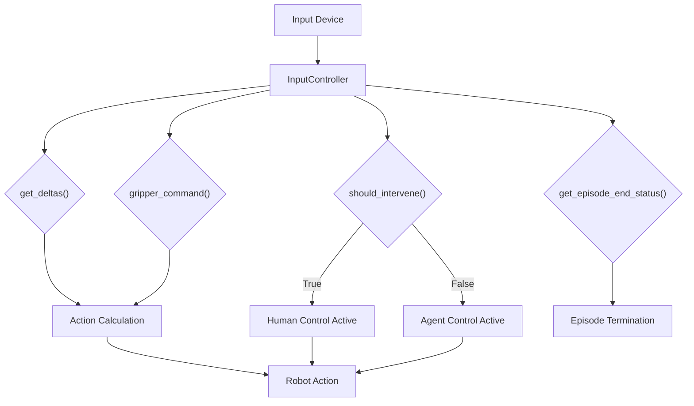

<!-- source: DeepWiki mcp.deepwiki.com · repo huggingface/gym-hil · page 4 Human Input System · fetched 2026-10-26 -->

# Human Input System

Relevant source files

The following files were used as context for generating this wiki page:

- [gym_hil/controller_config.json](gym_hil/controller_config.json)
- [gym_hil/wrappers/intervention_utils.py](gym_hil/wrappers/intervention_utils.py)

The Human Input System provides the core functionality for capturing and processing human input in the gym-hil Human-in-the-Loop Reinforcement Learning framework. This system enables human operators to control the Panda robot through various input devices including keyboard and gamepad controllers, supporting real-time intervention during RL training and teleoperation scenarios.

This document covers the input controller classes, configuration system, and integration mechanisms. For information about how these inputs are processed within the HIL environment wrappers, see [HIL Wrappers](#3.2). For details on the specific input controller implementations, see [Input Controllers](#4.1).

## Controller Architecture

The Human Input System is built around a hierarchical class structure with a base `InputController` class and specialized implementations for different input devices.

### Controller Class Hierarchy

Sources: [gym_hil/wrappers/intervention_utils.py:46-119](), [gym_hil/wrappers/intervention_utils.py:121-244](), [gym_hil/wrappers/intervention_utils.py:246-389](), [gym_hil/wrappers/intervention_utils.py:391-549]()

### Base Controller Interface

The `InputController` base class defines the standard interface for all input controllers, providing common functionality for movement deltas, gripper control, and intervention detection.

| Method | Purpose | Return Type |
|--------|---------|-------------|
| `get_deltas()` | Get current movement deltas (dx, dy, dz) | `tuple[float, float, float]` |
| `should_intervene()` | Check if human intervention is active | `bool` |
| `gripper_command()` | Get current gripper command | `str` ("open", "close", "no-op") |
| `get_episode_end_status()` | Get episode termination status | `str` (None, "success", "failure") |
| `update()` | Process input events | `None` |
| `start()` / `stop()` | Initialize/cleanup resources | `None` |

Sources: [gym_hil/wrappers/intervention_utils.py:79-119]()

## Input Processing Flow

The system processes human input through a standardized pipeline that converts raw input events into robot control commands.

### Input Processing Pipeline

Sources: [gym_hil/wrappers/intervention_utils.py:79-119]()

### Input Event Processing

Each controller type processes input events differently but follows the same general pattern:

1. **Event Capture**: Raw input events are captured from the device
2. **State Update**: Internal state variables are updated based on events
3. **Delta Calculation**: Movement deltas are calculated from current state
4. **Command Generation**: Gripper and intervention commands are generated
5. **Status Reporting**: Episode status and intervention flags are reported

Sources: [gym_hil/wrappers/intervention_utils.py:83-85](), [gym_hil/wrappers/intervention_utils.py:301-341](), [gym_hil/wrappers/intervention_utils.py:475-532]()

## Configuration System

The Human Input System uses a JSON-based configuration system to support different gamepad controllers with varying button and axis mappings.

### Configuration Structure

Sources: [gym_hil/controller_config.json:1-146](), [gym_hil/wrappers/intervention_utils.py:21-43]()

### Configuration Parameters

The configuration system supports three main parameter categories:

| Category | Description | Example |
|----------|-------------|---------|
| `axes` | Maps logical axes to device axis indices | `{"left_x": 0, "left_y": 1}` |
| `buttons` | Maps logical buttons to device button indices | `{"a": 0, "b": 1, "x": 2, "y": 3}` |
| `axis_inversion` | Defines axis inversion settings | `{"left_x": false, "left_y": true}` |

Sources: [gym_hil/controller_config.json:2-25]()

### Supported Controllers

The system includes predefined configurations for common gamepad controllers:

- **Xbox 360 Controller**: Standard Xbox gamepad with specific axis mappings
- **PS4 Controller**: PlayStation 4 DualShock controller
- **Logitech Gamepad F310**: Logitech F310 gamepad
- **Logitech Wireless Gamepad F710**: Logitech F710 wireless gamepad
- **Logitech Cordless RumblePad 2**: Logitech RumblePad 2

Sources: [gym_hil/controller_config.json:26-145]()

## Input Device Integration

The system supports two primary input device types, each with specific integration mechanisms and capabilities.

### Keyboard Controller Integration

Sources: [gym_hil/wrappers/intervention_utils.py:121-244]()

### Gamepad Controller Integration

Sources: [gym_hil/wrappers/intervention_utils.py:257-389](), [gym_hil/wrappers/intervention_utils.py:438-549]()

## Intervention Mechanisms

The Human Input System provides multiple mechanisms for human intervention and control during robot operation.

### Intervention Control Flow

Sources: [gym_hil/wrappers/intervention_utils.py:107-119]()

### Control Command Types

The system supports multiple types of control commands:

| Command Type | Purpose | Implementation |
|--------------|---------|----------------|
| **Movement Deltas** | 3D end-effector movement | `get_deltas()` returns (dx, dy, dz) |
| **Gripper Control** | Open/close gripper | `gripper_command()` returns "open"/"close"/"no-op" |
| **Intervention Flag** | Enable/disable human control | `should_intervene()` returns boolean |
| **Episode Control** | Terminate episodes | `get_episode_end_status()` returns status |

Sources: [gym_hil/wrappers/intervention_utils.py:79-119]()

### Input Command Mapping

Different input devices map to robot commands through device-specific implementations:

**Keyboard Mapping:**
- Arrow keys → X-Y movement deltas
- Shift keys → Z movement deltas  
- Ctrl keys → Gripper control
- Space → Intervention toggle
- Enter/Esc → Episode termination

**Gamepad Mapping:**
- Left analog stick → X-Y movement deltas
- Right analog stick (Y-axis) → Z movement deltas
- Trigger buttons → Gripper control
- Shoulder button → Intervention toggle
- Face buttons → Episode control

Sources: [gym_hil/wrappers/intervention_utils.py:199-207](), [gym_hil/wrappers/intervention_utils.py:280-289]()

---

