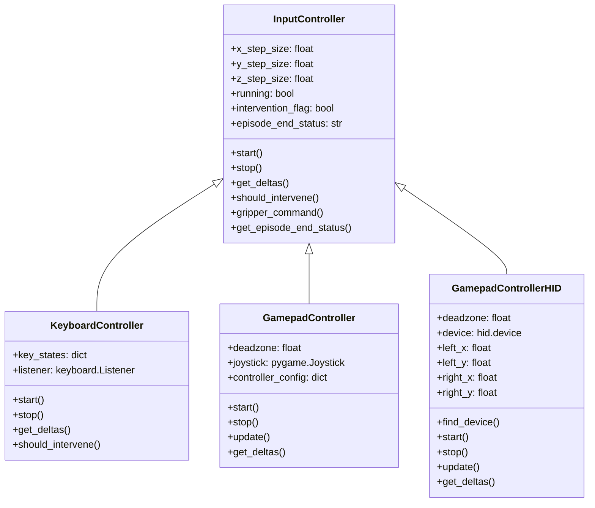
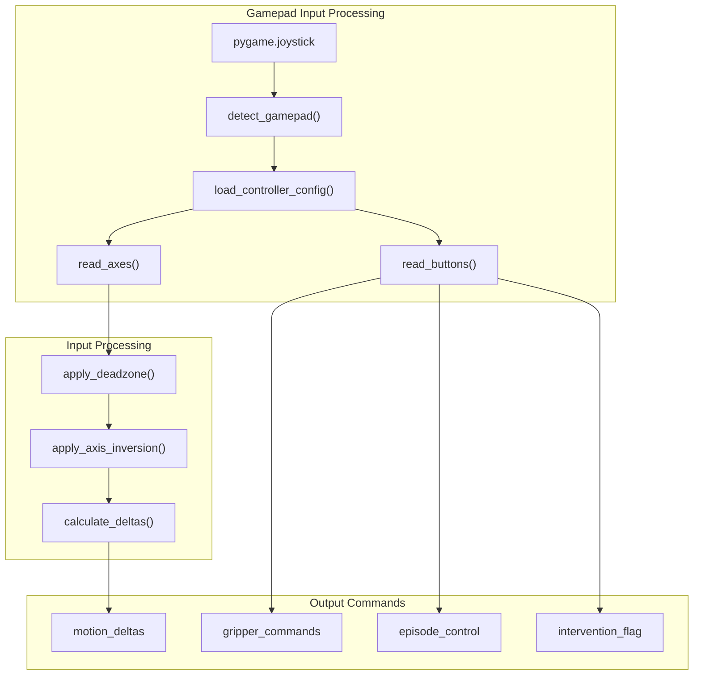
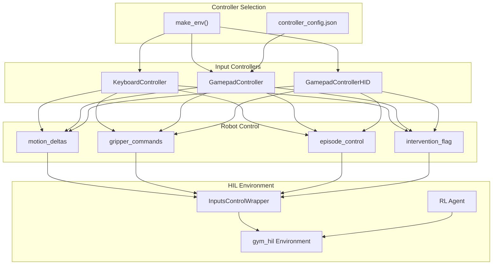

<!-- source: DeepWiki mcp.deepwiki.com · repo huggingface/gym-hil · page 4.1 Input Controllers · fetched 2026-10-26 -->

# Input Controllers

<details>
<summary>Relevant source files</summary>

The following files were used as context for generating this wiki page:

- [gym_hil/wrappers/intervention_utils.py](gym_hil/wrappers/intervention_utils.py)
- [tests/test_intervention_utils.py](tests/test_intervention_utils.py)

</details>


This document covers the input controller system that captures human input from keyboards and gamepads to generate motion deltas for robot control in the HIL (Human-in-the-Loop) system. The input controllers are the primary interface between human operators and the robotic manipulation environments.

For information about the JSON-based controller configuration system, see [Controller Configuration](#4.2). For details on how input controllers integrate with the HIL wrapper system, see [HIL Wrappers](#3.2).

## Overview

The input controller system provides a unified interface for capturing human input from different devices (keyboard, gamepad via pygame, gamepad via HIDAPI) and converting them into standardized motion deltas and control commands for the Panda robot. All controllers implement a common interface defined by the `InputController` base class.

## Controller Architecture

The input controller system follows a hierarchical class structure with a common base class and specialized implementations for different input devices:

**InputController Class Hierarchy**


Sources: [gym_hil/wrappers/intervention_utils.py:46-119](), [gym_hil/wrappers/intervention_utils.py:121-244](), [gym_hil/wrappers/intervention_utils.py:246-389](), [gym_hil/wrappers/intervention_utils.py:391-549]()

## Base InputController Class

The `InputController` class provides the common interface and shared functionality for all input controllers:

| Property | Type | Description |
|----------|------|-------------|
| `x_step_size` | float | Base movement step size in meters for X-axis |
| `y_step_size` | float | Base movement step size in meters for Y-axis |
| `z_step_size` | float | Base movement step size in meters for Z-axis |
| `running` | bool | Controller running state |
| `intervention_flag` | bool | Whether human intervention is active |
| `episode_end_status` | str | Episode termination status ("success", "failure", or None) |

### Key Methods

- `start()`: Initialize controller resources and begin input capture
- `stop()`: Release controller resources and stop input capture
- `get_deltas()`: Return current movement deltas (dx, dy, dz) in meters
- `should_intervene()`: Check if human intervention flag is set
- `gripper_command()`: Return gripper command ("open", "close", "no-op")
- `get_episode_end_status()`: Get episode termination status

Sources: [gym_hil/wrappers/intervention_utils.py:46-119]()

## KeyboardController

The `KeyboardController` uses the `pynput` library to capture keyboard input and convert it to robot motion commands.

### Key Mappings

| Key | Action | Internal State |
|-----|--------|----------------|
| Arrow Up | Move forward (X+) | `key_states["forward_x"]` |
| Arrow Down | Move backward (X-) | `key_states["backward_x"]` |
| Arrow Left | Move left (Y+) | `key_states["forward_y"]` |
| Arrow Right | Move right (Y-) | `key_states["backward_y"]` |
| Left Shift | Move down (Z-) | `key_states["backward_z"]` |
| Right Shift | Move up (Z+) | `key_states["forward_z"]` |
| Left Ctrl | Close gripper | `close_gripper_command` |
| Right Ctrl | Open gripper | `open_gripper_command` |
| Enter | End episode (success) | `episode_end_status = "success"` |
| Escape | End episode (failure) | `episode_end_status = "failure"` |
| Space | Toggle intervention | `key_states["intervention"]` |

### Implementation Details

The keyboard controller uses asynchronous event handling with `pynput.keyboard.Listener` to track key press and release events. Motion deltas are calculated by checking the current state of movement keys and multiplying by the configured step sizes.

Sources: [gym_hil/wrappers/intervention_utils.py:121-244]()

## GamepadController

The `GamepadController` uses `pygame` to interface with gamepad devices and supports configurable button and axis mappings through the controller configuration system.

**GamepadController Data Flow**


Sources: [gym_hil/wrappers/intervention_utils.py:246-389]()

### Gamepad Configuration

The gamepad controller automatically loads configuration based on the detected gamepad name using `load_controller_config()`. The configuration includes:

- **Axes mapping**: Maps physical stick axes to logical movement axes
- **Button mapping**: Maps physical buttons to logical functions
- **Axis inversion**: Allows inverting axis directions for different controllers

### Motion Calculation

Motion deltas are calculated from analog stick positions with deadzone filtering:

```python
# Pseudocode from GamepadController.get_deltas()
x_input = joystick.get_axis(left_x_axis)
y_input = joystick.get_axis(left_y_axis) 
z_input = joystick.get_axis(right_y_axis)

# Apply deadzone
if abs(x_input) < deadzone: x_input = 0
if abs(y_input) < deadzone: y_input = 0  
if abs(z_input) < deadzone: z_input = 0

# Apply axis inversion and calculate deltas
delta_x = y_input * y_step_size  # Forward/backward
delta_y = x_input * x_step_size  # Left/right  
delta_z = z_input * z_step_size  # Up/down
```

Sources: [gym_hil/wrappers/intervention_utils.py:342-389]()

## GamepadControllerHID

The `GamepadControllerHID` provides an alternative gamepad interface using the `hidapi` library for direct HID device access, which can be useful when `pygame` gamepad support is insufficient.

### Device Detection

The HID controller automatically searches for compatible gamepad devices by checking for known manufacturer names in the HID device enumeration:

```python
# Pseudocode from GamepadControllerHID.find_device()
devices = hid.enumerate()
for device in devices:
    if any(name in device["product_string"] for name in ["Logitech", "Xbox", "PS4", "PS5"]):
        return device
```

### Data Processing

The HID controller reads raw byte data from the gamepad and interprets it according to the specific controller protocol. The implementation includes hardcoded byte offsets for the Logitech RumblePad 2 controller:

| Data Byte | Purpose |
|-----------|---------|
| `data[1]` | Left stick X-axis (0-255) |
| `data[2]` | Left stick Y-axis (0-255) |
| `data[3]` | Right stick X-axis (0-255) |
| `data[4]` | Right stick Y-axis (0-255) |
| `data[5]` | Button states (bitfield) |
| `data[6]` | Trigger/shoulder buttons |

### Stability Handling

Due to HIDAPI timing issues, the `update()` method reads the device multiple times per frame to ensure stable readings:

```python
# From GamepadControllerHID.update()
for _ in range(10):
    self._update()
```

Sources: [gym_hil/wrappers/intervention_utils.py:391-549]()

## Controller Integration

**Input Controller System Integration**


Sources: [gym_hil/wrappers/intervention_utils.py:21-43]()

## Testing

The input controller system includes unit tests that verify the controller configuration loading functionality:

- **`test_load_controller_config()`**: Tests loading of default, Xbox, and Logitech controller configurations
- **Configuration validation**: Ensures all required fields (`axes`, `buttons`, `axis_inversion`) are present
- **Fallback behavior**: Verifies that unknown controllers fall back to default configuration

Sources: [tests/test_intervention_utils.py:20-54]()

---

