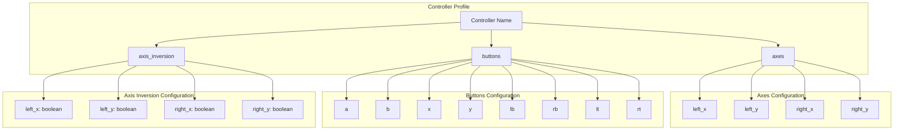
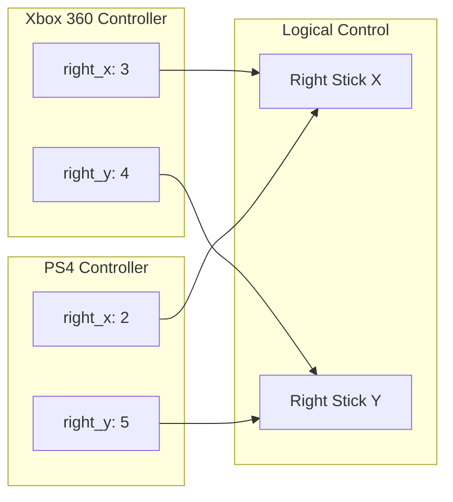
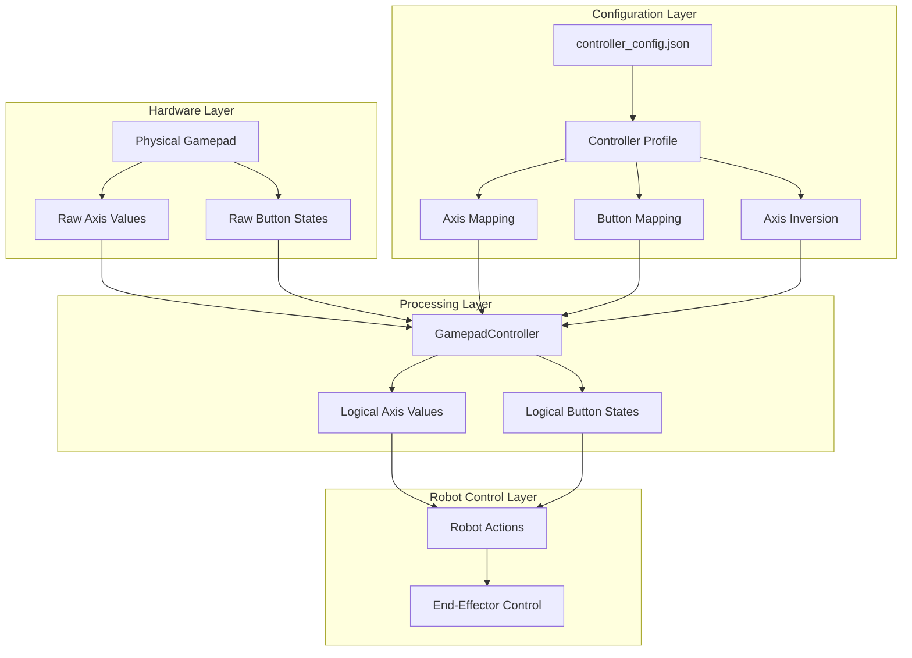

<!-- source: DeepWiki mcp.deepwiki.com · repo huggingface/gym-hil · page 4.2 Controller Configuration · fetched 2026-10-26 -->

# Controller Configuration

<details>
<summary>Relevant source files</summary>

The following files were used as context for generating this wiki page:

- [gym_hil/controller_config.json](gym_hil/controller_config.json)

</details>


This document describes the JSON-based controller configuration system used in gym-hil to map gamepad inputs to robot control actions. The configuration enables support for multiple gamepad types by providing device-specific mappings between hardware input indices and standardized logical control names.

For information about the actual controller classes that use these configurations, see [Input Controllers](#4.1). For details about how these inputs are processed into robot actions, see [HIL Wrappers](#3.2).

## Purpose and Scope

The controller configuration system provides a standardized interface for different gamepad hardware by mapping device-specific button and axis indices to consistent logical names. This allows the same robot control logic to work across different gamepad models without code changes.

## Configuration File Structure

The controller configuration is stored in [gym_hil/controller_config.json:1-146](). The file contains a JSON object where each key represents a controller profile name, and each value defines the input mappings for that controller type.

### Configuration Schema

Each controller profile contains three main sections:



Sources: [gym_hil/controller_config.json:1-146]()

## Controller Profiles

The configuration file includes profiles for commonly used gamepad controllers:

| Controller Name | Purpose |
|-----------------|---------|
| `default` | Fallback configuration for unknown controllers |
| `Xbox 360 Controller` | Microsoft Xbox 360 wired/wireless controller |
| `PS4 Controller` | Sony PlayStation 4 DualShock controller |
| `Logitech Gamepad F310` | Logitech F310 wired gamepad |
| `Logitech Wireless Gamepad F710` | Logitech F710 wireless gamepad |
| `Logitech Cordless RumblePad 2` | Logitech RumblePad 2 wireless controller |

### Default Profile

The `default` profile serves as a fallback when the connected controller is not recognized:

```json
{
  "default": {
    "axes": {
      "left_x": 0,
      "left_y": 1,
      "right_x": 2,
      "right_y": 3
    },
    "buttons": {
      "a": 0,
      "b": 1,
      "x": 2,
      "y": 3,
      "lb": 4,
      "rb": 5,
      "lt": 6,
      "rt": 7
    },
    "axis_inversion": {
      "left_x": false,
      "left_y": true,
      "right_x": false,
      "right_y": true
    }
  }
}
```

Sources: [gym_hil/controller_config.json:2-25]()

## Axis and Button Mappings

### Axis Mappings

The `axes` section maps logical axis names to hardware axis indices:

- `left_x`: Left analog stick horizontal axis
- `left_y`: Left analog stick vertical axis  
- `right_x`: Right analog stick horizontal axis
- `right_y`: Right analog stick vertical axis

### Button Mappings

The `buttons` section maps logical button names to hardware button indices:

- `a`, `b`, `x`, `y`: Face buttons (layout varies by controller)
- `lb`, `rb`: Left and right shoulder buttons
- `lt`, `rt`: Left and right trigger buttons

### Hardware Variation Example

Different controllers use different hardware indices for the same logical controls:



Sources: [gym_hil/controller_config.json:32-55]()

## Axis Inversion

The `axis_inversion` section controls whether axis values should be inverted (multiplied by -1) to match expected robot control directions. This compensates for differences in axis orientation between controller hardware and the robot coordinate system.

### Inversion Patterns

Common inversion patterns by controller type:

| Controller | left_x | left_y | right_x | right_y |
|------------|--------|--------|---------|---------|
| Default | false | true | false | true |
| Xbox 360 | true | true | true | true |
| PS4 | false | true | false | true |
| Logitech F310 | false | true | false | true |

### Y-Axis Inversion

Most controllers invert the Y-axis by default because:
- Gamepad Y-axis: up = negative, down = positive
- Robot control expectation: up = positive, down = negative

Sources: [gym_hil/controller_config.json:19-24](), [gym_hil/controller_config.json:43-48](), [gym_hil/controller_config.json:67-72]()

## Input Processing Flow

The configuration enables a standardized input processing pipeline:



Sources: [gym_hil/controller_config.json:1-146]()

## Adding New Controllers

To add support for a new controller type:

1. **Identify the controller name** as reported by the system
2. **Determine axis indices** by testing each analog stick
3. **Map button indices** by testing each button
4. **Test axis directions** to determine inversion requirements
5. **Add configuration entry** to the JSON file

### Example Configuration Entry

```json
{
  "New Controller Name": {
    "axes": {
      "left_x": 0,
      "left_y": 1,
      "right_x": 2,
      "right_y": 3
    },
    "buttons": {
      "a": 0,
      "b": 1,
      "x": 2,
      "y": 3,
      "lb": 4,
      "rb": 5,
      "lt": 6,
      "rt": 7
    },
    "axis_inversion": {
      "left_x": false,
      "left_y": true,
      "right_x": false,
      "right_y": true
    }
  }
}
```

### Configuration Validation

The configuration should be validated by:
- Testing all axis movements produce expected robot motion
- Verifying all buttons trigger correct actions
- Confirming axis inversion produces natural control feel

Sources: [gym_hil/controller_config.json:1-146]()

---

