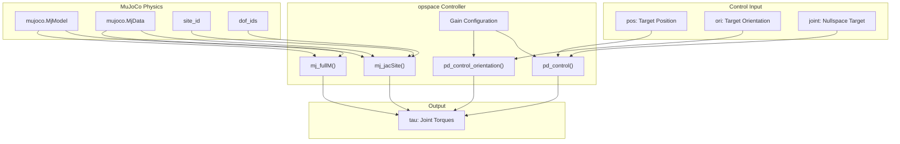
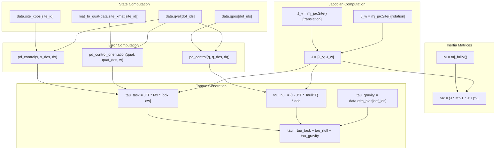

<!-- source: DeepWiki mcp.deepwiki.com · repo huggingface/gym-hil · page 5 Robot Control · fetched 2026-10-26 -->

# Robot Control

<details>
<summary>Relevant source files</summary>

The following files were used as context for generating this wiki page:

- [gym_hil/controllers/opspace.py](gym_hil/controllers/opspace.py)
- [poetry.lock](poetry.lock)

</details>


This document covers the low-level robot control systems in gym-hil, specifically focusing on operational space control algorithms that convert end-effector commands to joint torques using MuJoCo physics simulation. For information about high-level environment wrappers and human input handling, see [HIL Wrappers](#3.2). For details about the complete MuJoCo environment architecture, see [Base Environments](#3.1).

## Control Architecture Overview

The robot control system implements operational space control to enable precise end-effector motion control while handling joint-space redundancy. The control pipeline transforms Cartesian space commands into joint torques through inverse dynamics computation.



Sources: [gym_hil/controllers/opspace.py:176-288]()

## Operational Space Control Implementation

The core control function `opspace()` implements operational space control with position, orientation, and nullspace joint control capabilities.

### Function Signature and Parameters

The `opspace()` function accepts position, orientation, and joint targets along with configurable gains:

| Parameter | Type | Default | Description |
|-----------|------|---------|-------------|
| `pos` | `np.ndarray` | Current position | Target end-effector position |
| `ori` | `np.ndarray` | Current orientation | Target orientation (matrix or quaternion) |
| `joint` | `np.ndarray` | Current joint angles | Nullspace joint configuration |
| `pos_gains` | `tuple/array` | `(200, 200, 200)` | Position control gains |
| `ori_gains` | `tuple/array` | `(200, 200, 200)` | Orientation control gains |
| `damping_ratio` | `float` | `1.0` | Damping coefficient |
| `nullspace_stiffness` | `float` | `0.5` | Joint nullspace stiffness |

Sources: [gym_hil/controllers/opspace.py:176-191]()

### Control Algorithm Flow

The operational space control algorithm follows these computational steps:



Sources: [gym_hil/controllers/opspace.py:218-287]()

The algorithm computes task-space forces using PD control, projects them into joint space via the Jacobian transpose, and adds nullspace joint control for redundant degrees of freedom.

## Quaternion and Rotation Utilities

The control system includes comprehensive quaternion and rotation matrix utilities for orientation control.

### Matrix to Quaternion Conversion

The `mat_to_quat()` function converts 3x3 rotation matrices to quaternions using a numerically stable algorithm that handles different cases based on the matrix trace:

```python
def mat_to_quat(mat: np.ndarray) -> np.ndarray:
    """Convert a 3x3 rotation matrix to a quaternion.
    Returns: Quaternion as [w, x, y, z]
    """
```

The implementation avoids numerical instabilities by selecting the largest diagonal element for computation.

Sources: [gym_hil/controllers/opspace.py:23-59]()

### Quaternion Operations

The system provides specialized quaternion operations for orientation control:

- `quat_diff_active()`: Computes quaternion difference for orientation error calculation
- `quat_to_axisangle()`: Converts quaternions to axis-angle representation for PD control

These functions enable smooth orientation control by working in the quaternion space and converting to axis-angle for linear control laws.

Sources: [gym_hil/controllers/opspace.py:62-123]()

## PD Control Algorithms

The control system implements separate PD controllers for position and orientation with acceleration limiting capabilities.

### Position Control

The `pd_control()` function implements standard PD control with optional acceleration limiting:

```python
def pd_control(x, x_des, dx, kp_kv, ddx_max=0.0):
    x_err = x - x_des
    dx_err = dx
    x_err *= -kp_kv[:, 0]  # Apply kp gains
    dx_err *= -kp_kv[:, 1]  # Apply kd gains
    return x_err + dx_err
```

### Orientation Control

The `pd_control_orientation()` function handles orientation control using quaternion error computation:

- Computes quaternion error using `quat_diff_active()`
- Converts to axis-angle representation via `quat_to_axisangle()`
- Applies PD gains to orientation and angular velocity errors
- Supports angular acceleration limiting through `dw_max`

Sources: [gym_hil/controllers/opspace.py:125-174]()

## MuJoCo Integration

The operational space controller integrates tightly with MuJoCo's physics engine through specific API calls and data structures.

### Key MuJoCo Functions

| Function | Purpose | Usage in Controller |
|----------|---------|-------------------|
| `mj_jacSite()` | Compute site Jacobian | End-effector velocity mapping |
| `mj_fullM()` | Compute inertia matrix | Joint-space dynamics |
| `data.site_xpos` | Site position | Current end-effector position |
| `data.site_xmat` | Site orientation matrix | Current end-effector orientation |
| `data.qfrc_bias` | Bias forces | Gravity compensation |

### Required Data Elements

The controller operates on specific MuJoCo model and data elements:

- `site_id`: MuJoCo site identifier for the end-effector
- `dof_ids`: Array of joint degree-of-freedom indices  
- `model.nv`: Total number of velocity coordinates
- `data.qpos`, `data.qvel`: Joint positions and velocities

Sources: [gym_hil/controllers/opspace.py:176-287]()

## Control Performance Features

The operational space controller includes several advanced features for performance and stability.

### Nullspace Projection

For redundant manipulators like the Panda robot, the controller projects joint-space control into the nullspace of the task-space Jacobian:

```
tau_nullspace = (I - J^T * J_null^T) * tau_joint
```

This allows simultaneous task and joint control without conflicts, enabling posture control while tracking end-effector trajectories.

### Gravity Compensation

When `gravity_comp=True`, the controller adds gravitational and other bias forces:

```python
if gravity_comp:
    tau += data.qfrc_bias[dof_ids]
```

### Acceleration Limiting

The system supports limiting maximum accelerations through `max_pos_acceleration` and `max_ori_acceleration` parameters, ensuring safe operation by preventing excessive control forces.

### Inertia Matrix Conditioning

The controller handles singular configurations by using pseudo-inverse when the task-space inertia matrix becomes poorly conditioned:

```python
Mx = np.linalg.inv(Mx_inv) if abs(np.linalg.det(Mx_inv)) >= 1e-2 else np.linalg.pinv(Mx_inv, rcond=1e-2)
```

Sources: [gym_hil/controllers/opspace.py:268-287]()

---

