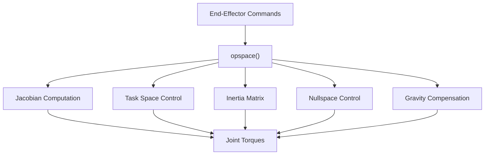
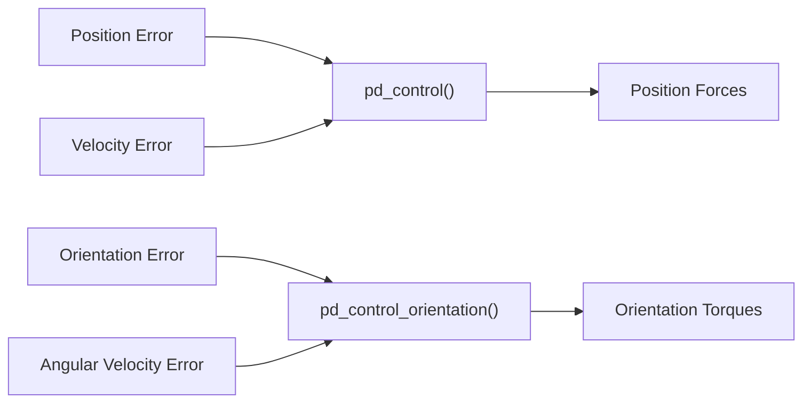
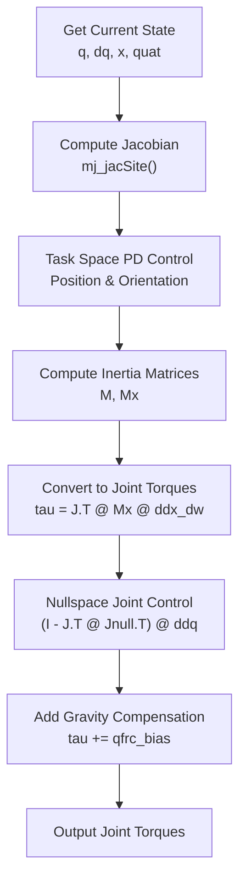
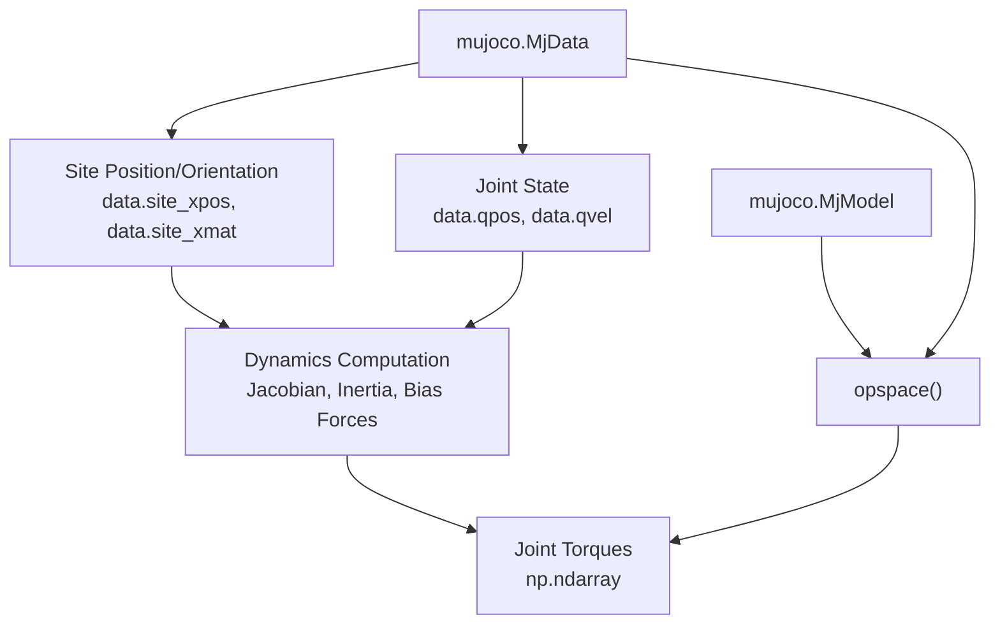

<!-- source: DeepWiki mcp.deepwiki.com · repo huggingface/gym-hil · page 5.1 Operational Space Control · fetched 2026-10-26 -->

# Operational Space Control

<details>
<summary>Relevant source files</summary>

The following files were used as context for generating this wiki page:

- [gym_hil/controllers/opspace.py](gym_hil/controllers/opspace.py)
- [poetry.lock](poetry.lock)

</details>


## Purpose and Scope

This document explains the operational space control system in gym-hil, which provides low-level robot control that converts end-effector position and orientation commands into joint torques for the Panda robot. The system uses MuJoCo physics simulation to compute dynamics and implement task-space control with nullspace optimization.

For information about the higher-level environment integration, see [Base Environments](#3.1). For details about human input processing that generates the commands sent to this controller, see [Input Controllers](#4.1).

## Overview

Operational space control allows precise control of a robot's end-effector in Cartesian coordinates while maintaining joint-level constraints and gravity compensation. The system transforms desired end-effector motions into appropriate joint torques using the robot's dynamics model.

### Control Flow Architecture



Sources: [gym_hil/controllers/opspace.py:176-287]()

## Core Components

### Quaternion Mathematics

The system uses quaternions for robust orientation representation and control. Key utility functions handle quaternion operations:

| Function | Purpose | Input | Output |
|----------|---------|-------|--------|
| `mat_to_quat` | Convert rotation matrix to quaternion | 3x3 rotation matrix | Quaternion [w,x,y,z] |
| `quat_diff_active` | Compute rotation difference | Source & target quaternions | Difference quaternion |
| `quat_to_axisangle` | Convert to axis-angle | Quaternion [w,x,y,z] | Axis-angle vector |

The quaternion difference computation uses the formula: `q_diff = q_target * q_source^(-1)`, where the inverse of a unit quaternion is its conjugate.

Sources: [gym_hil/controllers/opspace.py:23-123]()

### PD Control Implementation

The system implements proportional-derivative control for both position and orientation:



The `pd_control` function applies gains and optional acceleration limits:
- Position error: `x_err = -(x - x_des) * kp`
- Velocity damping: `dx_err = -dx * kv`
- Combined output: `ddx = x_err + dx_err`

Sources: [gym_hil/controllers/opspace.py:125-174]()

## Main Control Algorithm

### Function Signature and Parameters

The `opspace` function implements the complete operational space control algorithm:

```python
opspace(
    model,                    # MuJoCo model
    data,                     # MuJoCo data
    site_id,                  # End-effector site ID
    dof_ids: np.ndarray,      # Controlled joint indices
    pos: Optional[np.ndarray] = None,           # Target position
    ori: Optional[np.ndarray] = None,           # Target orientation
    joint: Optional[np.ndarray] = None,         # Target joint angles
    pos_gains: Union[Tuple, np.ndarray] = (200.0, 200.0, 200.0),
    ori_gains: Union[Tuple, np.ndarray] = (200.0, 200.0, 200.0),
    damping_ratio: float = 1.0,
    nullspace_stiffness: float = 0.5,
    max_pos_acceleration: Optional[float] = None,
    max_ori_acceleration: Optional[float] = None,
    gravity_comp: bool = True,
) -> np.ndarray
```

Sources: [gym_hil/controllers/opspace.py:176-191]()

### Control Algorithm Steps



Sources: [gym_hil/controllers/opspace.py:218-287]()

### Key Algorithm Components

**Jacobian Computation**: Uses MuJoCo's `mj_jacSite` to compute the 6x7 Jacobian matrix mapping joint velocities to end-effector linear and angular velocities.

**Inertia Matrix Computation**: 
- Joint space: `M` computed via `mj_fullM`
- Task space: `Mx = inv(J @ inv(M) @ J.T)`
- Uses pseudoinverse when determinant is small (< 1e-2)

**Task Space Control**:
- Position control: `ddx = pd_control(x, x_des, dx, kp_kv_pos)`
- Orientation control: `dw = pd_control_orientation(quat, quat_des, w, kp_kv_ori)`
- Combined: `ddx_dw = [ddx; dw]`

**Nullspace Projection**:
- Joint control: `ddq = pd_control(q, q_des, dq, kp_kv_joint)`  
- Projection: `(I - J.T @ Jnull.T) @ ddq`
- Where `Jnull = inv(M) @ J.T @ Mx`

Sources: [gym_hil/controllers/opspace.py:222-287]()

## Integration with MuJoCo Physics

### MuJoCo API Usage

The controller integrates tightly with MuJoCo's physics simulation:

| MuJoCo Function | Purpose | Usage in Controller |
|-----------------|---------|-------------------|
| `mj_jacSite` | Compute site Jacobian | Get end-effector velocity mapping |
| `mj_fullM` | Get full inertia matrix | Compute joint space dynamics |
| `data.site_xpos` | Site position | Current end-effector position |
| `data.site_xmat` | Site rotation matrix | Current end-effector orientation |
| `data.qfrc_bias` | Gravity/Coriolis forces | Gravity compensation |

### Data Flow with Physics Simulation



Sources: [gym_hil/controllers/opspace.py:192-287]()

## Control Parameters and Tuning

### Gain Configuration

The controller accepts separate gains for position and orientation control:

- **Position gains**: `pos_gains` - 3-element array for x, y, z stiffness (default: 200.0)
- **Orientation gains**: `ori_gains` - 3-element array for roll, pitch, yaw stiffness (default: 200.0) 
- **Damping ratio**: `damping_ratio` - Critical damping coefficient (default: 1.0)
- **Nullspace stiffness**: `nullspace_stiffness` - Joint space control gain (default: 0.5)

Damping coefficients are automatically computed as: `kd = damping_ratio * 2 * sqrt(kp)`

### Acceleration Limits

Optional acceleration limits prevent excessive control effort:
- `max_pos_acceleration` - Maximum linear acceleration magnitude
- `max_ori_acceleration` - Maximum angular acceleration magnitude

When limits are exceeded, the error signals are scaled proportionally to maintain direction while respecting bounds.

Sources: [gym_hil/controllers/opspace.py:184-217]()

## Error Handling and Robustness

### Numerical Stability

The controller includes several measures for numerical robustness:

1. **Quaternion normalization** in `quat_to_axisangle` to handle floating-point drift
2. **Small angle handling** when converting quaternions to axis-angle representation  
3. **Pseudoinverse fallback** when task space inertia matrix becomes singular
4. **Quaternion sign correction** to ensure shortest rotation path

### Singularity Handling

When the task space inertia matrix `Mx_inv` has determinant < 1e-2, the system uses `np.linalg.pinv` with rcond=1e-2 instead of direct inversion, providing graceful degradation near kinematic singularities.

Sources: [gym_hil/controllers/opspace.py:100-102](), [gym_hil/controllers/opspace.py:268](), [gym_hil/controllers/opspace.py:249-250]()

---

