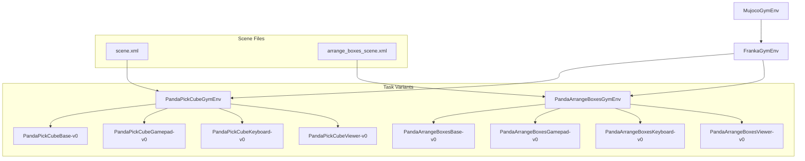
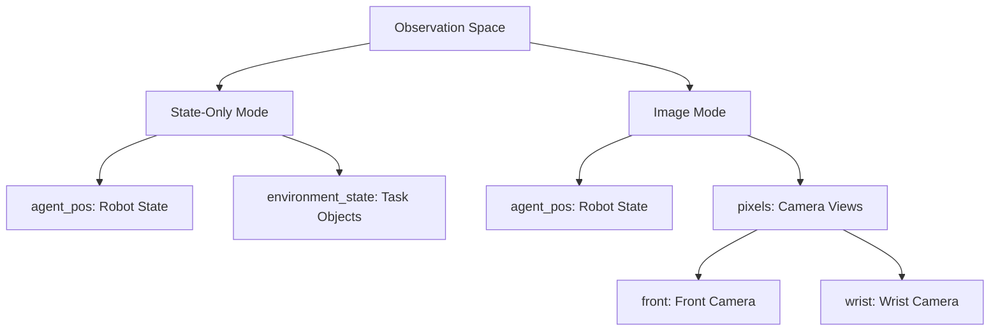
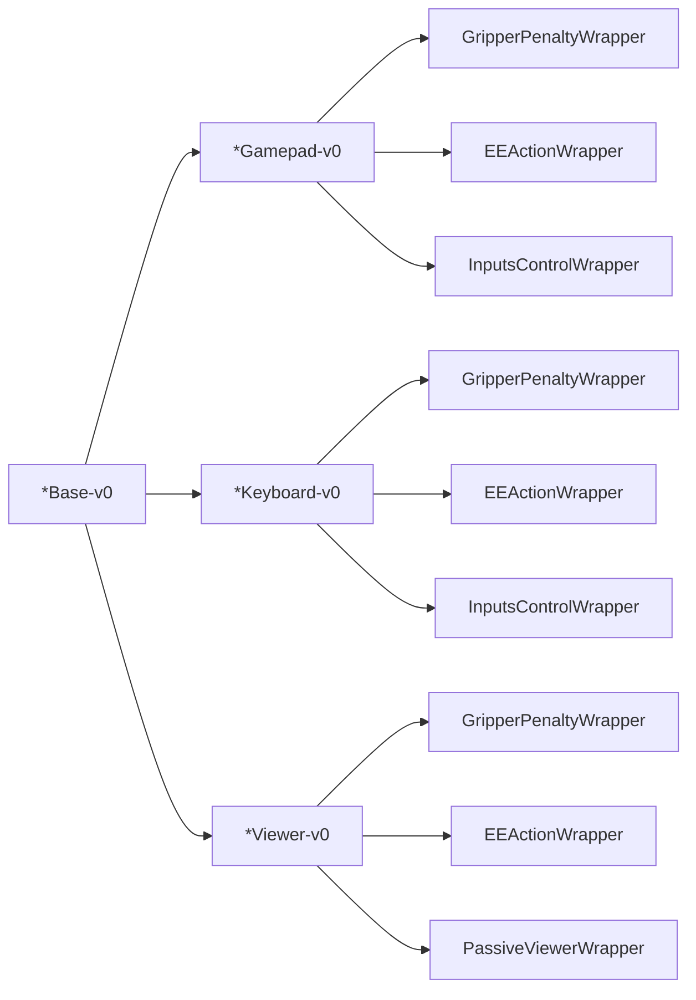
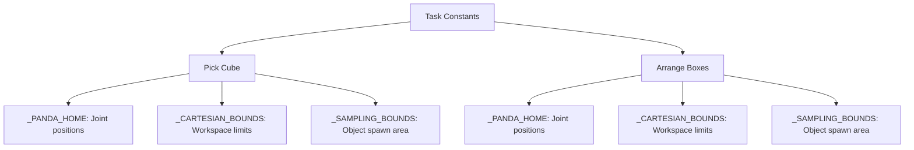

<!-- source: DeepWiki mcp.deepwiki.com · repo huggingface/gym-hil · page 6 Task Environments · fetched 2026-10-26 -->

# Task Environments

Relevant source files

The following files were used as context for generating this wiki page:

- [examples/test_arrangeboxes.py](examples/test_arrangeboxes.py)
- [gym_hil/assets/arrange_boxes_scene.xml](gym_hil/assets/arrange_boxes_scene.xml)
- [gym_hil/envs/panda_arrange_boxes_gym_env.py](gym_hil/envs/panda_arrange_boxes_gym_env.py)
- [gym_hil/envs/panda_pick_gym_env.py](gym_hil/envs/panda_pick_gym_env.py)
- [gym_hil/mujoco_gym_env.py](gym_hil/mujoco_gym_env.py)
- [gym_hil/wrappers/viewer_wrapper.py](gym_hil/wrappers/viewer_wrapper.py)

This document provides an overview of the specific robotic manipulation task environments available in gym-hil. These environments implement concrete manipulation tasks for the Panda robot using MuJoCo physics simulation.

For detailed implementation of the base environment classes and inheritance hierarchy, see [Base Environments](#3.1). For information about environment registration and factory functions, see [Environment Factory](#3.3). Detailed documentation of individual task environments can be found in [Panda Pick Cube](#6.1) and [Panda Arrange Boxes](#6.2).

## Architecture Overview

The task environments follow a clear inheritance hierarchy built on top of the base MuJoCo and Franka environment classes:

Sources: [gym_hil/envs/panda_pick_gym_env.py:30-31](), [gym_hil/envs/panda_arrange_boxes_gym_env.py:17-18](), [gym_hil/mujoco_gym_env.py:117-118]()

## Available Task Environments

gym-hil currently provides two main manipulation task environments:

| Environment Class | Task Description | Scene File | Success Criteria |
|-------------------|------------------|------------|------------------|
| `PandaPickCubeGymEnv` | Pick up a single cube and lift it | `scene.xml` | Cube lifted 0.1m above initial position |
| `PandaArrangeBoxesGymEnv` | Arrange multiple colored boxes to target positions | `arrange_boxes_scene.xml` | All boxes within 0.03m of targets |

## Common Environment Features

All task environments share several common features inherited from `FrankaGymEnv`:

### Observation Spaces

Sources: [gym_hil/envs/panda_pick_gym_env.py:61-99](), [gym_hil/envs/panda_arrange_boxes_gym_env.py:47-87]()

### Action Space
All environments use a 7-dimensional continuous action space:
- **Position delta**: `[x, y, z]` - End-effector position changes
- **Rotation delta**: `[rx, ry, rz]` - End-effector orientation changes  
- **Gripper command**: `[grasp]` - Gripper open/close control

Sources: [gym_hil/mujoco_gym_env.py:212-218]()

### Reward Types
Both environments support two reward computation modes:
- **Sparse**: Binary reward (0 or 1) based on task completion
- **Dense**: Continuous reward based on distance to goal and intermediate progress

Sources: [gym_hil/envs/panda_pick_gym_env.py:177-191](), [gym_hil/envs/panda_arrange_boxes_gym_env.py:180-192]()

## Environment Registration and Variants

Each task environment is registered with multiple variants that apply different wrapper combinations:

### Environment Registration Pattern

Sources: [gym_hil/__init__.py]()

### Variant Descriptions
- **Base**: Raw environment without HIL wrappers
- **Gamepad**: Configured for gamepad human input control
- **Keyboard**: Configured for keyboard human input control  
- **Viewer**: Includes passive MuJoCo viewer for visualization

## Scene Configuration

### Pick Cube Scene
The cube picking task uses a simple scene with:
- Single cube object with `block` joint and `block_pos` sensor
- Panda robot with standard configuration
- Front and wrist cameras for observation

### Arrange Boxes Scene  
The box arrangement task uses a more complex scene with:
- Five colored boxes (`block1`-`block5`) with individual joints and sensors
- Five target positions (`target1`-`target5`) with matching colors
- Extended workspace bounds to accommodate multiple objects

Sources: [gym_hil/assets/scene.xml](), [gym_hil/assets/arrange_boxes_scene.xml:1-106]()

## Implementation Details

### Task-Specific Constants
Each environment defines task-specific parameters:

Sources: [gym_hil/envs/panda_pick_gym_env.py:25-28](), [gym_hil/envs/panda_arrange_boxes_gym_env.py:12-14]()

### Core Methods
Each task environment implements the standard Gymnasium interface:
- `reset()`: Initialize episode, reset robot, randomize object positions
- `step()`: Apply action, compute observation/reward, check termination
- `_compute_observation()`: Generate observation dict matching observation space
- `_compute_reward()`: Calculate reward based on task progress
- `_is_success()`: Determine if task completion criteria are met

Sources: [gym_hil/envs/panda_pick_gym_env.py:101-199](), [gym_hil/envs/panda_arrange_boxes_gym_env.py:96-202]()

---

