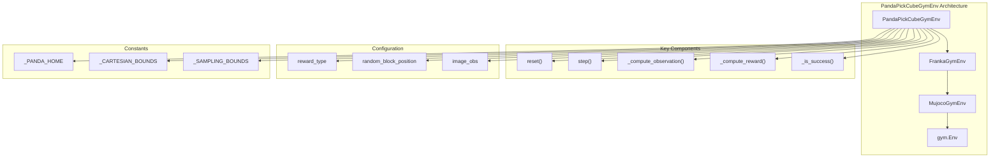
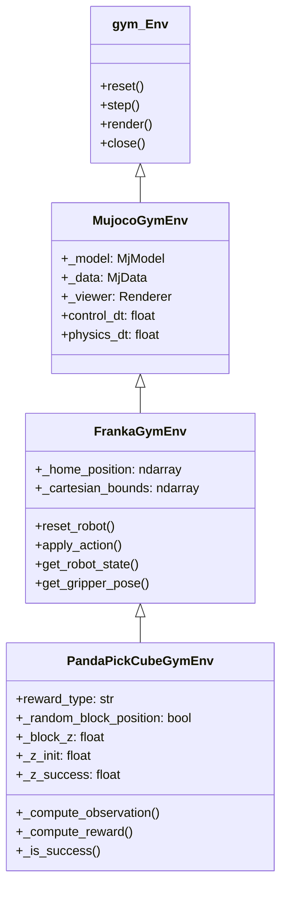
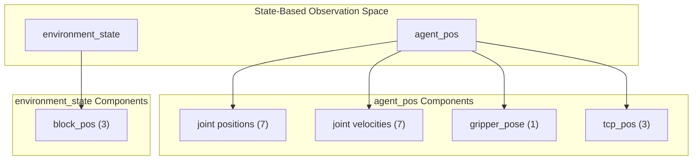
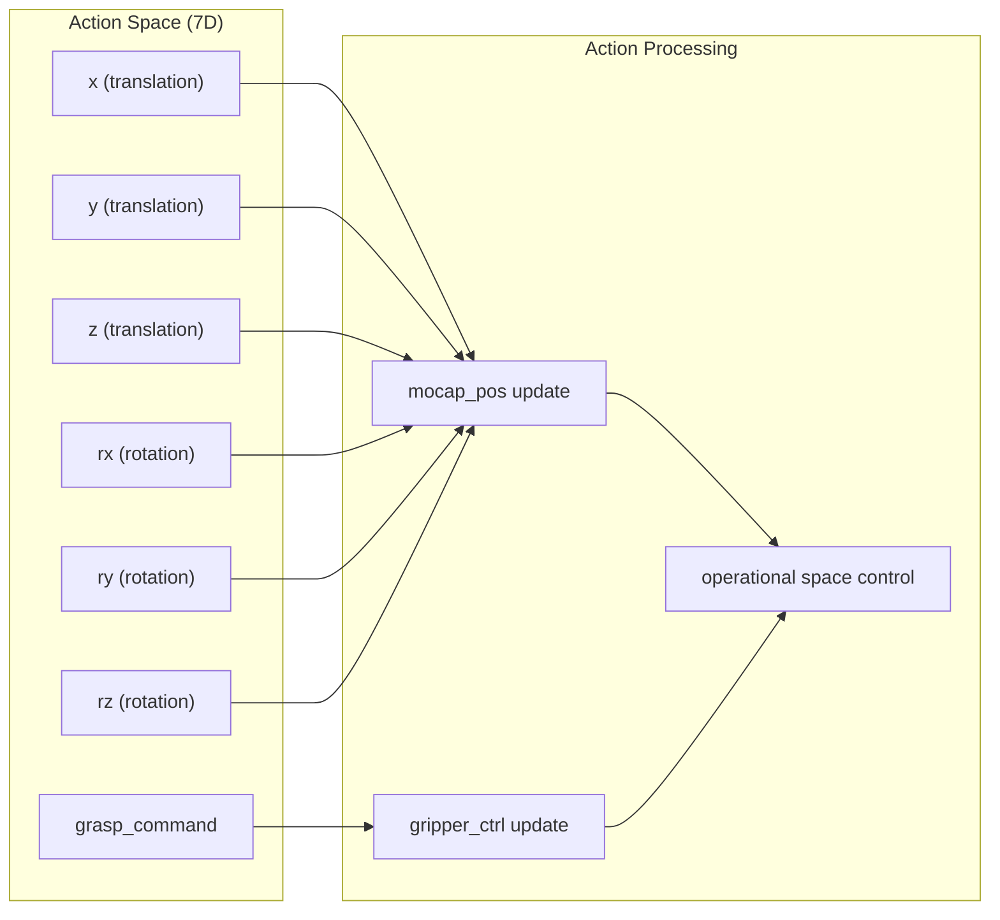
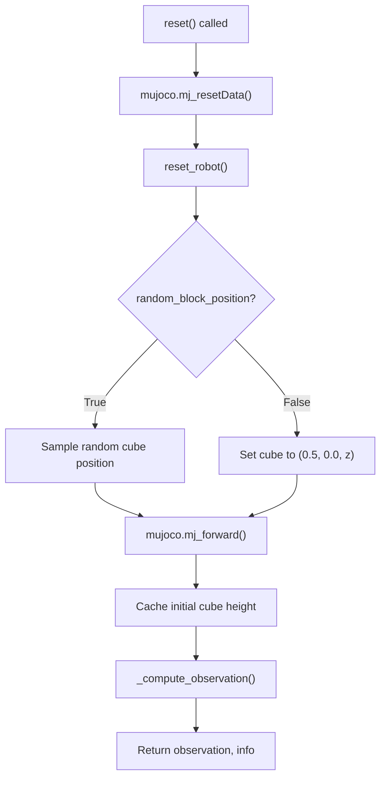
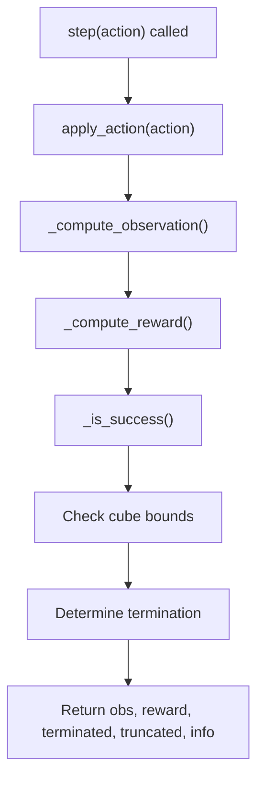
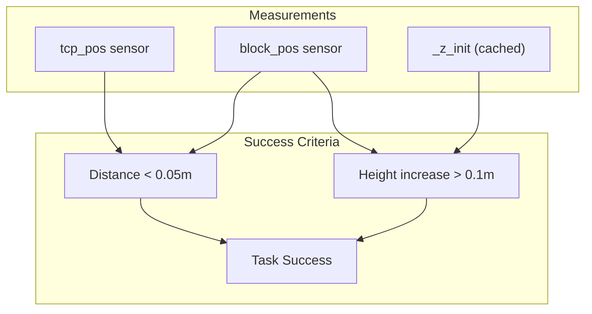

<!-- source: DeepWiki mcp.deepwiki.com · repo huggingface/gym-hil · page 6.1 Panda Pick Cube · fetched 2026-10-26 -->

# Panda Pick Cube

<details>
<summary>Relevant source files</summary>

The following files were used as context for generating this wiki page:

- [gym_hil/envs/panda_pick_gym_env.py](gym_hil/envs/panda_pick_gym_env.py)
- [gym_hil/mujoco_gym_env.py](gym_hil/mujoco_gym_env.py)
- [gym_hil/wrappers/viewer_wrapper.py](gym_hil/wrappers/viewer_wrapper.py)

</details>


This page documents the `PandaPickCubeGymEnv` environment, which implements a robotic manipulation task where a Panda robot arm must pick up a cube. This is one of the fundamental task environments in the gym-hil system for Human-in-the-Loop reinforcement learning.

For information about the base environment architecture and robot control systems, see [Base Environments](#3.1) and [Robot Control](#5). For details on wrapper systems that add HIL functionality, see [HIL Wrappers](#3.2).

## Environment Overview

The `PandaPickCubeGymEnv` class implements a cube-picking task using the Franka Emika Panda robot arm in MuJoCo simulation. The environment provides both sparse and dense reward formulations and supports both state-based and image-based observations.



Sources: [gym_hil/envs/panda_pick_gym_env.py:30-31](), [gym_hil/mujoco_gym_env.py:117-118]()

## Class Hierarchy and Inheritance

The `PandaPickCubeGymEnv` inherits from `FrankaGymEnv`, which provides base Panda robot functionality, operational space control, and MuJoCo integration.



Sources: [gym_hil/envs/panda_pick_gym_env.py:30](), [gym_hil/mujoco_gym_env.py:39](), [gym_hil/mujoco_gym_env.py:117]()

## Environment Configuration

### Constructor Parameters

The environment accepts several key configuration parameters:

| Parameter | Type | Default | Description |
|-----------|------|---------|-------------|
| `reward_type` | `str` | `"sparse"` | Reward formulation: "sparse" or "dense" |
| `random_block_position` | `bool` | `False` | Whether to randomize cube placement |
| `image_obs` | `bool` | `False` | Include camera observations |
| `control_dt` | `float` | `0.1` | Control timestep |
| `physics_dt` | `float` | `0.002` | Physics timestep |

Sources: [gym_hil/envs/panda_pick_gym_env.py:33-43]()

### Environment Constants

The environment defines several key constants that control the robot and task setup:

```python
_PANDA_HOME = np.asarray((0, 0.195, 0, -2.43, 0, 2.62, 0.785))
_CARTESIAN_BOUNDS = np.asarray([[0.2, -0.3, 0], [0.6, 0.3, 0.5]])
_SAMPLING_BOUNDS = np.asarray([[0.3, -0.15], [0.5, 0.15]])
```

- `_PANDA_HOME`: Joint configuration for robot home position
- `_CARTESIAN_BOUNDS`: Workspace bounds for end-effector movement
- `_SAMPLING_BOUNDS`: XY bounds for cube placement

Sources: [gym_hil/envs/panda_pick_gym_env.py:25-27]()

## Observation Space

The environment provides two observation space configurations depending on the `image_obs` parameter:

### State-Based Observations

When `image_obs=False`, the observation space contains:



Sources: [gym_hil/envs/panda_pick_gym_env.py:94-99](), [gym_hil/envs/panda_pick_gym_env.py:169-174]()

### Image-Based Observations

When `image_obs=True`, the observation space includes camera views:

- `pixels`: Dictionary containing "front" and "wrist" camera views
- `agent_pos`: Robot state information (same as state-based)

Sources: [gym_hil/envs/panda_pick_gym_env.py:72-92](), [gym_hil/envs/panda_pick_gym_env.py:161-168]()

## Action Space

The environment uses a 7-dimensional continuous action space:



All action values are normalized to the range [-1, 1]. The first 6 dimensions control end-effector pose, and the 7th dimension controls gripper opening/closing.

Sources: [gym_hil/mujoco_gym_env.py:214-218](), [gym_hil/mujoco_gym_env.py:230-258]()

## Environment Dynamics

### Reset Procedure

The `reset()` method initializes the environment state:



Sources: [gym_hil/envs/panda_pick_gym_env.py:101-125]()

### Step Execution

The `step()` method processes actions and updates the environment:



Sources: [gym_hil/envs/panda_pick_gym_env.py:127-148]()

## Reward Function

The environment supports two reward formulations:

### Dense Reward

The dense reward combines approach and lifting components:

```
r_close = exp(-20 * distance_to_cube)
r_lift = (current_height - initial_height) / (success_height - initial_height)
reward = 0.3 * r_close + 0.7 * r_lift
```

### Sparse Reward

The sparse reward provides binary feedback:

```
reward = 1.0 if cube_lifted > 0.1m else 0.0
```

Sources: [gym_hil/envs/panda_pick_gym_env.py:177-191]()

## Success Criteria

The task is considered successful when both conditions are met:

1. **Proximity**: Distance between end-effector and cube < 0.05m
2. **Lifting**: Cube height increase > 0.1m



Sources: [gym_hil/envs/panda_pick_gym_env.py:192-198]()

## Termination Conditions

The environment terminates when:

1. **Success**: Task completion criteria are met
2. **Bounds violation**: Cube moves outside sampling bounds (with 0.05m tolerance)

Sources: [gym_hil/envs/panda_pick_gym_env.py:141-146]()

## Usage Example

The environment can be instantiated and used as follows:

```python
from gym_hil.envs.panda_pick_gym_env import PandaPickCubeGymEnv
from gym_hil import PassiveViewerWrapper

# Create environment
env = PandaPickCubeGymEnv(
    reward_type="dense",
    random_block_position=True,
    image_obs=False
)

# Add viewer for visualization
env = PassiveViewerWrapper(env)

# Reset and step
obs, info = env.reset()
obs, reward, terminated, truncated, info = env.step(action)
```

Sources: [gym_hil/envs/panda_pick_gym_env.py:201-209]()

---

