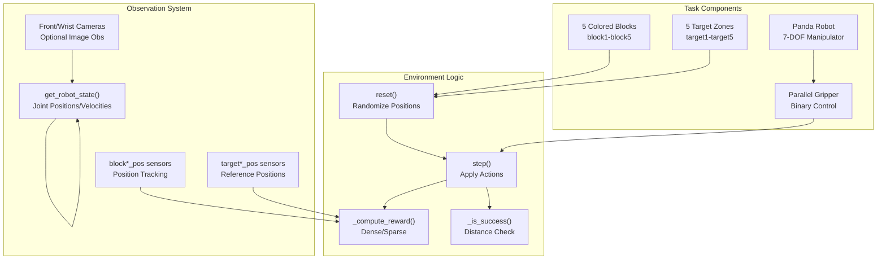
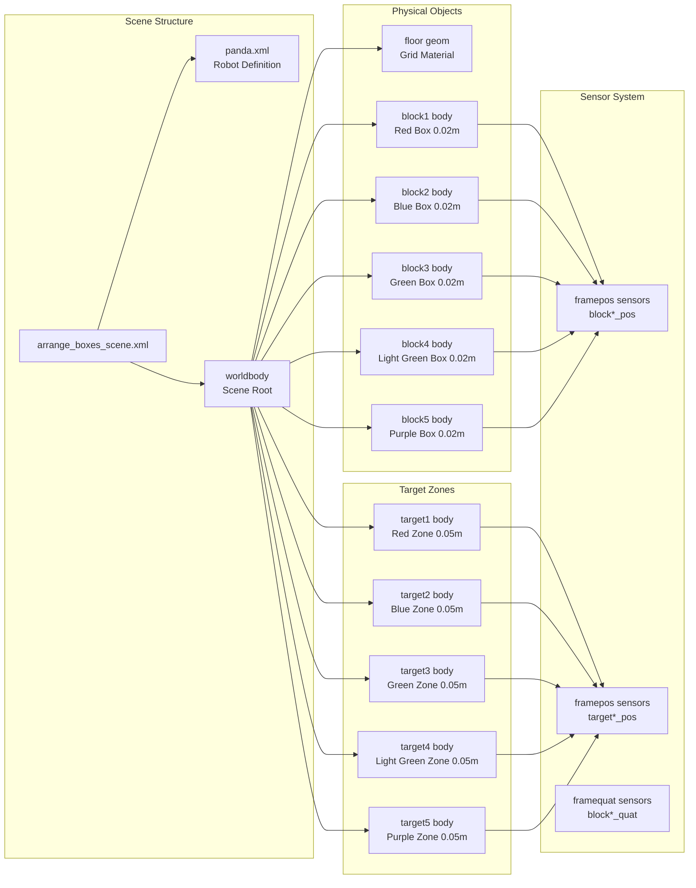

<!-- source: DeepWiki mcp.deepwiki.com · repo huggingface/gym-hil · page 6.2 Panda Arrange Boxes · fetched 2026-10-26 -->

# Panda Arrange Boxes

<details>
<summary>Relevant source files</summary>

The following files were used as context for generating this wiki page:

- [examples/test_arrangeboxes.py](examples/test_arrangeboxes.py)
- [gym_hil/assets/arrange_boxes_scene.xml](gym_hil/assets/arrange_boxes_scene.xml)
- [gym_hil/envs/panda_arrange_boxes_gym_env.py](gym_hil/envs/panda_arrange_boxes_gym_env.py)

</details>


This document describes the `PandaArrangeBoxesGymEnv` class, a multi-object manipulation task environment where the Panda robot must arrange five colored boxes to their designated target positions. This is one of the primary task environments in the gym-hil system for testing robotic manipulation capabilities.

For information about the single-object manipulation task, see [Panda Pick Cube](#6.1). For details about the base environment architecture that this inherits from, see [Base Environments](#3.1).

## Environment Overview

The `PandaArrangeBoxesGymEnv` implements a complex manipulation task where the robot must coordinate the placement of multiple objects simultaneously. The environment features five colored boxes that start in randomized positions and must be moved to their corresponding color-coded target zones.



Sources: [gym_hil/envs/panda_arrange_boxes_gym_env.py:17-203]()

## MuJoCo Scene Configuration

The environment uses a dedicated MuJoCo scene definition that specifies the physical properties and layout of all objects. The scene includes precise positioning, collision properties, and visual characteristics for each component.



### Object Specifications

| Object | Color | Size (m) | Mass (kg) | Initial Position |
|--------|-------|----------|-----------|------------------|
| block1 | Red | 0.02×0.02×0.02 | 0.1 | (0.3, -0.3, 0.02) |
| block2 | Blue | 0.02×0.02×0.02 | 0.1 | (0.3, -0.15, 0.02) |
| block3 | Green | 0.02×0.02×0.02 | 0.1 | (0.3, 0.0, 0.02) |
| block4 | Light Green | 0.02×0.02×0.02 | 0.1 | (0.3, 0.15, 0.02) |
| block5 | Purple | 0.02×0.02×0.02 | 0.1 | (0.3, 0.3, 0.02) |

| Target | Color | Size (m) | Position |
|--------|-------|----------|----------|
| target1 | Red (α=0.35) | 0.05×0.05×0.005 | (0.5, -0.3, 0.0) |
| target2 | Blue (α=0.35) | 0.05×0.05×0.005 | (0.5, -0.15, 0.0) |
| target3 | Green (α=0.35) | 0.05×0.05×0.005 | (0.5, 0.0, 0.0) |
| target4 | Light Green (α=0.35) | 0.05×0.05×0.005 | (0.5, 0.15, 0.0) |
| target5 | Purple (α=0.35) | 0.05×0.05×0.005 | (0.5, 0.3, 0.0) |

Sources: [gym_hil/assets/arrange_boxes_scene.xml:24-62]()

## Task Specification

The task requires the robot to move each colored box from its initial position to the corresponding colored target zone. Success is achieved when all five boxes are simultaneously within 0.03 meters of their respective targets.

### Reset Behavior

During environment reset, the `reset()` method randomizes block positions along the y-axis while maintaining their x-coordinate. This creates variability in the task difficulty while ensuring blocks remain within reachable workspace bounds.

```python
# Block positioning logic from reset() method
positions_coords = np.linspace(-self.block_range, self.block_range, self.no_blocks)
np.random.shuffle(positions_coords)
blocks = [f"block{i}" for i in range(1, self.no_blocks + 1)]
np.random.shuffle(blocks)
```

### Success Criteria

The environment defines success through the `_is_success()` method, which checks that all block-target distances are below a 0.03-meter threshold:

```python
def _is_success(self) -> bool:
    """Check if the task is successfully completed."""
    distances = [
        np.linalg.norm(block.data - target.data)
        for block, target in zip(block_sensors, target_sensors, strict=False)
    ]
    return all(dist < 0.03 for dist in distances)
```

Sources: [gym_hil/envs/panda_arrange_boxes_gym_env.py:96-121](), [gym_hil/envs/panda_arrange_boxes_gym_env.py:193-202]()

## Observation Space

The environment provides two observation modes depending on the `image_obs` parameter:

### State-Only Observations

```python
observation_space = spaces.Dict({
    "agent_pos": Box(-inf, inf, (agent_dim,), float32),
    "environment_state": Box(-inf, inf, (3,), float32)
})
```

- **agent_pos**: Robot joint positions and velocities from `get_robot_state()`
- **environment_state**: Position of block1 from `block1_pos` sensor

### Image Observations

```python
observation_space = spaces.Dict({
    "pixels": spaces.Dict({
        "front": Box(0, 255, (height, width, 3), uint8),
        "wrist": Box(0, 255, (height, width, 3), uint8)
    }),
    "agent_pos": Box(-inf, inf, (agent_dim,), float32)
})
```

- **pixels**: RGB images from front and wrist cameras
- **agent_pos**: Robot joint positions and velocities

Sources: [gym_hil/envs/panda_arrange_boxes_gym_env.py:47-87](), [gym_hil/envs/panda_arrange_boxes_gym_env.py:146-171]()

## Action Space

The environment inherits its action space from `FrankaGymEnv`, providing end-effector control through operational space commands:

| Action Dimension | Range | Description |
|------------------|-------|-------------|
| 0 | [-1, 1] | End-effector X displacement |
| 1 | [-1, 1] | End-effector Y displacement |
| 2 | [-1, 1] | End-effector Z displacement |
| 3 | [-1, 1] | Gripper control (binary) |

Cartesian bounds are enforced through `_CARTESIAN_BOUNDS` constant:
- X: [0.2, 0.6] meters
- Y: [-0.5, 0.5] meters  
- Z: [0.0, 0.5] meters

Sources: [gym_hil/envs/panda_arrange_boxes_gym_env.py:13]()

## Reward Function

The environment supports both dense and sparse reward types configured through the `reward_type` parameter:

### Dense Reward

```python
def _compute_reward(self) -> float:
    if self.reward_type == "dense":
        return sum(np.exp(-20 * d) for d in distances)
```

Returns the sum of exponential rewards for each block-target pair, encouraging gradual progress toward targets.

### Sparse Reward

```python
def _compute_reward(self) -> float:
    if self.reward_type == "sparse":
        return float(all(d < 0.03 for d in distances))
```

Returns 1.0 only when all blocks are successfully placed, 0.0 otherwise.

### Termination Conditions

The environment terminates when:
1. **Success**: All blocks within 0.03m of targets
2. **Bounds violation**: Any block exceeds sampling bounds plus margin

```python
exceeded_bounds = np.any(block_pos[:2] < (_SAMPLING_BOUNDS[0] - self.block_range - 0.05)) or \
                  np.any(block_pos[:2] > (_SAMPLING_BOUNDS[1] + self.block_range + 0.05))
terminated = bool(success or exceeded_bounds)
```

Sources: [gym_hil/envs/panda_arrange_boxes_gym_env.py:180-192](), [gym_hil/envs/panda_arrange_boxes_gym_env.py:137-144]()

## Environment Registration

The `PandaArrangeBoxesGymEnv` is registered in multiple variants through the environment factory system:

| Environment ID | Description |
|----------------|-------------|
| `PandaArrangeBoxesBase-v0` | Base environment without HIL wrappers |
| `PandaArrangeBoxesGamepad-v0` | Gamepad control with HIL wrappers |
| `PandaArrangeBoxesKeyboard-v0` | Keyboard control with HIL wrappers |
| `PandaArrangeBoxesViewer-v0` | Passive viewer mode with HIL wrappers |

Each variant applies different wrapper combinations from the HIL wrapper system to enable human-in-the-loop functionality.

Sources: [gym_hil/__init__.py](), [examples/test_arrangeboxes.py:63-71]()

---

