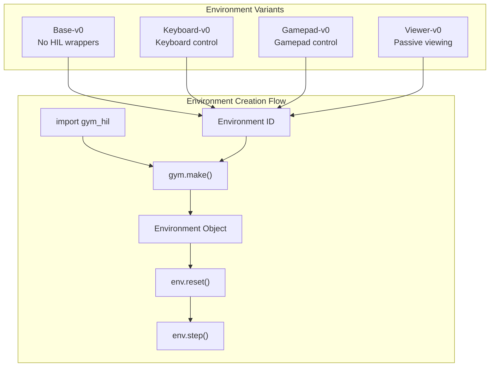
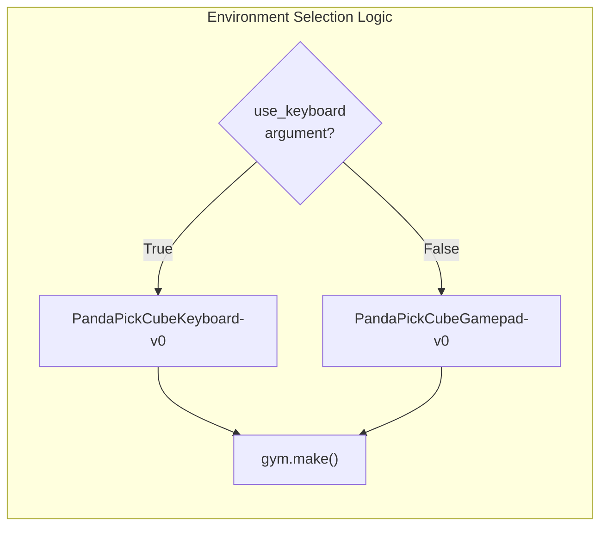
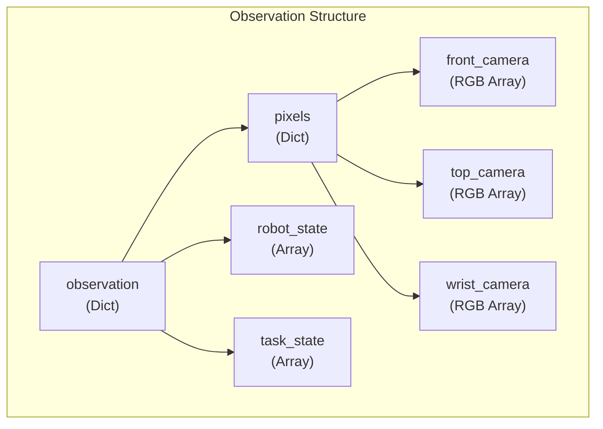
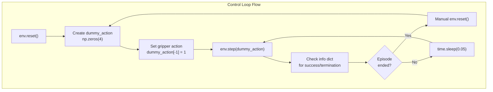
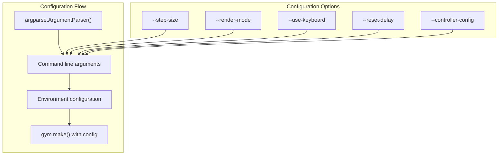
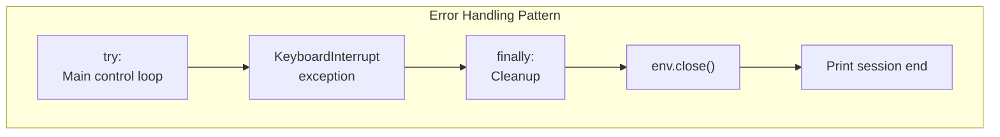

<!-- source: DeepWiki mcp.deepwiki.com · repo huggingface/gym-hil · page 7 Examples and Usage · fetched 2026-10-26 -->

# Examples and Usage

Relevant source files

The following files were used as context for generating this wiki page:

- [examples/test_teleoperation.py](examples/test_teleoperation.py)

This document provides practical examples demonstrating how to use gym-hil environments for teleoperation, training, and human-in-the-loop learning. The examples focus on basic environment setup, teleoperation control, and integration with the gymnasium API.

For detailed information about specific task environments, see [Panda Pick Cube](#6.1) and [Panda Arrange Boxes](#6.2). For teleoperation-specific guidance, see [Teleoperation](#7.1). For human input configuration, see [Input Controllers](#4.1).

## Basic Environment Creation

The gym-hil package integrates with the standard gymnasium API through environment registration. Environments are created using `gym.make()` with specific environment IDs that follow the pattern `gym_hil/{TaskName}{Variant}-v0`.

The basic environment creation pattern follows these steps:

1. Import the gym-hil package to register environments
2. Use `gym.make()` with appropriate environment ID
3. Configure render mode and observation settings
4. Reset environment to get initial observation
5. Step through environment with actions

Sources: [examples/test_teleoperation.py:23](), [examples/test_teleoperation.py:45-49]()

## Environment Variants and Configuration

The gym-hil package provides multiple variants of each task environment, each with different wrapper configurations for specific use cases.

| Environment Variant | Wrapper Stack | Use Case |
|---------------------|---------------|----------|
| `*Base-v0` | Base environment only | Testing, debugging, basic RL |
| `*Keyboard-v0` | HIL + Keyboard control | Keyboard teleoperation |
| `*Gamepad-v0` | HIL + Gamepad control | Gamepad teleoperation |
| `*Viewer-v0` | HIL + Passive viewer | Observation only |

The teleoperation example demonstrates switching between environment variants:

Sources: [examples/test_teleoperation.py:62-69]()

## Observation Space Structure

Gym-hil environments provide structured observations containing robot state, sensor data, and visual information. The observation space is a `Dict` space with specific keys for different data types.

The example includes observation space inspection to understand the structure:

Sources: [examples/test_teleoperation.py:52-58](), [examples/test_teleoperation.py:75-76]()

## Control Flow and Action Execution

The teleoperation example demonstrates the standard control loop pattern for gym-hil environments, including proper action formatting and episode management.

Key aspects of the control flow:

- **Dummy Action Setup**: Creates a 4-element float32 array for end-effector control
- **Gripper State**: The last action element controls gripper state (1 = maintain current state)
- **Episode Management**: Handles termination and truncation with manual reset
- **Update Rate Control**: Uses `time.sleep(0.05)` for 20Hz control rate

Sources: [examples/test_teleoperation.py:79-82](), [examples/test_teleoperation.py:84-99]()

## Environment Parameters and Configuration

The teleoperation example demonstrates various environment configuration options that can be passed to `gym.make()`:

| Parameter | Type | Description | Default |
|-----------|------|-------------|---------|
| `render_mode` | str | Visualization mode ("human", "rgb_array") | "human" |
| `image_obs` | bool | Include camera observations | True |
| `use_gamepad` | bool | Enable gamepad control | True |
| `max_episode_steps` | int | Maximum steps per episode | 1000 |
| `controller_config` | str | Path to controller JSON config | None |

The example shows how to configure these parameters:

Sources: [examples/test_teleoperation.py:27-42](), [examples/test_teleoperation.py:63-69]()

## Error Handling and Cleanup

The teleoperation example includes proper error handling and resource cleanup patterns:

This pattern ensures proper resource cleanup even when the program is interrupted by the user.

Sources: [examples/test_teleoperation.py:84](), [examples/test_teleoperation.py:101-105]()

---

