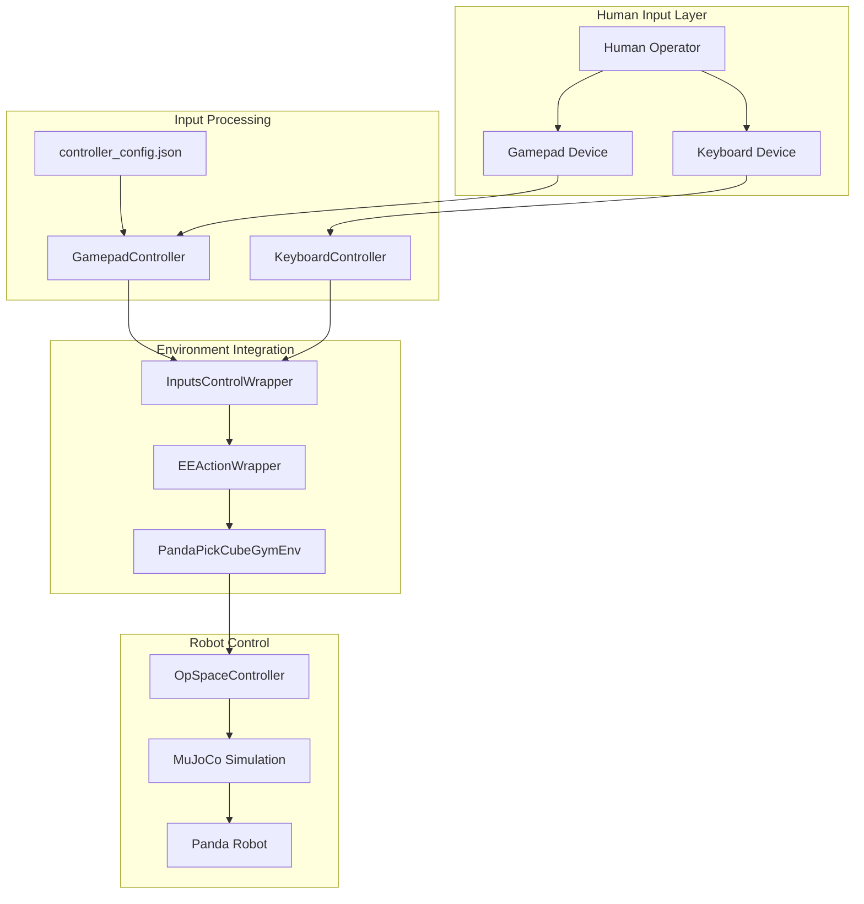
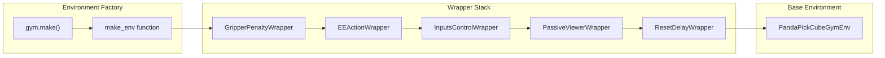
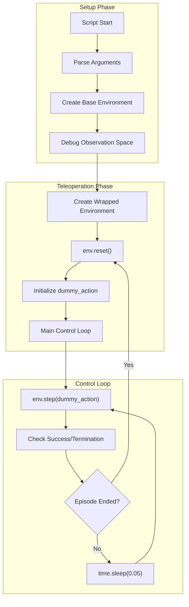
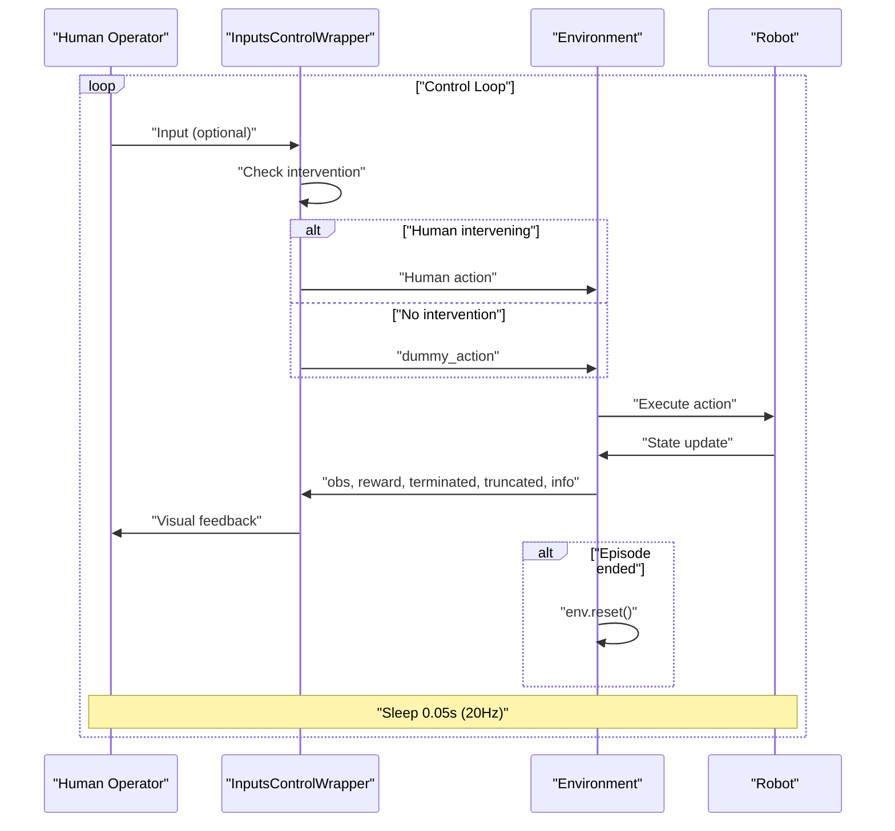

<!-- source: DeepWiki mcp.deepwiki.com · repo huggingface/gym-hil · page 7.1 Teleoperation · fetched 2026-10-26 -->

# Teleoperation

<details>
<summary>Relevant source files</summary>

The following files were used as context for generating this wiki page:

- [examples/test_teleoperation.py](examples/test_teleoperation.py)

</details>


This document covers the teleoperation functionality in gym-hil, which enables direct human control of the Panda robot through gamepad or keyboard input. Teleoperation allows operators to manually control the robot's end-effector position and gripper state in real-time within MuJoCo simulation environments.

For information about the underlying input controller implementations, see [Input Controllers](#4.1). For details about controller configuration and input mapping, see [Controller Configuration](#4.2). For information about the specific task environments used in teleoperation, see [Panda Pick Cube](#6.1).

## System Overview

The teleoperation system integrates human input devices with the gym-hil environment framework through specialized wrapper classes. The system supports both gamepad and keyboard control modes, allowing operators to directly manipulate the robot's end-effector position and gripper state.



The teleoperation flow begins with human input captured by either `GamepadController` or `KeyboardController` classes, which are configured through the `controller_config.json` file. The `InputsControlWrapper` processes these inputs and determines whether to apply human intervention or default robot actions.

Sources: [examples/test_teleoperation.py:26-109]()

## Environment Variants

The gym-hil framework provides pre-configured environment variants optimized for teleoperation:

| Environment ID | Control Method | Description |
|---|---|---|
| `gym_hil/PandaPickCubeGamepad-v0` | Gamepad | Full gamepad control with all HIL wrappers |
| `gym_hil/PandaPickCubeKeyboard-v0` | Keyboard | Keyboard control with all HIL wrappers |
| `gym_hil/PandaPickCubeBase-v0` | None | Base environment without HIL wrappers |

Each variant incorporates different wrapper combinations through the environment factory system. The gamepad and keyboard variants include the complete HIL wrapper stack, while the base variant provides direct access to the underlying environment for debugging purposes.



Sources: [examples/test_teleoperation.py:44-69]()

## Test Teleoperation Example

The `test_teleoperation.py` script demonstrates practical teleoperation usage with the following key components:

### Command Line Interface

The script accepts several configuration parameters:

```python
parser.add_argument("--step-size", type=float, default=0.01, help="Step size for movement in meters")
parser.add_argument("--render-mode", type=str, default="human", choices=["human", "rgb_array"], help="Rendering mode")
parser.add_argument("--use-keyboard", action="store_true", help="Use keyboard control")
parser.add_argument("--reset-delay", type=float, default=2.0, help="Delay in seconds when resetting the environment")
parser.add_argument("--controller-config", type=str, default=None, help="Path to controller configuration JSON file")
```

### Environment Setup Process

The script follows a two-stage setup process for debugging and validation:

1. **Base Environment Testing** - Creates the base environment without HIL wrappers to verify basic functionality
2. **Wrapped Environment Usage** - Creates the full HIL-wrapped environment for teleoperation



Sources: [examples/test_teleoperation.py:26-109]()

## Action Space and Control

The teleoperation system uses a 4-dimensional action space:

- **Dimensions 0-2**: End-effector position delta (x, y, z)
- **Dimension 3**: Gripper control (0=open, 1=close, other values=maintain)

### Dummy Action Configuration

The example initializes a dummy action that ensures proper gripper behavior when no intervention occurs:

```python
dummy_action = np.zeros(4, dtype=np.float32)
# This ensures the "stay gripper" action is set when the intervention button is not pressed
dummy_action[-1] = 1
```

This configuration sets the gripper to maintain its current state when the human is not actively intervening, preventing unintended gripper movements during passive observation.

Sources: [examples/test_teleoperation.py:80-82]()

## Control Loop Operation

The main teleoperation loop operates at approximately 20Hz with the following sequence:

1. **Environment Step** - Executes the action (either dummy or human-controlled)
2. **Feedback Processing** - Checks for task success and episode termination
3. **Auto-Reset** - Automatically resets the environment when episodes end
4. **Rate Control** - Maintains consistent update rate through `time.sleep(0.05)`



The system provides feedback through the `info` dictionary, including success indicators and intervention flags that can be used for learning algorithms or user interface updates.

Sources: [examples/test_teleoperation.py:84-104]()

## Session Management

The teleoperation session includes proper resource management:

- **Keyboard Interrupt Handling** - Gracefully exits on Ctrl+C
- **Environment Cleanup** - Calls `env.close()` to release resources
- **User Feedback** - Provides clear session start/end messages

This ensures that MuJoCo simulation resources, input device handles, and rendering contexts are properly released when the session ends.

Sources: [examples/test_teleoperation.py:101-105]()

---

