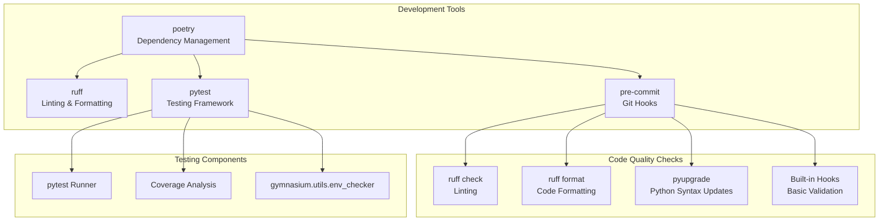
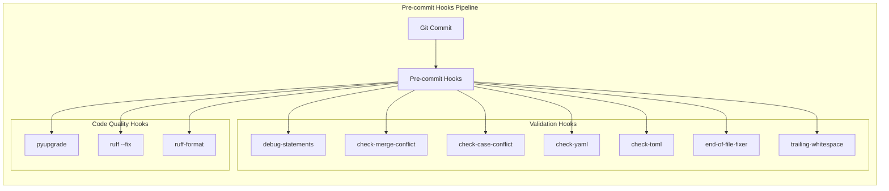
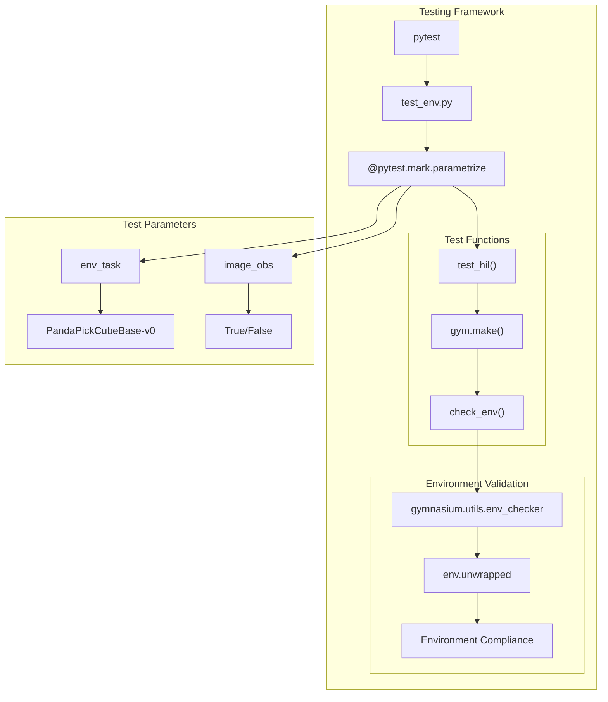
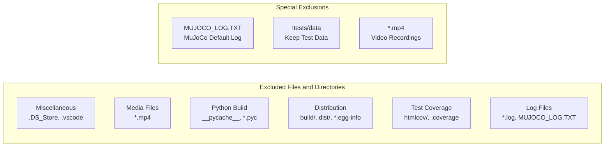

<!-- source: DeepWiki mcp.deepwiki.com · repo huggingface/gym-hil · page 8 Development · fetched 2026-10-26 -->

# Development

Relevant source files

The following files were used as context for generating this wiki page:

- [.github/workflows/quality.yml](.github/workflows/quality.yml)
- [.github/workflows/testing.yml](.github/workflows/testing.yml)
- [.gitignore](.gitignore)
- [.pre-commit-config.yaml](.pre-commit-config.yaml)
- [tests/test_env.py](tests/test_env.py)

This page covers the development setup, testing procedures, and contribution guidelines for developers working on gym-hil. It provides information about the tools, workflows, and standards used to maintain code quality and ensure reliable functionality.

For detailed information about the test suite and environment validation, see [Testing](#8.1). For documentation of the automated CI/CD pipeline and GitHub Actions workflows, see [CI/CD Pipeline](#8.2).

## Development Environment Setup

The gym-hil project uses Poetry for dependency management and virtual environment creation. The development setup includes code quality tools, testing frameworks, and pre-commit hooks to ensure consistent code standards.

### Development Tools and Dependencies

The project relies on several key development tools configured through Poetry and pre-commit hooks:

**Development Tools Configuration**
- **Poetry**: Manages dependencies and virtual environments with `pyproject.toml` configuration
- **Ruff**: Provides fast linting and code formatting with version specified in `.pre-commit-config.yaml`
- **pytest**: Testing framework with coverage analysis support
- **Pre-commit**: Enforces code quality standards before commits

Sources: [.pre-commit-config.yaml:1-25](), [.github/workflows/quality.yml:1-56](), [.github/workflows/testing.yml:1-54]()

## Code Quality and Standards

The project enforces code quality through automated tools and pre-commit hooks. All code must pass linting, formatting, and basic validation checks before being committed.

### Pre-commit Hook Configuration

**Code Quality Standards**
- **Python Version**: Requires Python 3.10 as specified in `default_language_version`
- **Linting**: Uses Ruff with automatic fixes enabled via `--fix` argument
- **Formatting**: Enforces consistent code formatting with `ruff-format`
- **Syntax Updates**: Automatically updates Python syntax using `pyupgrade`
- **Basic Validation**: Checks for debug statements, merge conflicts, and file format issues

Sources: [.pre-commit-config.yaml:1-25](), [.github/workflows/quality.yml:28-41]()

## Testing Overview

The project uses pytest for testing with Gymnasium's environment validation framework. Tests focus on verifying environment compliance and proper HIL functionality.

### Test Structure and Environment Validation

**Test Configuration**
- **Parameterized Tests**: Uses `@pytest.mark.parametrize` to test multiple environment configurations
- **Environment Validation**: Leverages `gymnasium.utils.env_checker.check_env()` for compliance verification
- **Coverage Analysis**: Includes coverage reporting with `--cov=./gym_hil` flag
- **Test Environments**: Currently tests `PandaPickCubeBase-v0` with and without image observations

Sources: [tests/test_env.py:24-33](), [.github/workflows/testing.yml:51-53]()

## Contributing Guidelines

Development contributions should follow the established workflow patterns and pass all automated quality checks.

### Development Workflow Requirements

| Stage | Tool | Requirement |
|-------|------|-------------|
| **Pre-commit** | `pre-commit` | All hooks must pass |
| **Code Quality** | `ruff` | Linting and formatting compliance |
| **Testing** | `pytest` | All tests must pass with coverage |
| **Environment** | `poetry` | Dependency management via Poetry |

**Key Development Practices**
- **Environment Setup**: Use Poetry for dependency installation with `poetry install --all-extras`
- **Code Standards**: Follow Ruff linting and formatting rules
- **Testing**: Write parameterized tests for new environments using `pytest.mark.parametrize`
- **Git Workflow**: Ensure pre-commit hooks pass before committing changes
- **Platform Support**: Tests run on Ubuntu with EGL rendering support

Sources: [.github/workflows/testing.yml:36-49](), [.pre-commit-config.yaml:1-25](), [.github/workflows/quality.yml:44-55]()

## Development Environment Configuration

The project excludes specific files and directories from version control to maintain a clean development environment.

### Git Ignore Patterns

**Notable Exclusions**
- **MuJoCo Logs**: Excludes `MUJOCO_LOG.TXT` which is MuJoCo's default log file
- **Media Files**: Excludes `.mp4` files, likely from environment recordings
- **Test Data**: Explicitly preserves `tests/data` directory with `!tests/data` pattern
- **Standard Python**: Follows typical Python `.gitignore` patterns for build artifacts and caches

Sources: [.gitignore:1-133]()

---

