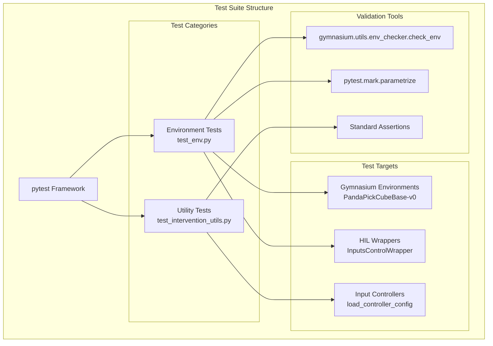
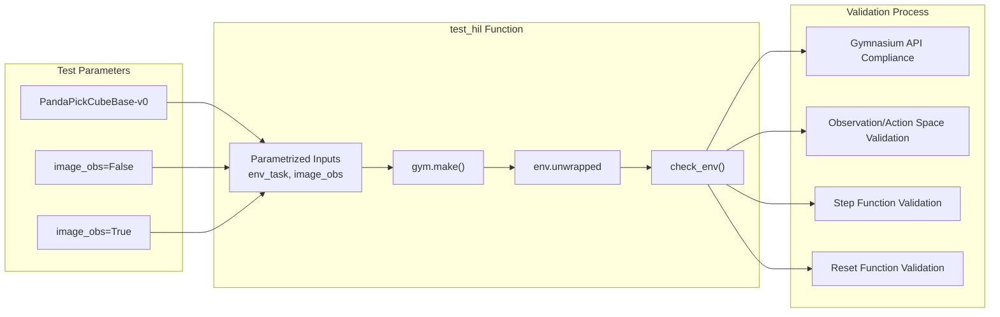
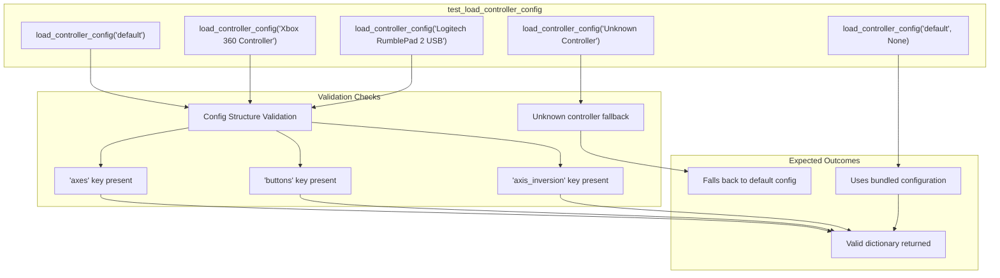
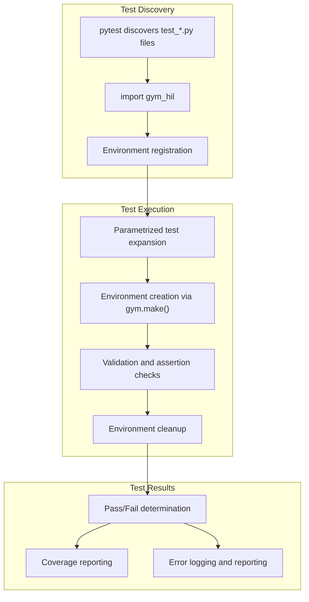
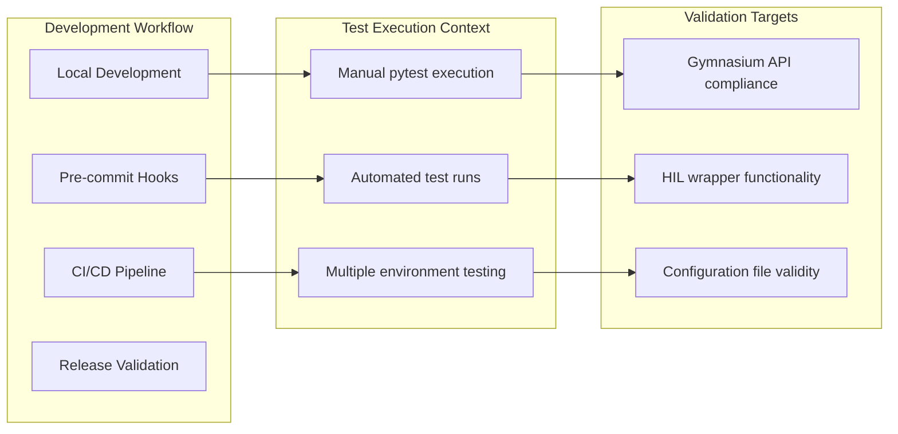

<!-- source: DeepWiki mcp.deepwiki.com · repo huggingface/gym-hil · page 8.1 Testing · fetched 2026-10-26 -->

# Testing

Relevant source files

The following files were used as context for generating this wiki page:

- [tests/test_env.py](tests/test_env.py)
- [tests/test_intervention_utils.py](tests/test_intervention_utils.py)

This document covers the testing framework and test suite for the gym-hil codebase. The testing system validates environment functionality, wrapper behavior, and component integration to ensure reliable Human-in-the-Loop reinforcement learning capabilities.

For information about CI/CD pipeline automation, see [CI/CD Pipeline](#8.2). For development setup and contribution guidelines, see [Development](#8).

## Test Architecture

The test suite is organized around validating core components of the gym-hil system, with particular focus on environment compliance and HIL functionality.

### Test Organization

Sources: [tests/test_env.py:1-34](), [tests/test_intervention_utils.py:1-54]()

## Environment Testing

The primary test suite validates that all gym-hil environments conform to the Gymnasium API specification and function correctly with different configurations.

### Environment Validation Framework

Sources: [tests/test_env.py:24-33]()

### Test Coverage

The environment tests cover multiple configuration scenarios using pytest parametrization:

| Test Parameter | Values | Purpose |
|---|---|---|
| `env_task` | `"PandaPickCubeBase-v0"` | Base environment validation |
| `image_obs` | `False`, `True` | Both state and image observation modes |

The `test_hil` function [tests/test_env.py:31-33]() creates each environment configuration and validates it using `gymnasium.utils.env_checker.check_env`, which performs comprehensive validation of:

- Observation and action space definitions
- Step function behavior and return values
- Reset function implementation
- Reward computation
- Environment state management

Sources: [tests/test_env.py:24-33]()

## Component Testing

Individual components are tested to ensure proper functionality and integration within the HIL system.

### Controller Configuration Testing

Sources: [tests/test_intervention_utils.py:20-54]()

The controller configuration tests validate the `load_controller_config` function [tests/test_intervention_utils.py:23]() across multiple scenarios:

- **Default Controller**: Validates the default controller configuration loads correctly
- **Known Controllers**: Tests Xbox 360 Controller and Logitech RumblePad 2 USB configurations
- **Unknown Controllers**: Ensures fallback behavior returns default configuration
- **Config Path Handling**: Validates that `None` config_path falls back to bundled configuration

Each test verifies that the returned configuration contains the required keys: `axes`, `buttons`, and `axis_inversion`.

Sources: [tests/test_intervention_utils.py:20-54]()

## Test Execution

The test suite uses pytest as the testing framework with specific patterns for environment and component validation.

### Test Execution Flow

Sources: [tests/test_env.py:21](), [tests/test_env.py:32]()

### Key Testing Patterns

The test suite employs several important patterns:

1. **Import Registration**: Tests begin by importing `gym_hil` [tests/test_env.py:21]() to ensure environment registration occurs
2. **Parametrized Testing**: Uses `@pytest.mark.parametrize` [tests/test_env.py:24-30]() to test multiple configurations
3. **Environment Unwrapping**: Tests validate the unwrapped environment [tests/test_env.py:33]() to access base functionality
4. **Assertion-Based Validation**: Uses standard assertions for component testing [tests/test_intervention_utils.py:25-49]()

## Integration with Development Workflow

The testing framework integrates with the broader development workflow through automated execution and validation.

### Test Integration Points

Sources: [tests/test_env.py:1-34](), [tests/test_intervention_utils.py:1-54]()

The testing system ensures that all environments maintain compatibility with the Gymnasium API while providing HIL-specific functionality. Tests validate both the base environment implementations and the wrapper system that adds human intervention capabilities.

---

