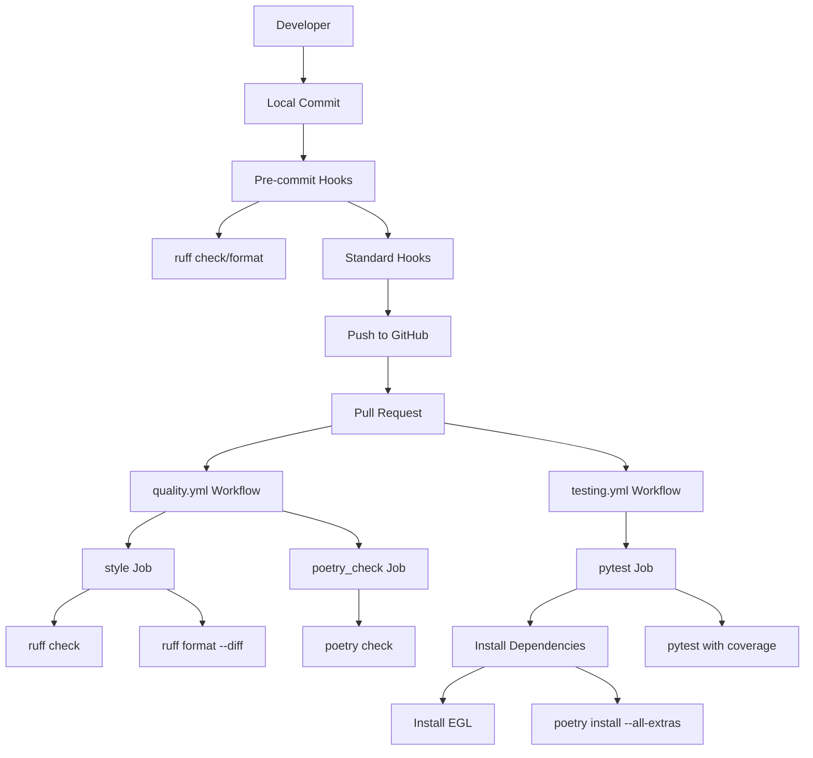
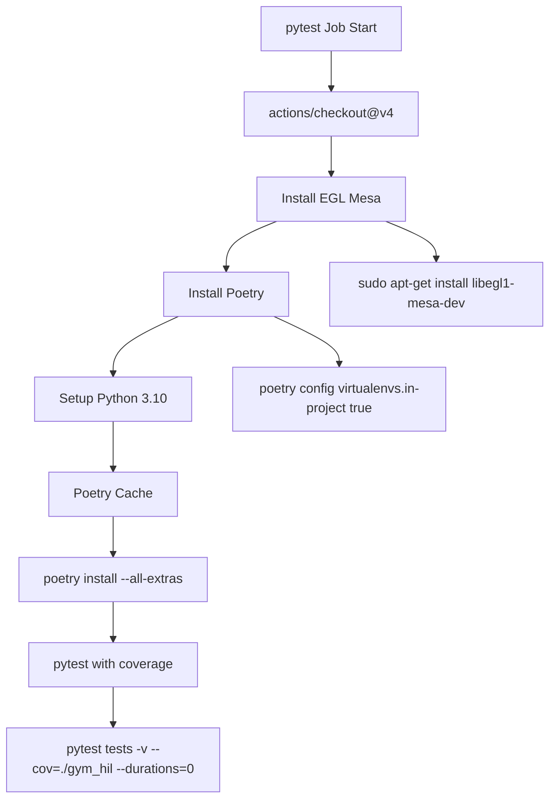
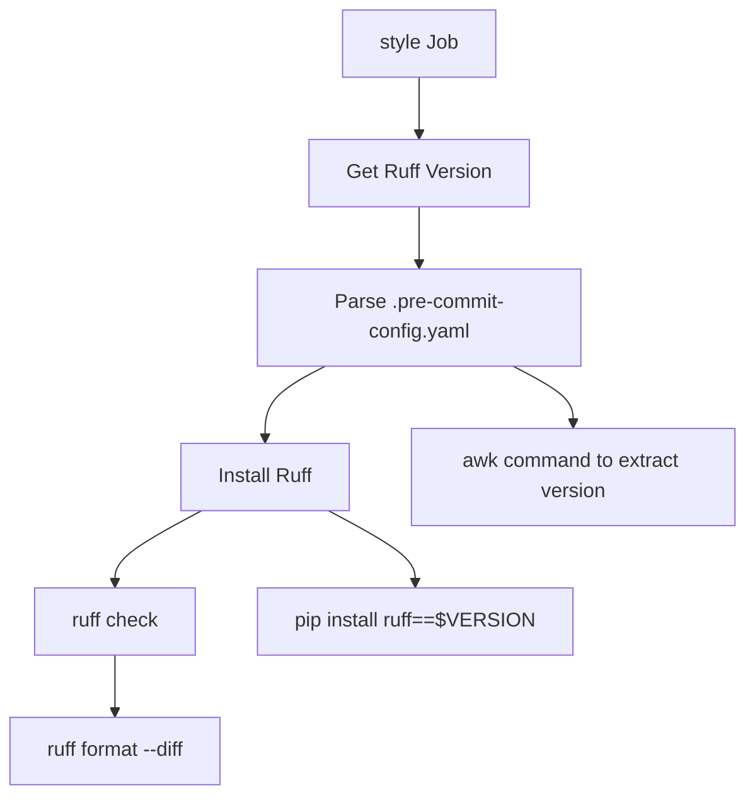
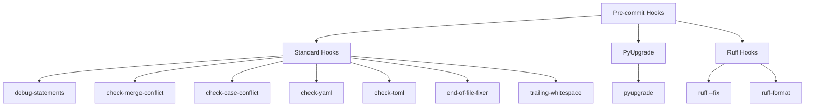
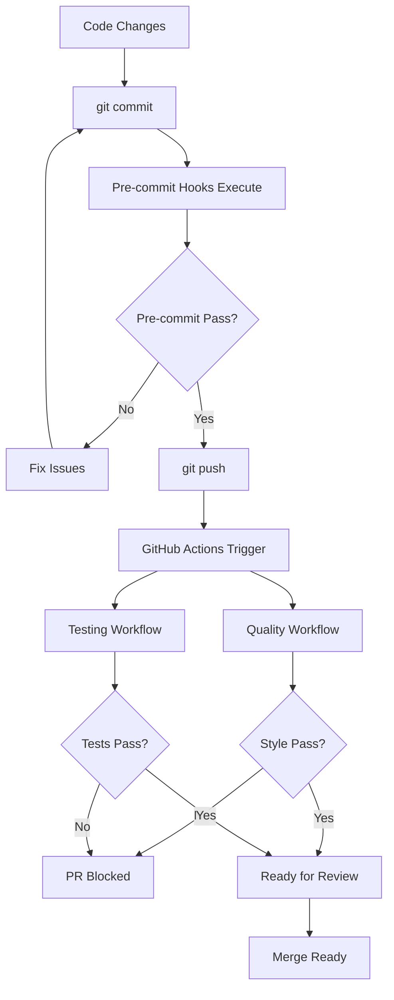

<!-- source: DeepWiki mcp.deepwiki.com · repo huggingface/gym-hil · page 8.2 CI/CD Pipeline · fetched 2026-10-26 -->

# CI/CD Pipeline

Relevant source files

The following files were used as context for generating this wiki page:

- [.github/workflows/quality.yml](.github/workflows/quality.yml)
- [.github/workflows/testing.yml](.github/workflows/testing.yml)
- [.gitignore](.gitignore)
- [.pre-commit-config.yaml](.pre-commit-config.yaml)

This document describes the continuous integration and continuous deployment (CI/CD) pipeline for the gym-hil repository. The pipeline ensures code quality, runs automated tests, and maintains development standards through GitHub Actions workflows and pre-commit hooks.

For information about the actual test suite and testing procedures, see [Testing](#8.1).

## Overview

The gym-hil project uses a multi-layered CI/CD approach combining GitHub Actions workflows with local pre-commit hooks to maintain code quality and reliability. The pipeline automatically triggers on pull requests and pushes to the main branch, running comprehensive tests and quality checks.

**CI/CD Pipeline Flow**

Sources: [.github/workflows/testing.yml:1-54](), [.github/workflows/quality.yml:1-56](), [.pre-commit-config.yaml:1-25]()

## Testing Workflow

The testing workflow is defined in `testing.yml` and runs the complete test suite with coverage reporting. It triggers on pull requests and pushes to main when relevant files are modified.

### Trigger Conditions

The workflow activates when changes are detected in:
- `gym_hil/**` - Core package files
- `tests/**` - Test files
- `examples.py` - Example scripts
- `.github/**` - Workflow configurations
- `poetry.lock` - Dependency lock file

### Test Environment Configuration

| Configuration | Value | Purpose |
|---------------|-------|---------|
| `MUJOCO_GL` | `egl` | Headless rendering for MuJoCo |
| `DATA_DIR` | `tests/data` | Test data directory |
| Python Version | `3.10` | Target Python version |

The workflow includes specialized setup for MuJoCo physics simulation:

**Testing Workflow Steps**

Sources: [.github/workflows/testing.yml:23-54]()

## Quality Workflow

The quality workflow enforces code style and project configuration standards through two parallel jobs: `style` and `poetry_check`.

### Style Job

The `style` job performs code formatting and linting using Ruff:

**Style Checking Process**

### Poetry Check Job

The `poetry_check` job validates the project's `pyproject.toml` configuration:

| Step | Command | Purpose |
|------|---------|---------|
| Install Poetry | `pipx install poetry` | Get Poetry package manager |
| Validate Config | `poetry check` | Check pyproject.toml validity |

Sources: [.github/workflows/quality.yml:15-56]()

## Pre-commit Hooks

Pre-commit hooks run locally before each commit to catch issues early in the development process. The configuration excludes `example.py` from checks and targets Python 3.10.

### Hook Categories

**Pre-commit Hook Structure**

### Hook Repositories

| Repository | Version | Purpose |
|------------|---------|---------|
| `pre-commit/pre-commit-hooks` | `v4.6.0` | Standard file checks |
| `asottile/pyupgrade` | `v3.15.2` | Python syntax modernization |
| `astral-sh/ruff-pre-commit` | `v0.4.3` | Linting and formatting |

Sources: [.pre-commit-config.yaml:1-25]()

## Development Workflow

The complete development workflow integrates local pre-commit hooks with GitHub Actions to ensure code quality at multiple stages:

**Complete Development Workflow**

### File Exclusions

The `.gitignore` file excludes development artifacts and generated files:

- Build artifacts: `build/`, `dist/`, `*.egg-info/`
- Python cache: `__pycache__/`, `*.pyc`
- Test outputs: `.coverage`, `.pytest_cache/`
- MuJoCo logs: `MUJOCO_LOG.TXT`
- Video files: `*.mp4`

Sources: [.gitignore:1-133](), [.github/workflows/testing.yml:3-21](), [.github/workflows/quality.yml:3-11]()

## Tool Versions and Dependencies

The CI/CD pipeline maintains consistency across environments by pinning tool versions:

| Tool | Version Source | Usage |
|------|---------------|--------|
| Ruff | `.pre-commit-config.yaml` | Linting and formatting |
| Python | `3.10` | Runtime environment |
| Poetry | Latest via `pipx` | Dependency management |
| Pre-commit hooks | Pinned in config | Code quality checks |

The testing environment includes MuJoCo-specific requirements like EGL for headless rendering, ensuring that physics simulations can run in CI without a display.

Sources: [.github/workflows/quality.yml:28-35](), [.github/workflows/testing.yml:33-34](), [.pre-commit-config.yaml:19-20]()

---

