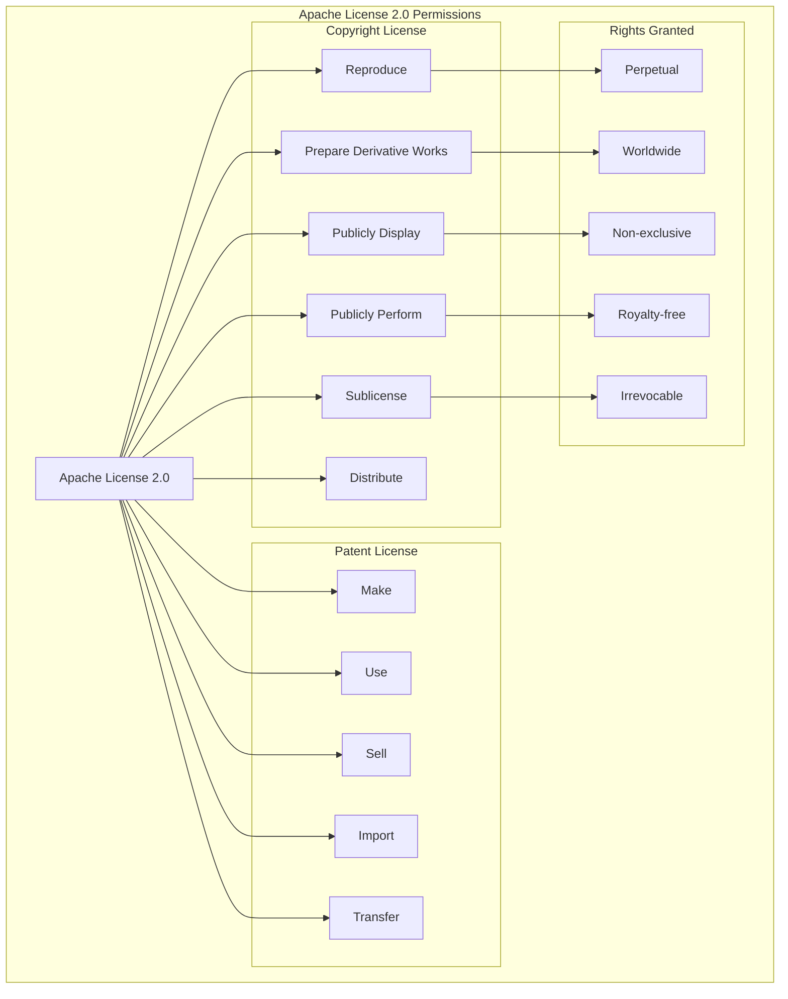

<!-- source: DeepWiki mcp.deepwiki.com · repo huggingface/gym-hil · page 9 License · fetched 2026-10-26 -->

# License

Relevant source files

The following files were used as context for generating this wiki page:

- [LICENSE](LICENSE)

This document covers the licensing terms and conditions for the gym-hil project. It explains the legal framework governing the use, distribution, and modification of the gym-hil codebase and its associated assets.

## License Overview

The gym-hil project is licensed under the Apache License, Version 2.0. This is a permissive open-source license that allows for both commercial and non-commercial use of the software while providing patent protection and requiring attribution.

The complete license text is available in the project root directory and defines the terms and conditions for use, reproduction, and distribution of the gym-hil software.

Sources: [LICENSE:1-202]()

## License Type and Version

**License Type:** Apache License, Version 2.0  
**License Date:** January 2004  
**Official URL:** http://www.apache.org/licenses/

The Apache License 2.0 is one of the most widely used open-source licenses, approved by the Open Source Initiative (OSI) and compatible with many other open-source licenses.

Sources: [LICENSE:1-3]()

## Key Permissions

The Apache License 2.0 grants the following permissions to users of the gym-hil project:

| Permission | Description |
|------------|-------------|
| **Use** | Use the software for any purpose, including commercial applications |
| **Modify** | Create derivative works and modifications |
| **Distribute** | Distribute copies of the original or modified software |
| **Patent Grant** | Receive patent rights from contributors for their contributions |
| **Private Use** | Use the software privately without disclosure |

### License Permissions Flow

Sources: [LICENSE:66-71](), [LICENSE:73-87]()

## Requirements and Conditions

Users of the gym-hil project must comply with the following requirements:

### Distribution Requirements

When redistributing the gym-hil software or derivative works, you must:

1. **Include License Copy**: Provide a copy of the Apache License 2.0 to recipients
2. **Notice of Changes**: Mark any modified files with prominent notices stating the changes
3. **Preserve Attribution**: Retain all copyright, patent, trademark, and attribution notices
4. **Include NOTICE File**: If present, include the NOTICE file in distributions

### Contribution Terms

Any contributions submitted to the gym-hil project are automatically licensed under the Apache License 2.0 unless explicitly stated otherwise. This ensures that all contributions maintain the same licensing terms.

Sources: [LICENSE:89-128](), [LICENSE:130-136]()

## Disclaimers and Limitations

The Apache License 2.0 includes important disclaimers that users should understand:

### Warranty Disclaimer

The software is provided "AS IS" without warranties of any kind, including:
- No warranty of merchantability
- No warranty of fitness for a particular purpose
- No warranty of non-infringement
- No warranty of title

### Liability Limitations

Contributors are not liable for any damages arising from the use of the software, including:
- Direct damages
- Indirect damages
- Special damages
- Incidental damages
- Consequential damages

Sources: [LICENSE:143-151](), [LICENSE:153-163]()

## Trademark Notice

The Apache License 2.0 does not grant permission to use trade names, trademarks, service marks, or product names of the licensor, except as required for reasonable and customary use in describing the origin of the work.

Sources: [LICENSE:138-141]()

## Patent Protection

The license includes patent protection provisions:

### Patent Grant

Contributors grant patent rights for their contributions, but these rights terminate if the licensee files patent litigation against the work.

### Patent Termination

If you institute patent litigation claiming that the gym-hil software constitutes patent infringement, your patent licenses under this license terminate as of the date such litigation is filed.

Sources: [LICENSE:73-87]()

## License Compliance for gym-hil Users

### For End Users

- You can use gym-hil for any purpose, including commercial applications
- No need to disclose your use of the library
- No royalty payments required

### For Distributors

- Include the LICENSE file in your distribution
- Preserve copyright notices in source code
- Mark any modifications you make to the original code

### For Contributors

- Contributions are automatically licensed under Apache 2.0
- You retain copyright to your contributions
- Patent rights are granted for your contributions

Sources: [LICENSE:66-71](), [LICENSE:89-128](), [LICENSE:130-136]()

## License Application

The license applies to all components of the gym-hil project, including:

- Source code in the `gym_hil` package
- Configuration files and assets
- Documentation and examples
- Test code and utilities

The license does not apply to:
- Third-party dependencies (which have their own licenses)
- User-generated content or configurations
- Derivative works that are kept separate from the original work

Sources: [LICENSE:1-202]()