# Page: Overview

# Overview

<details>
<summary>Relevant source files</summary>

The following files were used as context for generating this wiki page:

- [README.md](README.md)
- [images/hil-rl-schema.png](images/hil-rl-schema.png)
- [pyproject.toml](pyproject.toml)

</details>


## Purpose and Scope

The `gym-hil` package provides a collection of Gymnasium environments specifically designed for Human-in-the-Loop (HIL) reinforcement learning with robotic manipulation tasks. The framework enables real-time human intervention during agent training, allowing operators to override policy actions using gamepad or keyboard controllers. This approach improves sample efficiency, promotes safer exploration, and enables intuitive demonstration collection for robotic learning systems.

This document covers the high-level architecture, core components, and integration patterns of the gym-hil framework. For detailed information about specific environments, see [Task Environments](#6). For human input handling details, see [Human Input System](#4). For development setup and testing, see [Development](#8).

## System Architecture

The gym-hil framework consists of four main layers that work together to enable human-in-the-loop reinforcement learning:

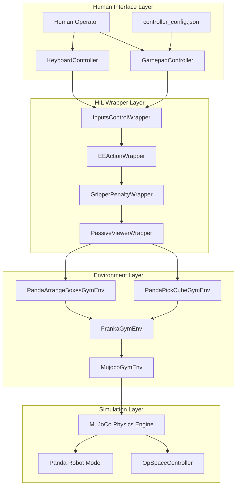

Sources: [README.md:1-202](), [pyproject.toml:19-46]()

## Environment Hierarchy

The framework uses a hierarchical class structure where specialized task environments inherit from base classes that provide MuJoCo integration and robot control:

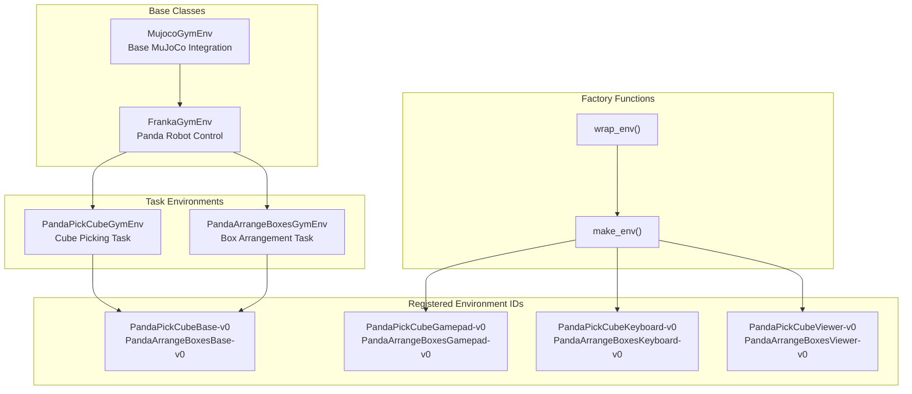

Sources: [README.md:82-89](), [pyproject.toml:1-91]()

## Human-in-the-Loop Workflow

The HIL workflow allows seamless switching between agent and human control during environment execution:

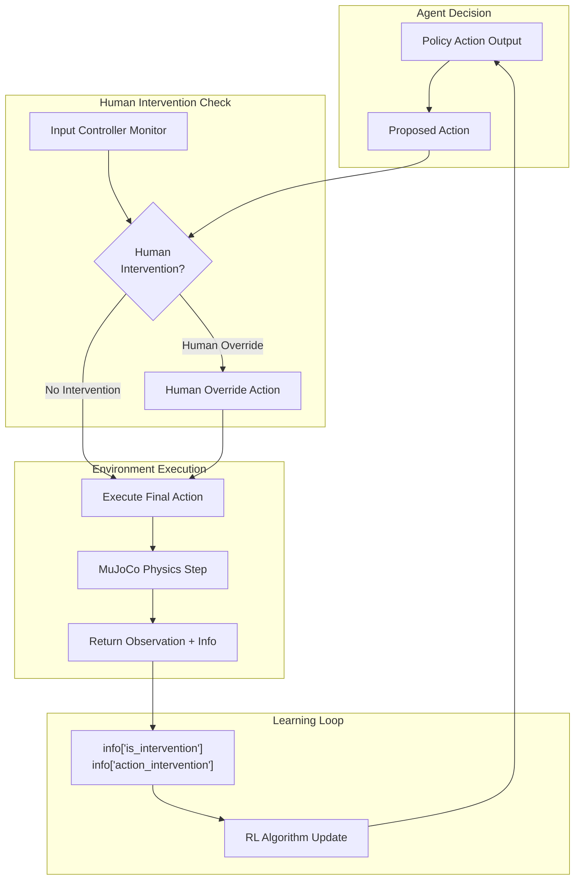

Sources: [README.md:12-18](), [README.md:68-76]()

## Technology Stack

The framework integrates multiple external libraries to provide comprehensive HIL functionality:

| Component | Library | Version | Purpose |
|-----------|---------|---------|---------|
| Physics Engine | MuJoCo | ≥2.3.7 | Robot simulation and physics |
| RL Interface | Gymnasium | 0.29.1 | Standard RL environment API |
| Human Input | Pygame | ≥2.5.1 | Gamepad input handling |
| Input Monitoring | Pynput | ≥1.7.7 | Keyboard input capture |
| HID Devices | HIDAPI | ≥0.14.0 | Low-level device communication |
| Video Recording | ImageIO | ≥2.34.0 | Frame capture and video export |

Sources: [pyproject.toml:39-46]()

## Key Features

### Environment Variants
The framework provides multiple variants of each task environment:
- **Base**: Core environment without human input capability
- **Gamepad**: Includes gamepad controller integration via `InputsControlWrapper`
- **Keyboard**: Includes keyboard controller integration
- **Viewer**: Adds passive visualization without input handling

### HIL Wrapper System
The wrapper architecture provides modular HIL functionality:
- `InputsControlWrapper`: Captures and processes human input
- `EEActionWrapper`: Transforms actions to end-effector coordinate space
- `GripperPenaltyWrapper`: Adds optional penalties for excessive gripper usage
- `PassiveViewerWrapper`: Provides visualization capabilities

### Controller Configuration
Human input mapping is configurable through JSON files, supporting multiple controller types with customizable button and axis mappings.

Sources: [README.md:100-108](), [README.md:110-175]()

## Integration with External Frameworks

### LeRobot Compatibility
All gym-hil environments are designed for seamless integration with Hugging Face's LeRobot framework, specifically supporting the HIL-SERL algorithm for human-in-the-loop reinforcement learning.

### Gymnasium Registration
Environments are automatically registered with Gymnasium's environment registry, enabling standard `gym.make()` instantiation patterns.

Sources: [README.md:177-184](), [README.md:30-33]()

## Target Use Cases

1. **Human Demonstration Collection**: Teleoperation for generating expert demonstrations
2. **Interactive Training**: Real-time human intervention during agent training
3. **Safety-Critical Learning**: Human oversight for dangerous or delicate manipulation tasks
4. **Sample-Efficient RL**: Leveraging human expertise to guide exploration and improve learning efficiency

Sources: [README.md:12-18](), [README.md:90-99]()

---

# Page: Getting Started

# Getting Started

<details>
<summary>Relevant source files</summary>

The following files were used as context for generating this wiki page:

- [README.md](README.md)
- [examples/test_teleoperation.py](examples/test_teleoperation.py)
- [images/hil-rl-schema.png](images/hil-rl-schema.png)
- [pyproject.toml](pyproject.toml)

</details>


This document provides installation instructions and basic usage examples for the gym-hil package. It covers the essential setup steps and demonstrates how to create and interact with Human-in-the-Loop reinforcement learning environments. For detailed information about the architecture and components, see [Core Architecture](#3). For specific task environments, see [Task Environments](#6).

## Installation Requirements

The gym-hil package requires Python 3.10 or higher and has several key dependencies for physics simulation, human input handling, and visualization.

### System Requirements

| Component | Version | Purpose |
|-----------|---------|---------|
| Python | ≥3.10 | Core runtime |
| MuJoCo | ≥2.3.7, <3.0.0 | Physics simulation |
| Gymnasium | 0.29.1 | RL environment interface |
| Pygame | ≥2.5.1 | Game controller input |
| Pynput | ≥1.7.7 | Keyboard input monitoring |
| HIDAPI | ≥0.14.0 | Human interface device access |
| ImageIO | ≥2.34.0 | Video recording support |

### Installation Steps

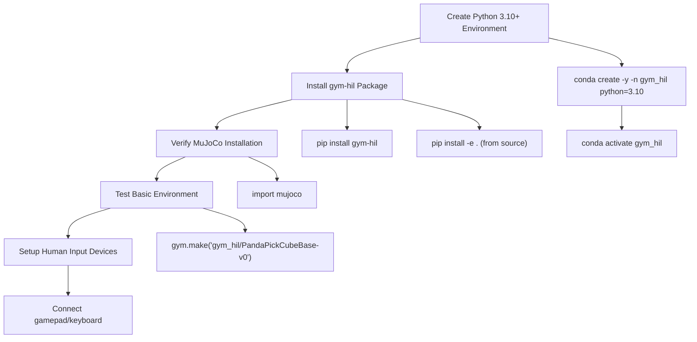

**Create virtual environment:**
```bash
conda create -y -n gym_hil python=3.10 && conda activate gym_hil
```

**Install from PyPI:**
```bash
pip install gym-hil
```

**Install from source:**
```bash
git clone https://github.com/HuggingFace/gym-hil.git && cd gym-hil
pip install -e .
```

Sources: [pyproject.toml:31-46](), [README.md:34-49]()

## Basic Usage Workflow

The gym-hil package follows the standard Gymnasium interface with additional HIL-specific features. The core workflow involves creating environments, handling human input, and processing intervention signals.

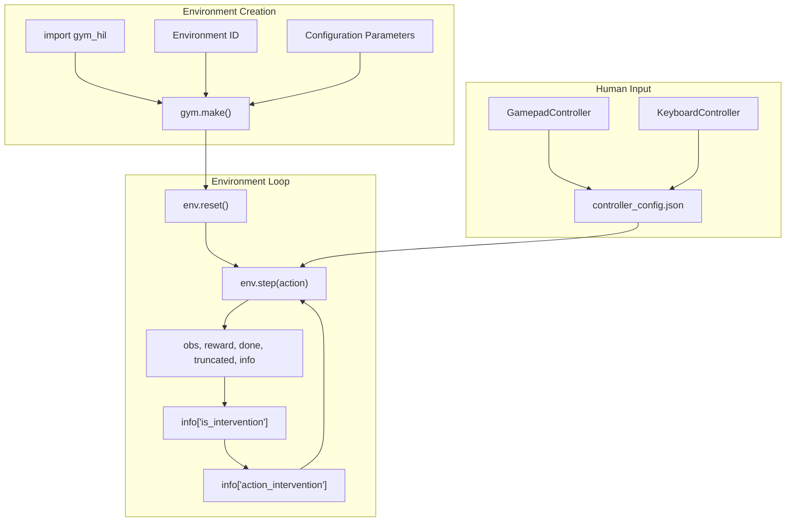

**Basic environment creation:**
```python
import gymnasium as gym
import gym_hil

env = gym.make("gym_hil/PandaPickCubeBase-v0", render_mode="human", image_obs=True)
```

**Standard gymnasium loop with HIL features:**
```python
obs, info = env.reset()
for i in range(200):
    obs, reward, done, truncated, info = env.step(env.action_space.sample())
    
    # Check for human intervention
    if info.get("is_intervention", False):
        executed_action = info["action_intervention"]
        print(f"Human intervened with action: {executed_action}")
    
    if done:
        obs, info = env.reset()
```

Sources: [README.md:53-80](), [examples/test_teleoperation.py:44-49](), [examples/test_teleoperation.py:78-96]()

## Available Environments

The gym-hil package provides multiple environment variants for different use cases, organized by base functionality and input modalities.

### Environment Hierarchy

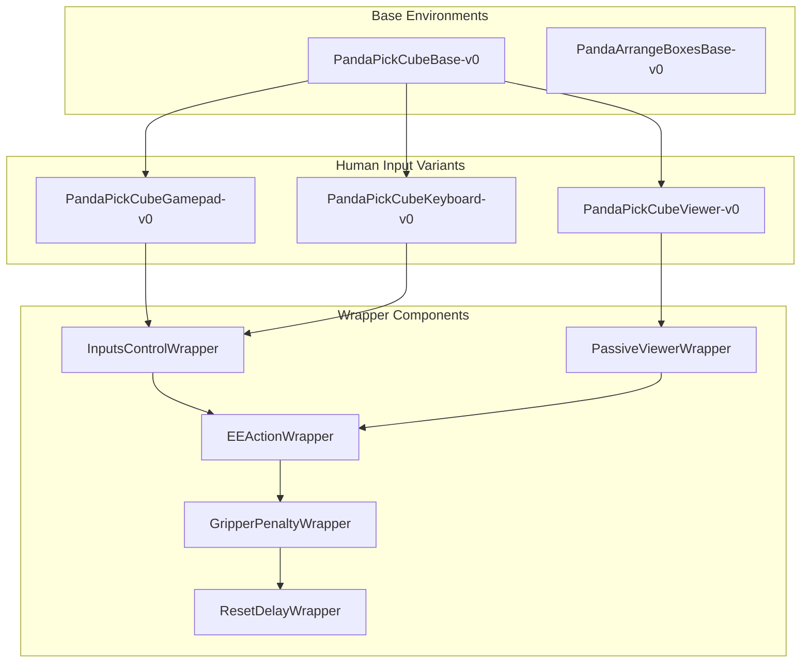

### Environment Specifications

| Environment ID | Description | Input Method | Wrappers Applied |
|---------------|-------------|--------------|------------------|
| `PandaPickCubeBase-v0` | Core cube picking task | None | Minimal |
| `PandaPickCubeGamepad-v0` | Gamepad-controlled teleoperation | Gamepad | `InputsControlWrapper`, `EEActionWrapper` |
| `PandaPickCubeKeyboard-v0` | Keyboard-controlled teleoperation | Keyboard | `InputsControlWrapper`, `EEActionWrapper` |
| `PandaPickCubeViewer-v0` | Passive viewing mode | None | `PassiveViewerWrapper` |
| `PandaArrangeBoxesBase-v0` | Multi-box arrangement task | None | Minimal |

**Environment creation examples:**
```python
# Base environment for algorithmic training
env = gym.make("gym_hil/PandaPickCubeBase-v0", render_mode="human")

# Gamepad teleoperation environment
env = gym.make("gym_hil/PandaPickCubeGamepad-v0", 
               render_mode="human", 
               use_gamepad=True,
               max_episode_steps=1000)

# Keyboard teleoperation environment
env = gym.make("gym_hil/PandaPickCubeKeyboard-v0", 
               render_mode="human", 
               use_keyboard=True)
```

Sources: [README.md:82-89](), [examples/test_teleoperation.py:44-69]()

## Your First Example

The `test_teleoperation.py` script demonstrates the complete workflow for human-in-the-loop interaction with the Panda robot.

### Running the Teleoperation Example

**Basic gamepad control:**
```bash
python examples/test_teleoperation.py
```

**Keyboard control:**
```bash
python examples/test_teleoperation.py --use-keyboard
```

**With custom controller configuration:**
```bash
python examples/test_teleoperation.py --controller-config path/to/config.json
```

### Key Components of the Example

The teleoperation script demonstrates several important patterns:

1. **Environment Configuration**: Setting up render modes, observation types, and episode limits
2. **Human Input Integration**: Handling both gamepad and keyboard input modalities
3. **Intervention Detection**: Monitoring and responding to human override signals
4. **Episode Management**: Handling resets and episode boundaries

```python
# Create environment with HIL wrappers
env_id = "gym_hil/PandaPickCubeKeyboard-v0" if args.use_keyboard else "gym_hil/PandaPickCubeGamepad-v0"
env = gym.make(env_id, render_mode=args.render_mode, image_obs=True, use_gamepad=not args.use_keyboard)

# Initialize dummy action for non-intervention states
dummy_action = np.zeros(4, dtype=np.float32)
dummy_action[-1] = 1  # Keep gripper in current state

# Main control loop
while True:
    obs, reward, terminated, truncated, info = env.step(dummy_action)
    
    if info.get("succeed", False):
        print("Success! Block has been picked up.")
    
    if terminated or truncated:
        obs, _ = env.reset()
```

Sources: [examples/test_teleoperation.py:26-110]()

## Default Controller Configuration

The package includes a default controller configuration that maps gamepad inputs to robot actions:

| Input | Action | Description |
|-------|--------|-------------|
| Left analog stick | X-Y movement | End-effector position in horizontal plane |
| Right analog stick (vertical) | Z movement | End-effector height adjustment |
| RB button | Intervention toggle | Enable/disable human control |
| LT button | Gripper close | Close robot gripper |
| RT button | Gripper open | Open robot gripper |
| Y/Triangle button | Success signal | Mark episode as successful |
| A/Cross button | Failure signal | Mark episode as failed |

The controller configuration is stored in `controller_config.json` and can be customized for different gamepad types.

Sources: [README.md:110-175](), [pyproject.toml:54]()

## Next Steps

After completing this getting started guide, explore these advanced topics:

- **[Core Architecture](#3)**: Understand the base classes and wrapper system
- **[Human Input System](#4)**: Learn about controller configuration and input handling
- **[Task Environments](#6)**: Explore specific robotic manipulation tasks
- **[Teleoperation](#7.1)**: Master human control techniques
- **[Development](#8)**: Set up development environment and contribute

For immediate experimentation, try modifying the teleoperation example to:
1. Adjust movement step sizes and control sensitivity
2. Add custom controller mappings
3. Record and analyze intervention patterns
4. Integrate with LeRobot for policy training

Sources: [README.md:177-184]()

---

# Page: Core Architecture

# Core Architecture

<details>
<summary>Relevant source files</summary>

The following files were used as context for generating this wiki page:

- [gym_hil/__init__.py](gym_hil/__init__.py)
- [gym_hil/envs/panda_pick_gym_env.py](gym_hil/envs/panda_pick_gym_env.py)
- [gym_hil/mujoco_gym_env.py](gym_hil/mujoco_gym_env.py)
- [gym_hil/wrappers/factory.py](gym_hil/wrappers/factory.py)
- [gym_hil/wrappers/viewer_wrapper.py](gym_hil/wrappers/viewer_wrapper.py)

</details>


The gym-hil core architecture provides a modular system for creating Human-in-the-Loop reinforcement learning environments built on MuJoCo physics simulation. The architecture consists of base environment classes, a flexible wrapper system, and a factory pattern for environment creation and configuration.

For detailed information about specific task implementations, see [Task Environments](#6). For human input handling mechanisms, see [Human Input System](#4).

## Base Environment Hierarchy

The foundation of gym-hil is built on a three-tier inheritance hierarchy that progressively adds functionality from basic MuJoCo integration to task-specific robotic manipulation environments.

### Class Inheritance Structure

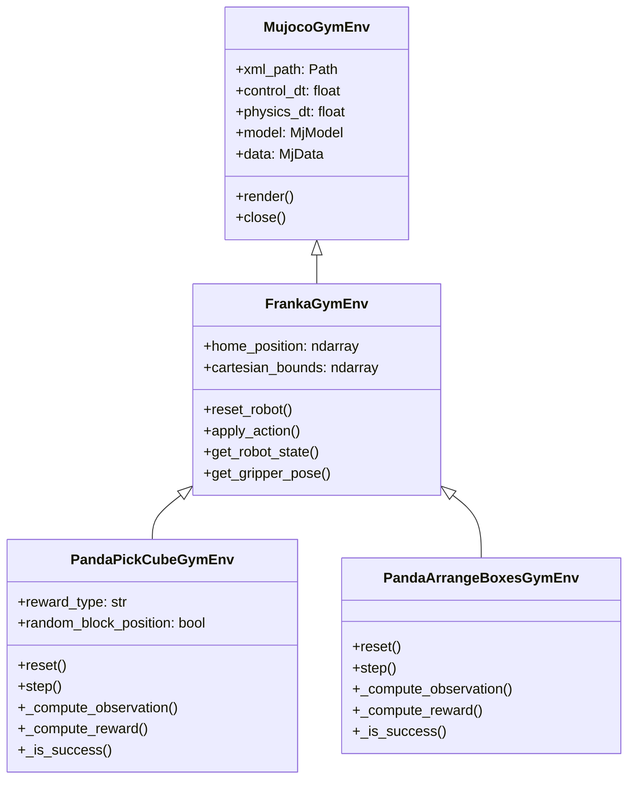

**Sources:** [gym_hil/mujoco_gym_env.py:39-116](), [gym_hil/mujoco_gym_env.py:117-283](), [gym_hil/envs/panda_pick_gym_env.py:30-199]()

The `MujocoGymEnv` class handles basic MuJoCo physics simulation integration, providing XML model loading, rendering capabilities, and timestep management. The `FrankaGymEnv` class extends this with Panda robot-specific functionality including operational space control and gripper management. Task-specific environments like `PandaPickCubeGymEnv` implement concrete manipulation tasks with custom observation spaces, reward functions, and success criteria.

## Wrapper System Architecture

The wrapper system provides modular functionality that can be composed around base environments to add HIL capabilities, rendering, and behavioral modifications.

### Wrapper Composition Flow

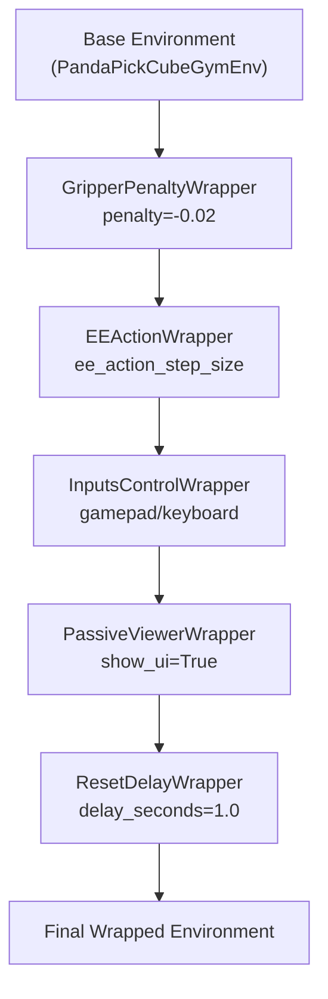

**Sources:** [gym_hil/wrappers/factory.py:25-81](), [gym_hil/wrappers/hil_wrappers.py](), [gym_hil/wrappers/viewer_wrapper.py:24-120]()

The wrapper system applies transformations in a specific order managed by the `wrap_env` function. Each wrapper adds distinct functionality: `GripperPenaltyWrapper` modifies rewards, `EEActionWrapper` converts end-effector commands, `InputsControlWrapper` handles human input, `PassiveViewerWrapper` provides visualization, and `ResetDelayWrapper` manages episode transitions.

## Environment Registration System

gym-hil uses Gymnasium's registration system to create multiple environment variants with different configurations and wrapper combinations.

### Registration Hierarchy

```mermaid
graph TD
    subgraph "Base Environments"
        PandaPickBase["gym_hil/PandaPickCubeBase-v0<br/>PandaPickCubeGymEnv"]
        PandaArrangeBase["gym_hil/PandaArrangeBoxesBase-v0<br/>PandaArrangeBoxesGymEnv"]
    end
    
    subgraph "Viewer Variants"
        PandaPickViewer["gym_hil/PandaPickCubeViewer-v0<br/>+ PassiveViewerWrapper"]
        PandaArrangeViewer["gym_hil/PandaArrangeBoxesViewer-v0<br/>+ PassiveViewerWrapper"]
    end
    
    subgraph "Factory Variants"
        PandaPickDefault["gym_hil/PandaPickCube-v0<br/>make_env()"]
        PandaPickGamepad["gym_hil/PandaPickCubeGamepad-v0<br/>make_env(use_gamepad=True)"]
        PandaPickKeyboard["gym_hil/PandaPickCubeKeyboard-v0<br/>make_env(use_viewer=True)"]
        PandaArrangeDefault["gym_hil/PandaArrangeBoxes-v0<br/>make_env()"]
        PandaArrangeGamepad["gym_hil/PandaArrangeBoxesGamepad-v0<br/>make_env(use_gamepad=True)"]
        PandaArrangeKeyboard["gym_hil/PandaArrangeBoxesKeyboard-v0<br/>make_env(use_viewer=True)"]
    end
    
    PandaPickBase --> PandaPickViewer
    PandaArrangeBase --> PandaArrangeViewer
    
    PandaPickBase --> PandaPickDefault
    PandaPickBase --> PandaPickGamepad
    PandaPickBase --> PandaPickKeyboard
    PandaArrangeBase --> PandaArrangeDefault
    PandaArrangeBase --> PandaArrangeGamepad
    PandaArrangeBase --> PandaArrangeKeyboard
```

**Sources:** [gym_hil/__init__.py:34-117]()

The registration system creates a three-tier structure: base environments provide core functionality, viewer variants add visualization, and factory variants use `make_env` to create fully configured HIL environments with specific input methods and wrapper combinations.

## Factory Pattern Implementation

The factory system provides a clean interface for creating and configuring environments with appropriate wrapper combinations.

### Factory Function Architecture

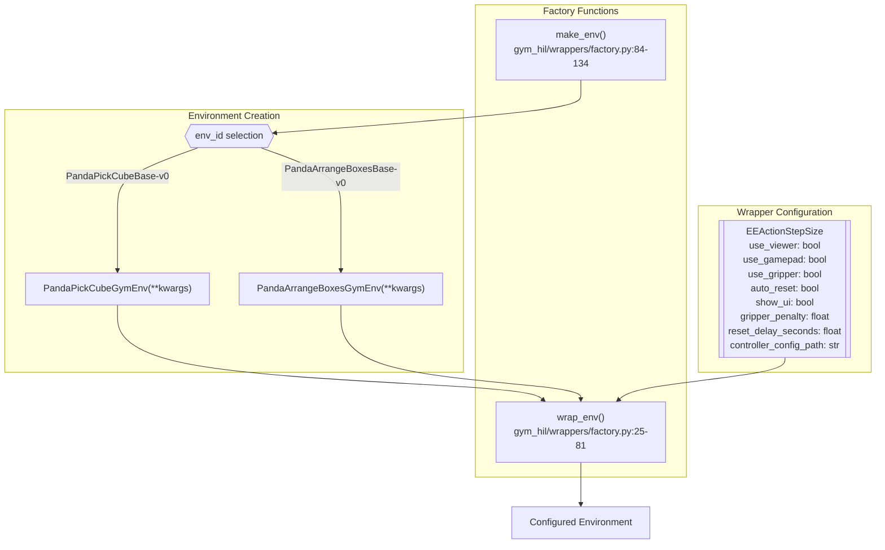

**Sources:** [gym_hil/wrappers/factory.py:84-134](), [gym_hil/wrappers/factory.py:25-81](), [gym_hil/wrappers/factory.py:19-23]()

The factory pattern separates environment creation from wrapper configuration. The `make_env` function handles base environment instantiation based on `env_id`, while `wrap_env` applies wrapper combinations based on configuration parameters. The `EEActionStepSize` TypedDict provides type safety for end-effector movement parameters.

## Component Integration

The architecture integrates multiple subsystems to create a cohesive HIL environment system.

### System Integration Flow

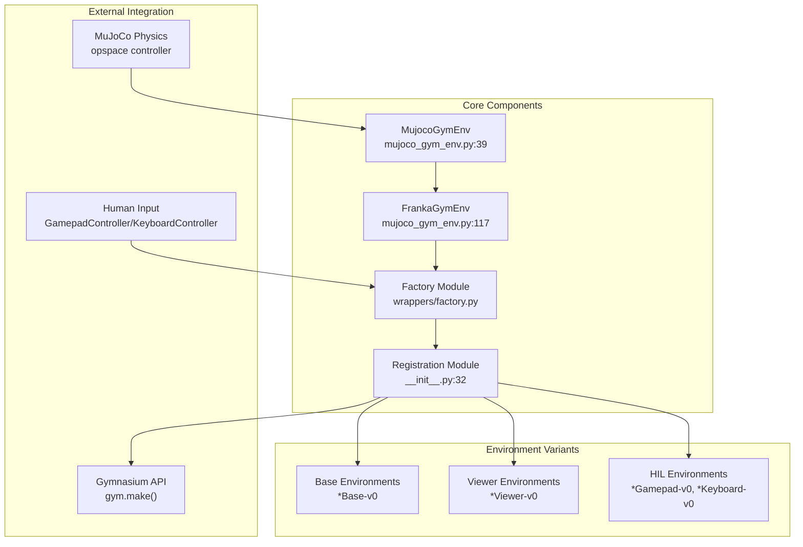

**Sources:** [gym_hil/__init__.py:17-30](), [gym_hil/mujoco_gym_env.py:26](), [gym_hil/wrappers/factory.py:3-16]()

The system integrates base environment classes with the factory pattern and registration system to provide a unified interface through the Gymnasium API. The MuJoCo physics engine and operational space control provide the simulation foundation, while human input controllers enable interactive control. The modular architecture allows for flexible configuration of environment variants suitable for different use cases.

---

# Page: Base Environments

# Base Environments

<details>
<summary>Relevant source files</summary>

The following files were used as context for generating this wiki page:

- [gym_hil/envs/__init__.py](gym_hil/envs/__init__.py)
- [gym_hil/envs/panda_pick_gym_env.py](gym_hil/envs/panda_pick_gym_env.py)
- [gym_hil/mujoco_gym_env.py](gym_hil/mujoco_gym_env.py)
- [gym_hil/wrappers/viewer_wrapper.py](gym_hil/wrappers/viewer_wrapper.py)

</details>


This section covers the foundational environment classes that provide MuJoCo physics simulation and Franka Panda robot control capabilities. These base classes form the inheritance hierarchy that all task-specific environments build upon.

For information about the wrapper system that adds Human-in-the-Loop functionality to these environments, see [HIL Wrappers](#3.2). For details about specific task implementations, see [Task Environments](#6).

## Class Hierarchy

The base environment system follows a clear inheritance structure that separates concerns between physics simulation, robot control, and task-specific logic:

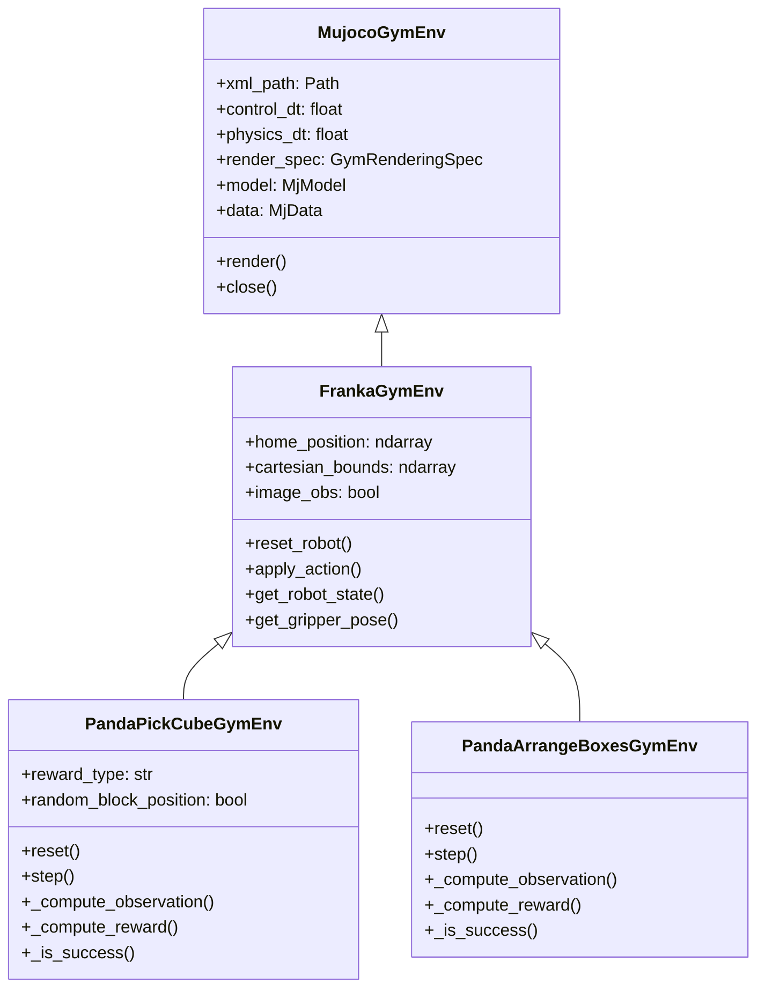

**Sources:** [gym_hil/mujoco_gym_env.py:39-116](), [gym_hil/mujoco_gym_env.py:117-283](), [gym_hil/envs/panda_pick_gym_env.py:30-199](), [gym_hil/envs/__init__.py:17-18]()

## MujocoGymEnv - Base MuJoCo Integration

The `MujocoGymEnv` class provides the fundamental integration between MuJoCo physics simulation and the Gymnasium API. It handles low-level physics simulation, rendering, and resource management.

### Core Components

| Component | Purpose | Configuration |
|-----------|---------|---------------|
| `MjModel` | Physics model loaded from XML | Via `xml_path` parameter |
| `MjData` | Simulation state data | Initialized with model |
| `MjRenderer` | Rendering pipeline | Configured via `GymRenderingSpec` |
| Control Loop | Physics timestep management | `control_dt` and `physics_dt` |

### Key Methods

- **`render()`**: Generates visual frames using MuJoCo's rendering system
- **`close()`**: Safely releases graphics resources with version compatibility
- **Property accessors**: Provide access to `model`, `data`, timing parameters, and random state

### Rendering Configuration

The `GymRenderingSpec` dataclass controls rendering parameters:

```python
@dataclass(frozen=True)
class GymRenderingSpec:
    height: int = 128
    width: int = 128
    camera_id: str | int = -1
    mode: Literal["rgb_array", "human"] = "rgb_array"
```

**Sources:** [gym_hil/mujoco_gym_env.py:39-116](), [gym_hil/mujoco_gym_env.py:31-37]()

## FrankaGymEnv - Franka Panda Robot Control

The `FrankaGymEnv` class extends `MujocoGymEnv` to provide Franka Panda robot-specific functionality, including operational space control, multi-camera rendering, and standardized robot state management.

### Robot Configuration

The environment is initialized with robot-specific parameters:

| Parameter | Purpose | Default Value |
|-----------|---------|---------------|
| `home_position` | 7-DOF joint configuration | `(0, -0.785, 0, -2.35, 0, 1.57, π/4)` |
| `cartesian_bounds` | Workspace limits (x,y,z) | `[[0.2, -0.3, 0], [0.6, 0.3, 0.5]]` |
| `image_obs` | Enable visual observations | `False` |

### Control System Architecture

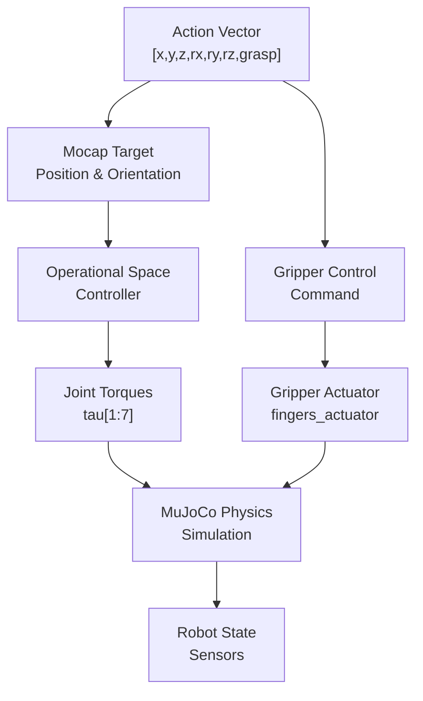

**Sources:** [gym_hil/mujoco_gym_env.py:117-283](), [gym_hil/mujoco_gym_env.py:230-259]()

### Action Space

The action space is a 7-dimensional continuous vector:

```python
action_space = spaces.Box(
    low=np.array([-1.0, -1.0, -1.0, -1.0, -1.0, -1.0, -1.0]),
    high=np.array([1.0, 1.0, 1.0, 1.0, 1.0, 1.0, 1.0]),
    dtype=np.float32
)
```

Components: `[x_delta, y_delta, z_delta, rx_delta, ry_delta, rz_delta, grasp_command]`

### Observation Space

The observation space structure depends on the `image_obs` parameter:

#### State-Only Observations
```python
observation_space = spaces.Dict({
    "agent_pos": spaces.Dict({
        "tcp_pose": spaces.Box(-np.inf, np.inf, shape=(7,)),
        "tcp_vel": spaces.Box(-np.inf, np.inf, shape=(6,)),
        "gripper_pose": spaces.Box(-1, 1, shape=(1,))
    })
})
```

#### Image + State Observations
When `image_obs=True`, additional pixel observations are included from two cameras:
- `"front"`: External view camera
- `"wrist"`: Hand-mounted camera (`handcam_rgb`)

### Key Methods

- **`reset_robot()`**: Resets robot to home position and synchronizes mocap target
- **`apply_action()`**: Converts action vector to robot commands using operational space control
- **`get_robot_state()`**: Returns concatenated robot state vector
- **`render()`**: Generates multi-camera visual observations

**Sources:** [gym_hil/mujoco_gym_env.py:117-283](), [gym_hil/mujoco_gym_env.py:212-219](), [gym_hil/mujoco_gym_env.py:175-211]()

## Task-Specific Environment Interface

Task environments inherit from `FrankaGymEnv` and implement the standard Gymnasium interface methods:

### Required Methods

| Method | Purpose | Returns |
|--------|---------|---------|
| `reset()` | Initialize episode state | `(observation, info)` |
| `step()` | Execute one environment step | `(obs, reward, terminated, truncated, info)` |
| `_compute_observation()` | Generate observation dict | `Dict[str, np.ndarray]` |
| `_compute_reward()` | Calculate step reward | `float` |
| `_is_success()` | Check task completion | `bool` |

### Common Implementation Pattern

Task environments typically follow this structure:

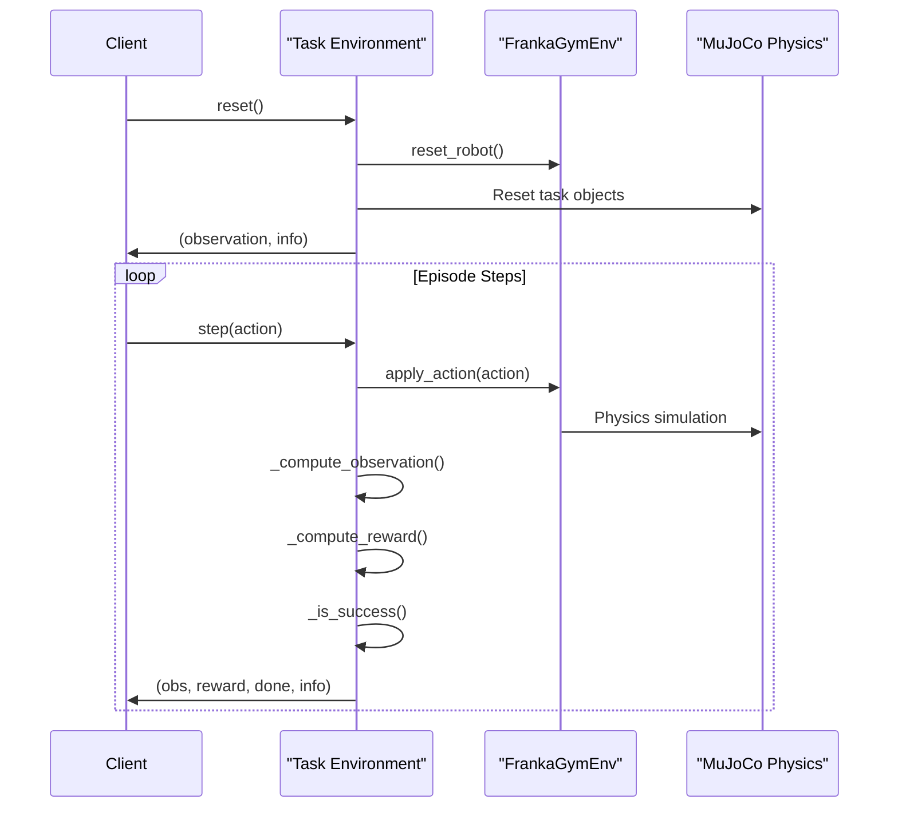

**Sources:** [gym_hil/envs/panda_pick_gym_env.py:101-149](), [gym_hil/envs/panda_pick_gym_env.py:150-199]()

## Environment Registration

The base environments are registered with specific naming conventions through the environment factory system. Each task environment is available in multiple variants:

- `*Base-v0`: Raw environment without wrappers
- `*Gamepad-v0`: Configured for gamepad control
- `*Keyboard-v0`: Configured for keyboard control  
- `*Viewer-v0`: Includes passive viewer

The inheritance chain ensures that all registered environments inherit the robust physics simulation and robot control capabilities provided by the base classes.

**Sources:** [gym_hil/envs/__init__.py:17-20]()

---

# Page: HIL Wrappers

# HIL Wrappers

<details>
<summary>Relevant source files</summary>

The following files were used as context for generating this wiki page:

- [gym_hil/wrappers/hil_wrappers.py](gym_hil/wrappers/hil_wrappers.py)
- [tests/test_ee_action_wrapper.py](tests/test_ee_action_wrapper.py)

</details>


## Purpose and Scope

The HIL Wrappers system provides a collection of Gymnasium wrapper classes that add Human-in-the-Loop (HIL) functionality to base robotic environments. These wrappers transform action spaces, handle human input intervention, apply task-specific penalties, and manage episode timing. They form a key component of the gym-hil framework by bridging the gap between standard RL environments and human-guided robotic control.

For information about the base environment classes that these wrappers extend, see [Base Environments](#3.1). For details about the environment factory system that assembles these wrappers, see [Environment Factory](#3.3).

## Wrapper Architecture Overview

The HIL wrapper system follows a chain-of-responsibility pattern where each wrapper adds specific functionality while maintaining the Gymnasium interface. The wrappers are typically applied in a specific order to ensure proper action transformation and human input handling.

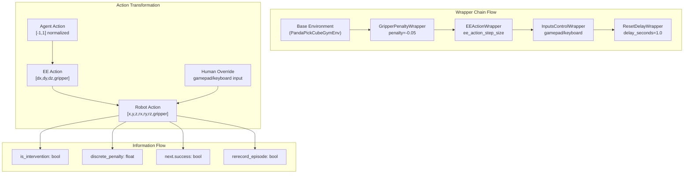

Sources: [gym_hil/wrappers/hil_wrappers.py:29-311]()

## Wrapper Classes

### GripperPenaltyWrapper

The `GripperPenaltyWrapper` applies penalties for inefficient gripper usage by detecting rapid open/close cycles. It tracks gripper state changes and applies a configurable penalty when the gripper command contradicts the current gripper position.

| Parameter | Type | Default | Description |
|-----------|------|---------|-------------|
| `penalty` | float | -0.05 | Penalty value applied for inefficient gripper usage |

**Penalty Logic:**
- Penalty applied when closing gripper (action < -0.5) while already closed (position < 0.1)
- Penalty applied when opening gripper (action > 0.5) while already open (position > 0.9)
- Gripper position normalized by `MAX_GRIPPER_COMMAND` constant

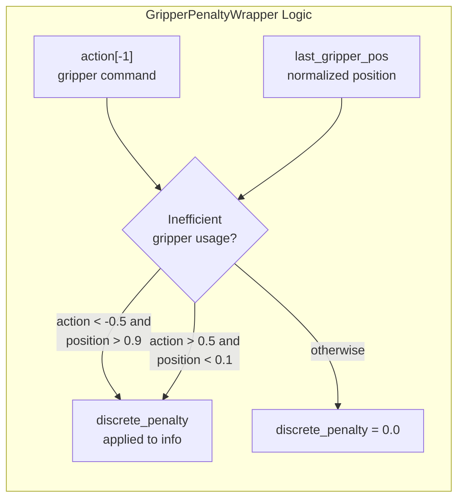

Sources: [gym_hil/wrappers/hil_wrappers.py:29-51]()

### EEActionWrapper

The `EEActionWrapper` transforms high-level end-effector commands into the 7-dimensional action space expected by the underlying MuJoCo environment. It handles coordinate system scaling and optional gripper control.

| Parameter | Type | Description |
|-----------|------|-------------|
| `ee_action_step_size` | dict | Step sizes for x, y, z movements in meters |
| `use_gripper` | bool | Whether to include gripper control in action space |

**Action Space Transformation:**
- Input: 3D or 4D action space (x, y, z, optional gripper)
- Output: 7D MuJoCo action space (x, y, z, rx, ry, rz, gripper)
- Orientation control (rx, ry, rz) currently set to zeros
- Gripper command normalized from [0, 2] to [-1, 1] range

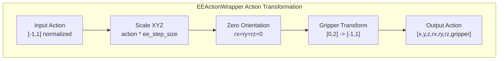

Sources: [gym_hil/wrappers/hil_wrappers.py:53-104](), [tests/test_ee_action_wrapper.py:39-99]()

### InputsControlWrapper

The `InputsControlWrapper` enables human intervention through gamepad or keyboard input. It creates controller instances, monitors for human input, and overrides agent actions when intervention is detected.

| Parameter | Type | Default | Description |
|-----------|------|---------|-------------|
| `x_step_size` | float | 1.0 | Movement step size for X axis |
| `y_step_size` | float | 1.0 | Movement step size for Y axis |
| `z_step_size` | float | 1.0 | Movement step size for Z axis |
| `use_gripper` | bool | False | Enable gripper control |
| `auto_reset` | bool | False | Auto-reset environment on episode end |
| `input_threshold` | float | 0.001 | Minimum input delta for intervention |
| `use_gamepad` | bool | True | Use gamepad instead of keyboard |
| `controller_config_path` | str | None | Path to controller configuration |

**Controller Selection Logic:**
- macOS: `GamepadControllerHID` (uses HID API)
- Other platforms: `GamepadController` (uses Pygame)
- Keyboard: `KeyboardController` (uses pynput)

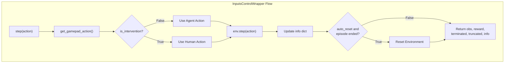

**Information Dictionary Updates:**
- `is_intervention`: Boolean indicating if human overrode the action
- `action_intervention`: The actual action used (agent or human)
- `rerecord_episode`: Boolean for episode rerecording requests
- `next.success`: Success status when episode ends

Sources: [gym_hil/wrappers/hil_wrappers.py:106-283]()

### ResetDelayWrapper

The `ResetDelayWrapper` adds a configurable time delay during environment reset operations. This provides a pause between episodes to allow human observation and preparation.

| Parameter | Type | Default | Description |
|-----------|------|---------|-------------|
| `delay_seconds` | float | 1.0 | Number of seconds to delay during reset |

The wrapper uses Python's `time.sleep()` to implement the delay and logs the delay duration for debugging purposes.

Sources: [gym_hil/wrappers/hil_wrappers.py:285-311]()

## Configuration and Integration

### Default Configuration

The HIL wrappers use several default configurations defined as module-level constants:

```python
DEFAULT_EE_STEP_SIZE = {"x": 0.025, "y": 0.025, "z": 0.025}
MAX_GRIPPER_COMMAND = 0.04  # From mujoco_gym_env.py
```

### Wrapper Chain Assembly

The wrappers are typically assembled in the following order through the environment factory system:

1. **GripperPenaltyWrapper** - Applied first to track gripper state
2. **EEActionWrapper** - Transforms action space for end-effector control
3. **InputsControlWrapper** - Enables human input intervention
4. **ResetDelayWrapper** - Applied last to manage episode timing

This order ensures proper action transformation flow and maintains the Gymnasium interface at each level.

Sources: [gym_hil/wrappers/hil_wrappers.py:26-27](), [gym_hil/mujoco_gym_env.py:24]()

---

# Page: Environment Factory

# Environment Factory

<details>
<summary>Relevant source files</summary>

The following files were used as context for generating this wiki page:

- [gym_hil/wrappers/factory.py](gym_hil/wrappers/factory.py)

</details>


## Purpose and Scope

The Environment Factory provides a centralized interface for creating and configuring gym-hil environments with specific wrapper combinations. It serves as the main entry point for instantiating environments with Human-in-the-Loop (HIL) functionality, handling the complex process of applying wrappers in the correct order and with appropriate configurations.

This factory system simplifies environment creation by encapsulating the wrapper application logic and providing sensible defaults for common use cases. For information about the individual wrapper components applied by the factory, see [HIL Wrappers](#3.2). For details about the base environment classes that the factory instantiates, see [Base Environments](#3.1).

## Factory Functions

The environment factory exposes two primary functions that work together to create configured environments:

### Core Factory Functions

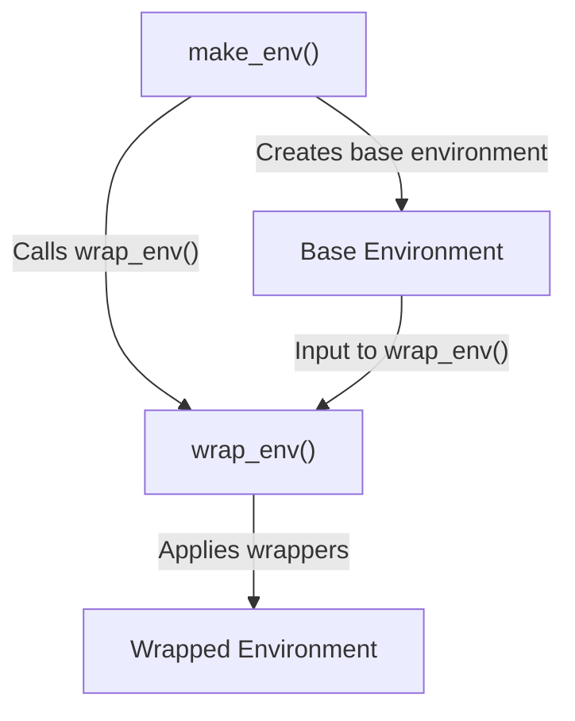

The `make_env()` function at [gym_hil/wrappers/factory.py:84-134]() serves as the primary entry point, creating a base environment and then applying wrappers through `wrap_env()`. The `wrap_env()` function at [gym_hil/wrappers/factory.py:25-81]() focuses specifically on wrapper application logic.

Sources: [gym_hil/wrappers/factory.py:84-134]()

### Base Environment Creation

The factory currently supports two base environment types:

| Environment ID | Class | Purpose |
|---|---|---|
| `gym_hil/PandaPickCubeBase-v0` | `PandaPickCubeGymEnv` | Cube picking manipulation task |
| `gym_hil/PandaArrangeBoxesBase-v0` | `PandaArrangeBoxesGymEnv` | Multi-object arrangement task |

The environment creation logic at [gym_hil/wrappers/factory.py:116-121]() directly instantiates these environment classes rather than using Gymnasium's registration system for the base variants.

Sources: [gym_hil/wrappers/factory.py:116-121]()

## Wrapper Application Order

The factory applies wrappers in a specific sequence to ensure proper functionality:

### Wrapper Chain Diagram

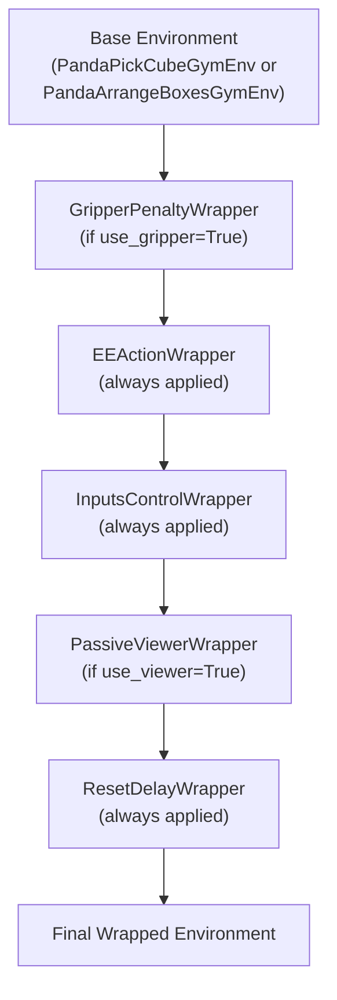

The wrapper application follows this order at [gym_hil/wrappers/factory.py:55-79]():

1. **GripperPenaltyWrapper** - Applied first if `use_gripper=True`, adds penalty for gripper actions
2. **EEActionWrapper** - Converts end-effector actions to joint space, always applied
3. **InputsControlWrapper** - Handles human input integration, always applied
4. **PassiveViewerWrapper** - Adds visualization capability if `use_viewer=True`
5. **ResetDelayWrapper** - Adds delay during environment reset, always applied last

Sources: [gym_hil/wrappers/factory.py:55-79]()

## Configuration Options

The factory functions accept comprehensive configuration parameters to customize environment behavior:

### Configuration Parameters

| Parameter | Type | Default | Purpose |
|---|---|---|---|
| `ee_step_size` | `EEActionStepSize` | `DEFAULT_EE_STEP_SIZE` | Step size for end-effector movement |
| `use_viewer` | `bool` | `False` | Enable passive viewer for visualization |
| `use_gamepad` | `bool` | `False` | Use gamepad instead of keyboard input |
| `use_gripper` | `bool` | `True` | Enable gripper control |
| `auto_reset` | `bool` | `False` | Automatically reset on episode end |
| `show_ui` | `bool` | `True` | Show UI panels in viewer |
| `gripper_penalty` | `float` | `-0.02` | Penalty value for gripper actions |
| `reset_delay_seconds` | `float` | `1.0` | Delay duration during reset |
| `controller_config_path` | `str` | `None` | Path to controller configuration JSON |

### EEActionStepSize Configuration

The `EEActionStepSize` TypedDict at [gym_hil/wrappers/factory.py:19-23]() defines movement step sizes for each axis:

```python
class EEActionStepSize(TypedDict):
    x: float
    y: float
    z: float
```

This configuration allows fine-grained control over end-effector movement sensitivity in each spatial dimension.

Sources: [gym_hil/wrappers/factory.py:19-23](), [gym_hil/wrappers/factory.py:25-49]()

## Environment Creation Flow

The complete environment creation process follows a structured flow:

### Creation Flow Diagram

```mermaid
flowchart TD
    Start["make_env() called"]
    ValidateID["Validate env_id"]
    CreateBase["Create base environment<br/>(PandaPickCubeGymEnv or<br/>PandaArrangeBoxesGymEnv)"]
    CallWrapEnv["Call wrap_env()"]
    
    subgraph "wrap_env() execution"
        ApplyGripper["Apply GripperPenaltyWrapper<br/>(if use_gripper)"]
        ApplyEE["Apply EEActionWrapper<br/>(with ee_step_size)"]
        ApplyInputs["Apply InputsControlWrapper<br/>(with controller config)"]
        ApplyViewer["Apply PassiveViewerWrapper<br/>(if use_viewer)"]
        ApplyReset["Apply ResetDelayWrapper<br/>(with delay_seconds)"]
    end
    
    Return["Return wrapped environment"]
    Error["Raise ValueError<br/>for unsupported env_id"]
    
    Start --> ValidateID
    ValidateID -->|"Supported ID"| CreateBase
    ValidateID -->|"Unsupported ID"| Error
    CreateBase --> CallWrapEnv
    CallWrapEnv --> ApplyGripper
    ApplyGripper --> ApplyEE
    ApplyEE --> ApplyInputs
    ApplyInputs --> ApplyViewer
    ApplyViewer --> ApplyReset
    ApplyReset --> Return
```

The factory ensures consistent wrapper application order and proper configuration propagation throughout the wrapper chain. Error handling occurs at [gym_hil/wrappers/factory.py:120-121]() for unsupported environment IDs.

Sources: [gym_hil/wrappers/factory.py:84-134](), [gym_hil/wrappers/factory.py:25-81]()

---

# Page: Human Input System

# Human Input System

<details>
<summary>Relevant source files</summary>

The following files were used as context for generating this wiki page:

- [gym_hil/controller_config.json](gym_hil/controller_config.json)
- [gym_hil/wrappers/intervention_utils.py](gym_hil/wrappers/intervention_utils.py)

</details>


The Human Input System provides the core functionality for capturing and processing human input in the gym-hil Human-in-the-Loop Reinforcement Learning framework. This system enables human operators to control the Panda robot through various input devices including keyboard and gamepad controllers, supporting real-time intervention during RL training and teleoperation scenarios.

This document covers the input controller classes, configuration system, and integration mechanisms. For information about how these inputs are processed within the HIL environment wrappers, see [HIL Wrappers](#3.2). For details on the specific input controller implementations, see [Input Controllers](#4.1).

## Controller Architecture

The Human Input System is built around a hierarchical class structure with a base `InputController` class and specialized implementations for different input devices.

### Controller Class Hierarchy

```mermaid
classDiagram
    class InputController {
        +x_step_size: float
        +y_step_size: float
        +z_step_size: float
        +running: bool
        +episode_end_status: str
        +intervention_flag: bool
        +open_gripper_command: bool
        +close_gripper_command: bool
        +start()
        +stop()
        +reset()
        +get_deltas() tuple
        +update()
        +should_intervene() bool
        +gripper_command() str
        +get_episode_end_status() str
    }
    
    class KeyboardController {
        +key_states: dict
        +listener: keyboard.Listener
        +start()
        +stop()
        +get_deltas() tuple
        +should_intervene() bool
        +reset()
    }
    
    class GamepadController {
        +deadzone: float
        +joystick: pygame.Joystick
        +controller_config: dict
        +start()
        +stop()
        +update()
        +get_deltas() tuple
    }
    
    class GamepadControllerHID {
        +deadzone: float
        +device: hid.device
        +device_info: dict
        +left_x: float
        +left_y: float
        +right_x: float
        +right_y: float
        +buttons: dict
        +start()
        +stop()
        +update()
        +get_deltas() tuple
    }
    
    InputController <|-- KeyboardController
    InputController <|-- GamepadController
    InputController <|-- GamepadControllerHID
```

Sources: [gym_hil/wrappers/intervention_utils.py:46-119](), [gym_hil/wrappers/intervention_utils.py:121-244](), [gym_hil/wrappers/intervention_utils.py:246-389](), [gym_hil/wrappers/intervention_utils.py:391-549]()

### Base Controller Interface

The `InputController` base class defines the standard interface for all input controllers, providing common functionality for movement deltas, gripper control, and intervention detection.

| Method | Purpose | Return Type |
|--------|---------|-------------|
| `get_deltas()` | Get current movement deltas (dx, dy, dz) | `tuple[float, float, float]` |
| `should_intervene()` | Check if human intervention is active | `bool` |
| `gripper_command()` | Get current gripper command | `str` ("open", "close", "no-op") |
| `get_episode_end_status()` | Get episode termination status | `str` (None, "success", "failure") |
| `update()` | Process input events | `None` |
| `start()` / `stop()` | Initialize/cleanup resources | `None` |

Sources: [gym_hil/wrappers/intervention_utils.py:79-119]()

## Input Processing Flow

The system processes human input through a standardized pipeline that converts raw input events into robot control commands.

### Input Processing Pipeline

```mermaid
sequenceDiagram
    participant Human as "Human Operator"
    participant Device as "Input Device"
    participant Controller as "InputController"
    participant HIL as "HIL Environment"
    participant Robot as "Panda Robot"
    
    Human->>Device: "Physical Input"
    Device->>Controller: "Raw Input Events"
    Controller->>Controller: "update()"
    Controller->>Controller: "Process Events"
    
    HIL->>Controller: "get_deltas()"
    Controller->>HIL: "Movement Deltas"
    
    HIL->>Controller: "should_intervene()"
    Controller->>HIL: "Intervention Flag"
    
    HIL->>Controller: "gripper_command()"
    Controller->>HIL: "Gripper Command"
    
    HIL->>Robot: "Combined Action"
    Robot->>HIL: "Observation"
```

Sources: [gym_hil/wrappers/intervention_utils.py:79-119]()

### Input Event Processing

Each controller type processes input events differently but follows the same general pattern:

1. **Event Capture**: Raw input events are captured from the device
2. **State Update**: Internal state variables are updated based on events
3. **Delta Calculation**: Movement deltas are calculated from current state
4. **Command Generation**: Gripper and intervention commands are generated
5. **Status Reporting**: Episode status and intervention flags are reported

Sources: [gym_hil/wrappers/intervention_utils.py:83-85](), [gym_hil/wrappers/intervention_utils.py:301-341](), [gym_hil/wrappers/intervention_utils.py:475-532]()

## Configuration System

The Human Input System uses a JSON-based configuration system to support different gamepad controllers with varying button and axis mappings.

### Configuration Structure

```mermaid
graph TB
    subgraph "controller_config.json"
        DefaultConfig["default"]
        Xbox360["Xbox 360 Controller"]
        PS4["PS4 Controller"]
        LogitechF310["Logitech Gamepad F310"]
        LogitechF710["Logitech Wireless Gamepad F710"]
        LogitechRumble["Logitech Cordless RumblePad 2"]
    end
    
    subgraph "Configuration Structure"
        Axes["axes"]
        Buttons["buttons"]
        AxisInversion["axis_inversion"]
    end
    
    subgraph "load_controller_config()"
        LoadFunction["load_controller_config()"]
        ControllerName["controller_name"]
        ConfigPath["config_path"]
    end
    
    DefaultConfig --> Axes
    DefaultConfig --> Buttons
    DefaultConfig --> AxisInversion
    
    LoadFunction --> ControllerName
    LoadFunction --> ConfigPath
    LoadFunction --> DefaultConfig
```

Sources: [gym_hil/controller_config.json:1-146](), [gym_hil/wrappers/intervention_utils.py:21-43]()

### Configuration Parameters

The configuration system supports three main parameter categories:

| Category | Description | Example |
|----------|-------------|---------|
| `axes` | Maps logical axes to device axis indices | `{"left_x": 0, "left_y": 1}` |
| `buttons` | Maps logical buttons to device button indices | `{"a": 0, "b": 1, "x": 2, "y": 3}` |
| `axis_inversion` | Defines axis inversion settings | `{"left_x": false, "left_y": true}` |

Sources: [gym_hil/controller_config.json:2-25]()

### Supported Controllers

The system includes predefined configurations for common gamepad controllers:

- **Xbox 360 Controller**: Standard Xbox gamepad with specific axis mappings
- **PS4 Controller**: PlayStation 4 DualShock controller
- **Logitech Gamepad F310**: Logitech F310 gamepad
- **Logitech Wireless Gamepad F710**: Logitech F710 wireless gamepad
- **Logitech Cordless RumblePad 2**: Logitech RumblePad 2

Sources: [gym_hil/controller_config.json:26-145]()

## Input Device Integration

The system supports two primary input device types, each with specific integration mechanisms and capabilities.

### Keyboard Controller Integration

```mermaid
graph LR
    subgraph "KeyboardController"
        KeyStates["key_states dict"]
        Listener["pynput.keyboard.Listener"]
        OnPress["on_press()"]
        OnRelease["on_release()"]
    end
    
    subgraph "Key Mappings"
        Movement["Arrow Keys → X-Y Movement"]
        Elevation["Shift Keys → Z Movement"]
        Gripper["Ctrl Keys → Gripper Control"]
        Episode["Enter/Esc → Episode Control"]
        Intervention["Space → Intervention Toggle"]
    end
    
    Listener --> OnPress
    Listener --> OnRelease
    OnPress --> KeyStates
    OnRelease --> KeyStates
    KeyStates --> Movement
    KeyStates --> Elevation
    KeyStates --> Gripper
    KeyStates --> Episode
    KeyStates --> Intervention
```

Sources: [gym_hil/wrappers/intervention_utils.py:121-244]()

### Gamepad Controller Integration

```mermaid
graph TB
    subgraph "GamepadController (pygame)"
        PygameInit["pygame.init()"]
        JoystickInit["pygame.joystick.init()"]
        ConfigLoad["load_controller_config()"]
        EventLoop["pygame.event.get()"]
    end
    
    subgraph "GamepadControllerHID (HIDAPI)"
        HIDEnum["hid.enumerate()"]
        DeviceOpen["device.open_path()"]
        RawRead["device.read(64)"]
        DataParse["Parse Raw Bytes"]
    end
    
    subgraph "Common Processing"
        DeadzoneApply["Apply Deadzone"]
        AxisInvert["Apply Axis Inversion"]
        DeltaCalc["Calculate Movement Deltas"]
        ButtonState["Process Button States"]
    end
    
    PygameInit --> ConfigLoad
    ConfigLoad --> EventLoop
    EventLoop --> DeadzoneApply
    
    HIDEnum --> DeviceOpen
    DeviceOpen --> RawRead
    RawRead --> DataParse
    DataParse --> DeadzoneApply
    
    DeadzoneApply --> AxisInvert
    AxisInvert --> DeltaCalc
    DeltaCalc --> ButtonState
```

Sources: [gym_hil/wrappers/intervention_utils.py:257-389](), [gym_hil/wrappers/intervention_utils.py:438-549]()

## Intervention Mechanisms

The Human Input System provides multiple mechanisms for human intervention and control during robot operation.

### Intervention Control Flow

```mermaid
flowchart TD
    InputDevice["Input Device"] --> Controller["InputController"]
    Controller --> InterventionFlag{"`should_intervene()`"}
    Controller --> MovementDeltas{"`get_deltas()`"}
    Controller --> GripperCmd{"`gripper_command()`"}
    Controller --> EpisodeStatus{"`get_episode_end_status()`"}
    
    InterventionFlag -->|True| HumanControl["Human Control Active"]
    InterventionFlag -->|False| AgentControl["Agent Control Active"]
    
    MovementDeltas --> ActionCalc["Action Calculation"]
    GripperCmd --> ActionCalc
    EpisodeStatus --> EpisodeEnd["Episode Termination"]
    
    ActionCalc --> RobotAction["Robot Action"]
    HumanControl --> RobotAction
    AgentControl --> RobotAction
```

Sources: [gym_hil/wrappers/intervention_utils.py:107-119]()

### Control Command Types

The system supports multiple types of control commands:

| Command Type | Purpose | Implementation |
|--------------|---------|----------------|
| **Movement Deltas** | 3D end-effector movement | `get_deltas()` returns (dx, dy, dz) |
| **Gripper Control** | Open/close gripper | `gripper_command()` returns "open"/"close"/"no-op" |
| **Intervention Flag** | Enable/disable human control | `should_intervene()` returns boolean |
| **Episode Control** | Terminate episodes | `get_episode_end_status()` returns status |

Sources: [gym_hil/wrappers/intervention_utils.py:79-119]()

### Input Command Mapping

Different input devices map to robot commands through device-specific implementations:

**Keyboard Mapping:**
- Arrow keys → X-Y movement deltas
- Shift keys → Z movement deltas  
- Ctrl keys → Gripper control
- Space → Intervention toggle
- Enter/Esc → Episode termination

**Gamepad Mapping:**
- Left analog stick → X-Y movement deltas
- Right analog stick (Y-axis) → Z movement deltas
- Trigger buttons → Gripper control
- Shoulder button → Intervention toggle
- Face buttons → Episode control

Sources: [gym_hil/wrappers/intervention_utils.py:199-207](), [gym_hil/wrappers/intervention_utils.py:280-289]()

---

# Page: Input Controllers

# Input Controllers

<details>
<summary>Relevant source files</summary>

The following files were used as context for generating this wiki page:

- [gym_hil/wrappers/intervention_utils.py](gym_hil/wrappers/intervention_utils.py)
- [tests/test_intervention_utils.py](tests/test_intervention_utils.py)

</details>


This document covers the input controller system that captures human input from keyboards and gamepads to generate motion deltas for robot control in the HIL (Human-in-the-Loop) system. The input controllers are the primary interface between human operators and the robotic manipulation environments.

For information about the JSON-based controller configuration system, see [Controller Configuration](#4.2). For details on how input controllers integrate with the HIL wrapper system, see [HIL Wrappers](#3.2).

## Overview

The input controller system provides a unified interface for capturing human input from different devices (keyboard, gamepad via pygame, gamepad via HIDAPI) and converting them into standardized motion deltas and control commands for the Panda robot. All controllers implement a common interface defined by the `InputController` base class.

## Controller Architecture

The input controller system follows a hierarchical class structure with a common base class and specialized implementations for different input devices:

**InputController Class Hierarchy**
```mermaid
classDiagram
    class InputController {
        +x_step_size: float
        +y_step_size: float
        +z_step_size: float
        +running: bool
        +intervention_flag: bool
        +episode_end_status: str
        +start()
        +stop()
        +get_deltas()
        +should_intervene()
        +gripper_command()
        +get_episode_end_status()
    }
    
    class KeyboardController {
        +key_states: dict
        +listener: keyboard.Listener
        +start()
        +stop()
        +get_deltas()
        +should_intervene()
    }
    
    class GamepadController {
        +deadzone: float
        +joystick: pygame.Joystick
        +controller_config: dict
        +start()
        +stop()
        +update()
        +get_deltas()
    }
    
    class GamepadControllerHID {
        +deadzone: float
        +device: hid.device
        +left_x: float
        +left_y: float
        +right_x: float
        +right_y: float
        +find_device()
        +start()
        +stop()
        +update()
        +get_deltas()
    }
    
    InputController <|-- KeyboardController
    InputController <|-- GamepadController
    InputController <|-- GamepadControllerHID
```

Sources: [gym_hil/wrappers/intervention_utils.py:46-119](), [gym_hil/wrappers/intervention_utils.py:121-244](), [gym_hil/wrappers/intervention_utils.py:246-389](), [gym_hil/wrappers/intervention_utils.py:391-549]()

## Base InputController Class

The `InputController` class provides the common interface and shared functionality for all input controllers:

| Property | Type | Description |
|----------|------|-------------|
| `x_step_size` | float | Base movement step size in meters for X-axis |
| `y_step_size` | float | Base movement step size in meters for Y-axis |
| `z_step_size` | float | Base movement step size in meters for Z-axis |
| `running` | bool | Controller running state |
| `intervention_flag` | bool | Whether human intervention is active |
| `episode_end_status` | str | Episode termination status ("success", "failure", or None) |

### Key Methods

- `start()`: Initialize controller resources and begin input capture
- `stop()`: Release controller resources and stop input capture
- `get_deltas()`: Return current movement deltas (dx, dy, dz) in meters
- `should_intervene()`: Check if human intervention flag is set
- `gripper_command()`: Return gripper command ("open", "close", "no-op")
- `get_episode_end_status()`: Get episode termination status

Sources: [gym_hil/wrappers/intervention_utils.py:46-119]()

## KeyboardController

The `KeyboardController` uses the `pynput` library to capture keyboard input and convert it to robot motion commands.

### Key Mappings

| Key | Action | Internal State |
|-----|--------|----------------|
| Arrow Up | Move forward (X+) | `key_states["forward_x"]` |
| Arrow Down | Move backward (X-) | `key_states["backward_x"]` |
| Arrow Left | Move left (Y+) | `key_states["forward_y"]` |
| Arrow Right | Move right (Y-) | `key_states["backward_y"]` |
| Left Shift | Move down (Z-) | `key_states["backward_z"]` |
| Right Shift | Move up (Z+) | `key_states["forward_z"]` |
| Left Ctrl | Close gripper | `close_gripper_command` |
| Right Ctrl | Open gripper | `open_gripper_command` |
| Enter | End episode (success) | `episode_end_status = "success"` |
| Escape | End episode (failure) | `episode_end_status = "failure"` |
| Space | Toggle intervention | `key_states["intervention"]` |

### Implementation Details

The keyboard controller uses asynchronous event handling with `pynput.keyboard.Listener` to track key press and release events. Motion deltas are calculated by checking the current state of movement keys and multiplying by the configured step sizes.

Sources: [gym_hil/wrappers/intervention_utils.py:121-244]()

## GamepadController

The `GamepadController` uses `pygame` to interface with gamepad devices and supports configurable button and axis mappings through the controller configuration system.

**GamepadController Data Flow**
```mermaid
flowchart TD
    subgraph "Gamepad Input Processing"
        PYGAME["pygame.joystick"]
        DETECT["detect_gamepad()"]
        CONFIG["load_controller_config()"]
        AXES["read_axes()"]
        BUTTONS["read_buttons()"]
    end
    
    subgraph "Input Processing"
        DEADZONE["apply_deadzone()"]
        INVERT["apply_axis_inversion()"]
        DELTAS["calculate_deltas()"]
    end
    
    subgraph "Output Commands"
        MOTION["motion_deltas"]
        GRIPPER["gripper_commands"]
        EPISODE["episode_control"]
        INTERVENTION["intervention_flag"]
    end
    
    PYGAME --> DETECT
    DETECT --> CONFIG
    CONFIG --> AXES
    CONFIG --> BUTTONS
    AXES --> DEADZONE
    DEADZONE --> INVERT
    INVERT --> DELTAS
    DELTAS --> MOTION
    BUTTONS --> GRIPPER
    BUTTONS --> EPISODE
    BUTTONS --> INTERVENTION
```

Sources: [gym_hil/wrappers/intervention_utils.py:246-389]()

### Gamepad Configuration

The gamepad controller automatically loads configuration based on the detected gamepad name using `load_controller_config()`. The configuration includes:

- **Axes mapping**: Maps physical stick axes to logical movement axes
- **Button mapping**: Maps physical buttons to logical functions
- **Axis inversion**: Allows inverting axis directions for different controllers

### Motion Calculation

Motion deltas are calculated from analog stick positions with deadzone filtering:

```python
# Pseudocode from GamepadController.get_deltas()
x_input = joystick.get_axis(left_x_axis)
y_input = joystick.get_axis(left_y_axis) 
z_input = joystick.get_axis(right_y_axis)

# Apply deadzone
if abs(x_input) < deadzone: x_input = 0
if abs(y_input) < deadzone: y_input = 0  
if abs(z_input) < deadzone: z_input = 0

# Apply axis inversion and calculate deltas
delta_x = y_input * y_step_size  # Forward/backward
delta_y = x_input * x_step_size  # Left/right  
delta_z = z_input * z_step_size  # Up/down
```

Sources: [gym_hil/wrappers/intervention_utils.py:342-389]()

## GamepadControllerHID

The `GamepadControllerHID` provides an alternative gamepad interface using the `hidapi` library for direct HID device access, which can be useful when `pygame` gamepad support is insufficient.

### Device Detection

The HID controller automatically searches for compatible gamepad devices by checking for known manufacturer names in the HID device enumeration:

```python
# Pseudocode from GamepadControllerHID.find_device()
devices = hid.enumerate()
for device in devices:
    if any(name in device["product_string"] for name in ["Logitech", "Xbox", "PS4", "PS5"]):
        return device
```

### Data Processing

The HID controller reads raw byte data from the gamepad and interprets it according to the specific controller protocol. The implementation includes hardcoded byte offsets for the Logitech RumblePad 2 controller:

| Data Byte | Purpose |
|-----------|---------|
| `data[1]` | Left stick X-axis (0-255) |
| `data[2]` | Left stick Y-axis (0-255) |
| `data[3]` | Right stick X-axis (0-255) |
| `data[4]` | Right stick Y-axis (0-255) |
| `data[5]` | Button states (bitfield) |
| `data[6]` | Trigger/shoulder buttons |

### Stability Handling

Due to HIDAPI timing issues, the `update()` method reads the device multiple times per frame to ensure stable readings:

```python
# From GamepadControllerHID.update()
for _ in range(10):
    self._update()
```

Sources: [gym_hil/wrappers/intervention_utils.py:391-549]()

## Controller Integration

**Input Controller System Integration**
```mermaid
flowchart TD
    subgraph "HIL Environment"
        ENV["gym_hil Environment"]
        WRAPPER["InputsControlWrapper"]
        AGENT["RL Agent"]
    end
    
    subgraph "Input Controllers"
        KEYBOARD["KeyboardController"]
        GAMEPAD["GamepadController"]
        GAMEPAD_HID["GamepadControllerHID"]
    end
    
    subgraph "Controller Selection"
        FACTORY["make_env()"]
        CONFIG["controller_config.json"]
    end
    
    subgraph "Robot Control"
        MOTION["motion_deltas"]
        GRIPPER["gripper_commands"]
        EPISODE["episode_control"]
        INTERVENTION["intervention_flag"]
    end
    
    FACTORY --> KEYBOARD
    FACTORY --> GAMEPAD
    FACTORY --> GAMEPAD_HID
    CONFIG --> GAMEPAD
    
    KEYBOARD --> MOTION
    GAMEPAD --> MOTION
    GAMEPAD_HID --> MOTION
    
    KEYBOARD --> GRIPPER
    GAMEPAD --> GRIPPER
    GAMEPAD_HID --> GRIPPER
    
    KEYBOARD --> EPISODE
    GAMEPAD --> EPISODE
    GAMEPAD_HID --> EPISODE
    
    KEYBOARD --> INTERVENTION
    GAMEPAD --> INTERVENTION
    GAMEPAD_HID --> INTERVENTION
    
    MOTION --> WRAPPER
    GRIPPER --> WRAPPER
    EPISODE --> WRAPPER
    INTERVENTION --> WRAPPER
    
    WRAPPER --> ENV
    AGENT --> ENV
```

Sources: [gym_hil/wrappers/intervention_utils.py:21-43]()

## Testing

The input controller system includes unit tests that verify the controller configuration loading functionality:

- **`test_load_controller_config()`**: Tests loading of default, Xbox, and Logitech controller configurations
- **Configuration validation**: Ensures all required fields (`axes`, `buttons`, `axis_inversion`) are present
- **Fallback behavior**: Verifies that unknown controllers fall back to default configuration

Sources: [tests/test_intervention_utils.py:20-54]()

---

# Page: Controller Configuration

# Controller Configuration

<details>
<summary>Relevant source files</summary>

The following files were used as context for generating this wiki page:

- [gym_hil/controller_config.json](gym_hil/controller_config.json)

</details>


This document describes the JSON-based controller configuration system used in gym-hil to map gamepad inputs to robot control actions. The configuration enables support for multiple gamepad types by providing device-specific mappings between hardware input indices and standardized logical control names.

For information about the actual controller classes that use these configurations, see [Input Controllers](#4.1). For details about how these inputs are processed into robot actions, see [HIL Wrappers](#3.2).

## Purpose and Scope

The controller configuration system provides a standardized interface for different gamepad hardware by mapping device-specific button and axis indices to consistent logical names. This allows the same robot control logic to work across different gamepad models without code changes.

## Configuration File Structure

The controller configuration is stored in [gym_hil/controller_config.json:1-146](). The file contains a JSON object where each key represents a controller profile name, and each value defines the input mappings for that controller type.

### Configuration Schema

Each controller profile contains three main sections:

```mermaid
graph TD
    subgraph "Controller Profile"
        PROFILE["Controller Name"]
        AXES["axes"]
        BUTTONS["buttons"] 
        INVERSION["axis_inversion"]
    end
    
    subgraph "Axes Configuration"
        LEFT_X["left_x"]
        LEFT_Y["left_y"]
        RIGHT_X["right_x"]
        RIGHT_Y["right_y"]
    end
    
    subgraph "Buttons Configuration"
        A["a"]
        B["b"]
        X["x"]
        Y["y"]
        LB["lb"]
        RB["rb"]
        LT["lt"]
        RT["rt"]
    end
    
    subgraph "Axis Inversion Configuration"
        INV_LEFT_X["left_x: boolean"]
        INV_LEFT_Y["left_y: boolean"]
        INV_RIGHT_X["right_x: boolean"]
        INV_RIGHT_Y["right_y: boolean"]
    end
    
    PROFILE --> AXES
    PROFILE --> BUTTONS
    PROFILE --> INVERSION
    
    AXES --> LEFT_X
    AXES --> LEFT_Y
    AXES --> RIGHT_X
    AXES --> RIGHT_Y
    
    BUTTONS --> A
    BUTTONS --> B
    BUTTONS --> X
    BUTTONS --> Y
    BUTTONS --> LB
    BUTTONS --> RB
    BUTTONS --> LT
    BUTTONS --> RT
    
    INVERSION --> INV_LEFT_X
    INVERSION --> INV_LEFT_Y
    INVERSION --> INV_RIGHT_X
    INVERSION --> INV_RIGHT_Y
```

Sources: [gym_hil/controller_config.json:1-146]()

## Controller Profiles

The configuration file includes profiles for commonly used gamepad controllers:

| Controller Name | Purpose |
|-----------------|---------|
| `default` | Fallback configuration for unknown controllers |
| `Xbox 360 Controller` | Microsoft Xbox 360 wired/wireless controller |
| `PS4 Controller` | Sony PlayStation 4 DualShock controller |
| `Logitech Gamepad F310` | Logitech F310 wired gamepad |
| `Logitech Wireless Gamepad F710` | Logitech F710 wireless gamepad |
| `Logitech Cordless RumblePad 2` | Logitech RumblePad 2 wireless controller |

### Default Profile

The `default` profile serves as a fallback when the connected controller is not recognized:

```json
{
  "default": {
    "axes": {
      "left_x": 0,
      "left_y": 1,
      "right_x": 2,
      "right_y": 3
    },
    "buttons": {
      "a": 0,
      "b": 1,
      "x": 2,
      "y": 3,
      "lb": 4,
      "rb": 5,
      "lt": 6,
      "rt": 7
    },
    "axis_inversion": {
      "left_x": false,
      "left_y": true,
      "right_x": false,
      "right_y": true
    }
  }
}
```

Sources: [gym_hil/controller_config.json:2-25]()

## Axis and Button Mappings

### Axis Mappings

The `axes` section maps logical axis names to hardware axis indices:

- `left_x`: Left analog stick horizontal axis
- `left_y`: Left analog stick vertical axis  
- `right_x`: Right analog stick horizontal axis
- `right_y`: Right analog stick vertical axis

### Button Mappings

The `buttons` section maps logical button names to hardware button indices:

- `a`, `b`, `x`, `y`: Face buttons (layout varies by controller)
- `lb`, `rb`: Left and right shoulder buttons
- `lt`, `rt`: Left and right trigger buttons

### Hardware Variation Example

Different controllers use different hardware indices for the same logical controls:

```mermaid
graph LR
    subgraph "Xbox 360 Controller"
        XBOX_RIGHT_X["right_x: 3"]
        XBOX_RIGHT_Y["right_y: 4"]
    end
    
    subgraph "PS4 Controller"
        PS4_RIGHT_X["right_x: 2"]
        PS4_RIGHT_Y["right_y: 5"]
    end
    
    subgraph "Logical Control"
        LOGICAL_RIGHT_X["Right Stick X"]
        LOGICAL_RIGHT_Y["Right Stick Y"]
    end
    
    XBOX_RIGHT_X --> LOGICAL_RIGHT_X
    PS4_RIGHT_X --> LOGICAL_RIGHT_X
    XBOX_RIGHT_Y --> LOGICAL_RIGHT_Y
    PS4_RIGHT_Y --> LOGICAL_RIGHT_Y
```

Sources: [gym_hil/controller_config.json:32-55]()

## Axis Inversion

The `axis_inversion` section controls whether axis values should be inverted (multiplied by -1) to match expected robot control directions. This compensates for differences in axis orientation between controller hardware and the robot coordinate system.

### Inversion Patterns

Common inversion patterns by controller type:

| Controller | left_x | left_y | right_x | right_y |
|------------|--------|--------|---------|---------|
| Default | false | true | false | true |
| Xbox 360 | true | true | true | true |
| PS4 | false | true | false | true |
| Logitech F310 | false | true | false | true |

### Y-Axis Inversion

Most controllers invert the Y-axis by default because:
- Gamepad Y-axis: up = negative, down = positive
- Robot control expectation: up = positive, down = negative

Sources: [gym_hil/controller_config.json:19-24](), [gym_hil/controller_config.json:43-48](), [gym_hil/controller_config.json:67-72]()

## Input Processing Flow

The configuration enables a standardized input processing pipeline:

```mermaid
flowchart TD
    subgraph "Hardware Layer"
        GAMEPAD["Physical Gamepad"]
        RAW_AXES["Raw Axis Values"]
        RAW_BUTTONS["Raw Button States"]
    end
    
    subgraph "Configuration Layer"
        CONFIG["controller_config.json"]
        PROFILE["Controller Profile"]
        AXIS_MAP["Axis Mapping"]
        BUTTON_MAP["Button Mapping"]
        INVERSION["Axis Inversion"]
    end
    
    subgraph "Processing Layer"
        CONTROLLER_CLASS["GamepadController"]
        LOGICAL_AXES["Logical Axis Values"]
        LOGICAL_BUTTONS["Logical Button States"]
    end
    
    subgraph "Robot Control Layer"
        ROBOT_ACTIONS["Robot Actions"]
        EE_CONTROL["End-Effector Control"]
    end
    
    GAMEPAD --> RAW_AXES
    GAMEPAD --> RAW_BUTTONS
    
    RAW_AXES --> CONTROLLER_CLASS
    RAW_BUTTONS --> CONTROLLER_CLASS
    
    CONFIG --> PROFILE
    PROFILE --> AXIS_MAP
    PROFILE --> BUTTON_MAP
    PROFILE --> INVERSION
    
    AXIS_MAP --> CONTROLLER_CLASS
    BUTTON_MAP --> CONTROLLER_CLASS
    INVERSION --> CONTROLLER_CLASS
    
    CONTROLLER_CLASS --> LOGICAL_AXES
    CONTROLLER_CLASS --> LOGICAL_BUTTONS
    
    LOGICAL_AXES --> ROBOT_ACTIONS
    LOGICAL_BUTTONS --> ROBOT_ACTIONS
    
    ROBOT_ACTIONS --> EE_CONTROL
```

Sources: [gym_hil/controller_config.json:1-146]()

## Adding New Controllers

To add support for a new controller type:

1. **Identify the controller name** as reported by the system
2. **Determine axis indices** by testing each analog stick
3. **Map button indices** by testing each button
4. **Test axis directions** to determine inversion requirements
5. **Add configuration entry** to the JSON file

### Example Configuration Entry

```json
{
  "New Controller Name": {
    "axes": {
      "left_x": 0,
      "left_y": 1,
      "right_x": 2,
      "right_y": 3
    },
    "buttons": {
      "a": 0,
      "b": 1,
      "x": 2,
      "y": 3,
      "lb": 4,
      "rb": 5,
      "lt": 6,
      "rt": 7
    },
    "axis_inversion": {
      "left_x": false,
      "left_y": true,
      "right_x": false,
      "right_y": true
    }
  }
}
```

### Configuration Validation

The configuration should be validated by:
- Testing all axis movements produce expected robot motion
- Verifying all buttons trigger correct actions
- Confirming axis inversion produces natural control feel

Sources: [gym_hil/controller_config.json:1-146]()

---

# Page: Robot Control

# Robot Control

<details>
<summary>Relevant source files</summary>

The following files were used as context for generating this wiki page:

- [gym_hil/controllers/opspace.py](gym_hil/controllers/opspace.py)
- [poetry.lock](poetry.lock)

</details>


This document covers the low-level robot control systems in gym-hil, specifically focusing on operational space control algorithms that convert end-effector commands to joint torques using MuJoCo physics simulation. For information about high-level environment wrappers and human input handling, see [HIL Wrappers](#3.2). For details about the complete MuJoCo environment architecture, see [Base Environments](#3.1).

## Control Architecture Overview

The robot control system implements operational space control to enable precise end-effector motion control while handling joint-space redundancy. The control pipeline transforms Cartesian space commands into joint torques through inverse dynamics computation.

```mermaid
graph TD
    subgraph "Control Input"
        POS["pos: Target Position"]
        ORI["ori: Target Orientation"] 
        JOINT["joint: Nullspace Target"]
    end
    
    subgraph "opspace Controller"
        GAINS["Gain Configuration"]
        PD_POS["pd_control()"]
        PD_ORI["pd_control_orientation()"]
        JACOBIAN["mj_jacSite()"]
        INERTIA["mj_fullM()"]
    end
    
    subgraph "MuJoCo Physics"
        MODEL["mujoco.MjModel"]
        DATA["mujoco.MjData"]
        SITE["site_id"]
        DOF["dof_ids"]
    end
    
    subgraph "Output"
        TAU["tau: Joint Torques"]
    end
    
    POS --> PD_POS
    ORI --> PD_ORI
    JOINT --> PD_POS
    
    GAINS --> PD_POS
    GAINS --> PD_ORI
    
    MODEL --> JACOBIAN
    DATA --> JACOBIAN
    SITE --> JACOBIAN
    DOF --> JACOBIAN
    
    MODEL --> INERTIA
    DATA --> INERTIA
    
    PD_POS --> TAU
    PD_ORI --> TAU
    JACOBIAN --> TAU
    INERTIA --> TAU
```

Sources: [gym_hil/controllers/opspace.py:176-288]()

## Operational Space Control Implementation

The core control function `opspace()` implements operational space control with position, orientation, and nullspace joint control capabilities.

### Function Signature and Parameters

The `opspace()` function accepts position, orientation, and joint targets along with configurable gains:

| Parameter | Type | Default | Description |
|-----------|------|---------|-------------|
| `pos` | `np.ndarray` | Current position | Target end-effector position |
| `ori` | `np.ndarray` | Current orientation | Target orientation (matrix or quaternion) |
| `joint` | `np.ndarray` | Current joint angles | Nullspace joint configuration |
| `pos_gains` | `tuple/array` | `(200, 200, 200)` | Position control gains |
| `ori_gains` | `tuple/array` | `(200, 200, 200)` | Orientation control gains |
| `damping_ratio` | `float` | `1.0` | Damping coefficient |
| `nullspace_stiffness` | `float` | `0.5` | Joint nullspace stiffness |

Sources: [gym_hil/controllers/opspace.py:176-191]()

### Control Algorithm Flow

The operational space control algorithm follows these computational steps:

```mermaid
graph TB
    subgraph "State Computation"
        CURR_POS["data.site_xpos[site_id]"]
        CURR_ORI["mat_to_quat(data.site_xmat[site_id])"]
        CURR_JOINT["data.qpos[dof_ids]"]
        CURR_VEL["data.qvel[dof_ids]"]
    end
    
    subgraph "Jacobian Computation"
        JAC_V["J_v = mj_jacSite()[translation]"]
        JAC_W["J_w = mj_jacSite()[rotation]"]
        JAC_FULL["J = [J_v; J_w]"]
    end
    
    subgraph "Error Computation"
        POS_ERR["pd_control(x, x_des, dx)"]
        ORI_ERR["pd_control_orientation(quat, quat_des, w)"]
        JOINT_ERR["pd_control(q, q_des, dq)"]
    end
    
    subgraph "Inertia Matrices"
        M_JOINT["M = mj_fullM()"]
        M_TASK["Mx = (J * M^-1 * J^T)^-1"]
    end
    
    subgraph "Torque Generation"
        TASK_TAU["tau_task = J^T * Mx * [ddx; dw]"]
        NULL_TAU["tau_null = (I - J^T * Jnull^T) * ddq"]
        GRAV_TAU["tau_gravity = data.qfrc_bias[dof_ids]"]
        TOTAL_TAU["tau = tau_task + tau_null + tau_gravity"]
    end
    
    CURR_POS --> POS_ERR
    CURR_ORI --> ORI_ERR
    CURR_JOINT --> JOINT_ERR
    CURR_VEL --> POS_ERR
    CURR_VEL --> ORI_ERR
    CURR_VEL --> JOINT_ERR
    
    JAC_V --> JAC_FULL
    JAC_W --> JAC_FULL
    
    POS_ERR --> TASK_TAU
    ORI_ERR --> TASK_TAU
    JOINT_ERR --> NULL_TAU
    
    M_JOINT --> M_TASK
    JAC_FULL --> M_TASK
    JAC_FULL --> TASK_TAU
    JAC_FULL --> NULL_TAU
    
    TASK_TAU --> TOTAL_TAU
    NULL_TAU --> TOTAL_TAU
    GRAV_TAU --> TOTAL_TAU
```

Sources: [gym_hil/controllers/opspace.py:218-287]()

The algorithm computes task-space forces using PD control, projects them into joint space via the Jacobian transpose, and adds nullspace joint control for redundant degrees of freedom.

## Quaternion and Rotation Utilities

The control system includes comprehensive quaternion and rotation matrix utilities for orientation control.

### Matrix to Quaternion Conversion

The `mat_to_quat()` function converts 3x3 rotation matrices to quaternions using a numerically stable algorithm that handles different cases based on the matrix trace:

```python
def mat_to_quat(mat: np.ndarray) -> np.ndarray:
    """Convert a 3x3 rotation matrix to a quaternion.
    Returns: Quaternion as [w, x, y, z]
    """
```

The implementation avoids numerical instabilities by selecting the largest diagonal element for computation.

Sources: [gym_hil/controllers/opspace.py:23-59]()

### Quaternion Operations

The system provides specialized quaternion operations for orientation control:

- `quat_diff_active()`: Computes quaternion difference for orientation error calculation
- `quat_to_axisangle()`: Converts quaternions to axis-angle representation for PD control

These functions enable smooth orientation control by working in the quaternion space and converting to axis-angle for linear control laws.

Sources: [gym_hil/controllers/opspace.py:62-123]()

## PD Control Algorithms

The control system implements separate PD controllers for position and orientation with acceleration limiting capabilities.

### Position Control

The `pd_control()` function implements standard PD control with optional acceleration limiting:

```python
def pd_control(x, x_des, dx, kp_kv, ddx_max=0.0):
    x_err = x - x_des
    dx_err = dx
    x_err *= -kp_kv[:, 0]  # Apply kp gains
    dx_err *= -kp_kv[:, 1]  # Apply kd gains
    return x_err + dx_err
```

### Orientation Control

The `pd_control_orientation()` function handles orientation control using quaternion error computation:

- Computes quaternion error using `quat_diff_active()`
- Converts to axis-angle representation via `quat_to_axisangle()`
- Applies PD gains to orientation and angular velocity errors
- Supports angular acceleration limiting through `dw_max`

Sources: [gym_hil/controllers/opspace.py:125-174]()

## MuJoCo Integration

The operational space controller integrates tightly with MuJoCo's physics engine through specific API calls and data structures.

### Key MuJoCo Functions

| Function | Purpose | Usage in Controller |
|----------|---------|-------------------|
| `mj_jacSite()` | Compute site Jacobian | End-effector velocity mapping |
| `mj_fullM()` | Compute inertia matrix | Joint-space dynamics |
| `data.site_xpos` | Site position | Current end-effector position |
| `data.site_xmat` | Site orientation matrix | Current end-effector orientation |
| `data.qfrc_bias` | Bias forces | Gravity compensation |

### Required Data Elements

The controller operates on specific MuJoCo model and data elements:

- `site_id`: MuJoCo site identifier for the end-effector
- `dof_ids`: Array of joint degree-of-freedom indices  
- `model.nv`: Total number of velocity coordinates
- `data.qpos`, `data.qvel`: Joint positions and velocities

Sources: [gym_hil/controllers/opspace.py:176-287]()

## Control Performance Features

The operational space controller includes several advanced features for performance and stability.

### Nullspace Projection

For redundant manipulators like the Panda robot, the controller projects joint-space control into the nullspace of the task-space Jacobian:

```
tau_nullspace = (I - J^T * J_null^T) * tau_joint
```

This allows simultaneous task and joint control without conflicts, enabling posture control while tracking end-effector trajectories.

### Gravity Compensation

When `gravity_comp=True`, the controller adds gravitational and other bias forces:

```python
if gravity_comp:
    tau += data.qfrc_bias[dof_ids]
```

### Acceleration Limiting

The system supports limiting maximum accelerations through `max_pos_acceleration` and `max_ori_acceleration` parameters, ensuring safe operation by preventing excessive control forces.

### Inertia Matrix Conditioning

The controller handles singular configurations by using pseudo-inverse when the task-space inertia matrix becomes poorly conditioned:

```python
Mx = np.linalg.inv(Mx_inv) if abs(np.linalg.det(Mx_inv)) >= 1e-2 else np.linalg.pinv(Mx_inv, rcond=1e-2)
```

Sources: [gym_hil/controllers/opspace.py:268-287]()

---

# Page: Operational Space Control

# Operational Space Control

<details>
<summary>Relevant source files</summary>

The following files were used as context for generating this wiki page:

- [gym_hil/controllers/opspace.py](gym_hil/controllers/opspace.py)
- [poetry.lock](poetry.lock)

</details>


## Purpose and Scope

This document explains the operational space control system in gym-hil, which provides low-level robot control that converts end-effector position and orientation commands into joint torques for the Panda robot. The system uses MuJoCo physics simulation to compute dynamics and implement task-space control with nullspace optimization.

For information about the higher-level environment integration, see [Base Environments](#3.1). For details about human input processing that generates the commands sent to this controller, see [Input Controllers](#4.1).

## Overview

Operational space control allows precise control of a robot's end-effector in Cartesian coordinates while maintaining joint-level constraints and gravity compensation. The system transforms desired end-effector motions into appropriate joint torques using the robot's dynamics model.

### Control Flow Architecture

```mermaid
graph TD
    EE_CMD["End-Effector Commands"]
    OPSPACE["opspace()"]
    JACOBIAN["Jacobian Computation"]
    TASKSPACE["Task Space Control"]
    INERTIA["Inertia Matrix"]
    NULLSPACE["Nullspace Control"]
    GRAVITY["Gravity Compensation"]
    JOINT_TORQUES["Joint Torques"]
    
    EE_CMD --> OPSPACE
    OPSPACE --> JACOBIAN
    OPSPACE --> TASKSPACE
    OPSPACE --> INERTIA
    OPSPACE --> NULLSPACE
    OPSPACE --> GRAVITY
    JACOBIAN --> JOINT_TORQUES
    TASKSPACE --> JOINT_TORQUES
    INERTIA --> JOINT_TORQUES
    NULLSPACE --> JOINT_TORQUES
    GRAVITY --> JOINT_TORQUES
```

Sources: [gym_hil/controllers/opspace.py:176-287]()

## Core Components

### Quaternion Mathematics

The system uses quaternions for robust orientation representation and control. Key utility functions handle quaternion operations:

| Function | Purpose | Input | Output |
|----------|---------|-------|--------|
| `mat_to_quat` | Convert rotation matrix to quaternion | 3x3 rotation matrix | Quaternion [w,x,y,z] |
| `quat_diff_active` | Compute rotation difference | Source & target quaternions | Difference quaternion |
| `quat_to_axisangle` | Convert to axis-angle | Quaternion [w,x,y,z] | Axis-angle vector |

The quaternion difference computation uses the formula: `q_diff = q_target * q_source^(-1)`, where the inverse of a unit quaternion is its conjugate.

Sources: [gym_hil/controllers/opspace.py:23-123]()

### PD Control Implementation

The system implements proportional-derivative control for both position and orientation:

```mermaid
graph LR
    POS_ERROR["Position Error"]
    VEL_ERROR["Velocity Error"]
    PD_POS["pd_control()"]
    
    ORI_ERROR["Orientation Error"]
    ANG_VEL_ERROR["Angular Velocity Error"]
    PD_ORI["pd_control_orientation()"]
    
    POS_FORCES["Position Forces"]
    ORI_TORQUES["Orientation Torques"]
    
    POS_ERROR --> PD_POS
    VEL_ERROR --> PD_POS
    PD_POS --> POS_FORCES
    
    ORI_ERROR --> PD_ORI
    ANG_VEL_ERROR --> PD_ORI
    PD_ORI --> ORI_TORQUES
```

The `pd_control` function applies gains and optional acceleration limits:
- Position error: `x_err = -(x - x_des) * kp`
- Velocity damping: `dx_err = -dx * kv`
- Combined output: `ddx = x_err + dx_err`

Sources: [gym_hil/controllers/opspace.py:125-174]()

## Main Control Algorithm

### Function Signature and Parameters

The `opspace` function implements the complete operational space control algorithm:

```python
opspace(
    model,                    # MuJoCo model
    data,                     # MuJoCo data
    site_id,                  # End-effector site ID
    dof_ids: np.ndarray,      # Controlled joint indices
    pos: Optional[np.ndarray] = None,           # Target position
    ori: Optional[np.ndarray] = None,           # Target orientation
    joint: Optional[np.ndarray] = None,         # Target joint angles
    pos_gains: Union[Tuple, np.ndarray] = (200.0, 200.0, 200.0),
    ori_gains: Union[Tuple, np.ndarray] = (200.0, 200.0, 200.0),
    damping_ratio: float = 1.0,
    nullspace_stiffness: float = 0.5,
    max_pos_acceleration: Optional[float] = None,
    max_ori_acceleration: Optional[float] = None,
    gravity_comp: bool = True,
) -> np.ndarray
```

Sources: [gym_hil/controllers/opspace.py:176-191]()

### Control Algorithm Steps

```mermaid
graph TD
    CURRENT_STATE["Get Current State<br/>q, dq, x, quat"]
    JACOBIAN_COMP["Compute Jacobian<br/>mj_jacSite()"]
    TASK_CONTROL["Task Space PD Control<br/>Position & Orientation"]
    INERTIA_COMP["Compute Inertia Matrices<br/>M, Mx"]
    TASK_FORCES["Convert to Joint Torques<br/>tau = J.T @ Mx @ ddx_dw"]
    NULL_CONTROL["Nullspace Joint Control<br/>(I - J.T @ Jnull.T) @ ddq"]
    GRAVITY_COMP["Add Gravity Compensation<br/>tau += qfrc_bias"]
    OUTPUT["Output Joint Torques"]
    
    CURRENT_STATE --> JACOBIAN_COMP
    JACOBIAN_COMP --> TASK_CONTROL
    TASK_CONTROL --> INERTIA_COMP
    INERTIA_COMP --> TASK_FORCES
    TASK_FORCES --> NULL_CONTROL
    NULL_CONTROL --> GRAVITY_COMP
    GRAVITY_COMP --> OUTPUT
```

Sources: [gym_hil/controllers/opspace.py:218-287]()

### Key Algorithm Components

**Jacobian Computation**: Uses MuJoCo's `mj_jacSite` to compute the 6x7 Jacobian matrix mapping joint velocities to end-effector linear and angular velocities.

**Inertia Matrix Computation**: 
- Joint space: `M` computed via `mj_fullM`
- Task space: `Mx = inv(J @ inv(M) @ J.T)`
- Uses pseudoinverse when determinant is small (< 1e-2)

**Task Space Control**:
- Position control: `ddx = pd_control(x, x_des, dx, kp_kv_pos)`
- Orientation control: `dw = pd_control_orientation(quat, quat_des, w, kp_kv_ori)`
- Combined: `ddx_dw = [ddx; dw]`

**Nullspace Projection**:
- Joint control: `ddq = pd_control(q, q_des, dq, kp_kv_joint)`  
- Projection: `(I - J.T @ Jnull.T) @ ddq`
- Where `Jnull = inv(M) @ J.T @ Mx`

Sources: [gym_hil/controllers/opspace.py:222-287]()

## Integration with MuJoCo Physics

### MuJoCo API Usage

The controller integrates tightly with MuJoCo's physics simulation:

| MuJoCo Function | Purpose | Usage in Controller |
|-----------------|---------|-------------------|
| `mj_jacSite` | Compute site Jacobian | Get end-effector velocity mapping |
| `mj_fullM` | Get full inertia matrix | Compute joint space dynamics |
| `data.site_xpos` | Site position | Current end-effector position |
| `data.site_xmat` | Site rotation matrix | Current end-effector orientation |
| `data.qfrc_bias` | Gravity/Coriolis forces | Gravity compensation |

### Data Flow with Physics Simulation

```mermaid
graph TB
    MUJOCO_MODEL["mujoco.MjModel"]
    MUJOCO_DATA["mujoco.MjData"]
    OPSPACE_FUNC["opspace()"]
    SITE_STATE["Site Position/Orientation<br/>data.site_xpos, data.site_xmat"]
    JOINT_STATE["Joint State<br/>data.qpos, data.qvel"]
    DYNAMICS["Dynamics Computation<br/>Jacobian, Inertia, Bias Forces"]
    TORQUES["Joint Torques<br/>np.ndarray"]
    
    MUJOCO_MODEL --> OPSPACE_FUNC
    MUJOCO_DATA --> OPSPACE_FUNC
    MUJOCO_DATA --> SITE_STATE
    MUJOCO_DATA --> JOINT_STATE
    SITE_STATE --> DYNAMICS
    JOINT_STATE --> DYNAMICS
    DYNAMICS --> TORQUES
    OPSPACE_FUNC --> TORQUES
```

Sources: [gym_hil/controllers/opspace.py:192-287]()

## Control Parameters and Tuning

### Gain Configuration

The controller accepts separate gains for position and orientation control:

- **Position gains**: `pos_gains` - 3-element array for x, y, z stiffness (default: 200.0)
- **Orientation gains**: `ori_gains` - 3-element array for roll, pitch, yaw stiffness (default: 200.0) 
- **Damping ratio**: `damping_ratio` - Critical damping coefficient (default: 1.0)
- **Nullspace stiffness**: `nullspace_stiffness` - Joint space control gain (default: 0.5)

Damping coefficients are automatically computed as: `kd = damping_ratio * 2 * sqrt(kp)`

### Acceleration Limits

Optional acceleration limits prevent excessive control effort:
- `max_pos_acceleration` - Maximum linear acceleration magnitude
- `max_ori_acceleration` - Maximum angular acceleration magnitude

When limits are exceeded, the error signals are scaled proportionally to maintain direction while respecting bounds.

Sources: [gym_hil/controllers/opspace.py:184-217]()

## Error Handling and Robustness

### Numerical Stability

The controller includes several measures for numerical robustness:

1. **Quaternion normalization** in `quat_to_axisangle` to handle floating-point drift
2. **Small angle handling** when converting quaternions to axis-angle representation  
3. **Pseudoinverse fallback** when task space inertia matrix becomes singular
4. **Quaternion sign correction** to ensure shortest rotation path

### Singularity Handling

When the task space inertia matrix `Mx_inv` has determinant < 1e-2, the system uses `np.linalg.pinv` with rcond=1e-2 instead of direct inversion, providing graceful degradation near kinematic singularities.

Sources: [gym_hil/controllers/opspace.py:100-102](), [gym_hil/controllers/opspace.py:268](), [gym_hil/controllers/opspace.py:249-250]()

---

# Page: Task Environments

# Task Environments

<details>
<summary>Relevant source files</summary>

The following files were used as context for generating this wiki page:

- [examples/test_arrangeboxes.py](examples/test_arrangeboxes.py)
- [gym_hil/assets/arrange_boxes_scene.xml](gym_hil/assets/arrange_boxes_scene.xml)
- [gym_hil/envs/panda_arrange_boxes_gym_env.py](gym_hil/envs/panda_arrange_boxes_gym_env.py)
- [gym_hil/envs/panda_pick_gym_env.py](gym_hil/envs/panda_pick_gym_env.py)
- [gym_hil/mujoco_gym_env.py](gym_hil/mujoco_gym_env.py)
- [gym_hil/wrappers/viewer_wrapper.py](gym_hil/wrappers/viewer_wrapper.py)

</details>


This document provides an overview of the specific robotic manipulation task environments available in gym-hil. These environments implement concrete manipulation tasks for the Panda robot using MuJoCo physics simulation.

For detailed implementation of the base environment classes and inheritance hierarchy, see [Base Environments](#3.1). For information about environment registration and factory functions, see [Environment Factory](#3.3). Detailed documentation of individual task environments can be found in [Panda Pick Cube](#6.1) and [Panda Arrange Boxes](#6.2).

## Architecture Overview

The task environments follow a clear inheritance hierarchy built on top of the base MuJoCo and Franka environment classes:

```mermaid
graph TD
    MGE["MujocoGymEnv"] --> FGE["FrankaGymEnv"]
    FGE --> PCE["PandaPickCubeGymEnv"]
    FGE --> PAE["PandaArrangeBoxesGymEnv"]
    
    subgraph "Scene Files"
        SCENE["scene.xml"]
        ARRANGE["arrange_boxes_scene.xml"]
    end
    
    subgraph "Task Variants"
        PCE --> PICK_BASE["PandaPickCubeBase-v0"]
        PCE --> PICK_GAMEPAD["PandaPickCubeGamepad-v0"]
        PCE --> PICK_KEYBOARD["PandaPickCubeKeyboard-v0"]
        PCE --> PICK_VIEWER["PandaPickCubeViewer-v0"]
        
        PAE --> ARRANGE_BASE["PandaArrangeBoxesBase-v0"]
        PAE --> ARRANGE_GAMEPAD["PandaArrangeBoxesGamepad-v0"]
        PAE --> ARRANGE_KEYBOARD["PandaArrangeBoxesKeyboard-v0"]
        PAE --> ARRANGE_VIEWER["PandaArrangeBoxesViewer-v0"]
    end
    
    SCENE --> PCE
    ARRANGE --> PAE
```

Sources: [gym_hil/envs/panda_pick_gym_env.py:30-31](), [gym_hil/envs/panda_arrange_boxes_gym_env.py:17-18](), [gym_hil/mujoco_gym_env.py:117-118]()

## Available Task Environments

gym-hil currently provides two main manipulation task environments:

| Environment Class | Task Description | Scene File | Success Criteria |
|-------------------|------------------|------------|------------------|
| `PandaPickCubeGymEnv` | Pick up a single cube and lift it | `scene.xml` | Cube lifted 0.1m above initial position |
| `PandaArrangeBoxesGymEnv` | Arrange multiple colored boxes to target positions | `arrange_boxes_scene.xml` | All boxes within 0.03m of targets |

## Common Environment Features

All task environments share several common features inherited from `FrankaGymEnv`:

### Observation Spaces
```mermaid
graph TD
    OBS["Observation Space"] --> STATE["State-Only Mode"]
    OBS --> IMAGE["Image Mode"]
    
    STATE --> AGENT["agent_pos: Robot State"]
    STATE --> ENV["environment_state: Task Objects"]
    
    IMAGE --> AGENT2["agent_pos: Robot State"]
    IMAGE --> PIXELS["pixels: Camera Views"]
    
    PIXELS --> FRONT["front: Front Camera"]
    PIXELS --> WRIST["wrist: Wrist Camera"]
```

Sources: [gym_hil/envs/panda_pick_gym_env.py:61-99](), [gym_hil/envs/panda_arrange_boxes_gym_env.py:47-87]()

### Action Space
All environments use a 7-dimensional continuous action space:
- **Position delta**: `[x, y, z]` - End-effector position changes
- **Rotation delta**: `[rx, ry, rz]` - End-effector orientation changes  
- **Gripper command**: `[grasp]` - Gripper open/close control

Sources: [gym_hil/mujoco_gym_env.py:212-218]()

### Reward Types
Both environments support two reward computation modes:
- **Sparse**: Binary reward (0 or 1) based on task completion
- **Dense**: Continuous reward based on distance to goal and intermediate progress

Sources: [gym_hil/envs/panda_pick_gym_env.py:177-191](), [gym_hil/envs/panda_arrange_boxes_gym_env.py:180-192]()

## Environment Registration and Variants

Each task environment is registered with multiple variants that apply different wrapper combinations:

### Environment Registration Pattern
```mermaid
graph LR
    BASE["*Base-v0"] --> GAMEPAD["*Gamepad-v0"]
    BASE --> KEYBOARD["*Keyboard-v0"]
    BASE --> VIEWER["*Viewer-v0"]
    
    GAMEPAD --> GW["GripperPenaltyWrapper"]
    GAMEPAD --> EW["EEActionWrapper"]
    GAMEPAD --> IC["InputsControlWrapper"]
    
    KEYBOARD --> GW2["GripperPenaltyWrapper"]
    KEYBOARD --> EW2["EEActionWrapper"]
    KEYBOARD --> IC2["InputsControlWrapper"]
    
    VIEWER --> GW3["GripperPenaltyWrapper"]
    VIEWER --> EW3["EEActionWrapper"]
    VIEWER --> PV["PassiveViewerWrapper"]
```

Sources: [gym_hil/__init__.py]()

### Variant Descriptions
- **Base**: Raw environment without HIL wrappers
- **Gamepad**: Configured for gamepad human input control
- **Keyboard**: Configured for keyboard human input control  
- **Viewer**: Includes passive MuJoCo viewer for visualization

## Scene Configuration

### Pick Cube Scene
The cube picking task uses a simple scene with:
- Single cube object with `block` joint and `block_pos` sensor
- Panda robot with standard configuration
- Front and wrist cameras for observation

### Arrange Boxes Scene  
The box arrangement task uses a more complex scene with:
- Five colored boxes (`block1`-`block5`) with individual joints and sensors
- Five target positions (`target1`-`target5`) with matching colors
- Extended workspace bounds to accommodate multiple objects

Sources: [gym_hil/assets/scene.xml](), [gym_hil/assets/arrange_boxes_scene.xml:1-106]()

## Implementation Details

### Task-Specific Constants
Each environment defines task-specific parameters:

```mermaid
graph TD
    CONST["Task Constants"] --> PICK["Pick Cube"]
    CONST --> ARRANGE["Arrange Boxes"]
    
    PICK --> PICK_HOME["_PANDA_HOME: Joint positions"]
    PICK --> PICK_BOUNDS["_CARTESIAN_BOUNDS: Workspace limits"]
    PICK --> PICK_SAMPLE["_SAMPLING_BOUNDS: Object spawn area"]
    
    ARRANGE --> ARRANGE_HOME["_PANDA_HOME: Joint positions"]
    ARRANGE --> ARRANGE_BOUNDS["_CARTESIAN_BOUNDS: Workspace limits"]
    ARRANGE --> ARRANGE_SAMPLE["_SAMPLING_BOUNDS: Object spawn area"]
```

Sources: [gym_hil/envs/panda_pick_gym_env.py:25-28](), [gym_hil/envs/panda_arrange_boxes_gym_env.py:12-14]()

### Core Methods
Each task environment implements the standard Gymnasium interface:
- `reset()`: Initialize episode, reset robot, randomize object positions
- `step()`: Apply action, compute observation/reward, check termination
- `_compute_observation()`: Generate observation dict matching observation space
- `_compute_reward()`: Calculate reward based on task progress
- `_is_success()`: Determine if task completion criteria are met

Sources: [gym_hil/envs/panda_pick_gym_env.py:101-199](), [gym_hil/envs/panda_arrange_boxes_gym_env.py:96-202]()

---

# Page: Panda Pick Cube

# Panda Pick Cube

<details>
<summary>Relevant source files</summary>

The following files were used as context for generating this wiki page:

- [gym_hil/envs/panda_pick_gym_env.py](gym_hil/envs/panda_pick_gym_env.py)
- [gym_hil/mujoco_gym_env.py](gym_hil/mujoco_gym_env.py)
- [gym_hil/wrappers/viewer_wrapper.py](gym_hil/wrappers/viewer_wrapper.py)

</details>


This page documents the `PandaPickCubeGymEnv` environment, which implements a robotic manipulation task where a Panda robot arm must pick up a cube. This is one of the fundamental task environments in the gym-hil system for Human-in-the-Loop reinforcement learning.

For information about the base environment architecture and robot control systems, see [Base Environments](#3.1) and [Robot Control](#5). For details on wrapper systems that add HIL functionality, see [HIL Wrappers](#3.2).

## Environment Overview

The `PandaPickCubeGymEnv` class implements a cube-picking task using the Franka Emika Panda robot arm in MuJoCo simulation. The environment provides both sparse and dense reward formulations and supports both state-based and image-based observations.

```mermaid
graph TD
    subgraph "PandaPickCubeGymEnv Architecture"
        PCE["PandaPickCubeGymEnv"]
        FGE["FrankaGymEnv"]
        MGE["MujocoGymEnv"]
        GYM["gym.Env"]
    end
    
    subgraph "Key Components"
        RESET["reset()"]
        STEP["step()"]
        OBS["_compute_observation()"]
        REW["_compute_reward()"]
        SUCCESS["_is_success()"]
    end
    
    subgraph "Configuration"
        REWARD_TYPE["reward_type"]
        RANDOM_POS["random_block_position"]
        IMAGE_OBS["image_obs"]
    end
    
    subgraph "Constants"
        HOME["_PANDA_HOME"]
        CART_BOUNDS["_CARTESIAN_BOUNDS"]
        SAMPLE_BOUNDS["_SAMPLING_BOUNDS"]
    end
    
    PCE --> FGE
    FGE --> MGE
    MGE --> GYM
    
    PCE --> RESET
    PCE --> STEP
    PCE --> OBS
    PCE --> REW
    PCE --> SUCCESS
    
    PCE --> REWARD_TYPE
    PCE --> RANDOM_POS
    PCE --> IMAGE_OBS
    
    PCE --> HOME
    PCE --> CART_BOUNDS
    PCE --> SAMPLE_BOUNDS
```

Sources: [gym_hil/envs/panda_pick_gym_env.py:30-31](), [gym_hil/mujoco_gym_env.py:117-118]()

## Class Hierarchy and Inheritance

The `PandaPickCubeGymEnv` inherits from `FrankaGymEnv`, which provides base Panda robot functionality, operational space control, and MuJoCo integration.

```mermaid
classDiagram
    class gym_Env {
        +reset()
        +step()
        +render()
        +close()
    }
    
    class MujocoGymEnv {
        +_model: MjModel
        +_data: MjData
        +_viewer: Renderer
        +control_dt: float
        +physics_dt: float
    }
    
    class FrankaGymEnv {
        +_home_position: ndarray
        +_cartesian_bounds: ndarray
        +reset_robot()
        +apply_action()
        +get_robot_state()
        +get_gripper_pose()
    }
    
    class PandaPickCubeGymEnv {
        +reward_type: str
        +_random_block_position: bool
        +_block_z: float
        +_z_init: float
        +_z_success: float
        +_compute_observation()
        +_compute_reward()
        +_is_success()
    }
    
    gym_Env <|-- MujocoGymEnv
    MujocoGymEnv <|-- FrankaGymEnv
    FrankaGymEnv <|-- PandaPickCubeGymEnv
```

Sources: [gym_hil/envs/panda_pick_gym_env.py:30](), [gym_hil/mujoco_gym_env.py:39](), [gym_hil/mujoco_gym_env.py:117]()

## Environment Configuration

### Constructor Parameters

The environment accepts several key configuration parameters:

| Parameter | Type | Default | Description |
|-----------|------|---------|-------------|
| `reward_type` | `str` | `"sparse"` | Reward formulation: "sparse" or "dense" |
| `random_block_position` | `bool` | `False` | Whether to randomize cube placement |
| `image_obs` | `bool` | `False` | Include camera observations |
| `control_dt` | `float` | `0.1` | Control timestep |
| `physics_dt` | `float` | `0.002` | Physics timestep |

Sources: [gym_hil/envs/panda_pick_gym_env.py:33-43]()

### Environment Constants

The environment defines several key constants that control the robot and task setup:

```python
_PANDA_HOME = np.asarray((0, 0.195, 0, -2.43, 0, 2.62, 0.785))
_CARTESIAN_BOUNDS = np.asarray([[0.2, -0.3, 0], [0.6, 0.3, 0.5]])
_SAMPLING_BOUNDS = np.asarray([[0.3, -0.15], [0.5, 0.15]])
```

- `_PANDA_HOME`: Joint configuration for robot home position
- `_CARTESIAN_BOUNDS`: Workspace bounds for end-effector movement
- `_SAMPLING_BOUNDS`: XY bounds for cube placement

Sources: [gym_hil/envs/panda_pick_gym_env.py:25-27]()

## Observation Space

The environment provides two observation space configurations depending on the `image_obs` parameter:

### State-Based Observations

When `image_obs=False`, the observation space contains:

```mermaid
graph TD
    subgraph "State-Based Observation Space"
        AGENT_POS["agent_pos"]
        ENV_STATE["environment_state"]
    end
    
    subgraph "agent_pos Components"
        QPOS["joint positions (7)"]
        QVEL["joint velocities (7)"]
        GRIPPER["gripper_pose (1)"]
        TCP_POS["tcp_pos (3)"]
    end
    
    subgraph "environment_state Components"
        BLOCK_POS["block_pos (3)"]
    end
    
    AGENT_POS --> QPOS
    AGENT_POS --> QVEL
    AGENT_POS --> GRIPPER
    AGENT_POS --> TCP_POS
    
    ENV_STATE --> BLOCK_POS
```

Sources: [gym_hil/envs/panda_pick_gym_env.py:94-99](), [gym_hil/envs/panda_pick_gym_env.py:169-174]()

### Image-Based Observations

When `image_obs=True`, the observation space includes camera views:

- `pixels`: Dictionary containing "front" and "wrist" camera views
- `agent_pos`: Robot state information (same as state-based)

Sources: [gym_hil/envs/panda_pick_gym_env.py:72-92](), [gym_hil/envs/panda_pick_gym_env.py:161-168]()

## Action Space

The environment uses a 7-dimensional continuous action space:

```mermaid
graph LR
    subgraph "Action Space (7D)"
        X["x (translation)"]
        Y["y (translation)"]
        Z["z (translation)"]
        RX["rx (rotation)"]
        RY["ry (rotation)"]
        RZ["rz (rotation)"]
        GRASP["grasp_command"]
    end
    
    subgraph "Action Processing"
        MOCAP["mocap_pos update"]
        GRIPPER["gripper_ctrl update"]
        OPSPACE["operational space control"]
    end
    
    X --> MOCAP
    Y --> MOCAP
    Z --> MOCAP
    RX --> MOCAP
    RY --> MOCAP
    RZ --> MOCAP
    GRASP --> GRIPPER
    
    MOCAP --> OPSPACE
    GRIPPER --> OPSPACE
```

All action values are normalized to the range [-1, 1]. The first 6 dimensions control end-effector pose, and the 7th dimension controls gripper opening/closing.

Sources: [gym_hil/mujoco_gym_env.py:214-218](), [gym_hil/mujoco_gym_env.py:230-258]()

## Environment Dynamics

### Reset Procedure

The `reset()` method initializes the environment state:

```mermaid
flowchart TD
    START["reset() called"]
    RESET_DATA["mujoco.mj_resetData()"]
    RESET_ROBOT["reset_robot()"]
    DECISION{"random_block_position?"}
    RANDOM_POS["Sample random cube position"]
    FIXED_POS["Set cube to (0.5, 0.0, z)"]
    FORWARD["mujoco.mj_forward()"]
    CACHE_Z["Cache initial cube height"]
    COMPUTE_OBS["_compute_observation()"]
    RETURN["Return observation, info"]
    
    START --> RESET_DATA
    RESET_DATA --> RESET_ROBOT
    RESET_ROBOT --> DECISION
    DECISION -->|True| RANDOM_POS
    DECISION -->|False| FIXED_POS
    RANDOM_POS --> FORWARD
    FIXED_POS --> FORWARD
    FORWARD --> CACHE_Z
    CACHE_Z --> COMPUTE_OBS
    COMPUTE_OBS --> RETURN
```

Sources: [gym_hil/envs/panda_pick_gym_env.py:101-125]()

### Step Execution

The `step()` method processes actions and updates the environment:

```mermaid
flowchart TD
    START["step(action) called"]
    APPLY["apply_action(action)"]
    COMPUTE_OBS["_compute_observation()"]
    COMPUTE_REW["_compute_reward()"]
    CHECK_SUCCESS["_is_success()"]
    CHECK_BOUNDS["Check cube bounds"]
    DETERMINE_TERM["Determine termination"]
    RETURN["Return obs, reward, terminated, truncated, info"]
    
    START --> APPLY
    APPLY --> COMPUTE_OBS
    COMPUTE_OBS --> COMPUTE_REW
    COMPUTE_REW --> CHECK_SUCCESS
    CHECK_SUCCESS --> CHECK_BOUNDS
    CHECK_BOUNDS --> DETERMINE_TERM
    DETERMINE_TERM --> RETURN
```

Sources: [gym_hil/envs/panda_pick_gym_env.py:127-148]()

## Reward Function

The environment supports two reward formulations:

### Dense Reward

The dense reward combines approach and lifting components:

```
r_close = exp(-20 * distance_to_cube)
r_lift = (current_height - initial_height) / (success_height - initial_height)
reward = 0.3 * r_close + 0.7 * r_lift
```

### Sparse Reward

The sparse reward provides binary feedback:

```
reward = 1.0 if cube_lifted > 0.1m else 0.0
```

Sources: [gym_hil/envs/panda_pick_gym_env.py:177-191]()

## Success Criteria

The task is considered successful when both conditions are met:

1. **Proximity**: Distance between end-effector and cube < 0.05m
2. **Lifting**: Cube height increase > 0.1m

```mermaid
graph TD
    subgraph "Success Criteria"
        PROX["Distance < 0.05m"]
        LIFT["Height increase > 0.1m"]
        SUCCESS["Task Success"]
    end
    
    subgraph "Measurements"
        TCP_POS["tcp_pos sensor"]
        BLOCK_POS["block_pos sensor"]
        INIT_HEIGHT["_z_init (cached)"]
    end
    
    TCP_POS --> PROX
    BLOCK_POS --> PROX
    BLOCK_POS --> LIFT
    INIT_HEIGHT --> LIFT
    
    PROX --> SUCCESS
    LIFT --> SUCCESS
```

Sources: [gym_hil/envs/panda_pick_gym_env.py:192-198]()

## Termination Conditions

The environment terminates when:

1. **Success**: Task completion criteria are met
2. **Bounds violation**: Cube moves outside sampling bounds (with 0.05m tolerance)

Sources: [gym_hil/envs/panda_pick_gym_env.py:141-146]()

## Usage Example

The environment can be instantiated and used as follows:

```python
from gym_hil.envs.panda_pick_gym_env import PandaPickCubeGymEnv
from gym_hil import PassiveViewerWrapper

# Create environment
env = PandaPickCubeGymEnv(
    reward_type="dense",
    random_block_position=True,
    image_obs=False
)

# Add viewer for visualization
env = PassiveViewerWrapper(env)

# Reset and step
obs, info = env.reset()
obs, reward, terminated, truncated, info = env.step(action)
```

Sources: [gym_hil/envs/panda_pick_gym_env.py:201-209]()

---

# Page: Panda Arrange Boxes

# Panda Arrange Boxes

<details>
<summary>Relevant source files</summary>

The following files were used as context for generating this wiki page:

- [examples/test_arrangeboxes.py](examples/test_arrangeboxes.py)
- [gym_hil/assets/arrange_boxes_scene.xml](gym_hil/assets/arrange_boxes_scene.xml)
- [gym_hil/envs/panda_arrange_boxes_gym_env.py](gym_hil/envs/panda_arrange_boxes_gym_env.py)

</details>


This document describes the `PandaArrangeBoxesGymEnv` class, a multi-object manipulation task environment where the Panda robot must arrange five colored boxes to their designated target positions. This is one of the primary task environments in the gym-hil system for testing robotic manipulation capabilities.

For information about the single-object manipulation task, see [Panda Pick Cube](#6.1). For details about the base environment architecture that this inherits from, see [Base Environments](#3.1).

## Environment Overview

The `PandaArrangeBoxesGymEnv` implements a complex manipulation task where the robot must coordinate the placement of multiple objects simultaneously. The environment features five colored boxes that start in randomized positions and must be moved to their corresponding color-coded target zones.

```mermaid
graph TD
    subgraph "Task Components"
        BLOCKS["5 Colored Blocks<br/>block1-block5"]
        TARGETS["5 Target Zones<br/>target1-target5"]
        ROBOT["Panda Robot<br/>7-DOF Manipulator"]
        GRIPPER["Parallel Gripper<br/>Binary Control"]
    end
    
    subgraph "Environment Logic"
        RESET["reset()<br/>Randomize Positions"]
        STEP["step()<br/>Apply Actions"]
        REWARD["_compute_reward()<br/>Dense/Sparse"]
        SUCCESS["_is_success()<br/>Distance Check"]
    end
    
    subgraph "Observation System"
        ROBOT_STATE["get_robot_state()<br/>Joint Positions/Velocities"]
        BLOCK_SENSORS["block*_pos sensors<br/>Position Tracking"]
        TARGET_SENSORS["target*_pos sensors<br/>Reference Positions"]
        CAMERAS["Front/Wrist Cameras<br/>Optional Image Obs"]
    end
    
    BLOCKS --> RESET
    TARGETS --> RESET
    RESET --> STEP
    STEP --> REWARD
    STEP --> SUCCESS
    
    ROBOT_STATE --> ROBOT_STATE
    BLOCK_SENSORS --> REWARD
    TARGET_SENSORS --> REWARD
    CAMERAS --> ROBOT_STATE
    
    ROBOT --> GRIPPER
    GRIPPER --> STEP
```

Sources: [gym_hil/envs/panda_arrange_boxes_gym_env.py:17-203]()

## MuJoCo Scene Configuration

The environment uses a dedicated MuJoCo scene definition that specifies the physical properties and layout of all objects. The scene includes precise positioning, collision properties, and visual characteristics for each component.

```mermaid
graph LR
    subgraph "Scene Structure"
        SCENE["arrange_boxes_scene.xml"]
        PANDA["panda.xml<br/>Robot Definition"]
        WORLDBODY["worldbody<br/>Scene Root"]
    end
    
    subgraph "Physical Objects"
        FLOOR["floor geom<br/>Grid Material"]
        BLOCK1["block1 body<br/>Red Box 0.02m"]
        BLOCK2["block2 body<br/>Blue Box 0.02m"]
        BLOCK3["block3 body<br/>Green Box 0.02m"]
        BLOCK4["block4 body<br/>Light Green Box 0.02m"]
        BLOCK5["block5 body<br/>Purple Box 0.02m"]
    end
    
    subgraph "Target Zones"
        TARGET1["target1 body<br/>Red Zone 0.05m"]
        TARGET2["target2 body<br/>Blue Zone 0.05m"]
        TARGET3["target3 body<br/>Green Zone 0.05m"]
        TARGET4["target4 body<br/>Light Green Zone 0.05m"]
        TARGET5["target5 body<br/>Purple Zone 0.05m"]
    end
    
    subgraph "Sensor System"
        BLOCK_SENSORS["framepos sensors<br/>block*_pos"]
        TARGET_SENSORS["framepos sensors<br/>target*_pos"]
        QUAT_SENSORS["framequat sensors<br/>block*_quat"]
    end
    
    SCENE --> PANDA
    SCENE --> WORLDBODY
    WORLDBODY --> FLOOR
    WORLDBODY --> BLOCK1
    WORLDBODY --> BLOCK2
    WORLDBODY --> BLOCK3
    WORLDBODY --> BLOCK4
    WORLDBODY --> BLOCK5
    WORLDBODY --> TARGET1
    WORLDBODY --> TARGET2
    WORLDBODY --> TARGET3
    WORLDBODY --> TARGET4
    WORLDBODY --> TARGET5
    
    BLOCK1 --> BLOCK_SENSORS
    BLOCK2 --> BLOCK_SENSORS
    BLOCK3 --> BLOCK_SENSORS
    BLOCK4 --> BLOCK_SENSORS
    BLOCK5 --> BLOCK_SENSORS
    TARGET1 --> TARGET_SENSORS
    TARGET2 --> TARGET_SENSORS
    TARGET3 --> TARGET_SENSORS
    TARGET4 --> TARGET_SENSORS
    TARGET5 --> TARGET_SENSORS
```

### Object Specifications

| Object | Color | Size (m) | Mass (kg) | Initial Position |
|--------|-------|----------|-----------|------------------|
| block1 | Red | 0.02×0.02×0.02 | 0.1 | (0.3, -0.3, 0.02) |
| block2 | Blue | 0.02×0.02×0.02 | 0.1 | (0.3, -0.15, 0.02) |
| block3 | Green | 0.02×0.02×0.02 | 0.1 | (0.3, 0.0, 0.02) |
| block4 | Light Green | 0.02×0.02×0.02 | 0.1 | (0.3, 0.15, 0.02) |
| block5 | Purple | 0.02×0.02×0.02 | 0.1 | (0.3, 0.3, 0.02) |

| Target | Color | Size (m) | Position |
|--------|-------|----------|----------|
| target1 | Red (α=0.35) | 0.05×0.05×0.005 | (0.5, -0.3, 0.0) |
| target2 | Blue (α=0.35) | 0.05×0.05×0.005 | (0.5, -0.15, 0.0) |
| target3 | Green (α=0.35) | 0.05×0.05×0.005 | (0.5, 0.0, 0.0) |
| target4 | Light Green (α=0.35) | 0.05×0.05×0.005 | (0.5, 0.15, 0.0) |
| target5 | Purple (α=0.35) | 0.05×0.05×0.005 | (0.5, 0.3, 0.0) |

Sources: [gym_hil/assets/arrange_boxes_scene.xml:24-62]()

## Task Specification

The task requires the robot to move each colored box from its initial position to the corresponding colored target zone. Success is achieved when all five boxes are simultaneously within 0.03 meters of their respective targets.

### Reset Behavior

During environment reset, the `reset()` method randomizes block positions along the y-axis while maintaining their x-coordinate. This creates variability in the task difficulty while ensuring blocks remain within reachable workspace bounds.

```python
# Block positioning logic from reset() method
positions_coords = np.linspace(-self.block_range, self.block_range, self.no_blocks)
np.random.shuffle(positions_coords)
blocks = [f"block{i}" for i in range(1, self.no_blocks + 1)]
np.random.shuffle(blocks)
```

### Success Criteria

The environment defines success through the `_is_success()` method, which checks that all block-target distances are below a 0.03-meter threshold:

```python
def _is_success(self) -> bool:
    """Check if the task is successfully completed."""
    distances = [
        np.linalg.norm(block.data - target.data)
        for block, target in zip(block_sensors, target_sensors, strict=False)
    ]
    return all(dist < 0.03 for dist in distances)
```

Sources: [gym_hil/envs/panda_arrange_boxes_gym_env.py:96-121](), [gym_hil/envs/panda_arrange_boxes_gym_env.py:193-202]()

## Observation Space

The environment provides two observation modes depending on the `image_obs` parameter:

### State-Only Observations

```python
observation_space = spaces.Dict({
    "agent_pos": Box(-inf, inf, (agent_dim,), float32),
    "environment_state": Box(-inf, inf, (3,), float32)
})
```

- **agent_pos**: Robot joint positions and velocities from `get_robot_state()`
- **environment_state**: Position of block1 from `block1_pos` sensor

### Image Observations

```python
observation_space = spaces.Dict({
    "pixels": spaces.Dict({
        "front": Box(0, 255, (height, width, 3), uint8),
        "wrist": Box(0, 255, (height, width, 3), uint8)
    }),
    "agent_pos": Box(-inf, inf, (agent_dim,), float32)
})
```

- **pixels**: RGB images from front and wrist cameras
- **agent_pos**: Robot joint positions and velocities

Sources: [gym_hil/envs/panda_arrange_boxes_gym_env.py:47-87](), [gym_hil/envs/panda_arrange_boxes_gym_env.py:146-171]()

## Action Space

The environment inherits its action space from `FrankaGymEnv`, providing end-effector control through operational space commands:

| Action Dimension | Range | Description |
|------------------|-------|-------------|
| 0 | [-1, 1] | End-effector X displacement |
| 1 | [-1, 1] | End-effector Y displacement |
| 2 | [-1, 1] | End-effector Z displacement |
| 3 | [-1, 1] | Gripper control (binary) |

Cartesian bounds are enforced through `_CARTESIAN_BOUNDS` constant:
- X: [0.2, 0.6] meters
- Y: [-0.5, 0.5] meters  
- Z: [0.0, 0.5] meters

Sources: [gym_hil/envs/panda_arrange_boxes_gym_env.py:13]()

## Reward Function

The environment supports both dense and sparse reward types configured through the `reward_type` parameter:

### Dense Reward

```python
def _compute_reward(self) -> float:
    if self.reward_type == "dense":
        return sum(np.exp(-20 * d) for d in distances)
```

Returns the sum of exponential rewards for each block-target pair, encouraging gradual progress toward targets.

### Sparse Reward

```python
def _compute_reward(self) -> float:
    if self.reward_type == "sparse":
        return float(all(d < 0.03 for d in distances))
```

Returns 1.0 only when all blocks are successfully placed, 0.0 otherwise.

### Termination Conditions

The environment terminates when:
1. **Success**: All blocks within 0.03m of targets
2. **Bounds violation**: Any block exceeds sampling bounds plus margin

```python
exceeded_bounds = np.any(block_pos[:2] < (_SAMPLING_BOUNDS[0] - self.block_range - 0.05)) or \
                  np.any(block_pos[:2] > (_SAMPLING_BOUNDS[1] + self.block_range + 0.05))
terminated = bool(success or exceeded_bounds)
```

Sources: [gym_hil/envs/panda_arrange_boxes_gym_env.py:180-192](), [gym_hil/envs/panda_arrange_boxes_gym_env.py:137-144]()

## Environment Registration

The `PandaArrangeBoxesGymEnv` is registered in multiple variants through the environment factory system:

| Environment ID | Description |
|----------------|-------------|
| `PandaArrangeBoxesBase-v0` | Base environment without HIL wrappers |
| `PandaArrangeBoxesGamepad-v0` | Gamepad control with HIL wrappers |
| `PandaArrangeBoxesKeyboard-v0` | Keyboard control with HIL wrappers |
| `PandaArrangeBoxesViewer-v0` | Passive viewer mode with HIL wrappers |

Each variant applies different wrapper combinations from the HIL wrapper system to enable human-in-the-loop functionality.

Sources: [gym_hil/__init__.py](), [examples/test_arrangeboxes.py:63-71]()

---

# Page: Examples and Usage

# Examples and Usage

<details>
<summary>Relevant source files</summary>

The following files were used as context for generating this wiki page:

- [examples/test_teleoperation.py](examples/test_teleoperation.py)

</details>


This document provides practical examples demonstrating how to use gym-hil environments for teleoperation, training, and human-in-the-loop learning. The examples focus on basic environment setup, teleoperation control, and integration with the gymnasium API.

For detailed information about specific task environments, see [Panda Pick Cube](#6.1) and [Panda Arrange Boxes](#6.2). For teleoperation-specific guidance, see [Teleoperation](#7.1). For human input configuration, see [Input Controllers](#4.1).

## Basic Environment Creation

The gym-hil package integrates with the standard gymnasium API through environment registration. Environments are created using `gym.make()` with specific environment IDs that follow the pattern `gym_hil/{TaskName}{Variant}-v0`.

```mermaid
graph TD
    subgraph "Environment Creation Flow"
        IMPORT["import gym_hil"]
        GYMMAKE["gym.make()"]
        ENVID["Environment ID"]
        ENVOBJ["Environment Object"]
        RESET["env.reset()"]
        STEP["env.step()"]
    end
    
    subgraph "Environment Variants"
        BASE["Base-v0<br/>No HIL wrappers"]
        KEYBOARD["Keyboard-v0<br/>Keyboard control"]
        GAMEPAD["Gamepad-v0<br/>Gamepad control"]
        VIEWER["Viewer-v0<br/>Passive viewing"]
    end
    
    IMPORT --> GYMMAKE
    ENVID --> GYMMAKE
    GYMMAKE --> ENVOBJ
    ENVOBJ --> RESET
    RESET --> STEP
    
    BASE --> ENVID
    KEYBOARD --> ENVID
    GAMEPAD --> ENVID
    VIEWER --> ENVID
```

The basic environment creation pattern follows these steps:

1. Import the gym-hil package to register environments
2. Use `gym.make()` with appropriate environment ID
3. Configure render mode and observation settings
4. Reset environment to get initial observation
5. Step through environment with actions

Sources: [examples/test_teleoperation.py:23](), [examples/test_teleoperation.py:45-49]()

## Environment Variants and Configuration

The gym-hil package provides multiple variants of each task environment, each with different wrapper configurations for specific use cases.

| Environment Variant | Wrapper Stack | Use Case |
|---------------------|---------------|----------|
| `*Base-v0` | Base environment only | Testing, debugging, basic RL |
| `*Keyboard-v0` | HIL + Keyboard control | Keyboard teleoperation |
| `*Gamepad-v0` | HIL + Gamepad control | Gamepad teleoperation |
| `*Viewer-v0` | HIL + Passive viewer | Observation only |

The teleoperation example demonstrates switching between environment variants:

```mermaid
graph LR
    subgraph "Environment Selection Logic"
        USEKEYBOARD{"use_keyboard<br/>argument?"}
        KEYBOARDENV["PandaPickCubeKeyboard-v0"]
        GAMEPADENV["PandaPickCubeGamepad-v0"]
        GYMMAKE["gym.make()"]
    end
    
    USEKEYBOARD -->|True| KEYBOARDENV
    USEKEYBOARD -->|False| GAMEPADENV
    KEYBOARDENV --> GYMMAKE
    GAMEPADENV --> GYMMAKE
```

Sources: [examples/test_teleoperation.py:62-69]()

## Observation Space Structure

Gym-hil environments provide structured observations containing robot state, sensor data, and visual information. The observation space is a `Dict` space with specific keys for different data types.

```mermaid
graph TD
    subgraph "Observation Structure"
        OBS["observation<br/>(Dict)"]
        PIXELS["pixels<br/>(Dict)"]
        ROBOT["robot_state<br/>(Array)"]
        TASK["task_state<br/>(Array)"]
        
        FRONTCAM["front_camera<br/>(RGB Array)"]
        TOPCAM["top_camera<br/>(RGB Array)"]
        WRISTCAM["wrist_camera<br/>(RGB Array)"]
    end
    
    OBS --> PIXELS
    OBS --> ROBOT
    OBS --> TASK
    
    PIXELS --> FRONTCAM
    PIXELS --> TOPCAM
    PIXELS --> WRISTCAM
```

The example includes observation space inspection to understand the structure:

Sources: [examples/test_teleoperation.py:52-58](), [examples/test_teleoperation.py:75-76]()

## Control Flow and Action Execution

The teleoperation example demonstrates the standard control loop pattern for gym-hil environments, including proper action formatting and episode management.

```mermaid
flowchart TD
    subgraph "Control Loop Flow"
        RESET["env.reset()"]
        DUMMYACTION["Create dummy_action<br/>np.zeros(4)"]
        SETGRIPPER["Set gripper action<br/>dummy_action[-1] = 1"]
        STEP["env.step(dummy_action)"]
        CHECKINFO["Check info dict<br/>for success/termination"]
        AUTORESET{"Episode<br/>ended?"}
        MANUALRESET["Manual env.reset()"]
        DELAY["time.sleep(0.05)"]
    end
    
    RESET --> DUMMYACTION
    DUMMYACTION --> SETGRIPPER
    SETGRIPPER --> STEP
    STEP --> CHECKINFO
    CHECKINFO --> AUTORESET
    AUTORESET -->|Yes| MANUALRESET
    AUTORESET -->|No| DELAY
    MANUALRESET --> DUMMYACTION
    DELAY --> STEP
```

Key aspects of the control flow:

- **Dummy Action Setup**: Creates a 4-element float32 array for end-effector control
- **Gripper State**: The last action element controls gripper state (1 = maintain current state)
- **Episode Management**: Handles termination and truncation with manual reset
- **Update Rate Control**: Uses `time.sleep(0.05)` for 20Hz control rate

Sources: [examples/test_teleoperation.py:79-82](), [examples/test_teleoperation.py:84-99]()

## Environment Parameters and Configuration

The teleoperation example demonstrates various environment configuration options that can be passed to `gym.make()`:

| Parameter | Type | Description | Default |
|-----------|------|-------------|---------|
| `render_mode` | str | Visualization mode ("human", "rgb_array") | "human" |
| `image_obs` | bool | Include camera observations | True |
| `use_gamepad` | bool | Enable gamepad control | True |
| `max_episode_steps` | int | Maximum steps per episode | 1000 |
| `controller_config` | str | Path to controller JSON config | None |

The example shows how to configure these parameters:

```mermaid
graph TD
    subgraph "Configuration Flow"
        ARGPARSE["argparse.ArgumentParser()"]
        ARGS["Command line arguments"]
        ENVCONFIG["Environment configuration"]
        GYMMAKE["gym.make() with config"]
    end
    
    subgraph "Configuration Options"
        STEPSIZE["--step-size"]
        RENDERMODE["--render-mode"]
        USEKEYBOARD["--use-keyboard"]
        RESETDELAY["--reset-delay"]
        CONTROLLERCONFIG["--controller-config"]
    end
    
    ARGPARSE --> ARGS
    STEPSIZE --> ARGS
    RENDERMODE --> ARGS
    USEKEYBOARD --> ARGS
    RESETDELAY --> ARGS
    CONTROLLERCONFIG --> ARGS
    
    ARGS --> ENVCONFIG
    ENVCONFIG --> GYMMAKE
```

Sources: [examples/test_teleoperation.py:27-42](), [examples/test_teleoperation.py:63-69]()

## Error Handling and Cleanup

The teleoperation example includes proper error handling and resource cleanup patterns:

```mermaid
graph TD
    subgraph "Error Handling Pattern"
        TRYBLOCK["try:<br/>Main control loop"]
        KEYBOARDINT["KeyboardInterrupt<br/>exception"]
        FINALLY["finally:<br/>Cleanup"]
        ENVCLOSE["env.close()"]
        PRINT["Print session end"]
    end
    
    TRYBLOCK --> KEYBOARDINT
    KEYBOARDINT --> FINALLY
    FINALLY --> ENVCLOSE
    ENVCLOSE --> PRINT
```

This pattern ensures proper resource cleanup even when the program is interrupted by the user.

Sources: [examples/test_teleoperation.py:84](), [examples/test_teleoperation.py:101-105]()

---

# Page: Teleoperation

# Teleoperation

<details>
<summary>Relevant source files</summary>

The following files were used as context for generating this wiki page:

- [examples/test_teleoperation.py](examples/test_teleoperation.py)

</details>


This document covers the teleoperation functionality in gym-hil, which enables direct human control of the Panda robot through gamepad or keyboard input. Teleoperation allows operators to manually control the robot's end-effector position and gripper state in real-time within MuJoCo simulation environments.

For information about the underlying input controller implementations, see [Input Controllers](#4.1). For details about controller configuration and input mapping, see [Controller Configuration](#4.2). For information about the specific task environments used in teleoperation, see [Panda Pick Cube](#6.1).

## System Overview

The teleoperation system integrates human input devices with the gym-hil environment framework through specialized wrapper classes. The system supports both gamepad and keyboard control modes, allowing operators to directly manipulate the robot's end-effector position and gripper state.

```mermaid
graph TD
    subgraph "Human Input Layer"
        HO["Human Operator"]
        GP["Gamepad Device"]
        KB["Keyboard Device"]
    end
    
    subgraph "Input Processing"
        GPC["GamepadController"]
        KC["KeyboardController"]
        CC["controller_config.json"]
    end
    
    subgraph "Environment Integration"
        ICW["InputsControlWrapper"]
        EEW["EEActionWrapper"]
        BASE["PandaPickCubeGymEnv"]
    end
    
    subgraph "Robot Control"
        OPSPACE["OpSpaceController"]
        MUJOCO["MuJoCo Simulation"]
        PANDA["Panda Robot"]
    end
    
    HO --> GP
    HO --> KB
    GP --> GPC
    KB --> KC
    CC --> GPC
    
    GPC --> ICW
    KC --> ICW
    ICW --> EEW
    EEW --> BASE
    
    BASE --> OPSPACE
    OPSPACE --> MUJOCO
    MUJOCO --> PANDA
```

The teleoperation flow begins with human input captured by either `GamepadController` or `KeyboardController` classes, which are configured through the `controller_config.json` file. The `InputsControlWrapper` processes these inputs and determines whether to apply human intervention or default robot actions.

Sources: [examples/test_teleoperation.py:26-109]()

## Environment Variants

The gym-hil framework provides pre-configured environment variants optimized for teleoperation:

| Environment ID | Control Method | Description |
|---|---|---|
| `gym_hil/PandaPickCubeGamepad-v0` | Gamepad | Full gamepad control with all HIL wrappers |
| `gym_hil/PandaPickCubeKeyboard-v0` | Keyboard | Keyboard control with all HIL wrappers |
| `gym_hil/PandaPickCubeBase-v0` | None | Base environment without HIL wrappers |

Each variant incorporates different wrapper combinations through the environment factory system. The gamepad and keyboard variants include the complete HIL wrapper stack, while the base variant provides direct access to the underlying environment for debugging purposes.

```mermaid
graph LR
    subgraph "Environment Factory"
        MAKE["gym.make()"]
        FACTORY["make_env function"]
    end
    
    subgraph "Wrapper Stack"
        GP_WRAP["GripperPenaltyWrapper"]
        EE_WRAP["EEActionWrapper"] 
        IC_WRAP["InputsControlWrapper"]
        PV_WRAP["PassiveViewerWrapper"]
        RD_WRAP["ResetDelayWrapper"]
    end
    
    subgraph "Base Environment"
        BASE["PandaPickCubeGymEnv"]
    end
    
    MAKE --> FACTORY
    FACTORY --> GP_WRAP
    GP_WRAP --> EE_WRAP
    EE_WRAP --> IC_WRAP
    IC_WRAP --> PV_WRAP
    PV_WRAP --> RD_WRAP
    RD_WRAP --> BASE
```

Sources: [examples/test_teleoperation.py:44-69]()

## Test Teleoperation Example

The `test_teleoperation.py` script demonstrates practical teleoperation usage with the following key components:

### Command Line Interface

The script accepts several configuration parameters:

```python
parser.add_argument("--step-size", type=float, default=0.01, help="Step size for movement in meters")
parser.add_argument("--render-mode", type=str, default="human", choices=["human", "rgb_array"], help="Rendering mode")
parser.add_argument("--use-keyboard", action="store_true", help="Use keyboard control")
parser.add_argument("--reset-delay", type=float, default=2.0, help="Delay in seconds when resetting the environment")
parser.add_argument("--controller-config", type=str, default=None, help="Path to controller configuration JSON file")
```

### Environment Setup Process

The script follows a two-stage setup process for debugging and validation:

1. **Base Environment Testing** - Creates the base environment without HIL wrappers to verify basic functionality
2. **Wrapped Environment Usage** - Creates the full HIL-wrapped environment for teleoperation

```mermaid
flowchart TD
    subgraph "Setup Phase"
        START["Script Start"]
        ARGS["Parse Arguments"]
        BASE_ENV["Create Base Environment"]
        DEBUG["Debug Observation Space"]
    end
    
    subgraph "Teleoperation Phase"
        WRAP_ENV["Create Wrapped Environment"]
        RESET["env.reset()"]
        DUMMY["Initialize dummy_action"]
        LOOP["Main Control Loop"]
    end
    
    subgraph "Control Loop"
        STEP["env.step(dummy_action)"]
        CHECK["Check Success/Termination"]
        RESET_CHECK{"Episode Ended?"}
        SLEEP["time.sleep(0.05)"]
    end
    
    START --> ARGS
    ARGS --> BASE_ENV
    BASE_ENV --> DEBUG
    DEBUG --> WRAP_ENV
    WRAP_ENV --> RESET
    RESET --> DUMMY
    DUMMY --> LOOP
    LOOP --> STEP
    STEP --> CHECK
    CHECK --> RESET_CHECK
    RESET_CHECK -->|Yes| RESET
    RESET_CHECK -->|No| SLEEP
    SLEEP --> STEP
```

Sources: [examples/test_teleoperation.py:26-109]()

## Action Space and Control

The teleoperation system uses a 4-dimensional action space:

- **Dimensions 0-2**: End-effector position delta (x, y, z)
- **Dimension 3**: Gripper control (0=open, 1=close, other values=maintain)

### Dummy Action Configuration

The example initializes a dummy action that ensures proper gripper behavior when no intervention occurs:

```python
dummy_action = np.zeros(4, dtype=np.float32)
# This ensures the "stay gripper" action is set when the intervention button is not pressed
dummy_action[-1] = 1
```

This configuration sets the gripper to maintain its current state when the human is not actively intervening, preventing unintended gripper movements during passive observation.

Sources: [examples/test_teleoperation.py:80-82]()

## Control Loop Operation

The main teleoperation loop operates at approximately 20Hz with the following sequence:

1. **Environment Step** - Executes the action (either dummy or human-controlled)
2. **Feedback Processing** - Checks for task success and episode termination
3. **Auto-Reset** - Automatically resets the environment when episodes end
4. **Rate Control** - Maintains consistent update rate through `time.sleep(0.05)`

```mermaid
sequenceDiagram
    participant H as "Human Operator"
    participant IC as "InputsControlWrapper"  
    participant E as "Environment"
    participant R as "Robot"
    
    loop "Control Loop"
        H->>IC: "Input (optional)"
        IC->>IC: "Check intervention"
        alt "Human intervening"
            IC->>E: "Human action"
        else "No intervention"
            IC->>E: "dummy_action"
        end
        E->>R: "Execute action"
        R->>E: "State update"
        E->>IC: "obs, reward, terminated, truncated, info"
        IC->>H: "Visual feedback"
        
        alt "Episode ended"
            E->>E: "env.reset()"
        end
        
        Note over H,R: "Sleep 0.05s (20Hz)"
    end
```

The system provides feedback through the `info` dictionary, including success indicators and intervention flags that can be used for learning algorithms or user interface updates.

Sources: [examples/test_teleoperation.py:84-104]()

## Session Management

The teleoperation session includes proper resource management:

- **Keyboard Interrupt Handling** - Gracefully exits on Ctrl+C
- **Environment Cleanup** - Calls `env.close()` to release resources
- **User Feedback** - Provides clear session start/end messages

This ensures that MuJoCo simulation resources, input device handles, and rendering contexts are properly released when the session ends.

Sources: [examples/test_teleoperation.py:101-105]()

---

# Page: Development

# Development

<details>
<summary>Relevant source files</summary>

The following files were used as context for generating this wiki page:

- [.github/workflows/quality.yml](.github/workflows/quality.yml)
- [.github/workflows/testing.yml](.github/workflows/testing.yml)
- [.gitignore](.gitignore)
- [.pre-commit-config.yaml](.pre-commit-config.yaml)
- [tests/test_env.py](tests/test_env.py)

</details>


This page covers the development setup, testing procedures, and contribution guidelines for developers working on gym-hil. It provides information about the tools, workflows, and standards used to maintain code quality and ensure reliable functionality.

For detailed information about the test suite and environment validation, see [Testing](#8.1). For documentation of the automated CI/CD pipeline and GitHub Actions workflows, see [CI/CD Pipeline](#8.2).

## Development Environment Setup

The gym-hil project uses Poetry for dependency management and virtual environment creation. The development setup includes code quality tools, testing frameworks, and pre-commit hooks to ensure consistent code standards.

### Development Tools and Dependencies

The project relies on several key development tools configured through Poetry and pre-commit hooks:

```mermaid
graph TB
    subgraph "Development Tools"
        POETRY["poetry<br/>Dependency Management"]
        RUFF["ruff<br/>Linting & Formatting"]
        PYTEST["pytest<br/>Testing Framework"]
        PRECOMMIT["pre-commit<br/>Git Hooks"]
    end
    
    subgraph "Code Quality Checks"
        RUFF_CHECK["ruff check<br/>Linting"]
        RUFF_FORMAT["ruff format<br/>Code Formatting"]
        PYUPGRADE["pyupgrade<br/>Python Syntax Updates"]
        BUILTIN_HOOKS["Built-in Hooks<br/>Basic Validation"]
    end
    
    subgraph "Testing Components"
        PYTEST_RUNNER["pytest Runner"]
        COVERAGE["Coverage Analysis"]
        ENV_CHECKER["gymnasium.utils.env_checker"]
    end
    
    POETRY --> RUFF
    POETRY --> PYTEST
    POETRY --> PRECOMMIT
    
    PRECOMMIT --> RUFF_CHECK
    PRECOMMIT --> RUFF_FORMAT
    PRECOMMIT --> PYUPGRADE
    PRECOMMIT --> BUILTIN_HOOKS
    
    PYTEST --> PYTEST_RUNNER
    PYTEST --> COVERAGE
    PYTEST --> ENV_CHECKER
```

**Development Tools Configuration**
- **Poetry**: Manages dependencies and virtual environments with `pyproject.toml` configuration
- **Ruff**: Provides fast linting and code formatting with version specified in `.pre-commit-config.yaml`
- **pytest**: Testing framework with coverage analysis support
- **Pre-commit**: Enforces code quality standards before commits

Sources: [.pre-commit-config.yaml:1-25](), [.github/workflows/quality.yml:1-56](), [.github/workflows/testing.yml:1-54]()

## Code Quality and Standards

The project enforces code quality through automated tools and pre-commit hooks. All code must pass linting, formatting, and basic validation checks before being committed.

### Pre-commit Hook Configuration

```mermaid
graph LR
    subgraph "Pre-commit Hooks Pipeline"
        COMMIT["Git Commit"]
        PRECOMMIT_HOOKS["Pre-commit Hooks"]
        
        subgraph "Validation Hooks"
            DEBUG_STMT["debug-statements"]
            MERGE_CONFLICT["check-merge-conflict"]
            CASE_CONFLICT["check-case-conflict"]
            YAML_CHECK["check-yaml"]
            TOML_CHECK["check-toml"]
            EOF_FIXER["end-of-file-fixer"]
            TRAILING_WS["trailing-whitespace"]
        end
        
        subgraph "Code Quality Hooks"
            PYUPGRADE_HOOK["pyupgrade"]
            RUFF_HOOK["ruff --fix"]
            RUFF_FORMAT_HOOK["ruff-format"]
        end
    end
    
    COMMIT --> PRECOMMIT_HOOKS
    PRECOMMIT_HOOKS --> DEBUG_STMT
    PRECOMMIT_HOOKS --> MERGE_CONFLICT
    PRECOMMIT_HOOKS --> CASE_CONFLICT
    PRECOMMIT_HOOKS --> YAML_CHECK
    PRECOMMIT_HOOKS --> TOML_CHECK
    PRECOMMIT_HOOKS --> EOF_FIXER
    PRECOMMIT_HOOKS --> TRAILING_WS
    PRECOMMIT_HOOKS --> PYUPGRADE_HOOK
    PRECOMMIT_HOOKS --> RUFF_HOOK
    PRECOMMIT_HOOKS --> RUFF_FORMAT_HOOK
```

**Code Quality Standards**
- **Python Version**: Requires Python 3.10 as specified in `default_language_version`
- **Linting**: Uses Ruff with automatic fixes enabled via `--fix` argument
- **Formatting**: Enforces consistent code formatting with `ruff-format`
- **Syntax Updates**: Automatically updates Python syntax using `pyupgrade`
- **Basic Validation**: Checks for debug statements, merge conflicts, and file format issues

Sources: [.pre-commit-config.yaml:1-25](), [.github/workflows/quality.yml:28-41]()

## Testing Overview

The project uses pytest for testing with Gymnasium's environment validation framework. Tests focus on verifying environment compliance and proper HIL functionality.

### Test Structure and Environment Validation

```mermaid
graph TB
    subgraph "Testing Framework"
        PYTEST_MAIN["pytest"]
        TEST_ENV["test_env.py"]
        PARAMETRIZE["@pytest.mark.parametrize"]
        
        subgraph "Test Functions"
            TEST_HIL["test_hil()"]
            GYM_MAKE["gym.make()"]
            CHECK_ENV["check_env()"]
        end
        
        subgraph "Environment Validation"
            ENV_CHECKER["gymnasium.utils.env_checker"]
            UNWRAPPED["env.unwrapped"]
            VALIDATION["Environment Compliance"]
        end
    end
    
    subgraph "Test Parameters"
        ENV_TASK["env_task"]
        IMAGE_OBS["image_obs"]
        PANDA_PICK["PandaPickCubeBase-v0"]
        BOOL_FLAGS["True/False"]
    end
    
    PYTEST_MAIN --> TEST_ENV
    TEST_ENV --> PARAMETRIZE
    PARAMETRIZE --> TEST_HIL
    TEST_HIL --> GYM_MAKE
    GYM_MAKE --> CHECK_ENV
    CHECK_ENV --> ENV_CHECKER
    ENV_CHECKER --> UNWRAPPED
    UNWRAPPED --> VALIDATION
    
    PARAMETRIZE --> ENV_TASK
    PARAMETRIZE --> IMAGE_OBS
    ENV_TASK --> PANDA_PICK
    IMAGE_OBS --> BOOL_FLAGS
```

**Test Configuration**
- **Parameterized Tests**: Uses `@pytest.mark.parametrize` to test multiple environment configurations
- **Environment Validation**: Leverages `gymnasium.utils.env_checker.check_env()` for compliance verification
- **Coverage Analysis**: Includes coverage reporting with `--cov=./gym_hil` flag
- **Test Environments**: Currently tests `PandaPickCubeBase-v0` with and without image observations

Sources: [tests/test_env.py:24-33](), [.github/workflows/testing.yml:51-53]()

## Contributing Guidelines

Development contributions should follow the established workflow patterns and pass all automated quality checks.

### Development Workflow Requirements

| Stage | Tool | Requirement |
|-------|------|-------------|
| **Pre-commit** | `pre-commit` | All hooks must pass |
| **Code Quality** | `ruff` | Linting and formatting compliance |
| **Testing** | `pytest` | All tests must pass with coverage |
| **Environment** | `poetry` | Dependency management via Poetry |

**Key Development Practices**
- **Environment Setup**: Use Poetry for dependency installation with `poetry install --all-extras`
- **Code Standards**: Follow Ruff linting and formatting rules
- **Testing**: Write parameterized tests for new environments using `pytest.mark.parametrize`
- **Git Workflow**: Ensure pre-commit hooks pass before committing changes
- **Platform Support**: Tests run on Ubuntu with EGL rendering support

Sources: [.github/workflows/testing.yml:36-49](), [.pre-commit-config.yaml:1-25](), [.github/workflows/quality.yml:44-55]()

## Development Environment Configuration

The project excludes specific files and directories from version control to maintain a clean development environment.

### Git Ignore Patterns

```mermaid
graph LR
    subgraph "Excluded Files and Directories"
        MISC["Miscellaneous<br/>.DS_Store, .vscode"]
        MEDIA["Media Files<br/>*.mp4"]
        PYTHON["Python Build<br/>__pycache__, *.pyc"]
        DIST["Distribution<br/>build/, dist/, *.egg-info"]
        TEST["Test Coverage<br/>htmlcov/, .coverage"]
        LOGS["Log Files<br/>*.log, MUJOCO_LOG.TXT"]
    end
    
    subgraph "Special Exclusions"
        MUJOCO_LOG["MUJOCO_LOG.TXT<br/>MuJoCo Default Log"]
        TEST_DATA["!tests/data<br/>Keep Test Data"]
        MP4_FILES["*.mp4<br/>Video Recordings"]
    end
```

**Notable Exclusions**
- **MuJoCo Logs**: Excludes `MUJOCO_LOG.TXT` which is MuJoCo's default log file
- **Media Files**: Excludes `.mp4` files, likely from environment recordings
- **Test Data**: Explicitly preserves `tests/data` directory with `!tests/data` pattern
- **Standard Python**: Follows typical Python `.gitignore` patterns for build artifacts and caches

Sources: [.gitignore:1-133]()

---

# Page: Testing

# Testing

<details>
<summary>Relevant source files</summary>

The following files were used as context for generating this wiki page:

- [tests/test_env.py](tests/test_env.py)
- [tests/test_intervention_utils.py](tests/test_intervention_utils.py)

</details>


This document covers the testing framework and test suite for the gym-hil codebase. The testing system validates environment functionality, wrapper behavior, and component integration to ensure reliable Human-in-the-Loop reinforcement learning capabilities.

For information about CI/CD pipeline automation, see [CI/CD Pipeline](#8.2). For development setup and contribution guidelines, see [Development](#8).

## Test Architecture

The test suite is organized around validating core components of the gym-hil system, with particular focus on environment compliance and HIL functionality.

### Test Organization

```mermaid
graph TB
    subgraph "Test Suite Structure"
        PYTEST["pytest Framework"]
        
        subgraph "Test Categories"
            ENV_TESTS["Environment Tests<br/>test_env.py"]
            UTILS_TESTS["Utility Tests<br/>test_intervention_utils.py"]
        end
        
        subgraph "Test Targets"
            GYM_ENVS["Gymnasium Environments<br/>PandaPickCubeBase-v0"]
            WRAPPERS["HIL Wrappers<br/>InputsControlWrapper"]
            CONTROLLERS["Input Controllers<br/>load_controller_config"]
        end
        
        subgraph "Validation Tools"
            CHECK_ENV["gymnasium.utils.env_checker.check_env"]
            PARAMETRIZE["pytest.mark.parametrize"]
            ASSERT["Standard Assertions"]
        end
    end
    
    PYTEST --> ENV_TESTS
    PYTEST --> UTILS_TESTS
    
    ENV_TESTS --> GYM_ENVS
    ENV_TESTS --> WRAPPERS
    UTILS_TESTS --> CONTROLLERS
    
    ENV_TESTS --> CHECK_ENV
    ENV_TESTS --> PARAMETRIZE
    UTILS_TESTS --> ASSERT
```

Sources: [tests/test_env.py:1-34](), [tests/test_intervention_utils.py:1-54]()

## Environment Testing

The primary test suite validates that all gym-hil environments conform to the Gymnasium API specification and function correctly with different configurations.

### Environment Validation Framework

```mermaid
graph LR
    subgraph "test_hil Function"
        PARAMS["Parametrized Inputs<br/>env_task, image_obs"]
        MAKE_ENV["gym.make()"]
        CHECK_ENV["check_env()"]
        UNWRAP["env.unwrapped"]
    end
    
    subgraph "Test Parameters"
        TASK_PARAM["PandaPickCubeBase-v0"]
        IMAGE_FALSE["image_obs=False"]
        IMAGE_TRUE["image_obs=True"]
    end
    
    subgraph "Validation Process"
        API_CHECK["Gymnasium API Compliance"]
        SPACE_CHECK["Observation/Action Space Validation"]
        STEP_CHECK["Step Function Validation"]
        RESET_CHECK["Reset Function Validation"]
    end
    
    PARAMS --> MAKE_ENV
    MAKE_ENV --> UNWRAP
    UNWRAP --> CHECK_ENV
    
    TASK_PARAM --> PARAMS
    IMAGE_FALSE --> PARAMS
    IMAGE_TRUE --> PARAMS
    
    CHECK_ENV --> API_CHECK
    CHECK_ENV --> SPACE_CHECK
    CHECK_ENV --> STEP_CHECK
    CHECK_ENV --> RESET_CHECK
```

Sources: [tests/test_env.py:24-33]()

### Test Coverage

The environment tests cover multiple configuration scenarios using pytest parametrization:

| Test Parameter | Values | Purpose |
|---|---|---|
| `env_task` | `"PandaPickCubeBase-v0"` | Base environment validation |
| `image_obs` | `False`, `True` | Both state and image observation modes |

The `test_hil` function [tests/test_env.py:31-33]() creates each environment configuration and validates it using `gymnasium.utils.env_checker.check_env`, which performs comprehensive validation of:

- Observation and action space definitions
- Step function behavior and return values
- Reset function implementation
- Reward computation
- Environment state management

Sources: [tests/test_env.py:24-33]()

## Component Testing

Individual components are tested to ensure proper functionality and integration within the HIL system.

### Controller Configuration Testing

```mermaid
graph TD
    subgraph "test_load_controller_config"
        LOAD_DEFAULT["load_controller_config('default')"]
        LOAD_XBOX["load_controller_config('Xbox 360 Controller')"]
        LOAD_RUMBLE["load_controller_config('Logitech RumblePad 2 USB')"]
        LOAD_UNKNOWN["load_controller_config('Unknown Controller')"]
        LOAD_NONE["load_controller_config('default', None)"]
    end
    
    subgraph "Validation Checks"
        CONFIG_STRUCTURE["Config Structure Validation"]
        AXES_KEY["'axes' key present"]
        BUTTONS_KEY["'buttons' key present"]
        INVERSION_KEY["'axis_inversion' key present"]
        FALLBACK_CHECK["Unknown controller fallback"]
    end
    
    subgraph "Expected Outcomes"
        VALID_DICT["Valid dictionary returned"]
        FALLBACK_DEFAULT["Falls back to default config"]
        BUNDLED_CONFIG["Uses bundled configuration"]
    end
    
    LOAD_DEFAULT --> CONFIG_STRUCTURE
    LOAD_XBOX --> CONFIG_STRUCTURE
    LOAD_RUMBLE --> CONFIG_STRUCTURE
    LOAD_UNKNOWN --> FALLBACK_CHECK
    LOAD_NONE --> BUNDLED_CONFIG
    
    CONFIG_STRUCTURE --> AXES_KEY
    CONFIG_STRUCTURE --> BUTTONS_KEY
    CONFIG_STRUCTURE --> INVERSION_KEY
    
    AXES_KEY --> VALID_DICT
    BUTTONS_KEY --> VALID_DICT
    INVERSION_KEY --> VALID_DICT
    FALLBACK_CHECK --> FALLBACK_DEFAULT
    BUNDLED_CONFIG --> VALID_DICT
```

Sources: [tests/test_intervention_utils.py:20-54]()

The controller configuration tests validate the `load_controller_config` function [tests/test_intervention_utils.py:23]() across multiple scenarios:

- **Default Controller**: Validates the default controller configuration loads correctly
- **Known Controllers**: Tests Xbox 360 Controller and Logitech RumblePad 2 USB configurations
- **Unknown Controllers**: Ensures fallback behavior returns default configuration
- **Config Path Handling**: Validates that `None` config_path falls back to bundled configuration

Each test verifies that the returned configuration contains the required keys: `axes`, `buttons`, and `axis_inversion`.

Sources: [tests/test_intervention_utils.py:20-54]()

## Test Execution

The test suite uses pytest as the testing framework with specific patterns for environment and component validation.

### Test Execution Flow

```mermaid
graph TB
    subgraph "Test Discovery"
        PYTEST_DISCOVER["pytest discovers test_*.py files"]
        IMPORT_HIL["import gym_hil"]
        ENV_REGISTRATION["Environment registration"]
    end
    
    subgraph "Test Execution"
        PARAMETRIZE_TESTS["Parametrized test expansion"]
        ENV_CREATION["Environment creation via gym.make()"]
        VALIDATION_CHECKS["Validation and assertion checks"]
        TEARDOWN["Environment cleanup"]
    end
    
    subgraph "Test Results"
        PASS_FAIL["Pass/Fail determination"]
        COVERAGE_REPORT["Coverage reporting"]
        ERROR_LOGGING["Error logging and reporting"]
    end
    
    PYTEST_DISCOVER --> IMPORT_HIL
    IMPORT_HIL --> ENV_REGISTRATION
    ENV_REGISTRATION --> PARAMETRIZE_TESTS
    
    PARAMETRIZE_TESTS --> ENV_CREATION
    ENV_CREATION --> VALIDATION_CHECKS
    VALIDATION_CHECKS --> TEARDOWN
    
    TEARDOWN --> PASS_FAIL
    PASS_FAIL --> COVERAGE_REPORT
    PASS_FAIL --> ERROR_LOGGING
```

Sources: [tests/test_env.py:21](), [tests/test_env.py:32]()

### Key Testing Patterns

The test suite employs several important patterns:

1. **Import Registration**: Tests begin by importing `gym_hil` [tests/test_env.py:21]() to ensure environment registration occurs
2. **Parametrized Testing**: Uses `@pytest.mark.parametrize` [tests/test_env.py:24-30]() to test multiple configurations
3. **Environment Unwrapping**: Tests validate the unwrapped environment [tests/test_env.py:33]() to access base functionality
4. **Assertion-Based Validation**: Uses standard assertions for component testing [tests/test_intervention_utils.py:25-49]()

## Integration with Development Workflow

The testing framework integrates with the broader development workflow through automated execution and validation.

### Test Integration Points

```mermaid
graph LR
    subgraph "Development Workflow"
        LOCAL_DEV["Local Development"]
        COMMIT_HOOKS["Pre-commit Hooks"]
        CI_PIPELINE["CI/CD Pipeline"]
        RELEASE_VALIDATION["Release Validation"]
    end
    
    subgraph "Test Execution Context"
        MANUAL_TESTING["Manual pytest execution"]
        AUTOMATED_TESTING["Automated test runs"]
        ENVIRONMENT_MATRIX["Multiple environment testing"]
    end
    
    subgraph "Validation Targets"
        API_COMPLIANCE["Gymnasium API compliance"]
        HIL_FUNCTIONALITY["HIL wrapper functionality"]
        CONFIGURATION_VALIDITY["Configuration file validity"]
    end
    
    LOCAL_DEV --> MANUAL_TESTING
    COMMIT_HOOKS --> AUTOMATED_TESTING
    CI_PIPELINE --> ENVIRONMENT_MATRIX
    
    MANUAL_TESTING --> API_COMPLIANCE
    AUTOMATED_TESTING --> HIL_FUNCTIONALITY
    ENVIRONMENT_MATRIX --> CONFIGURATION_VALIDITY
```

Sources: [tests/test_env.py:1-34](), [tests/test_intervention_utils.py:1-54]()

The testing system ensures that all environments maintain compatibility with the Gymnasium API while providing HIL-specific functionality. Tests validate both the base environment implementations and the wrapper system that adds human intervention capabilities.

---

# Page: CI/CD Pipeline

# CI/CD Pipeline

<details>
<summary>Relevant source files</summary>

The following files were used as context for generating this wiki page:

- [.github/workflows/quality.yml](.github/workflows/quality.yml)
- [.github/workflows/testing.yml](.github/workflows/testing.yml)
- [.gitignore](.gitignore)
- [.pre-commit-config.yaml](.pre-commit-config.yaml)

</details>


This document describes the continuous integration and continuous deployment (CI/CD) pipeline for the gym-hil repository. The pipeline ensures code quality, runs automated tests, and maintains development standards through GitHub Actions workflows and pre-commit hooks.

For information about the actual test suite and testing procedures, see [Testing](#8.1).

## Overview

The gym-hil project uses a multi-layered CI/CD approach combining GitHub Actions workflows with local pre-commit hooks to maintain code quality and reliability. The pipeline automatically triggers on pull requests and pushes to the main branch, running comprehensive tests and quality checks.

```mermaid
graph TD
    DEV["Developer"] --> COMMIT["Local Commit"]
    COMMIT --> PRECOMMIT["Pre-commit Hooks"]
    PRECOMMIT --> RUFF_LOCAL["ruff check/format"]
    PRECOMMIT --> HOOKS["Standard Hooks"]
    
    HOOKS --> PUSH["Push to GitHub"]
    PUSH --> PR["Pull Request"]
    
    PR --> QUALITY_WF["quality.yml Workflow"]
    PR --> TESTING_WF["testing.yml Workflow"]
    
    QUALITY_WF --> STYLE_JOB["style Job"]
    QUALITY_WF --> POETRY_JOB["poetry_check Job"]
    
    STYLE_JOB --> RUFF_CHECK["ruff check"]
    STYLE_JOB --> RUFF_FORMAT["ruff format --diff"]
    
    POETRY_JOB --> POETRY_CHECK["poetry check"]
    
    TESTING_WF --> PYTEST_JOB["pytest Job"]
    PYTEST_JOB --> INSTALL_DEPS["Install Dependencies"]
    PYTEST_JOB --> RUN_TESTS["pytest with coverage"]
    
    INSTALL_DEPS --> EGL["Install EGL"]
    INSTALL_DEPS --> POETRY_INSTALL["poetry install --all-extras"]
```

**CI/CD Pipeline Flow**

Sources: [.github/workflows/testing.yml:1-54](), [.github/workflows/quality.yml:1-56](), [.pre-commit-config.yaml:1-25]()

## Testing Workflow

The testing workflow is defined in `testing.yml` and runs the complete test suite with coverage reporting. It triggers on pull requests and pushes to main when relevant files are modified.

### Trigger Conditions

The workflow activates when changes are detected in:
- `gym_hil/**` - Core package files
- `tests/**` - Test files
- `examples.py` - Example scripts
- `.github/**` - Workflow configurations
- `poetry.lock` - Dependency lock file

### Test Environment Configuration

| Configuration | Value | Purpose |
|---------------|-------|---------|
| `MUJOCO_GL` | `egl` | Headless rendering for MuJoCo |
| `DATA_DIR` | `tests/data` | Test data directory |
| Python Version | `3.10` | Target Python version |

The workflow includes specialized setup for MuJoCo physics simulation:

```mermaid
graph TD
    START["pytest Job Start"] --> CHECKOUT["actions/checkout@v4"]
    CHECKOUT --> INSTALL_EGL["Install EGL Mesa"]
    INSTALL_EGL --> SETUP_POETRY["Install Poetry"]
    SETUP_POETRY --> SETUP_PYTHON["Setup Python 3.10"]
    SETUP_PYTHON --> CACHE["Poetry Cache"]
    CACHE --> INSTALL_DEPS["poetry install --all-extras"]
    INSTALL_DEPS --> RUN_PYTEST["pytest with coverage"]
    
    INSTALL_EGL --> EGL_CMD["sudo apt-get install libegl1-mesa-dev"]
    SETUP_POETRY --> POETRY_CONFIG["poetry config virtualenvs.in-project true"]
    RUN_PYTEST --> PYTEST_CMD["pytest tests -v --cov=./gym_hil --durations=0"]
```

**Testing Workflow Steps**

Sources: [.github/workflows/testing.yml:23-54]()

## Quality Workflow

The quality workflow enforces code style and project configuration standards through two parallel jobs: `style` and `poetry_check`.

### Style Job

The `style` job performs code formatting and linting using Ruff:

```mermaid
graph TD
    STYLE_START["style Job"] --> GET_RUFF["Get Ruff Version"]
    GET_RUFF --> PARSE_CONFIG["Parse .pre-commit-config.yaml"]
    PARSE_CONFIG --> INSTALL_RUFF["Install Ruff"]
    INSTALL_RUFF --> RUFF_CHECK["ruff check"]
    RUFF_CHECK --> RUFF_FORMAT["ruff format --diff"]
    
    PARSE_CONFIG --> AWK_CMD["awk command to extract version"]
    INSTALL_RUFF --> PIP_INSTALL["pip install ruff==$VERSION"]
```

**Style Checking Process**

### Poetry Check Job

The `poetry_check` job validates the project's `pyproject.toml` configuration:

| Step | Command | Purpose |
|------|---------|---------|
| Install Poetry | `pipx install poetry` | Get Poetry package manager |
| Validate Config | `poetry check` | Check pyproject.toml validity |

Sources: [.github/workflows/quality.yml:15-56]()

## Pre-commit Hooks

Pre-commit hooks run locally before each commit to catch issues early in the development process. The configuration excludes `example.py` from checks and targets Python 3.10.

### Hook Categories

```mermaid
graph TD
    PRECOMMIT["Pre-commit Hooks"] --> STANDARD["Standard Hooks"]
    PRECOMMIT --> PYUPGRADE["PyUpgrade"]
    PRECOMMIT --> RUFF_HOOKS["Ruff Hooks"]
    
    STANDARD --> DEBUG["debug-statements"]
    STANDARD --> MERGE["check-merge-conflict"]
    STANDARD --> CASE["check-case-conflict"]
    STANDARD --> YAML["check-yaml"]
    STANDARD --> TOML["check-toml"]
    STANDARD --> EOF["end-of-file-fixer"]
    STANDARD --> TRAILING["trailing-whitespace"]
    
    PYUPGRADE --> UPGRADE["pyupgrade"]
    
    RUFF_HOOKS --> RUFF_CHECK["ruff --fix"]
    RUFF_HOOKS --> RUFF_FMT["ruff-format"]
```

**Pre-commit Hook Structure**

### Hook Repositories

| Repository | Version | Purpose |
|------------|---------|---------|
| `pre-commit/pre-commit-hooks` | `v4.6.0` | Standard file checks |
| `asottile/pyupgrade` | `v3.15.2` | Python syntax modernization |
| `astral-sh/ruff-pre-commit` | `v0.4.3` | Linting and formatting |

Sources: [.pre-commit-config.yaml:1-25]()

## Development Workflow

The complete development workflow integrates local pre-commit hooks with GitHub Actions to ensure code quality at multiple stages:

```mermaid
graph TD
    CODE_CHANGE["Code Changes"] --> LOCAL_COMMIT["git commit"]
    LOCAL_COMMIT --> PRECOMMIT_RUN["Pre-commit Hooks Execute"]
    
    PRECOMMIT_RUN --> PRECOMMIT_PASS{"Pre-commit Pass?"}
    PRECOMMIT_PASS -->|No| FIX_ISSUES["Fix Issues"]
    FIX_ISSUES --> LOCAL_COMMIT
    
    PRECOMMIT_PASS -->|Yes| PUSH_CODE["git push"]
    PUSH_CODE --> GITHUB_ACTIONS["GitHub Actions Trigger"]
    
    GITHUB_ACTIONS --> QUALITY_CHECK["Quality Workflow"]
    GITHUB_ACTIONS --> TEST_RUN["Testing Workflow"]
    
    QUALITY_CHECK --> STYLE_PASS{"Style Pass?"}
    TEST_RUN --> TESTS_PASS{"Tests Pass?"}
    
    STYLE_PASS -->|No| PR_BLOCK["PR Blocked"]
    TESTS_PASS -->|No| PR_BLOCK
    
    STYLE_PASS -->|Yes| READY_CHECK["Ready for Review"]
    TESTS_PASS -->|Yes| READY_CHECK
    
    READY_CHECK --> MERGE_READY["Merge Ready"]
```

**Complete Development Workflow**

### File Exclusions

The `.gitignore` file excludes development artifacts and generated files:

- Build artifacts: `build/`, `dist/`, `*.egg-info/`
- Python cache: `__pycache__/`, `*.pyc`
- Test outputs: `.coverage`, `.pytest_cache/`
- MuJoCo logs: `MUJOCO_LOG.TXT`
- Video files: `*.mp4`

Sources: [.gitignore:1-133](), [.github/workflows/testing.yml:3-21](), [.github/workflows/quality.yml:3-11]()

## Tool Versions and Dependencies

The CI/CD pipeline maintains consistency across environments by pinning tool versions:

| Tool | Version Source | Usage |
|------|---------------|--------|
| Ruff | `.pre-commit-config.yaml` | Linting and formatting |
| Python | `3.10` | Runtime environment |
| Poetry | Latest via `pipx` | Dependency management |
| Pre-commit hooks | Pinned in config | Code quality checks |

The testing environment includes MuJoCo-specific requirements like EGL for headless rendering, ensuring that physics simulations can run in CI without a display.

Sources: [.github/workflows/quality.yml:28-35](), [.github/workflows/testing.yml:33-34](), [.pre-commit-config.yaml:19-20]()

---

# Page: License

# License

<details>
<summary>Relevant source files</summary>

The following files were used as context for generating this wiki page:

- [LICENSE](LICENSE)

</details>


This document covers the licensing terms and conditions for the gym-hil project. It explains the legal framework governing the use, distribution, and modification of the gym-hil codebase and its associated assets.

## License Overview

The gym-hil project is licensed under the Apache License, Version 2.0. This is a permissive open-source license that allows for both commercial and non-commercial use of the software while providing patent protection and requiring attribution.

The complete license text is available in the project root directory and defines the terms and conditions for use, reproduction, and distribution of the gym-hil software.

Sources: [LICENSE:1-202]()

## License Type and Version

**License Type:** Apache License, Version 2.0  
**License Date:** January 2004  
**Official URL:** http://www.apache.org/licenses/

The Apache License 2.0 is one of the most widely used open-source licenses, approved by the Open Source Initiative (OSI) and compatible with many other open-source licenses.

Sources: [LICENSE:1-3]()

## Key Permissions

The Apache License 2.0 grants the following permissions to users of the gym-hil project:

| Permission | Description |
|------------|-------------|
| **Use** | Use the software for any purpose, including commercial applications |
| **Modify** | Create derivative works and modifications |
| **Distribute** | Distribute copies of the original or modified software |
| **Patent Grant** | Receive patent rights from contributors for their contributions |
| **Private Use** | Use the software privately without disclosure |

### License Permissions Flow

```mermaid
graph TD
    subgraph "Apache License 2.0 Permissions"
        LICENSE[Apache License 2.0]
        
        subgraph "Copyright License"
            REPRODUCE[Reproduce]
            DERIVATIVE[Prepare Derivative Works]
            DISPLAY[Publicly Display]
            PERFORM[Publicly Perform]
            SUBLICENSE[Sublicense]
            DISTRIBUTE[Distribute]
        end
        
        subgraph "Patent License"
            MAKE[Make]
            USE[Use]
            SELL[Sell]
            IMPORT[Import]
            TRANSFER[Transfer]
        end
        
        subgraph "Rights Granted"
            PERPETUAL[Perpetual]
            WORLDWIDE[Worldwide]
            NONEXCLUSIVE[Non-exclusive]
            ROYALTY_FREE[Royalty-free]
            IRREVOCABLE[Irrevocable]
        end
    end
    
    LICENSE --> REPRODUCE
    LICENSE --> DERIVATIVE
    LICENSE --> DISPLAY
    LICENSE --> PERFORM
    LICENSE --> SUBLICENSE
    LICENSE --> DISTRIBUTE
    
    LICENSE --> MAKE
    LICENSE --> USE
    LICENSE --> SELL
    LICENSE --> IMPORT
    LICENSE --> TRANSFER
    
    REPRODUCE --> PERPETUAL
    DERIVATIVE --> WORLDWIDE
    DISPLAY --> NONEXCLUSIVE
    PERFORM --> ROYALTY_FREE
    SUBLICENSE --> IRREVOCABLE
```

Sources: [LICENSE:66-71](), [LICENSE:73-87]()

## Requirements and Conditions

Users of the gym-hil project must comply with the following requirements:

### Distribution Requirements

When redistributing the gym-hil software or derivative works, you must:

1. **Include License Copy**: Provide a copy of the Apache License 2.0 to recipients
2. **Notice of Changes**: Mark any modified files with prominent notices stating the changes
3. **Preserve Attribution**: Retain all copyright, patent, trademark, and attribution notices
4. **Include NOTICE File**: If present, include the NOTICE file in distributions

### Contribution Terms

Any contributions submitted to the gym-hil project are automatically licensed under the Apache License 2.0 unless explicitly stated otherwise. This ensures that all contributions maintain the same licensing terms.

Sources: [LICENSE:89-128](), [LICENSE:130-136]()

## Disclaimers and Limitations

The Apache License 2.0 includes important disclaimers that users should understand:

### Warranty Disclaimer

The software is provided "AS IS" without warranties of any kind, including:
- No warranty of merchantability
- No warranty of fitness for a particular purpose
- No warranty of non-infringement
- No warranty of title

### Liability Limitations

Contributors are not liable for any damages arising from the use of the software, including:
- Direct damages
- Indirect damages
- Special damages
- Incidental damages
- Consequential damages

Sources: [LICENSE:143-151](), [LICENSE:153-163]()

## Trademark Notice

The Apache License 2.0 does not grant permission to use trade names, trademarks, service marks, or product names of the licensor, except as required for reasonable and customary use in describing the origin of the work.

Sources: [LICENSE:138-141]()

## Patent Protection

The license includes patent protection provisions:

### Patent Grant

Contributors grant patent rights for their contributions, but these rights terminate if the licensee files patent litigation against the work.

### Patent Termination

If you institute patent litigation claiming that the gym-hil software constitutes patent infringement, your patent licenses under this license terminate as of the date such litigation is filed.

Sources: [LICENSE:73-87]()

## License Compliance for gym-hil Users

### For End Users

- You can use gym-hil for any purpose, including commercial applications
- No need to disclose your use of the library
- No royalty payments required

### For Distributors

- Include the LICENSE file in your distribution
- Preserve copyright notices in source code
- Mark any modifications you make to the original code

### For Contributors

- Contributions are automatically licensed under Apache 2.0
- You retain copyright to your contributions
- Patent rights are granted for your contributions

Sources: [LICENSE:66-71](), [LICENSE:89-128](), [LICENSE:130-136]()

## License Application

The license applies to all components of the gym-hil project, including:

- Source code in the `gym_hil` package
- Configuration files and assets
- Documentation and examples
- Test code and utilities

The license does not apply to:
- Third-party dependencies (which have their own licenses)
- User-generated content or configurations
- Derivative works that are kept separate from the original work

Sources: [LICENSE:1-202]()