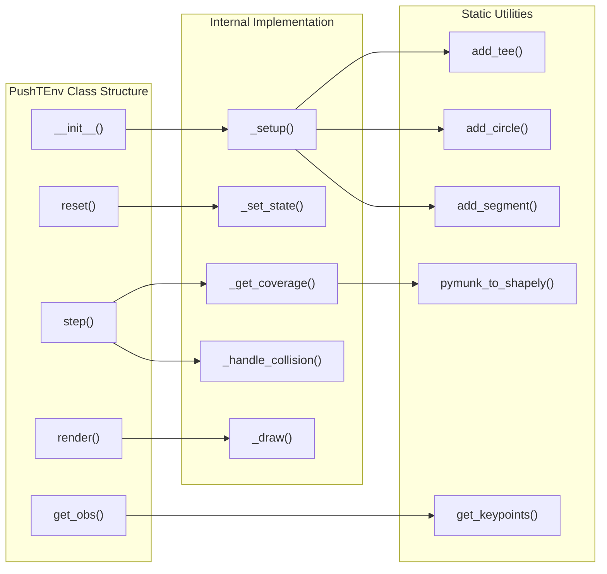
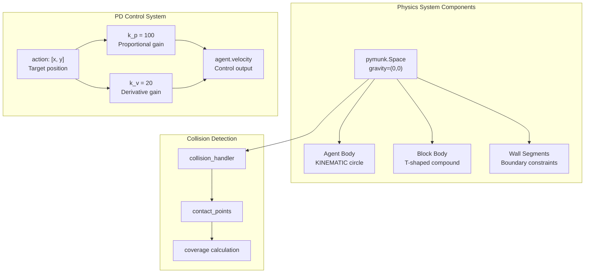
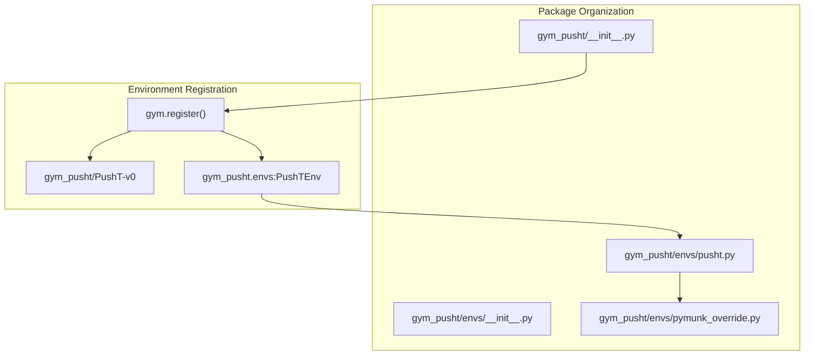

<!-- source: DeepWiki mcp.deepwiki.com · repo huggingface/gym-pusht · page 1 Overview · fetched 2026-10-26 -->

# Overview

<details>
<summary>Relevant source files</summary>

The following files were used as context for generating this wiki page:

- [README.md](README.md)
- [gym_pusht/envs/pusht.py](gym_pusht/envs/pusht.py)

</details>


This document provides a high-level introduction to the gym-pusht codebase, explaining the system architecture, core components, and key features of the PushT reinforcement learning environment. For detailed information about the environment's API and configuration options, see [Environment API](#2.1). For installation and development setup instructions, see [Installation and Configuration](#3.1).

## What is PushT?

PushT is a 2D robotic manipulation environment implemented as a Gymnasium-compatible reinforcement learning environment. The task involves a circular agent (robot end-effector) pushing a T-shaped block into a designated goal zone within a bounded workspace.

```mermaid
graph TD
    subgraph "PushT Task"
        AGENT[Agent<br/>"Circular robot end-effector"]
        BLOCK[Block<br/>"T-shaped object"]
        GOAL[Goal<br/>"Target zone for block"]
        WORKSPACE[Workspace<br/>"512x512 bounded area"]
    end
    
    subgraph "Objective"
        PUSH["Push block into goal zone"]
        SUCCESS["95% block coverage = success"]
        REWARD["Reward = coverage percentage"]
    end
    
    AGENT --> PUSH
    BLOCK --> PUSH
    PUSH --> GOAL
    PUSH --> SUCCESS
    PUSH --> REWARD
    
    WORKSPACE --> AGENT
    WORKSPACE --> BLOCK
    WORKSPACE --> GOAL
```

**Task Objective**: Achieve at least 95% coverage of the T-shaped block within the goal zone through strategic pushing actions.

Sources: [gym_pusht/envs/pusht.py:40-82](), [README.md:42-80]()

## System Architecture

The gym-pusht system integrates multiple technologies to create a physics-based reinforcement learning environment with flexible observation modes and robust development infrastructure.

```mermaid
graph TB
    subgraph "RL_Interface" ["Reinforcement Learning Interface"]
        GYM_ENV["gym.Env"]
        PUSHT_ENV["PushTEnv"]
        REGISTRATION["Environment Registration"]
    end
    
    subgraph "Physics_Engine" ["Physics Simulation"]
        PYMUNK_SPACE["pymunk.Space"]
        BODIES["Body objects"]
        PD_CONTROL["PD Controller"]
        COLLISION["Collision Detection"]
    end
    
    subgraph "Rendering_System" ["Rendering & Visualization"]
        PYGAME_SURFACE["pygame.Surface"]
        DRAW_OPTIONS["DrawOptions"]
        IMAGE_PROCESSING["cv2 + numpy"]
    end
    
    subgraph "Geometry_Engine" ["Geometric Operations"]
        SHAPELY_GEOM["shapely.geometry"]
        COVERAGE_CALC["Coverage Calculation"]
        KEYPOINT_EXTRACT["Keypoint Extraction"]
    end
    
    subgraph "Observation_Types" ["Multi-Modal Observations"]
        STATE_OBS["state: 5D vector"]
        PIXEL_OBS["pixels: 96x96 RGB"]
        ENV_STATE_OBS["environment_state_agent_pos"]
        PIXEL_AGENT_OBS["pixels_agent_pos"]
    end
    
    GYM_ENV --> PUSHT_ENV
    PUSHT_ENV --> REGISTRATION
    
    PUSHT_ENV --> PYMUNK_SPACE
    PYMUNK_SPACE --> BODIES
    PYMUNK_SPACE --> PD_CONTROL
    PYMUNK_SPACE --> COLLISION
    
    PUSHT_ENV --> PYGAME_SURFACE
    PYGAME_SURFACE --> DRAW_OPTIONS
    PYGAME_SURFACE --> IMAGE_PROCESSING
    
    PUSHT_ENV --> SHAPELY_GEOM
    SHAPELY_GEOM --> COVERAGE_CALC
    SHAPELY_GEOM --> KEYPOINT_EXTRACT
    
    PUSHT_ENV --> STATE_OBS
    PUSHT_ENV --> PIXEL_OBS
    PUSHT_ENV --> ENV_STATE_OBS
    PUSHT_ENV --> PIXEL_AGENT_OBS
```



Sources: [gym_pusht/envs/pusht.py:1-20](), [gym_pusht/__init__.py]()

## Core Components and Code Mapping

This section maps the system's conceptual components to their implementation in the codebase.

### Environment Implementation



**Key Implementation Details**:
- `PushTEnv` class extends `gym.Env` and implements the standard Gymnasium interface
- Physics simulation runs at 100 Hz with PD control for smooth agent movement
- Four observation modes supported through conditional logic in `get_obs()`
- Collision detection integrated with pymunk's collision handler system

Sources: [gym_pusht/envs/pusht.py:40-542]()

### Technology Stack Integration

```mermaid
graph TD
    subgraph "Dependencies" ["External Dependencies"]
        GYMNASIUM["gymnasium"]
        PYMUNK["pymunk"]
        PYGAME["pygame"]
        SHAPELY["shapely"]
        OPENCV["cv2"]
        NUMPY["numpy"]
    end
    
    subgraph "Core_Functions" ["Core Functionality"]
        ENV_INTERFACE["Environment Interface"]
        PHYSICS_SIM["Physics Simulation"]
        RENDERING["Rendering Pipeline"]
        GEOMETRY["Geometric Operations"]
        IMAGE_PROC["Image Processing"]
        MATH_OPS["Mathematical Operations"]
    end
    
    GYMNASIUM --> ENV_INTERFACE
    PYMUNK --> PHYSICS_SIM
    PYGAME --> RENDERING
    SHAPELY --> GEOMETRY
    OPENCV --> IMAGE_PROC
    NUMPY --> MATH_OPS
    
    ENV_INTERFACE --> "gym.Env inheritance"
    PHYSICS_SIM --> "pymunk.Space + Bodies"
    RENDERING --> "pygame.Surface + DrawOptions"
    GEOMETRY --> "shapely.geometry operations"
    IMAGE_PROC --> "cv2.resize + markers"
    MATH_OPS --> "Array operations"
```

Sources: [gym_pusht/envs/pusht.py:5-18]()

## Key Features

### Multi-Modal Observation Support

The environment provides four distinct observation types to support different RL algorithm requirements:

| Observation Type | Dimensions | Description | Use Case |
|------------------|------------|-------------|----------|
| `state` | 5D vector | `[agent_x, agent_y, block_x, block_y, block_angle]` | State-based RL algorithms |
| `pixels` | 96x96x3 RGB | Rendered environment image | Vision-based deep RL |
| `environment_state_agent_pos` | Dict: 16D + 2D | T-shape keypoints + agent position | Hybrid approaches |
| `pixels_agent_pos` | Dict: 96x96x3 + 2D | Image + agent position | Multi-modal learning |

Sources: [gym_pusht/envs/pusht.py:183-230](), [gym_pusht/envs/pusht.py:383-403]()

### Physics-Based Simulation



**PD Control Implementation**: The agent uses proportional-derivative control with gains `k_p=100` and `k_v=20` for smooth, responsive movement to target positions.

Sources: [gym_pusht/envs/pusht.py:164-167](), [gym_pusht/envs/pusht.py:240-254](), [gym_pusht/envs/pusht.py:431-456]()

### Reward and Success Criteria

The environment uses geometric intersection to calculate precise coverage metrics:

1. **Coverage Calculation**: Uses `shapely.geometry` to compute intersection area between block and goal zone
2. **Reward Function**: `reward = clip(coverage / 0.95, 0.0, 1.0)`
3. **Success Threshold**: Episode terminates when coverage ≥ 95%
4. **Geometric Precision**: `pymunk_to_shapely()` function converts physics shapes for accurate area calculations

Sources: [gym_pusht/envs/pusht.py:232-238](), [gym_pusht/envs/pusht.py:255-266](), [gym_pusht/envs/pusht.py:27-37]()

## Package Structure and Registration

The gym-pusht package follows standard Gymnasium environment registration patterns:



**Environment Access**: Users instantiate the environment via `gym.make("gym_pusht/PushT-v0")` which resolves to the `PushTEnv` class through Gymnasium's registration system.

Sources: [gym_pusht/__init__.py](), [gym_pusht/envs/__init__.py]()

This architecture provides a robust, extensible foundation for reinforcement learning research in robotic manipulation tasks, with comprehensive observation modalities and physics-based realism.

---

