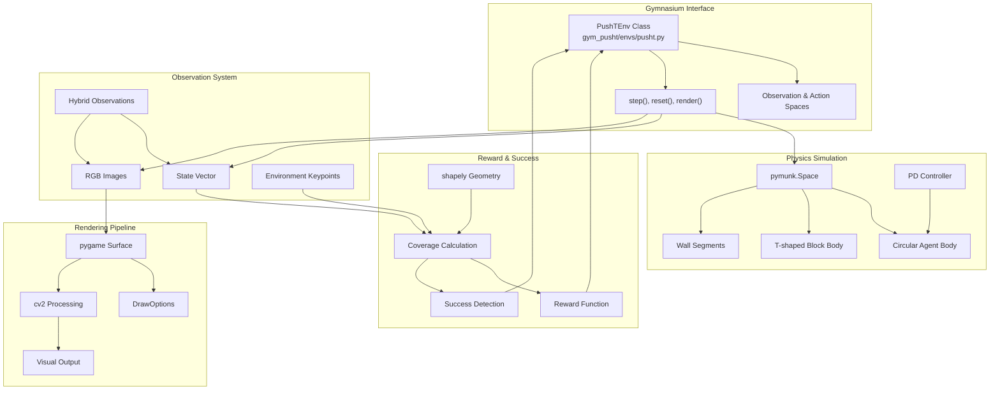
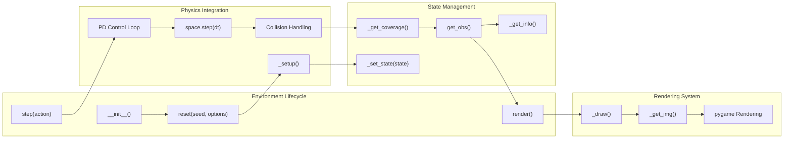
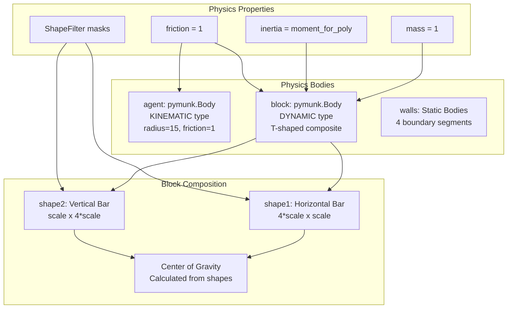
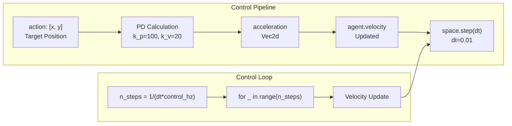
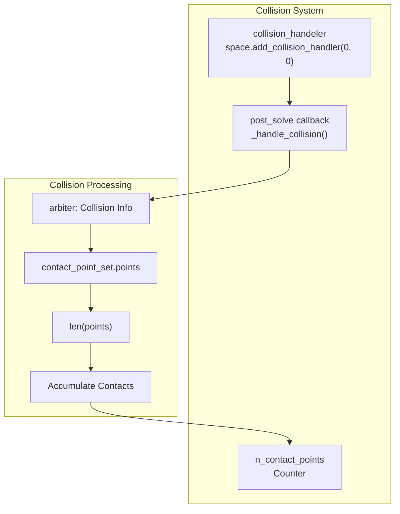
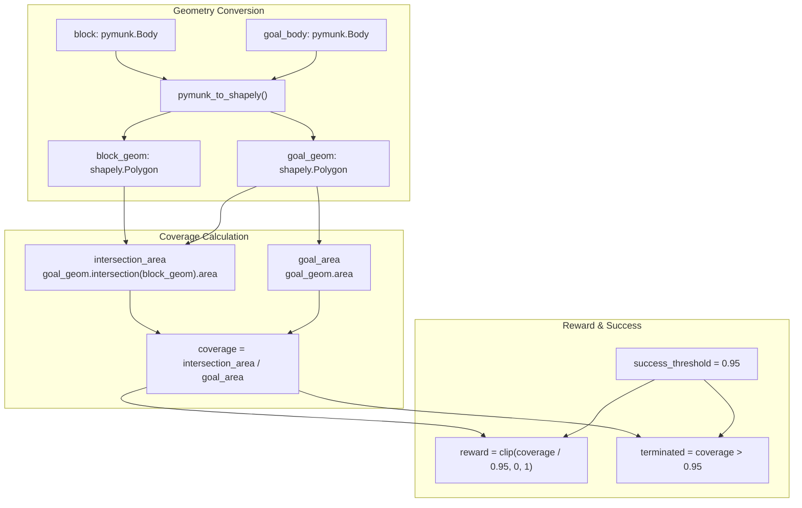
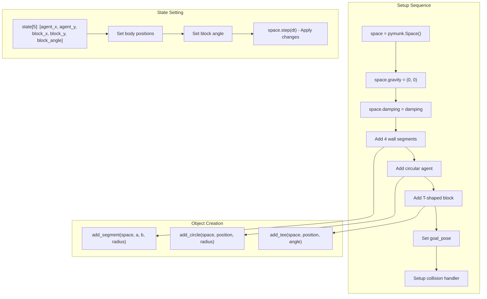

<!-- source: DeepWiki mcp.deepwiki.com · repo huggingface/gym-pusht · page 2 PushT Environment · fetched 2026-10-26 -->

# PushT Environment

Relevant source files

The following files were used as context for generating this wiki page:

- [gym_pusht/__init__.py](gym_pusht/__init__.py)
- [gym_pusht/envs/pusht.py](gym_pusht/envs/pusht.py)

This document provides comprehensive technical documentation for the PushT environment implementation, covering its architecture, components, and core functionality. The PushT environment is a 2D robotic manipulation task where an agent must push a T-shaped block into a goal zone using physics-based simulation.

For information about the public API interface and usage examples, see [Environment API](#2.1). For details about the underlying physics engine integration, see [Physics Simulation](#2.2). For information about different observation modalities, see [Observation Types](#2.3).

## Core Architecture Overview

The PushT environment is implemented as a single `PushTEnv` class that integrates multiple subsystems to create a complete robotic manipulation simulation. The environment follows the Gymnasium API standard while providing multiple observation modalities and physics-based dynamics.

### System Architecture

Sources: [gym_pusht/envs/pusht.py:40-542]()

### Component Integration Flow

Sources: [gym_pusht/envs/pusht.py:137-467]()

## Environment Components

### Core Class Structure

The `PushTEnv` class inherits from `gym.Env` and implements all required Gymnasium interface methods. The class manages multiple subsystems through carefully orchestrated initialization and update cycles.

| Component | Type | Purpose | Key Methods |
|-----------|------|---------|-------------|
| `obs_type` | str | Observation modality selection | `_initialize_observation_space()` |
| `space` | `pymunk.Space` | Physics simulation container | `_setup()` |
| `agent` | `pymunk.Body` | Circular robot agent | `add_circle()` |
| `block` | `pymunk.Body` | T-shaped manipulation target | `add_tee()` |
| `goal_pose` | `np.ndarray` | Target configuration | `get_goal_pose_body()` |

The environment supports four distinct observation types: `state`, `pixels`, `environment_state_agent_pos`, and `pixels_agent_pos`, each providing different information modalities for reinforcement learning algorithms.

Sources: [gym_pusht/envs/pusht.py:137-181](), [gym_pusht/envs/pusht.py:183-230]()

### Physics Object Configuration

Sources: [gym_pusht/envs/pusht.py:477-518](), [gym_pusht/envs/pusht.py:431-456]()

## Control System Architecture

### PD Control Implementation

The environment implements a Proportional-Derivative (PD) controller to manage agent movement. The controller converts discrete target positions into smooth velocity commands applied to the physics simulation.

The PD controller equation implemented in the step method:
- `acceleration = k_p * (action - agent.position) + k_v * (Vec2d(0, 0) - agent.velocity)`
- `agent.velocity += acceleration * dt`

Sources: [gym_pusht/envs/pusht.py:240-253](), [gym_pusht/envs/pusht.py:164-166]()

### Collision Detection and Response

The environment implements collision detection through pymunk's built-in collision system with custom handling for contact point tracking.

Sources: [gym_pusht/envs/pusht.py:428-430](), [gym_pusht/envs/pusht.py:453-456]()

## Reward and Success Computation

### Coverage-Based Reward System

The environment uses geometric intersection calculations to determine reward based on how much of the T-shaped block overlaps with the goal zone.

The `pymunk_to_shapely()` function converts pymunk polygon shapes to shapely geometries for precise intersection calculations.

Sources: [gym_pusht/envs/pusht.py:232-238](), [gym_pusht/envs/pusht.py:27-37](), [gym_pusht/envs/pusht.py:255-258](), [gym_pusht/envs/pusht.py:181]()

## State Management and Initialization

### Environment Setup Process

The environment initialization follows a structured setup process that creates the physics world and populates it with the necessary objects.

Sources: [gym_pusht/envs/pusht.py:431-456](), [gym_pusht/envs/pusht.py:458-467](), [gym_pusht/envs/pusht.py:469-518]()

### Random State Generation

The reset method generates random initial states using controlled randomization to ensure reproducible episodes while maintaining task diversity.

| Parameter | Range | Purpose |
|-----------|-------|---------|
| `agent_x` | [50, 450] | Agent horizontal position |
| `agent_y` | [50, 450] | Agent vertical position |
| `block_x` | [100, 400] | Block horizontal position |
| `block_y` | [100, 400] | Block vertical position |
| `block_angle` | [-π, π] | Block rotation angle |

The environment also supports deterministic state setting through the `reset_to_state` option, enabling reproducible evaluation scenarios.

Sources: [gym_pusht/envs/pusht.py:268-296](), [gym_pusht/envs/pusht.py:272-287]()

---

