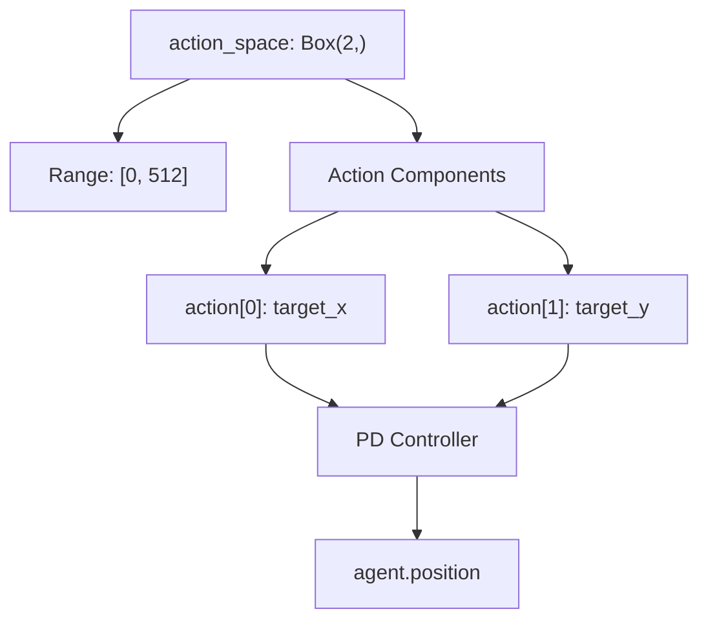
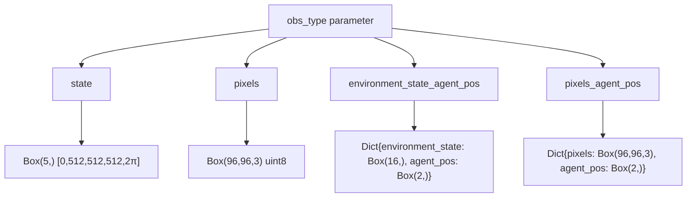
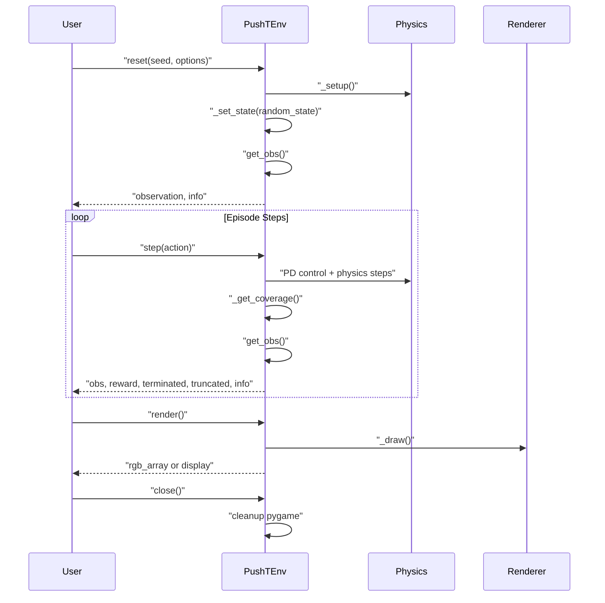
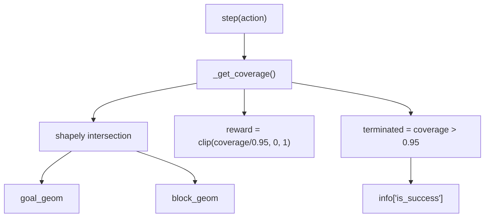

<!-- source: DeepWiki mcp.deepwiki.com · repo huggingface/gym-pusht · page 2.1 Environment API · fetched 2026-10-26 -->

# Environment API

<details>
<summary>Relevant source files</summary>

The following files were used as context for generating this wiki page:

- [README.md](README.md)
- [gym_pusht/envs/pusht.py](gym_pusht/envs/pusht.py)
- [tests/test_env.py](tests/test_env.py)

</details>


This page documents the public interface of the PushT environment, including instantiation, action and observation spaces, core methods, and configuration options. This covers the standard Gymnasium API implementation in the `PushTEnv` class.

For information about the internal physics simulation mechanics, see [Physics Simulation](#2.2). For details about the different observation types and their data structures, see [Observation Types](#2.3).

## Environment Instantiation

The PushT environment is registered with Gymnasium and instantiated using the standard `gym.make()` interface:

```python
import gymnasium as gym
import gym_pusht

env = gym.make("gym_pusht/PushT-v0", obs_type="state", render_mode="rgb_array")
```

The environment identifier is `"gym_pusht/PushT-v0"` and supports various configuration parameters passed as keyword arguments to `gym.make()`.

**Sources:** [gym_pusht/envs/pusht.py:88-91](), [README.md:85-90]()

## Action Space Structure



The action space is a continuous 2D Box space representing target positions for the agent. The PD controller moves the agent toward these target coordinates.

| Property | Value | Description |
|----------|--------|-------------|
| Type | `spaces.Box` | Continuous action space |
| Shape | `(2,)` | Two-dimensional [x, y] coordinates |
| Range | `[0, 512]` | Valid coordinate range |
| Data Type | `np.float32` | Floating point actions |

**Sources:** [gym_pusht/envs/pusht.py:161](), [gym_pusht/envs/pusht.py:50-51]()

## Observation Space Types

The environment supports four distinct observation types, each with different space structures:



### State Observation
- **Type:** `spaces.Box(low=[0,0,0,0,0], high=[512,512,512,512,2π])`
- **Data:** `[agent_x, agent_y, block_x, block_y, block_angle]`
- **Usage:** Direct state-based RL algorithms

### Pixels Observation  
- **Type:** `spaces.Box(low=0, high=255, shape=(96,96,3), dtype=uint8)`
- **Data:** RGB image of environment
- **Usage:** Vision-based RL algorithms

### Environment State + Agent Position
- **Type:** `spaces.Dict` with two components:
  - `environment_state`: 16D keypoint coordinates of T-block
  - `agent_pos`: 2D agent position
- **Usage:** Hybrid state representation

### Pixels + Agent Position
- **Type:** `spaces.Dict` with two components:
  - `pixels`: 96x96 RGB image  
  - `agent_pos`: 2D agent position
- **Usage:** Vision algorithms with explicit agent position

**Sources:** [gym_pusht/envs/pusht.py:183-230](), [gym_pusht/envs/pusht.py:55-66]()

## Core Gymnasium Methods



### reset(seed=None, options=None)

Resets the environment to initial state. Returns `(observation, info)`.

**Special Options:**
- `options["reset_to_state"]`: Reset to specific state vector instead of random initialization

```python
# Random reset
obs, info = env.reset()

# Reset to specific state  
obs, info = env.reset(options={"reset_to_state": [100, 200, 300, 400, 1.5]})
```

### step(action)

Executes one environment step with the given action. Returns `(observation, reward, terminated, truncated, info)`.

**Step Process:**
1. Apply PD control for multiple physics substeps
2. Calculate coverage-based reward
3. Check termination condition (≥95% coverage)
4. Generate observation
5. Return step results

### render()

Generates visual representation of current environment state.

**Modes:**
- `"rgb_array"`: Returns numpy array image
- `"human"`: Displays in pygame window

### close()

Cleanup method that closes pygame display and releases resources.

**Sources:** [gym_pusht/envs/pusht.py:240-266](), [gym_pusht/envs/pusht.py:268-296](), [gym_pusht/envs/pusht.py:335-364](), [gym_pusht/envs/pusht.py:365-368]()

## Configuration Parameters

The `PushTEnv` constructor accepts the following parameters:

| Parameter | Type | Default | Description |
|-----------|------|---------|-------------|
| `obs_type` | str | `"state"` | Observation type: `"state"`, `"pixels"`, `"environment_state_agent_pos"`, `"pixels_agent_pos"` |
| `render_mode` | str | `"rgb_array"` | Rendering mode: `"rgb_array"` or `"human"` |
| `block_cog` | tuple | `None` | Custom center of gravity for T-block |
| `damping` | float | `None` | Physics damping factor (0 if None) |
| `observation_width` | int | 96 | Width of observation images |
| `observation_height` | int | 96 | Height of observation images |
| `visualization_width` | int | 680 | Width of visualization images |
| `visualization_height` | int | 680 | Height of visualization images |

**Physics Parameters:**
- `k_p = 100`: PD controller proportional gain
- `k_v = 20`: PD controller derivative gain  
- `dt = 0.01`: Physics timestep
- `control_hz = 10`: Control frequency
- `success_threshold = 0.95`: Coverage threshold for success

**Sources:** [gym_pusht/envs/pusht.py:137-148](), [gym_pusht/envs/pusht.py:164-181]()

## Reward and Termination System



### Reward Calculation

The reward is based on the coverage percentage of the T-block within the goal zone:

1. **Geometric Intersection:** Uses Shapely library to compute intersection area between block and goal geometries
2. **Coverage Ratio:** `intersection_area / goal_area`  
3. **Reward Scaling:** `reward = np.clip(coverage / success_threshold, 0.0, 1.0)`

### Termination Conditions

- **Success Termination:** Episode terminates when block coverage ≥ 95% of goal zone
- **No Time Limit:** Environment has no built-in time limit (handled by Gymnasium wrappers)
- **No Failure Conditions:** Agent cannot fail the task

### Info Dictionary

The `info` dict returned by `step()` contains:

| Key | Type | Description |
|-----|------|-------------|
| `pos_agent` | np.array(2,) | Agent position |
| `vel_agent` | np.array(2,) | Agent velocity |
| `block_pose` | np.array(3,) | Block [x, y, angle] |
| `goal_pose` | np.array(3,) | Goal [x, y, angle] |
| `n_contacts` | int | Contact points per step |
| `is_success` | bool | Whether success threshold met |
| `coverage` | float | Current coverage percentage |

**Sources:** [gym_pusht/envs/pusht.py:232-238](), [gym_pusht/envs/pusht.py:255-264](), [gym_pusht/envs/pusht.py:416-426]()

---

