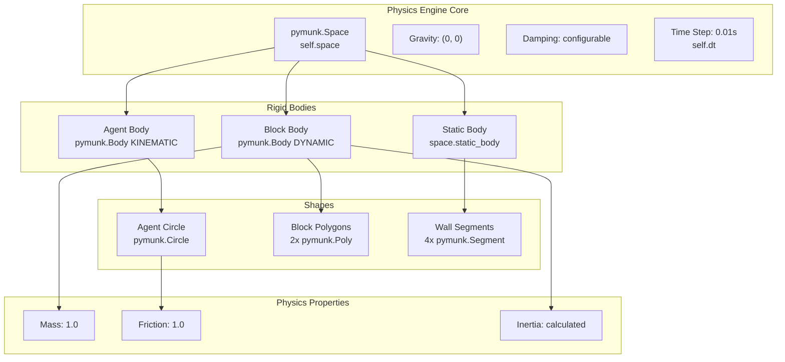
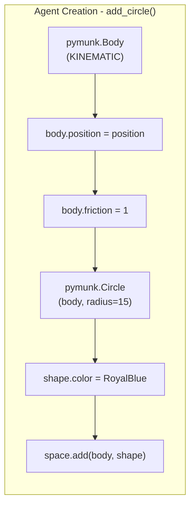
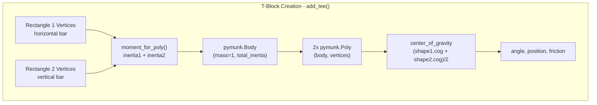
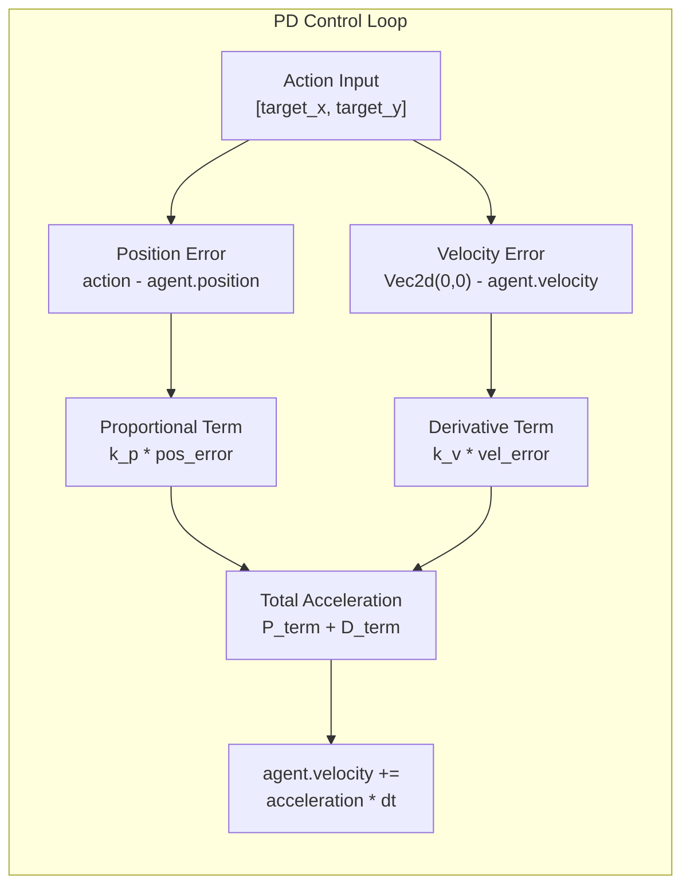
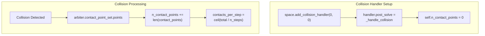
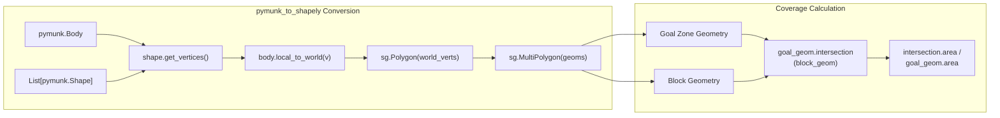
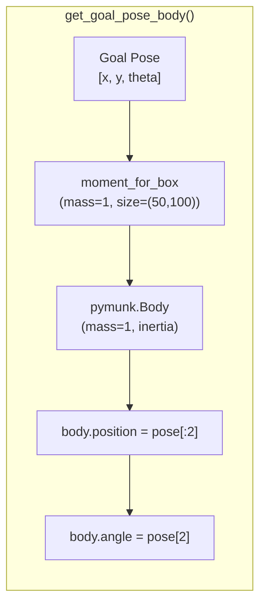
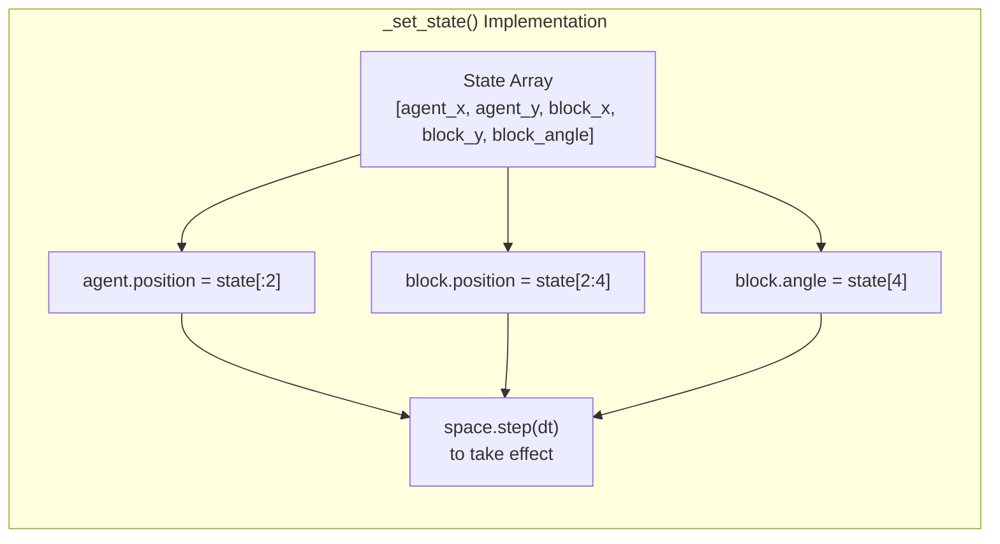

<!-- source: DeepWiki mcp.deepwiki.com · repo huggingface/gym-pusht · page 2.2 Physics Simulation · fetched 2026-10-26 -->

# Physics Simulation

Relevant source files

The following files were used as context for generating this wiki page:

- [gym_pusht/envs/pusht.py](gym_pusht/envs/pusht.py)
- [gym_pusht/envs/pymunk_override.py](gym_pusht/envs/pymunk_override.py)

This document covers the physics simulation engine that powers the PushT environment, including the 2D physics implementation, object dynamics, control systems, and collision detection. The physics simulation is responsible for realistic agent movement, block manipulation, and environmental interactions.

For information about the rendering and visualization of the physics simulation, see [Rendering System](#2.4). For details about the broader environment structure, see [Environment API](#2.1).

## Physics Engine Architecture

The PushT environment uses `pymunk` as its core 2D physics engine, providing rigid body simulation with realistic collision detection and response. The physics system operates in a 512x512 coordinate space with no gravity, creating a tabletop-like manipulation environment.

### Physics Engine Core Components

**Sources:** [gym_pusht/envs/pusht.py:432-434](), [gym_pusht/envs/pusht.py:166](), [gym_pusht/envs/pusht.py:447-449]()

The physics space is initialized with zero gravity and configurable damping, creating a frictionless air hockey-like environment where objects maintain momentum until acted upon by forces.

## Object Dynamics and Bodies

The simulation contains three primary object types: the circular agent, the T-shaped block, and static boundary walls. Each object has distinct physical properties and behaviors.

### Physical Object Specifications

| Object | Body Type | Shape | Mass | Friction | Inertia |
|--------|-----------|-------|------|----------|---------|
| Agent | KINEMATIC | Circle (radius=15) | N/A | 1.0 | N/A |
| Block | DYNAMIC | 2x Polygon (T-shape) | 1.0 | 1.0 | Calculated |
| Walls | STATIC | 4x Segment | Infinite | Default | Infinite |

### Agent Body Implementation

**Sources:** [gym_pusht/envs/pusht.py:477-484]()

The agent uses a `KINEMATIC` body type, meaning its motion is controlled directly rather than by forces, enabling precise PD control.

### Block Body Implementation

The T-shaped block consists of two rectangular polygons forming a T-shape, with calculated center of mass and moment of inertia.

**Sources:** [gym_pusht/envs/pusht.py:487-518]()

The T-block vertices are defined as scaled coordinates creating a symmetric T-shape with configurable size and color.

## PD Control System

The agent movement uses a Proportional-Derivative (PD) controller that provides smooth, stable motion toward target positions while maintaining realistic dynamics.

### PD Controller Architecture

**Sources:** [gym_pusht/envs/pusht.py:164-165](), [gym_pusht/envs/pusht.py:246-250]()

### Control Parameters

The PD controller uses the following tuned parameters:
- `k_p = 100`: Proportional gain for position error
- `k_v = 20`: Derivative gain for velocity damping  
- `dt = 0.01`: Time step for integration
- `control_hz = 10`: Control frequency from render FPS

The control loop executes multiple physics steps per action to ensure smooth motion: `n_steps = int(1 / (dt * control_hz))` results in 10 physics steps per control update.

## Collision Detection and Handling

The physics system implements comprehensive collision detection between all objects, tracking contact points for reward calculation and debugging.

### Collision System Implementation

**Sources:** [gym_pusht/envs/pusht.py:454-456](), [gym_pusht/envs/pusht.py:428-430](), [gym_pusht/envs/pusht.py:417-418]()

The collision handler accumulates contact points throughout the physics step cycle, providing metrics for environment analysis and debugging.

## Geometric Operations and Coverage Calculation

The physics simulation integrates with `shapely` geometry library to perform precise coverage calculations for reward computation, converting between pymunk physics objects and shapely geometric representations.

### Geometry Conversion Pipeline

**Sources:** [gym_pusht/envs/pusht.py:27-37](), [gym_pusht/envs/pusht.py:232-238]()

### Goal Pose Body Creation

The goal zone is represented as a physics body positioned at the target location, enabling precise geometric calculations:

**Sources:** [gym_pusht/envs/pusht.py:406-414]()

## Physics Integration with Environment

The physics simulation integrates seamlessly with the broader environment system, providing state information, handling resets, and supporting multiple observation modes.

### Physics Step Integration

The `step()` method coordinates physics simulation with environment logic:

1. **Reset Contact Counter**: `self.n_contact_points = 0`
2. **Calculate Step Count**: `n_steps = int(1 / (dt * control_hz))`
3. **Execute Control Loop**: Multiple PD control + physics steps
4. **Calculate Coverage**: Geometric intersection for reward
5. **Check Termination**: Success threshold at 95% coverage

### State Management

The physics system supports direct state setting for environment resets and reproducibility:

**Sources:** [gym_pusht/envs/pusht.py:458-467]()

The physics system maintains consistency between different observation types by providing both direct state access and geometric keypoint extraction through the `get_keypoints()` method.

**Sources:** [gym_pusht/envs/pusht.py:521-541]()

---

