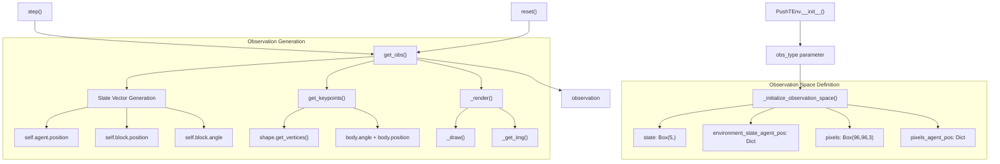
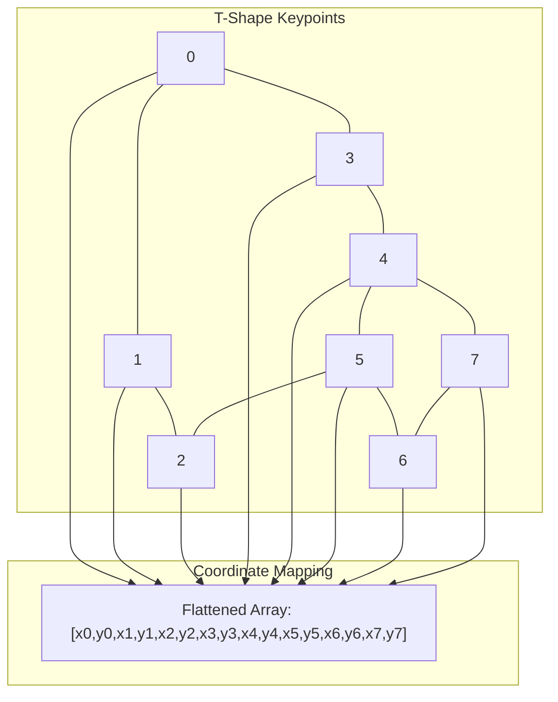
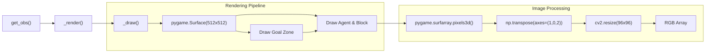

<!-- source: DeepWiki mcp.deepwiki.com · repo huggingface/gym-pusht · page 2.3 Observation Types · fetched 2026-10-26 -->

# Observation Types

<details>
<summary>Relevant source files</summary>

The following files were used as context for generating this wiki page:

- [README.md](README.md)
- [gym_pusht/envs/pusht.py](gym_pusht/envs/pusht.py)

</details>


This document details the four observation types supported by the PushT environment and their implementation. It covers the data structures, value ranges, and generation methods for each observation mode.

For information about the environment's action space and reward system, see [Environment API](#2.1). For details about the rendering pipeline that generates pixel observations, see [Rendering System](#2.4).

## Overview

The PushT environment supports four distinct observation types through the `obs_type` parameter, each designed for different reinforcement learning approaches:

| Observation Type | Description | Use Case |
|------------------|-------------|----------|
| `state` | 5D state vector | State-based RL algorithms |
| `environment_state_agent_pos` | Keypoints + agent position | Structured state representation |
| `pixels` | RGB image | Vision-based RL algorithms |
| `pixels_agent_pos` | Image + agent position | Hybrid vision-position methods |

The observation type is configured during environment initialization and determines both the observation space definition and the data returned by `get_obs()`.

**Observation System Architecture**



Sources: [gym_pusht/envs/pusht.py:137-162](), [gym_pusht/envs/pusht.py:183-230](), [gym_pusht/envs/pusht.py:383-403]()

## State Observation Type

The `state` observation type provides a compact 5-dimensional vector representation of the environment state.

### Data Structure

| Component | Index | Range | Description |
|-----------|-------|-------|-------------|
| `agent_x` | 0 | [0, 512] | Agent X coordinate |
| `agent_y` | 1 | [0, 512] | Agent Y coordinate |
| `block_x` | 2 | [0, 512] | Block center X coordinate |
| `block_y` | 3 | [0, 512] | Block center Y coordinate |
| `block_angle` | 4 | [0, 2π] | Block rotation angle |

### Implementation

The state observation is generated by concatenating the agent position, block position, and normalized block angle:

```python
# From get_obs() method
agent_position = np.array(self.agent.position)
block_position = np.array(self.block.position)
block_angle = self.block.angle % (2 * np.pi)
return np.concatenate([agent_position, block_position, [block_angle]], dtype=np.float64)
```

The observation space is defined as a `Box` with appropriate bounds for each component.

Sources: [gym_pusht/envs/pusht.py:184-190](), [gym_pusht/envs/pusht.py:384-388]()

## Environment State Agent Position Type

The `environment_state_agent_pos` observation type returns a dictionary containing structured keypoint data and agent position.

### Data Structure

```python
{
    "environment_state": np.array(16,),  # Flattened keypoint coordinates
    "agent_pos": np.array(2,)            # Agent position [x, y]
}
```

### Keypoint System

The T-shaped block is represented by 8 keypoints forming the vertices of two overlapping rectangles:

**T-Shape Keypoint Layout**



The keypoints are extracted using `get_keypoints()`, which transforms each vertex from local shape coordinates to world coordinates:

```python
# Transformation process for each vertex
v = v.rotated(shape.body.angle)  # Apply rotation
v = v + shape.body.position      # Apply translation
```

Sources: [gym_pusht/envs/pusht.py:191-205](), [gym_pusht/envs/pusht.py:390-394](), [gym_pusht/envs/pusht.py:521-541]()

## Pixels Observation Type

The `pixels` observation type provides a visual representation of the environment as an RGB image.

### Image Specifications

| Property | Value | Description |
|----------|-------|-------------|
| Dimensions | 96×96 | Default observation size |
| Channels | 3 | RGB color channels |
| Data Type | `np.uint8` | 8-bit unsigned integers |
| Value Range | [0, 255] | Standard RGB range |

### Generation Pipeline

**Pixel Observation Generation**



The rendering process creates a 512×512 internal surface, draws all environment elements, then resizes to the target observation dimensions.

Sources: [gym_pusht/envs/pusht.py:206-209](), [gym_pusht/envs/pusht.py:396-398](), [gym_pusht/envs/pusht.py:298-314](), [gym_pusht/envs/pusht.py:316-333]()

## Pixels Agent Position Type

The `pixels_agent_pos` observation type combines visual information with explicit agent position data.

### Data Structure

```python
{
    "pixels": np.array((96, 96, 3), dtype=np.uint8),  # RGB image
    "agent_pos": np.array(2, dtype=np.float64)        # Agent coordinates [x, y]
}
```

This hybrid approach enables algorithms that benefit from both visual context and precise positional information. The pixel component is generated using the same pipeline as the `pixels` type, while the agent position is extracted directly from the physics simulation.

### Use Cases

- **Hybrid RL Algorithms**: Methods that process visual features while maintaining access to precise position data
- **Multi-Modal Learning**: Approaches that fuse different types of sensory information
- **Debugging and Analysis**: Scenarios where both visual and numerical data are needed

Sources: [gym_pusht/envs/pusht.py:210-225](), [gym_pusht/envs/pusht.py:399-403]()

## Configuration and Customization

### Observation Space Initialization

The observation spaces are configured in `_initialize_observation_space()` based on the `obs_type` parameter. Invalid observation types raise a `ValueError` with supported options.

### Image Dimensions

Pixel-based observations support customizable dimensions through constructor parameters:

- `observation_width`: Width for observation images (default: 96)
- `observation_height`: Height for observation images (default: 96)
- `visualization_width`: Width for human rendering (default: 680)
- `visualization_height`: Height for human rendering (default: 680)

### Value Ranges and Coordinate System

All spatial coordinates use the environment's 512×512 coordinate system, with the origin at the bottom-left corner following pygame conventions. The block angle is normalized to the range [0, 2π] using modulo arithmetic.

Sources: [gym_pusht/envs/pusht.py:183-230](), [gym_pusht/envs/pusht.py:137-162](), [gym_pusht/envs/pusht.py:226-230]()

---

