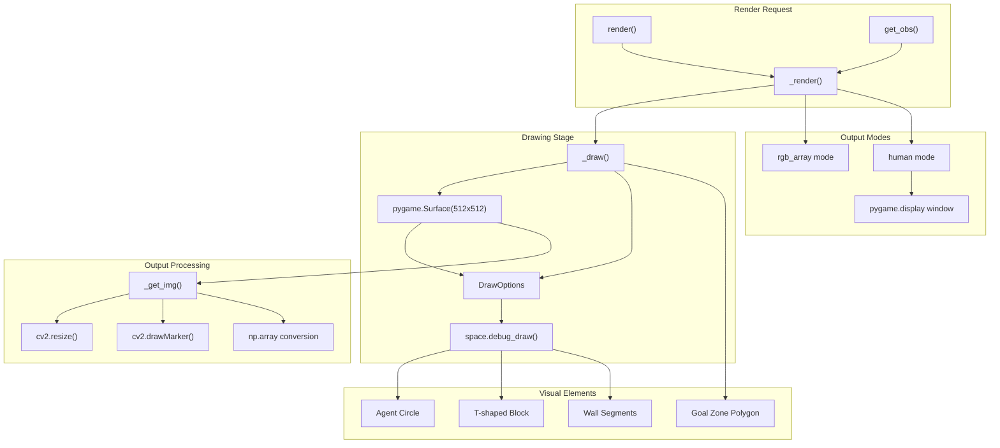
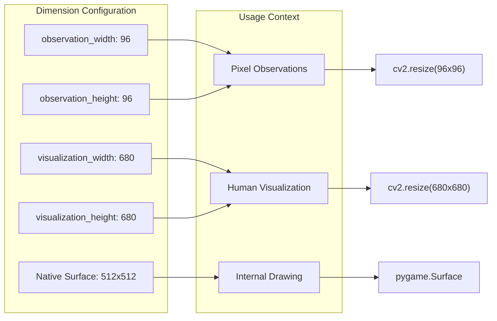
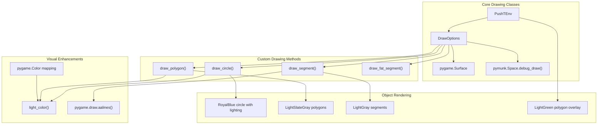
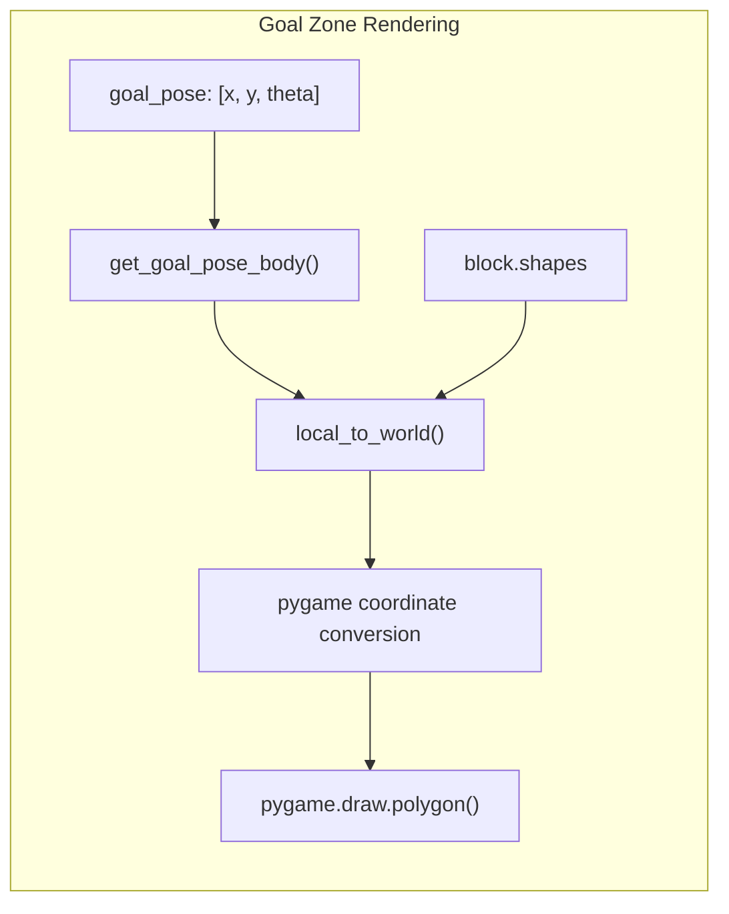
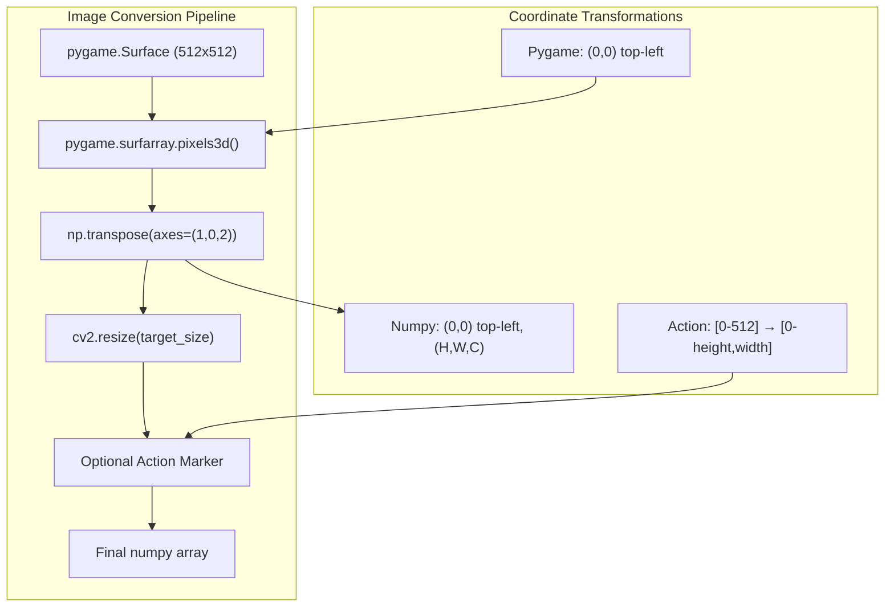
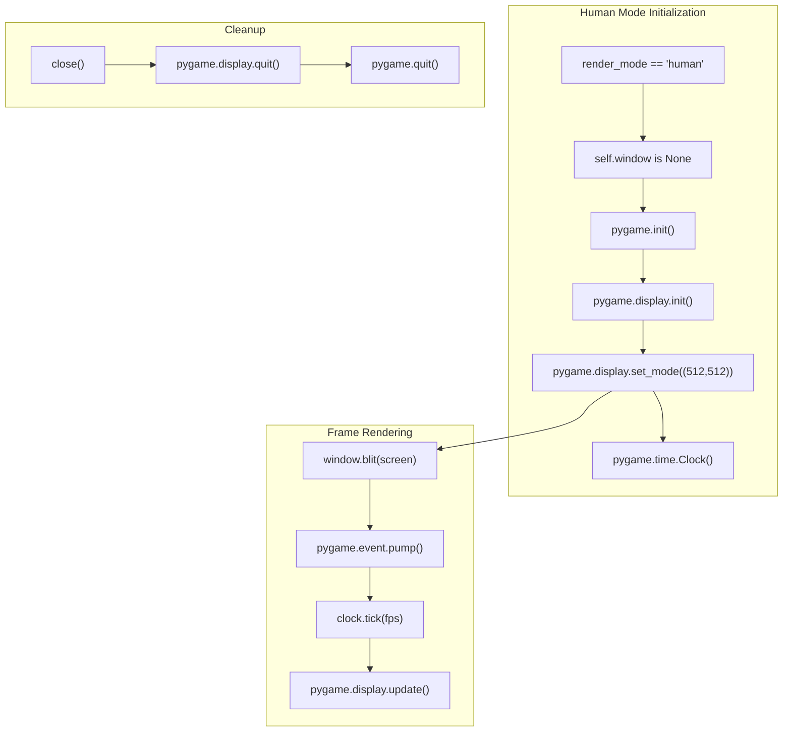

<!-- source: DeepWiki mcp.deepwiki.com · repo huggingface/gym-pusht · page 2.4 Rendering System · fetched 2026-10-26 -->

# Rendering System

Relevant source files

The following files were used as context for generating this wiki page:

- [gym_pusht/envs/pusht.py](gym_pusht/envs/pusht.py)
- [gym_pusht/envs/pymunk_override.py](gym_pusht/envs/pymunk_override.py)

The rendering system in gym-pusht provides visualization capabilities for the PushT environment, converting the physical simulation state into visual representations. This system handles both human-readable displays for debugging and RGB array outputs for computer vision-based reinforcement learning algorithms.

For information about the underlying physics simulation that drives the rendered content, see [Physics Simulation](#2.2). For details about how rendered images are used in different observation types, see [Observation Types](#2.3).

## Rendering Pipeline Overview

The rendering system follows a multi-stage pipeline that converts physics simulation state into visual output through pygame surfaces and optional image processing:

Sources: [gym_pusht/envs/pusht.py:298-364](), [gym_pusht/envs/pusht.py:335-347]()

## Render Modes and Configuration

The PushT environment supports two primary render modes with configurable dimensions:

| Render Mode | Purpose | Output Type | Window Management |
|------------|---------|-------------|-------------------|
| `rgb_array` | RL training and pixel observations | numpy array | None |
| `human` | Interactive debugging and visualization | pygame window | Automatic |

The environment maintains separate dimensions for different use cases:

Sources: [gym_pusht/envs/pusht.py:154-157](), [gym_pusht/envs/pusht.py:338-343]()

## Drawing System Architecture

The rendering system uses a custom `DrawOptions` class that overrides pymunk's default drawing behavior to provide enhanced visual styling:

Sources: [gym_pusht/envs/pymunk_override.py:77-244](), [gym_pusht/envs/pusht.py:20](), [gym_pusht/envs/pusht.py:302-314]()

## Visual Elements and Styling

The rendering system draws distinct visual elements with specific styling:

| Element | Shape Type | Color | Drawing Method | Code Location |
|---------|------------|-------|----------------|---------------|
| Agent | Circle (radius 15) | RoyalBlue with lighting | `draw_circle()` | [gym_pusht/envs/pusht.py:482]() |
| T-Block | Two polygons | LightSlateGray | `draw_polygon()` | [gym_pusht/envs/pusht.py:509-510]() |
| Walls | Line segments | LightGray | `draw_segment()` | [gym_pusht/envs/pusht.py:473]() |
| Goal Zone | Polygon outline | LightGreen | `pygame.draw.polygon()` | [gym_pusht/envs/pusht.py:310]() |
| Action Marker | Cross marker | Red (255,0,0) | `cv2.drawMarker()` | [gym_pusht/envs/pusht.py:325-332]() |

The goal zone visualization uses a separate rendering path that transforms the block geometry to the goal pose and draws it as a translucent overlay:

Sources: [gym_pusht/envs/pusht.py:305-310](), [gym_pusht/envs/pusht.py:406-414]()

## Image Processing and Conversion

The rendering system converts pygame surfaces to numpy arrays through a multi-step process that handles coordinate system differences and optional overlays:

The action marker rendering provides visual feedback for debugging by overlaying the last action as a red cross:

| Parameter | Value | Formula |
|-----------|-------|---------|
| Marker Size | Scaled to image | `int(8 / 96 * render_size)` |
| Line Thickness | Scaled to image | `int(1 / 96 * render_size)` |
| Coordinate Mapping | Action space to pixel | `(action / 512 * [height, width])` |
| Marker Type | Cross | `cv2.MARKER_CROSS` |

Sources: [gym_pusht/envs/pusht.py:316-333](), [gym_pusht/envs/pusht.py:320-332]()

## Window Management and Human Mode

The human rendering mode uses lazy initialization of pygame components to avoid overhead when not needed:

The frame rate calculation accounts for the physics timestep: `fps = render_fps * int(1 / (dt * control_hz))` where `dt=0.01` and `control_hz=10`.

Sources: [gym_pusht/envs/pusht.py:348-361](), [gym_pusht/envs/pusht.py:365-368](), [gym_pusht/envs/pusht.py:360]()

## Rendering Performance Considerations

The rendering system includes several optimizations:

- **Lazy Window Creation**: Human mode components are only initialized when first used
- **Conditional Action Rendering**: Action markers are only drawn when `render_action=True` and a previous action exists
- **Size-based Scaling**: Visual elements scale appropriately with different output resolutions
- **Surface Reuse**: The core 512x512 surface is created once per render call and reused

The environment variable `MUJOCO_GL != "egl"` controls whether human mode is available, allowing headless operation in server environments.

Sources: [gym_pusht/envs/pusht.py:22-24](), [gym_pusht/envs/pusht.py:349-354](), [gym_pusht/envs/pusht.py:320-321]()

---

