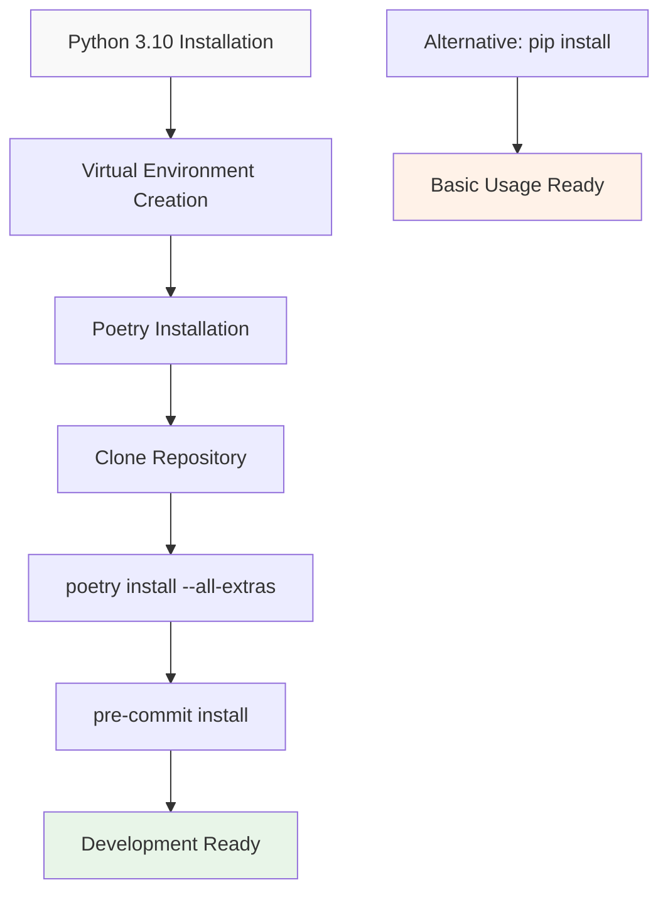
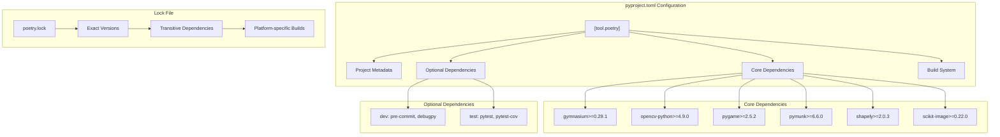
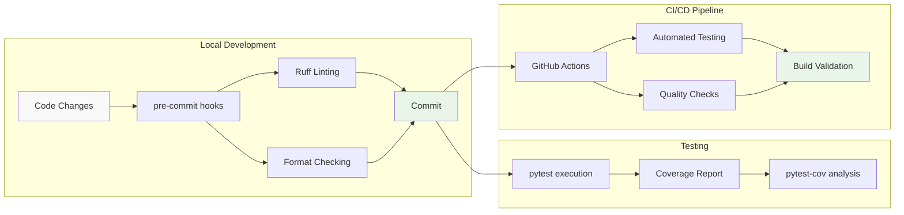

<!-- source: DeepWiki mcp.deepwiki.com · repo huggingface/gym-pusht · page 3 Development Setup · fetched 2026-10-26 -->

# Development Setup

<details>
<summary>Relevant source files</summary>

The following files were used as context for generating this wiki page:

- [README.md](README.md)
- [poetry.lock](poetry.lock)
- [pyproject.toml](pyproject.toml)

</details>


This document covers the development environment setup for the gym-pusht repository, including installation procedures, dependency management, and development workflow tools. It provides comprehensive guidance for contributors to establish a proper development environment and follow the project's development practices.

For information about the actual environment implementation and API, see [PushT Environment](#2). For testing procedures and infrastructure, see [Testing](#3.3).

## Environment Requirements

The gym-pusht project requires Python 3.10 or higher and uses Poetry for dependency management. The development setup supports multiple platforms including macOS, Linux, and Windows.

**Python Version Requirements:**
- Minimum: Python 3.10
- Recommended: Python 3.10 (as specified in [pyproject.toml:24]())

**Development Environment Setup Flow**



Sources: [README.md:10-18](), [README.md:139-145]()

## Installation Methods

### Production Installation

For end users, the package can be installed directly from PyPI:

```bash
pip install gym-pusht
```

### Development Installation

For contributors and developers, use Poetry for full development setup:

1. **Create Virtual Environment:**
   ```bash
   conda create -y -n pusht python=3.10 && conda activate pusht
   ```

2. **Install with Development Dependencies:**
   ```bash
   poetry install --all-extras
   ```

The `--all-extras` flag installs all optional dependency groups defined in [pyproject.toml:37-39]():
- `dev`: Development tools including `pre-commit` and `debugpy`
- `test`: Testing framework with `pytest` and `pytest-cov`

Sources: [README.md:10-18](), [README.md:142-145](), [pyproject.toml:37-39]()

## Poetry Dependency Management

The project uses Poetry for sophisticated dependency management with precise version control and optional dependency groups.

**Poetry Configuration Structure**



Sources: [pyproject.toml:23-40](), [poetry.lock:1-1075]()

### Core Dependencies

| Package | Version | Purpose |
|---------|---------|---------|
| `gymnasium` | >=0.29.1 | RL environment framework |
| `opencv-python` | >=4.9.0 | Computer vision operations |
| `pygame` | >=2.5.2 | Rendering and visualization |
| `pymunk` | >=6.6.0 | 2D physics simulation |
| `shapely` | >=2.0.3 | Geometric operations |
| `scikit-image` | >=0.22.0 | Image processing utilities |

Sources: [pyproject.toml:25-30]()

### Development Dependencies

Development dependencies are organized into optional groups:

- **dev**: `pre-commit>=3.7.0`, `debugpy>=1.8.1`
- **test**: `pytest>=8.1.0`, `pytest-cov>=5.0.0`

These can be installed selectively or together using Poetry's extras syntax.

Sources: [pyproject.toml:31-39]()

## Code Quality Tools

The project enforces code quality through automated tools integrated into the development workflow.

### Ruff Configuration

Ruff serves as both linter and formatter with configuration in [pyproject.toml:42-74]():

```toml
[tool.ruff]
line-length = 110
target-version = "py310"
```

**Ruff Rules and Exclusions:**
- **Selected rules**: E4, E7, E9 (syntax errors), F (Pyflakes), I (import sorting), N (naming), B (bugbear), C4 (comprehensions), SIM (simplify)
- **Excluded files**: `example.py`, build directories, virtual environments
- **Line length**: 110 characters
- **Target**: Python 3.10

Sources: [pyproject.toml:42-74]()

### Pre-commit Hooks

Pre-commit hooks ensure code quality before commits:

```bash
# Install pre-commit hooks
pre-commit install

# Run checks manually
pre-commit
```

The pre-commit system integrates with Ruff and other quality checks to maintain consistent code standards across the repository.

Sources: [README.md:149-155]()

## Development Workflow

The development workflow integrates multiple tools for quality assurance and testing.

**Development Tools Integration**



Sources: [README.md:147-155](), [pyproject.toml:31-34]()

### Build System

The project uses Poetry's modern build backend:

```toml
[build-system]
requires = ["poetry-core"]
build-backend = "poetry.core.masonry.api"
```

This configuration enables:
- Modern Python packaging standards
- Consistent builds across environments
- Integration with Poetry's dependency resolution

Sources: [pyproject.toml:76-78]()

## Package Structure and Metadata

The package is configured with comprehensive metadata for distribution:

| Field | Value |
|-------|-------|
| Name | `gym-pusht` |
| Version | `0.1.5` |
| License | `Apache-2.0` |
| Python Requirement | `^3.10` |
| Package Include | `gym_pusht` |

**Development Status**: Alpha (Development Status :: 3 - Alpha)

The package includes proper classifiers for PyPI distribution and targets developers working with reinforcement learning environments.

Sources: [pyproject.toml:1-21]()

## Environment Validation

After setup, validate the installation by running the basic example:

```python
import gymnasium as gym
import gym_pusht

env = gym.make("gym_pusht/PushT-v0", render_mode="human")
observation, info = env.reset()
```

This validates that all core dependencies are properly installed and the environment can be instantiated successfully.

Sources: [README.md:23-40]()

---

