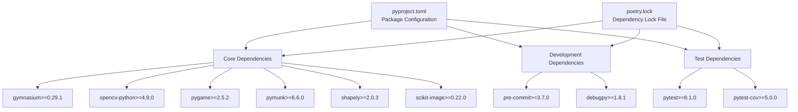
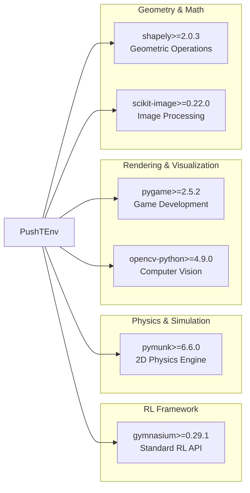
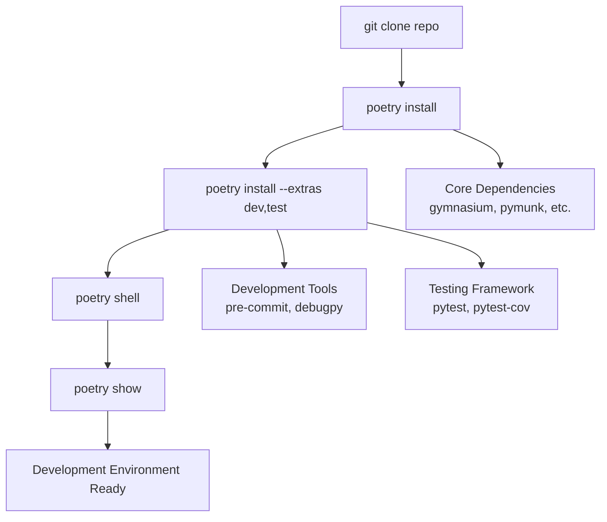
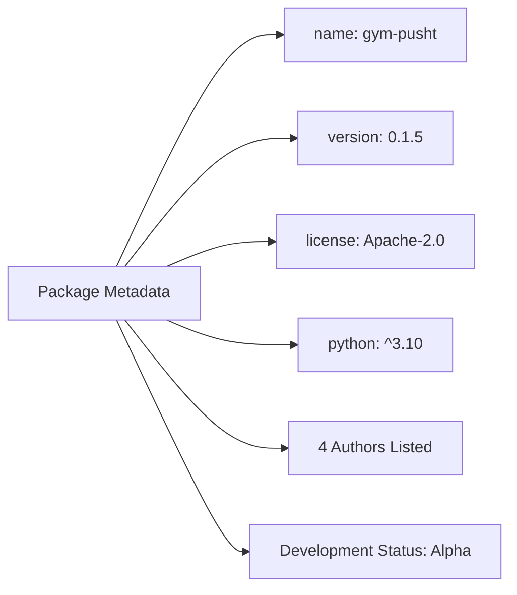

<!-- source: DeepWiki mcp.deepwiki.com · repo huggingface/gym-pusht · page 3.1 Installation and Configuration · fetched 2026-10-26 -->

# Installation and Configuration

<details>
<summary>Relevant source files</summary>

The following files were used as context for generating this wiki page:

- [poetry.lock](poetry.lock)
- [pyproject.toml](pyproject.toml)

</details>


This document explains how to install the gym-pusht package, manage its dependencies using Poetry, and configure the development environment. It covers both end-user installation and developer setup workflows.

For information about running tests and validation, see [Testing](#3.3). For details about the development workflow and CI/CD pipeline, see [Development Workflow](#3.2).

## Installation Methods

### End-User Installation

The gym-pusht package can be installed directly from source using pip:

```bash
pip install git+https://github.com/huggingface/gym-pusht.git
```

This installs the package with its core runtime dependencies defined in [pyproject.toml:23-35]().

### Developer Installation

For development work, clone the repository and install with Poetry:

```bash
git clone https://github.com/huggingface/gym-pusht.git
cd gym-pusht
poetry install
```

This installs the package in editable mode with all dependencies locked to the exact versions specified in [poetry.lock:1-1075]().

## Dependency Management with Poetry

### Core Architecture

The project uses Poetry for dependency management, with configuration centralized in `pyproject.toml` and exact versions locked in `poetry.lock`.



**Sources:** [pyproject.toml:23-39](), [poetry.lock:1-1075]()

### Dependency Categories

The project organizes dependencies into three categories defined in [pyproject.toml:37-39]():

| Category | Purpose | Installation Command |
|----------|---------|---------------------|
| Core | Runtime dependencies for the PushT environment | `poetry install` |
| `dev` | Development tools (pre-commit, debugpy) | `poetry install --extras dev` |
| `test` | Testing framework (pytest, coverage) | `poetry install --extras test` |

### Core Dependencies Breakdown



**Sources:** [pyproject.toml:25-30]()

## Development Environment Setup

### Poetry Environment Management

Poetry creates isolated virtual environments automatically. The environment setup process follows this workflow:



**Sources:** [pyproject.toml:37-39]()

### Pre-commit Hook Configuration

The development environment includes pre-commit hooks for code quality. After installing with the `dev` extra, initialize pre-commit:

```bash
poetry run pre-commit install
```

This configures automated code quality checks that run before each commit, using the Ruff linter and formatter configured in [pyproject.toml:42-78]().

## Configuration Options

### Build System Configuration

The package uses Poetry's build backend as specified in [pyproject.toml:76-78]():

```toml
[build-system]
requires = ["poetry-core"]
build-backend = "poetry.core.masonry.api"
```

### Code Quality Configuration

Ruff is configured for linting and formatting with the following key settings from [pyproject.toml:42-78]():

| Setting | Value | Purpose |
|---------|--------|---------|
| `line-length` | 110 | Maximum line length |
| `target-version` | "py310" | Python version compatibility |
| `select` | ["E4", "E7", "E9", "F", "I", "N", "B", "C4", "SIM"] | Enabled rule categories |

The configuration excludes `example.py` from linting checks to allow for more relaxed code style in example files.

### Package Metadata Configuration

The package metadata in [pyproject.toml:1-20]() defines:



**Sources:** [pyproject.toml:1-20]()

## Environment Validation

### Dependency Verification

After installation, verify the environment is correctly configured:

```bash
# Check installed packages
poetry show

# Verify core dependencies are available
poetry run python -c "import gym_pusht; print('✓ gym_pusht imported successfully')"
poetry run python -c "import gymnasium; print('✓ gymnasium available')"
poetry run python -c "import pymunk; print('✓ pymunk available')"
```

### Development Tool Verification

For development environments, verify development tools:

```bash
# Check pre-commit is installed
poetry run pre-commit --version

# Verify Ruff configuration
poetry run ruff check --version

# Test pytest setup
poetry run pytest --version
```

**Sources:** [pyproject.toml:31-34](), [pyproject.toml:42-72]()

### Python Version Compatibility

The package requires Python 3.10 or higher as specified in [pyproject.toml:24](). This constraint ensures compatibility with all core dependencies, particularly the newer versions of scientific computing libraries like numpy and scipy that have specific Python version requirements.

**Sources:** [pyproject.toml:24](), [poetry.lock:1-1075]()

---

