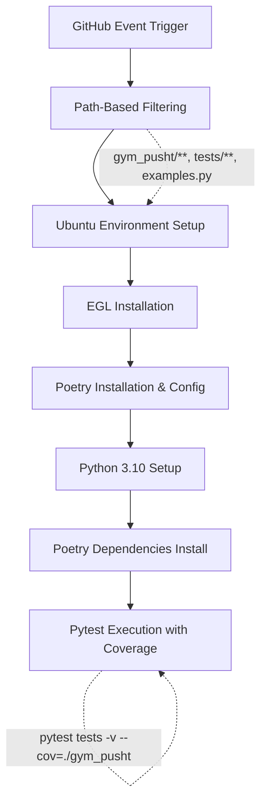
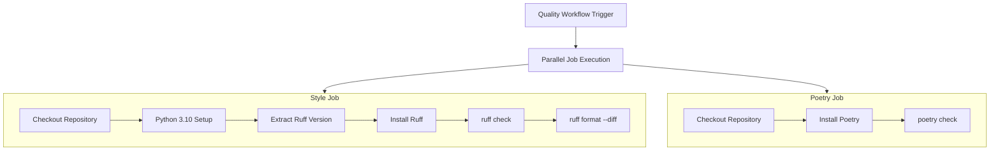
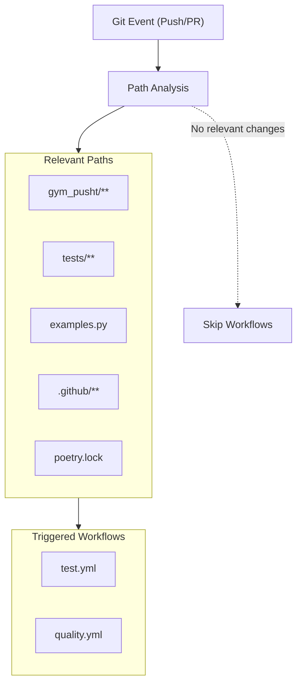

<!-- source: DeepWiki mcp.deepwiki.com · repo huggingface/gym-pusht · page 3.2 Development Workflow · fetched 2026-10-26 -->

# Development Workflow

Relevant source files

The following files were used as context for generating this wiki page:

- [.github/workflows/quality.yml](.github/workflows/quality.yml)
- [.github/workflows/test.yml](.github/workflows/test.yml)
- [.pre-commit-config.yaml](.pre-commit-config.yaml)

## Purpose and Scope

This section documents the automated development workflow, CI/CD pipeline, and quality gates used in the gym-pusht repository. It covers the pre-commit hooks, GitHub Actions workflows, and code quality enforcement mechanisms that ensure code consistency and reliability. For information about initial environment setup and dependency management, see [Installation and Configuration](#3.1). For details about running and writing tests, see [Testing](#3.3).

## Pre-commit Hook Configuration

The repository uses pre-commit hooks to enforce code quality before commits reach the remote repository. The configuration is defined in [.pre-commit-config.yaml:1-34]() and includes multiple validation stages:

### File and Code Quality Checks

| Hook | Repository | Purpose |
|------|------------|---------|
| `check-added-large-files` | pre-commit-hooks | Prevents large files from being committed |
| `debug-statements` | pre-commit-hooks | Detects debug statements left in code |
| `check-merge-conflict` | pre-commit-hooks | Identifies unresolved merge conflicts |
| `check-case-conflict` | pre-commit-hooks | Prevents case-sensitive filename conflicts |
| `check-yaml` | pre-commit-hooks | Validates YAML syntax |
| `check-toml` | pre-commit-hooks | Validates TOML syntax |
| `end-of-file-fixer` | pre-commit-hooks | Ensures files end with newlines |
| `trailing-whitespace` | pre-commit-hooks | Removes trailing whitespace |

### Code Modernization and Formatting

The workflow includes `pyupgrade` [.pre-commit-config.yaml:16-19]() to automatically upgrade Python syntax to modern standards, and Ruff for both linting and formatting [.pre-commit-config.yaml:20-25]().

### Dependency Management Validation

Poetry hooks ensure dependency consistency:
- `poetry-check`: Validates `pyproject.toml` structure
- `poetry-lock`: Ensures lockfile is synchronized with dependencies [.pre-commit-config.yaml:26-33]()

**Sources:** [.pre-commit-config.yaml:1-34]()

## CI/CD Pipeline Architecture

### Test Workflow Pipeline

The test workflow [.github/workflows/test.yml:1-54]() triggers on pull requests and pushes to main, but only when relevant paths are modified [.github/workflows/test.yml:7-21](). It includes EGL installation for headless rendering [.github/workflows/test.yml:33-34]() and runs comprehensive test coverage analysis [.github/workflows/test.yml:52-53]().

### Quality Workflow Pipeline

The quality workflow [.github/workflows/quality.yml:1-56]() runs two parallel jobs: style checking with Ruff and dependency validation with Poetry. The Ruff version is dynamically extracted from the pre-commit configuration [.github/workflows/quality.yml:28-32]() to maintain consistency.

**Sources:** [.github/workflows/test.yml:1-54](), [.github/workflows/quality.yml:1-56]()

## Quality Gates and Enforcement

### Multi-Layer Quality Enforcement

```mermaid
flowchart LR
    developer["Developer"]
    local_commit["Local Commit"]
    pre_commit_hooks["Pre-commit Hooks"]
    push_to_remote["Push to Remote"]
    pr_creation["Pull Request Creation"]
    github_actions["GitHub Actions"]
    merge_approval["Merge Approval"]
    
    developer --> local_commit
    local_commit --> pre_commit_hooks
    pre_commit_hooks --> push_to_remote
    push_to_remote --> pr_creation
    pr_creation --> github_actions
    github_actions --> merge_approval
    
    pre_commit_hooks -. "Blocks commit if fails" .-> local_commit
    github_actions -. "Blocks merge if fails" .-> merge_approval
```

### Code Quality Tools Configuration

| Tool | Configuration | Purpose |
|------|---------------|---------|
| `ruff` | [.pre-commit-config.yaml:23-25]() | Linting and formatting with `--fix` auto-correction |
| `pyupgrade` | [.pre-commit-config.yaml:16-19]() | Python syntax modernization |
| `poetry` | [.pre-commit-config.yaml:26-33]() | Dependency management validation |
| `pytest` | [.github/workflows/test.yml:52-53]() | Test execution with coverage reporting |

### Environment Consistency

The workflow ensures environment consistency through:
- Python 3.10 specification [.pre-commit-config.yaml:3](), [.github/workflows/quality.yml:13]()
- Poetry dependency management with lock file validation
- EGL installation for headless rendering support [.github/workflows/test.yml:33-34]()
- Virtual environment isolation [.github/workflows/test.yml:38-39]()

**Sources:** [.pre-commit-config.yaml:1-34](), [.github/workflows/test.yml:33-54](), [.github/workflows/quality.yml:13-56]()

## Workflow Triggers and Path Filtering

### Selective Workflow Execution

The CI/CD system uses intelligent path-based filtering to optimize build times:

Test workflow triggers [.github/workflows/test.yml:7-21]() and quality workflow triggers [.github/workflows/quality.yml:5-10]() are optimized to run only when code or configuration changes occur, reducing unnecessary CI resource usage.

**Sources:** [.github/workflows/test.yml:7-21](), [.github/workflows/quality.yml:5-10]()

---

