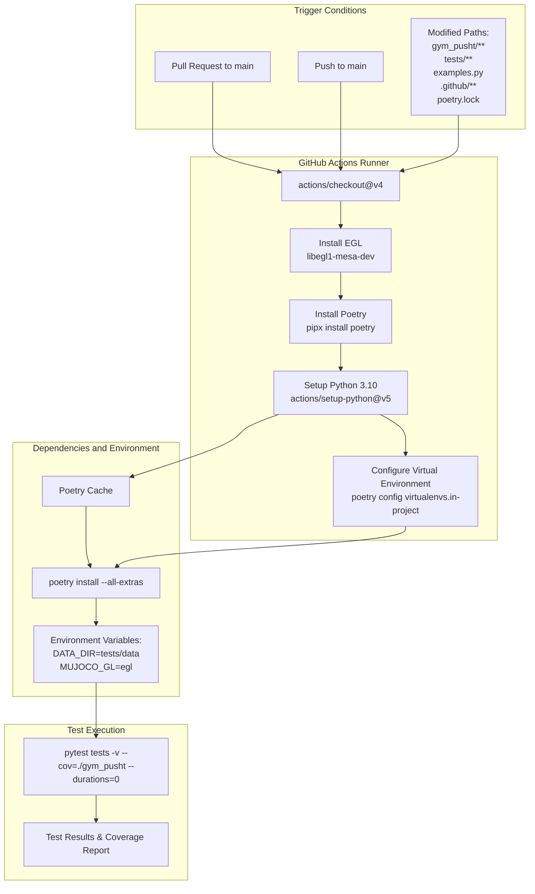
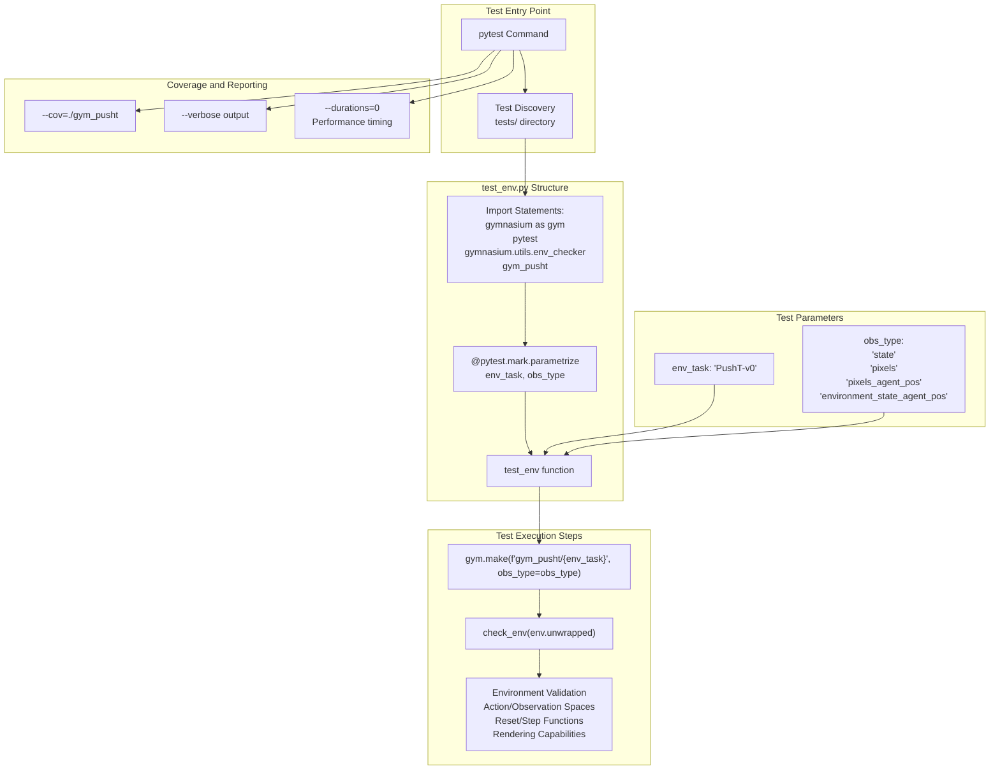

<!-- source: DeepWiki mcp.deepwiki.com · repo huggingface/gym-pusht · page 3.3 Testing · fetched 2026-10-26 -->

# Testing

<details>
<summary>Relevant source files</summary>

The following files were used as context for generating this wiki page:

- [.github/workflows/test.yml](.github/workflows/test.yml)
- [tests/test_env.py](tests/test_env.py)

</details>


This document covers the testing infrastructure for the gym-pusht environment, including automated CI/CD testing, local test execution, and the test framework architecture. The testing system ensures environment correctness, validates all observation types, and maintains code quality through continuous integration.

For information about development workflow and code quality checks, see [Development Workflow](#3.2). For details about the environment's observation types being tested, see [Observation Types](#2.3).

## Test Infrastructure and CI/CD Pipeline

The gym-pusht repository uses GitHub Actions for automated testing on every pull request and push to the main branch. The test pipeline is configured to run comprehensive validation of the environment implementation.

### CI/CD Test Pipeline Flow



Sources: [.github/workflows/test.yml:1-54]()

The CI pipeline includes several key components:

| Component | Purpose | Configuration |
|-----------|---------|---------------|
| **EGL Installation** | Enables headless rendering for visual tests | `libegl1-mesa-dev` package |
| **Poetry Management** | Handles dependency installation and virtual environments | `virtualenvs.in-project true` |
| **Python Environment** | Standardized Python 3.10 runtime | Cached poetry dependencies |
| **Environment Variables** | Configures test data location and rendering backend | `DATA_DIR=tests/data`, `MUJOCO_GL=egl` |

## Test Framework Architecture

The testing system is built on pytest with parametrized testing to validate all environment configurations systematically.

### Test Structure and Execution Flow



Sources: [tests/test_env.py:1-20](), [.github/workflows/test.yml:51-53]()

## Test Coverage and Validation

The current test suite provides comprehensive validation of the PushT environment through systematic testing of all supported observation types.

### Environment Validation Matrix

| Test Parameter | Values | Validation Purpose |
|----------------|--------|--------------------|
| **env_task** | `"PushT-v0"` | Core environment functionality |
| **obs_type** | `"state"` | 5D state vector observation |
| | `"pixels"` | 96x96 RGB image observation |
| | `"pixels_agent_pos"` | Image + agent position hybrid |
| | `"environment_state_agent_pos"` | 16D keypoints + agent position |

The `test_env` function [tests/test_env.py:17-19]() performs the following validations for each parameter combination:

1. **Environment Instantiation**: Verifies `gym.make()` can create the environment with specified parameters
2. **Gymnasium Compliance**: Uses `check_env()` to validate adherence to Gymnasium API standards
3. **Action/Observation Space Consistency**: Ensures spaces are properly defined and compatible
4. **Reset/Step Functionality**: Validates core environment methods work correctly

### Test Execution Command Structure

The pytest execution includes several important flags:

```bash
pytest tests -v --cov=./gym_pusht --durations=0
```

| Flag | Purpose |
|------|---------|
| `tests` | Target directory for test discovery |
| `-v` | Verbose output showing individual test results |
| `--cov=./gym_pusht` | Generate code coverage report for the main package |
| `--durations=0` | Show execution time for all tests |

Sources: [.github/workflows/test.yml:53]()

## Running Tests Locally

To execute the test suite in a local development environment:

### Prerequisites Setup

1. **Install Dependencies**: Use Poetry to install all dependencies including test extras
2. **Environment Configuration**: Set appropriate environment variables for headless testing
3. **Graphics Backend**: Ensure EGL or appropriate OpenGL context is available

### Local Test Execution

The same pytest command used in CI can be run locally:

```bash
pytest tests -v --cov=./gym_pusht --durations=0
```

For specific test subsets or debugging, pytest supports various filtering options:

- Test specific observation types: `pytest tests -k "state"`
- Run with detailed output: `pytest tests -v -s`
- Generate HTML coverage report: `pytest tests --cov=./gym_pusht --cov-report=html`

Sources: [.github/workflows/test.yml:48-53]()

## Writing New Tests

The current test structure provides a foundation for extending test coverage. New tests should follow the established patterns:

### Test Organization Principles

1. **Parametrized Testing**: Use `@pytest.mark.parametrize` for testing multiple configurations
2. **Environment Validation**: Leverage `gymnasium.utils.env_checker.check_env()` for standard compliance
3. **Import Structure**: Follow the established import pattern with proper noqa annotations
4. **Test Naming**: Use descriptive function names that clearly indicate test purpose

### Extending Test Coverage

Future test additions might include:

- **Performance Testing**: Validate environment step execution time
- **Reward Function Testing**: Verify reward calculation correctness
- **Physics Validation**: Test collision detection and object dynamics
- **Rendering Testing**: Validate visual output consistency
- **Edge Case Handling**: Test boundary conditions and error handling

The modular test structure in [tests/test_env.py:8-16]() demonstrates how to efficiently test multiple environment configurations while maintaining clear, readable test code.

Sources: [tests/test_env.py:1-20]()

---

