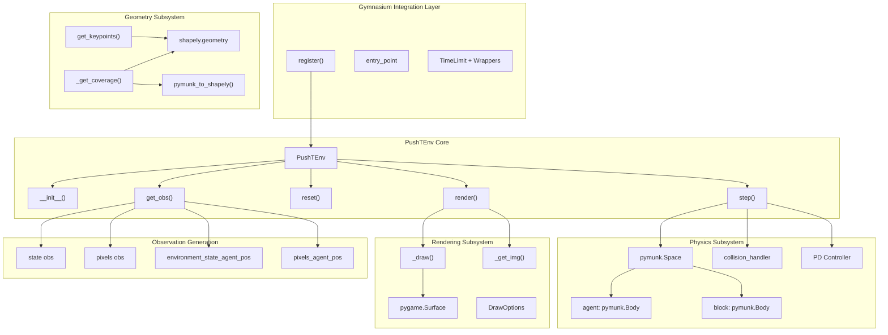
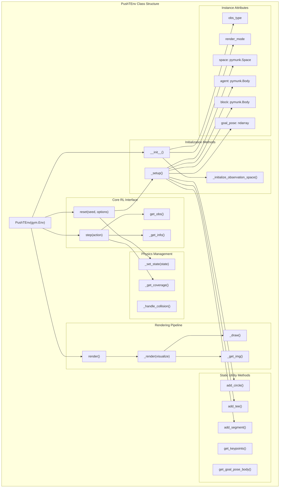
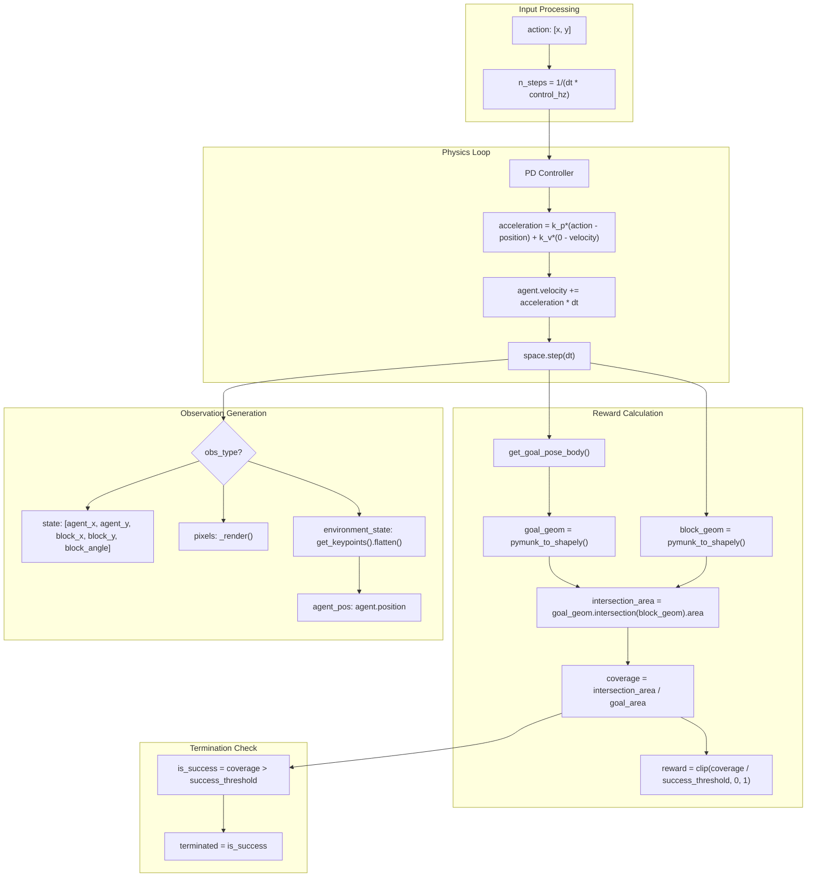
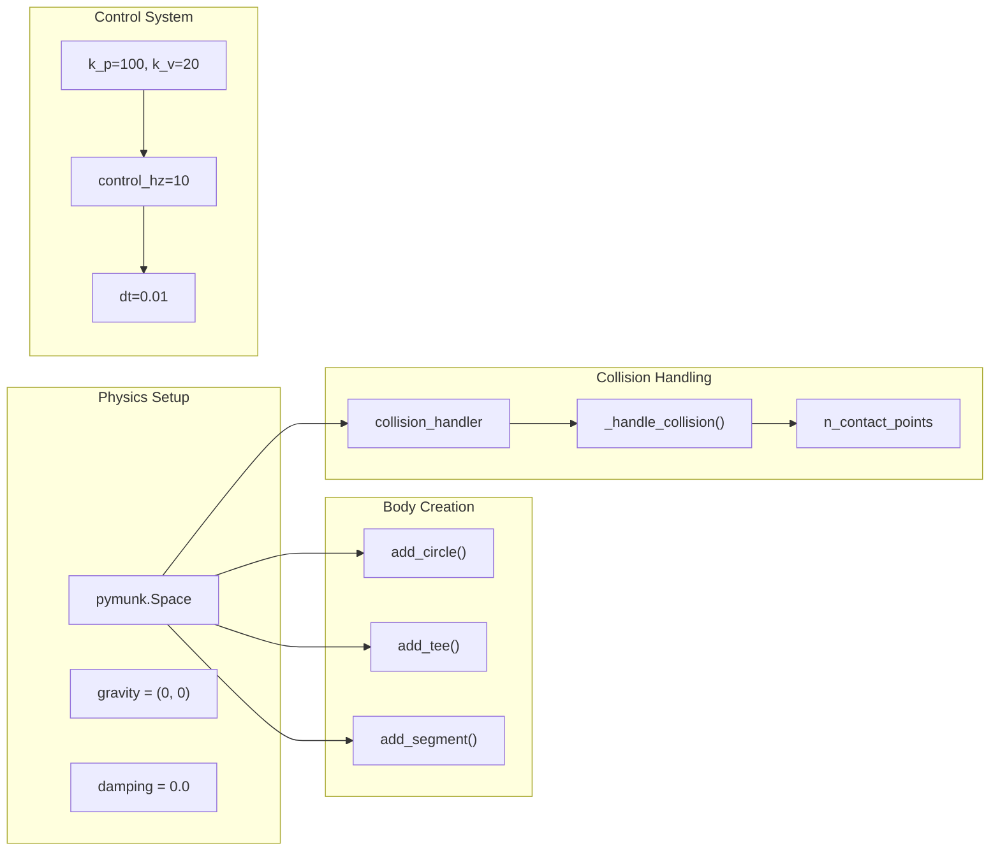
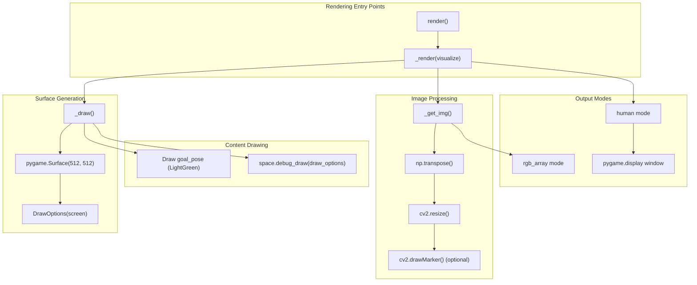

<!-- source: DeepWiki mcp.deepwiki.com · repo huggingface/gym-pusht · page 4 Architecture and Implementation · fetched 2026-10-26 -->

# Architecture and Implementation

<details>
<summary>Relevant source files</summary>

The following files were used as context for generating this wiki page:

- [gym_pusht/__init__.py](gym_pusht/__init__.py)
- [gym_pusht/envs/__init__.py](gym_pusht/envs/__init__.py)
- [gym_pusht/envs/pusht.py](gym_pusht/envs/pusht.py)

</details>


This page provides technical details about the codebase structure, design patterns, and implementation decisions of the gym-pusht environment. It covers the internal architecture, component relationships, and key implementation choices that enable the 2D physics-based reinforcement learning environment.

For information about using the environment APIs, see [Environment API](#2.1). For details about the physics simulation mechanics, see [Physics Simulation](#2.2).

## Core Architecture Overview

The gym-pusht codebase implements a modular architecture centered around the `PushTEnv` class, which integrates multiple subsystems for physics simulation, rendering, and reinforcement learning. The architecture follows the Gymnasium environment pattern while incorporating specialized components for 2D physics and multi-modal observations.

### High-Level System Architecture



**Sources:** [gym_pusht/envs/pusht.py:1-542](), [gym_pusht/__init__.py:1-9]()

## Class Structure and Implementation

### Primary Classes and Components

The implementation centers around a single main class with supporting utility functions and external library integrations:

| Component | Type | Location | Responsibility |
|-----------|------|----------|----------------|
| `PushTEnv` | Class | [gym_pusht/envs/pusht.py:40-542]() | Main environment implementation |
| `pymunk_to_shapely` | Function | [gym_pusht/envs/pusht.py:27-37]() | Geometry conversion utility |
| `DrawOptions` | Class | [gym_pusht/envs/pymunk_override.py]() | Custom rendering options |

### PushTEnv Class Architecture



**Sources:** [gym_pusht/envs/pusht.py:40-542]()

## Data Flow and Processing Pipeline

### Environment Step Execution Flow

The environment processes actions through a multi-stage pipeline involving physics simulation, reward calculation, and observation generation:



**Sources:** [gym_pusht/envs/pusht.py:240-266](), [gym_pusht/envs/pusht.py:383-403](), [gym_pusht/envs/pusht.py:232-238]()

## Design Patterns and Implementation Decisions

### Multi-Modal Observation Pattern

The environment implements a flexible observation system supporting four distinct observation types through conditional logic in `get_obs()`:

| Observation Type | Structure | Use Case |
|------------------|-----------|----------|
| `"state"` | `[agent_x, agent_y, block_x, block_y, block_angle]` | State-based RL algorithms |
| `"pixels"` | `(96, 96, 3)` RGB array | Vision-based RL algorithms |
| `"environment_state_agent_pos"` | Dict with `environment_state` + `agent_pos` | Keypoint-based methods |
| `"pixels_agent_pos"` | Dict with `pixels` + `agent_pos` | Hybrid vision + position methods |

**Sources:** [gym_pusht/envs/pusht.py:183-230](), [gym_pusht/envs/pusht.py:383-403]()

### Physics Integration Pattern

The implementation uses pymunk as the primary physics engine with custom integration points:



**Sources:** [gym_pusht/envs/pusht.py:431-456](), [gym_pusht/envs/pusht.py:164-168](), [gym_pusht/envs/pusht.py:476-518]()

### Geometry Processing Pattern

The codebase implements a geometry processing pipeline that bridges pymunk physics bodies with shapely geometric operations:

1. **Conversion Layer**: `pymunk_to_shapely()` converts pymunk shapes to shapely polygons
2. **Coverage Calculation**: Uses shapely intersection operations for precise coverage measurement
3. **Keypoint Extraction**: `get_keypoints()` extracts T-shaped block vertices for observation

**Sources:** [gym_pusht/envs/pusht.py:27-37](), [gym_pusht/envs/pusht.py:232-238](), [gym_pusht/envs/pusht.py:520-541]()

### Rendering Pipeline Architecture

The rendering system implements a multi-stage pipeline supporting both human visualization and pixel observations:



**Sources:** [gym_pusht/envs/pusht.py:298-364](), [gym_pusht/envs/pusht.py:316-333]()

## Component Integration and Dependencies

### External Library Integration

The environment integrates multiple external libraries through well-defined interfaces:

| Library | Usage | Integration Point |
|---------|-------|-------------------|
| `pymunk` | 2D physics simulation | [gym_pusht/envs/pusht.py:14](), physics bodies and space |
| `pygame` | Rendering and visualization | [gym_pusht/envs/pusht.py:12](), surface and drawing operations |
| `shapely` | Geometric operations | [gym_pusht/envs/pusht.py:16](), coverage calculations |
| `gymnasium` | RL environment interface | [gym_pusht/envs/pusht.py:6](), base class and spaces |
| `opencv-python` | Image processing | [gym_pusht/envs/pusht.py:5](), image resizing and marker drawing |
| `numpy` | Numerical operations | [gym_pusht/envs/pusht.py:7](), array operations throughout |

### Environment Registration Pattern

The environment follows the standard gymnasium registration pattern with custom configuration:

```python
register(
    id="gym_pusht/PushT-v0",
    entry_point="gym_pusht.envs:PushTEnv",
    max_episode_steps=300,
    kwargs={"obs_type": "state"},
)
```

This registration enables instantiation via `gym.make("gym_pusht/PushT-v0")` with automatic wrapper application.

**Sources:** [gym_pusht/__init__.py:3-8](), [gym_pusht/envs/__init__.py:1-3]()

---

