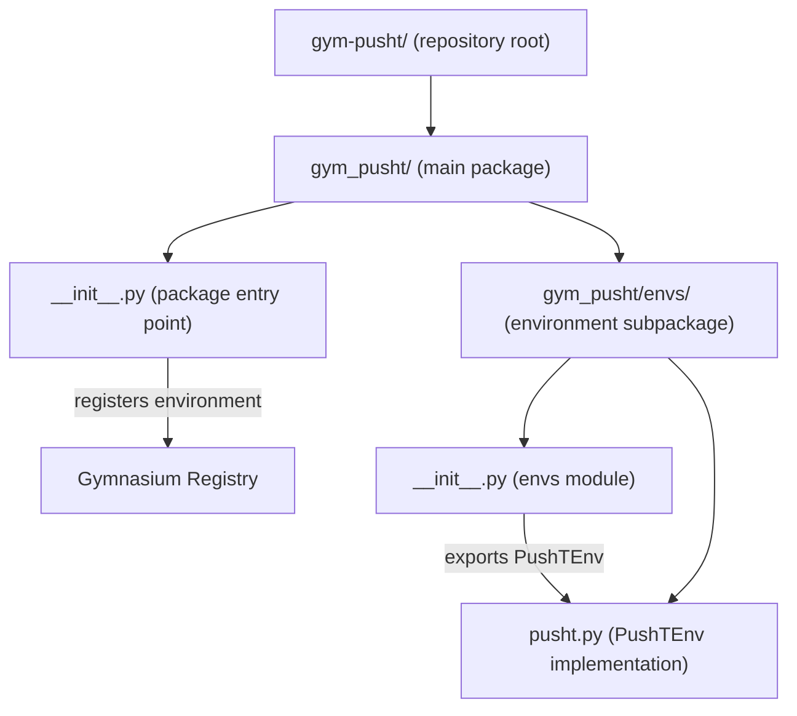
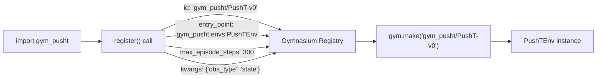
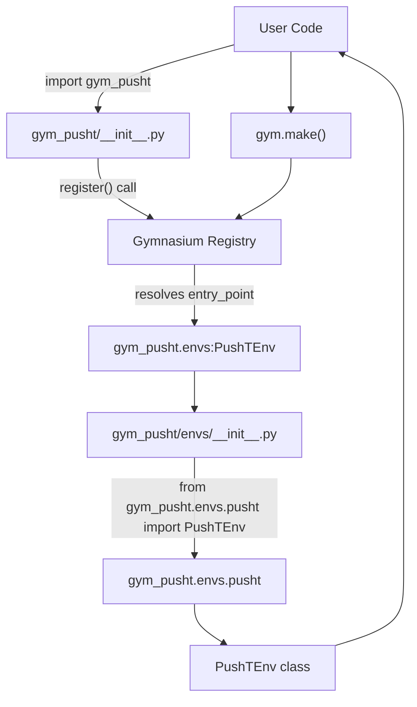

<!-- source: DeepWiki mcp.deepwiki.com · repo huggingface/gym-pusht · page 4.1 Package Structure · fetched 2026-10-26 -->

# Package Structure

<details>
<summary>Relevant source files</summary>

The following files were used as context for generating this wiki page:

- [.gitignore](.gitignore)
- [gym_pusht/__init__.py](gym_pusht/__init__.py)
- [gym_pusht/envs/__init__.py](gym_pusht/envs/__init__.py)

</details>


This document explains the organization of the `gym-pusht` Python package, its module hierarchy, and how the package integrates with the Gymnasium framework. This covers the physical file organization, import structure, and entry point registration system that makes the PushT environment discoverable and usable.

For details about the internal implementation of the environment itself, see [Environment API](#2.1). For information about dependencies and external libraries, see [Dependencies and Technology Stack](#4.2).

## Package Organization

The `gym-pusht` package follows a standard Python package structure with clear separation between the main package interface and environment implementations.

### Top-Level Package Structure



**Sources:** [gym_pusht/__init__.py:1-9](), [gym_pusht/envs/__init__.py:1-4]()

### Module Hierarchy and Responsibilities

| Module | Purpose | Key Exports |
|--------|---------|-------------|
| `gym_pusht` | Package entry point and environment registration | Environment registration with Gymnasium |
| `gym_pusht.envs` | Environment implementations subpackage | `PushTEnv` class |
| `gym_pusht.envs.pusht` | Core PushT environment implementation | `PushTEnv` class definition |

## Environment Registration System

The package uses Gymnasium's registration system to make the PushT environment discoverable through the standard `gym.make()` interface.

### Registration Flow



**Sources:** [gym_pusht/__init__.py:3-8]()

The registration occurs automatically when the package is imported and configures:
- **Environment ID**: `"gym_pusht/PushT-v0"`
- **Entry Point**: `"gym_pusht.envs:PushTEnv"`
- **Episode Limit**: `300` steps maximum
- **Default Parameters**: `obs_type="state"`

## Import Structure

The package uses a layered import system that provides clean separation between public interfaces and implementation details.

### Import Chain



**Sources:** [gym_pusht/__init__.py:1-9](), [gym_pusht/envs/__init__.py:1-4]()

### Public API Surface

The package exposes a minimal public API through the Gymnasium registration system:

```python
# Primary usage pattern
import gym_pusht  # Triggers registration
env = gym.make("gym_pusht/PushT-v0")

# Direct import (less common)
from gym_pusht.envs import PushTEnv
env = PushTEnv()
```

The `__all__` declaration in [gym_pusht/envs/__init__.py:3]() explicitly controls which symbols are exported from the envs subpackage, ensuring only `PushTEnv` is publicly available.

## File Organization Patterns

The package follows Python packaging best practices:

- **Namespace Package**: Uses the `gym_pusht` namespace to avoid conflicts
- **Subpackage Structure**: Separates environments into dedicated `envs` subpackage
- **Clean Exports**: Uses `__all__` declarations to control public interfaces
- **Entry Point Registration**: Leverages Gymnasium's plugin system for discovery

**Sources:** [gym_pusht/__init__.py:1-9](), [gym_pusht/envs/__init__.py:1-4]()

---

