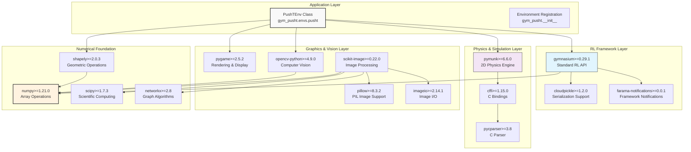
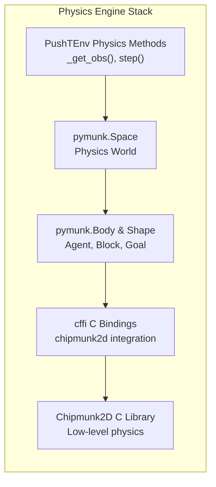
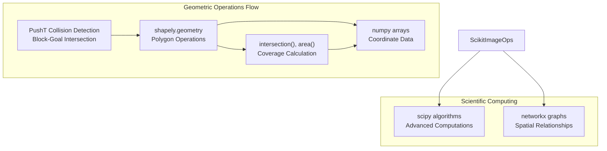
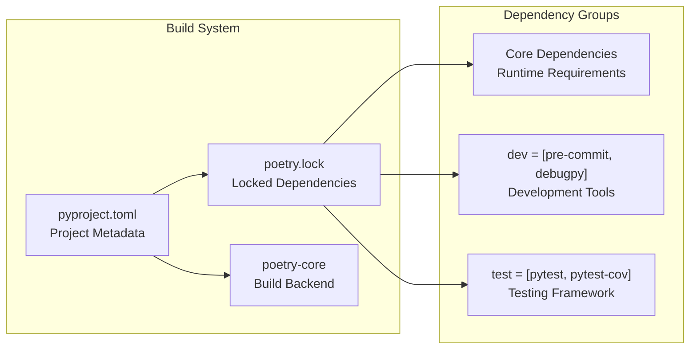
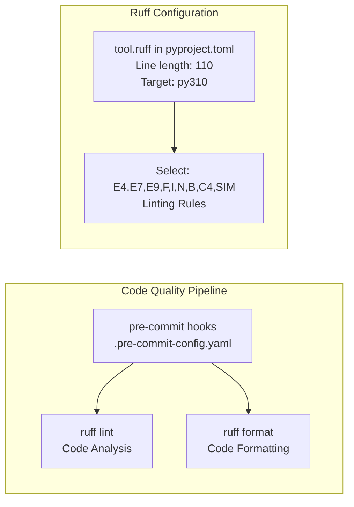
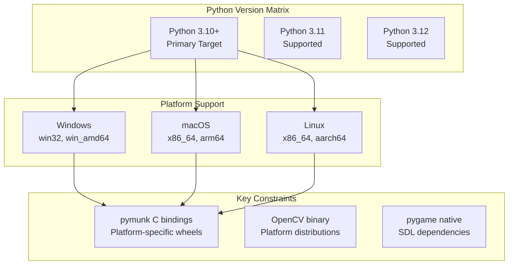
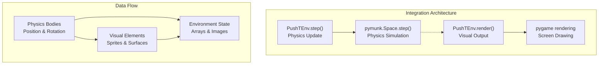

<!-- source: DeepWiki mcp.deepwiki.com · repo huggingface/gym-pusht · page 4.2 Dependencies and Technology Stack · fetched 2026-10-26 -->

# Dependencies and Technology Stack

Relevant source files

The following files were used as context for generating this wiki page:

- [poetry.lock](poetry.lock)
- [pyproject.toml](pyproject.toml)

This document provides a comprehensive overview of the external libraries, frameworks, and tools that comprise the technology stack for the gym-pusht repository. It covers the core runtime dependencies, development tools, build system configuration, and how these components integrate to create the PushT reinforcement learning environment.

For package structure and organization details, see [Package Structure](#4.1). For development workflow and CI/CD pipeline information, see [Development Workflow](#3.2).

## Core Technology Stack

The gym-pusht package is built on a multi-layered technology stack that combines reinforcement learning frameworks, 2D physics simulation, computer vision, and game development libraries.

**Technology Stack Overview**
Sources: [pyproject.toml:23-35](), [poetry.lock:1-1075]()

## Core Runtime Dependencies

### Reinforcement Learning Framework

| Package | Version | Role | Key Features |
|---------|---------|------|-------------|
| `gymnasium` | ≥0.29.1 | RL Environment API | Standard interface, observation/action spaces, environment lifecycle |
| `cloudpickle` | ≥1.2.0 | Serialization | Environment state pickling, cross-process communication |
| `farama-notifications` | ≥0.0.1 | Framework Integration | Compatibility notifications, version warnings |
| `typing-extensions` | ≥4.3.0 | Type Support | Enhanced type hints for environment interfaces |

The `PushTEnv` class in [gym_pusht/envs/pusht.py]() inherits from `gymnasium.Env` and implements the standard RL interface methods (`reset()`, `step()`, `render()`).

Sources: [pyproject.toml:25](), [poetry.lock:251-279]()

### Physics Simulation Engine

| Package | Version | Role | C Dependencies |
|---------|---------|------|----------------|
| `pymunk` | ≥6.6.0 | 2D Physics Engine | Chipmunk2D physics library |
| `cffi` | ≥1.15.0 | C Foreign Function Interface | Python-C bindings for pymunk |
| `pycparser` | - | C Code Parsing | CFFI dependency for C header parsing |

Sources: [pyproject.toml:28](), [poetry.lock:681-750]()

### Graphics and Visualization

The rendering system combines multiple libraries for different aspects of visual output:

| Package | Version | Primary Use | Integration Point |
|---------|---------|-------------|------------------|
| `pygame` | ≥2.5.2 | Real-time rendering, window management | `render()` method, display surfaces |
| `opencv-python` | ≥4.9.0 | Image array operations, color conversion | Observation processing pipeline |
| `scikit-image` | ≥0.22.0 | Advanced image processing | Image transformations, filtering |
| `pillow` | ≥8.3.2 | Image format support | File I/O, format conversions |
| `imageio` | ≥2.14.1 | Image and video I/O | Data loading utilities |

The custom rendering pipeline likely uses [gym_pusht/pymunk_override.py]() to extend pygame's drawing capabilities for pymunk objects.

Sources: [pyproject.toml:26-27,30](), [poetry.lock:615-679,434-456,851-892]()

### Geometric and Numerical Operations

| Package | Version | Role | Key Algorithms |
|---------|---------|------|----------------|
| `numpy` | ≥1.21.0 | Numerical foundation | Array operations, linear algebra |
| `scipy` | ≥1.9.0 | Scientific computing | Advanced mathematical functions |
| `shapely` | ≥2.0.3 | Geometric operations | Polygon intersection, area calculation |
| `networkx` | ≥2.8 | Graph algorithms | Spatial graph operations (via scikit-image) |

Sources: [pyproject.toml:29](), [poetry.lock:389-431,894-934,952-1007,357-373]()

## Development and Build Infrastructure

### Build System Configuration

The project uses Poetry for dependency management with a pyproject.toml-based configuration:

**Build Configuration Details:**
- **Build Backend:** `poetry.core.masonry.api`
- **Python Version:** `^3.10` (Python 3.10+)
- **Package Name:** `gym-pusht`
- **License:** Apache-2.0

Sources: [pyproject.toml:1-22,76-78]()

### Development Dependencies

| Extra Group | Packages | Purpose |
|-------------|----------|---------|
| `dev` | `pre-commit`, `debugpy` | Code quality, debugging |
| `test` | `pytest`, `pytest-cov` | Testing, coverage reporting |

**Pre-commit Integration:**
The `pre-commit` framework integrates with Ruff for code formatting and linting:

**Ruff Configuration Highlights:**
- **Line Length:** 110 characters
- **Target Version:** Python 3.10
- **Selected Rules:** Error detection, import sorting, naming conventions, bugbear, comprehensions, simplification

Sources: [pyproject.toml:31-39,42-73](), [poetry.lock:586-602]()

### Testing Infrastructure

| Package | Version | Role | Features |
|---------|---------|------|----------|
| `pytest` | ≥8.1.0 | Testing framework | Test discovery, fixtures, parameterization |
| `pytest-cov` | ≥5.0.0 | Coverage reporting | Line coverage analysis, reporting |
| `coverage` | ≥5.2.1 | Coverage measurement | Core coverage engine |

**Supporting Test Dependencies:**
- `iniconfig` - Configuration file parsing
- `pluggy` - Plugin architecture for pytest
- `exceptiongroup` - Exception handling (Python <3.11)
- `colorama` - Colored terminal output (Windows)

Sources: [pyproject.toml:33-34](), [poetry.lock:752-790]()

## Python Version and Platform Compatibility

### Version Requirements

**Platform-Specific Considerations:**
- **Windows:** Requires Visual C++ runtime for native extensions
- **macOS:** Universal2 wheels for Intel/ARM compatibility  
- **Linux:** manylinux wheels for broad distribution compatibility

Sources: [pyproject.toml:24](), [poetry.lock:686-744,621-678,434-447]()

## Dependency Integration Patterns

### Physics-Graphics Integration

The environment integrates physics simulation with real-time rendering through several key patterns:

**Key Integration Points:**
1. **Physics-to-Graphics:** pymunk body positions → pygame sprite coordinates
2. **Graphics-to-Observation:** pygame surface → numpy array → opencv processing
3. **Geometry-to-Physics:** shapely polygons → pymunk collision shapes

Sources: Inferred from dependency relationships and typical physics engine patterns

This dependency architecture enables the PushT environment to provide realistic 2D physics simulation, multi-modal observations (visual and state-based), and flexible rendering capabilities while maintaining compatibility with the standard gymnasium RL interface.

---

