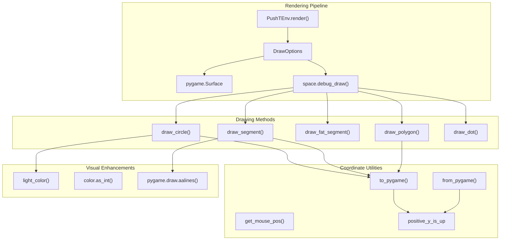
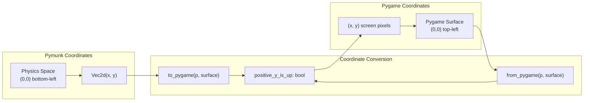
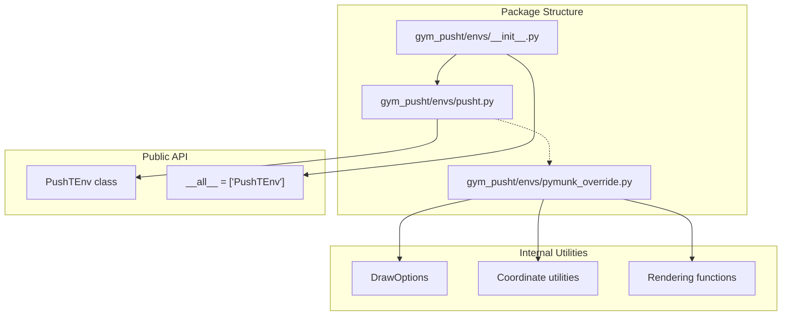
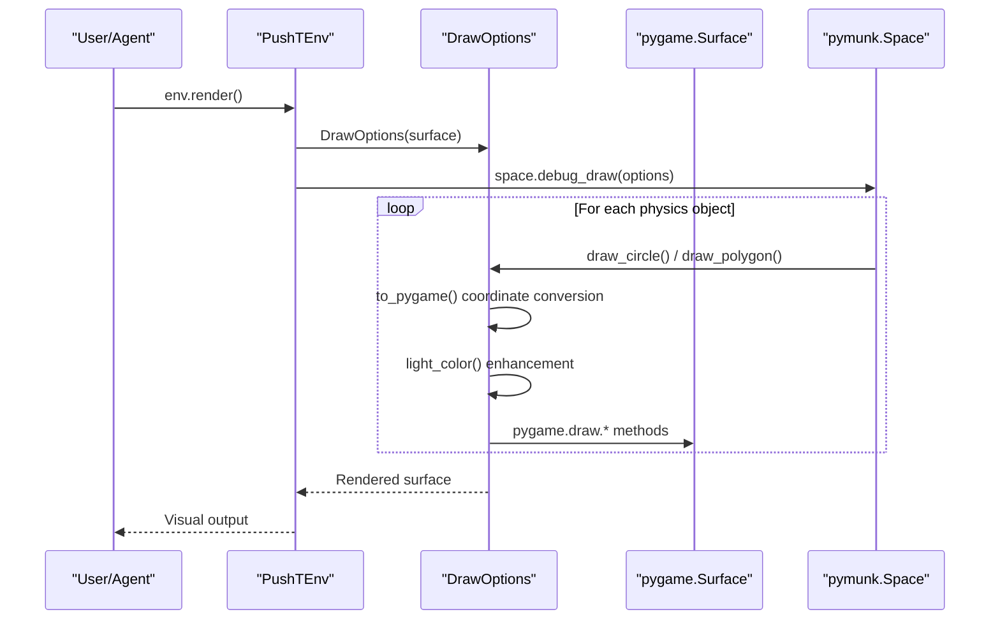

<!-- source: DeepWiki mcp.deepwiki.com · repo huggingface/gym-pusht · page 4.3 Utilities and Supporting Modules · fetched 2026-10-26 -->

# Utilities and Supporting Modules

Relevant source files

The following files were used as context for generating this wiki page:

- [gym_pusht/envs/__init__.py](gym_pusht/envs/__init__.py)
- [gym_pusht/envs/pymunk_override.py](gym_pusht/envs/pymunk_override.py)

This page documents the utility modules and supporting components that enable the PushT environment's functionality. These modules provide essential services like custom rendering, coordinate transformations, and package organization that support the core environment implementation.

For information about the core environment implementation, see [PushT Environment](#2). For details about the overall architecture, see [Architecture and Implementation](#4).

## Overview

The supporting modules in gym-pusht provide specialized functionality that extends and enhances the core environment capabilities. The primary utility module is the custom pygame rendering system that overrides default pymunk drawing behavior to provide enhanced visualization capabilities.

## Rendering Utilities

### Custom Pymunk Drawing System

The `pymunk_override.py` module provides a customized drawing system that extends pymunk's default pygame integration with enhanced visual capabilities and coordinate system handling.

**Sources:** [gym_pusht/envs/pymunk_override.py:1-245]()

### DrawOptions Class

The `DrawOptions` class extends `pymunk.SpaceDebugDrawOptions` to provide custom rendering behavior for physics objects in the PushT environment.

| Component | Purpose | Key Methods |
|-----------|---------|-------------|
| `DrawOptions` | Main drawing controller | `__init__()`, `draw_circle()`, `draw_polygon()` |
| Circle rendering | Enhanced circle drawing with lighting effects | `draw_circle()` at [line 127-143]() |
| Polygon rendering | Custom polygon drawing with rounded edges | `draw_polygon()` at [line 191-208]() |
| Segment rendering | Anti-aliased line drawing | `draw_segment()` at [line 145-149]() |

**Key Features:**
- **Enhanced circle rendering**: Applies lighting effects using `light_color()` function [gym_pusht/envs/pymunk_override.py:241-244]()
- **Anti-aliased lines**: Uses `pygame.draw.aalines()` for smooth line rendering [gym_pusht/envs/pymunk_override.py:149]()
- **Coordinate transformation**: Automatic conversion between pymunk and pygame coordinate systems

**Sources:** [gym_pusht/envs/pymunk_override.py:77-213]()

### Coordinate System Management

The module provides utilities for handling coordinate system differences between pymunk (physics) and pygame (rendering) coordinate systems.

**Coordinate Functions:**
- `to_pygame()`: Converts pymunk coordinates to pygame surface coordinates [gym_pusht/envs/pymunk_override.py:221-231]()
- `from_pygame()`: Converts pygame coordinates to pymunk coordinates [gym_pusht/envs/pymunk_override.py:234-238]()
- `positive_y_is_up`: Boolean flag controlling coordinate system orientation [gym_pusht/envs/pymunk_override.py:51-74]()

**Sources:** [gym_pusht/envs/pymunk_override.py:51-238]()

### Visual Enhancement Functions

The module includes utility functions for improving the visual appearance of rendered objects:

| Function | Purpose | Implementation |
|----------|---------|----------------|
| `light_color()` | Creates lighter version of colors for shading effects | Multiplies RGB values by 1.2, clamped to 255 |
| `get_mouse_pos()` | Gets mouse position in pymunk coordinates | Converts pygame mouse position using coordinate utilities |

The `light_color()` function enhances visual depth by creating highlighting effects on drawn objects [gym_pusht/envs/pymunk_override.py:241-244]().

**Sources:** [gym_pusht/envs/pymunk_override.py:215-244]()

## Package Organization

### Module Initialization

The `__init__.py` file in the envs package provides clean namespace organization by exposing only the essential `PushTEnv` class.

The `__init__.py` file follows Python best practices by:
- Importing only the main environment class [gym_pusht/envs/__init__.py:1]()
- Explicitly defining public API through `__all__` [gym_pusht/envs/__init__.py:3]()
- Keeping internal utilities hidden from the public interface

**Sources:** [gym_pusht/envs/__init__.py:1-4]()

## Integration with Core Environment

### Rendering Pipeline Integration

The utilities integrate seamlessly with the main PushT environment to provide enhanced visualization capabilities during environment rendering and debugging.

The rendering utilities support the main environment by:
- Providing enhanced visual feedback during training and debugging
- Handling coordinate system conversions automatically
- Applying visual enhancements like lighting and anti-aliasing
- Maintaining clean separation between physics simulation and visualization

**Sources:** [gym_pusht/envs/pymunk_override.py:77-213](), [gym_pusht/envs/__init__.py:1-4]()

---

