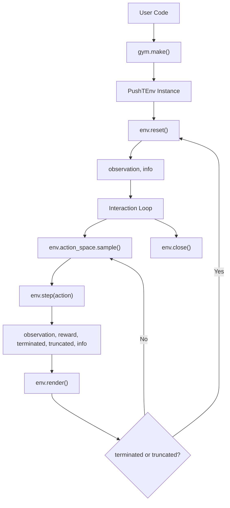
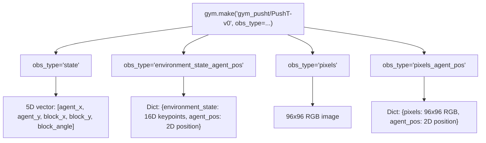
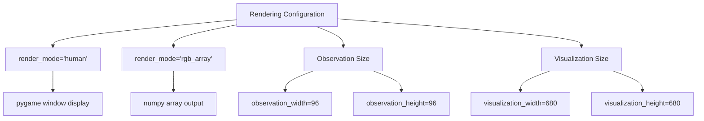
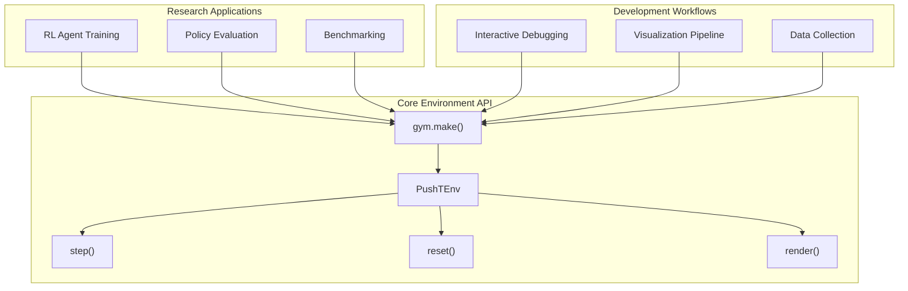

<!-- source: DeepWiki mcp.deepwiki.com · repo huggingface/gym-pusht · page 5 Usage Examples · fetched 2026-10-26 -->

# Usage Examples

<details>
<summary>Relevant source files</summary>

The following files were used as context for generating this wiki page:

- [README.md](README.md)
- [example.py](example.py)

</details>


This document provides practical examples demonstrating how to use the PushT environment in different contexts and configurations. It covers basic environment interaction patterns, observation type configurations, rendering modes, and advanced usage scenarios.

For detailed information about the environment's internal architecture and implementation, see [PushT Environment](#2). For installation and development setup instructions, see [Development Setup](#3).

## Basic Environment Interaction

The fundamental usage pattern involves creating the environment, running an interaction loop, and properly closing resources. The core API follows the standard Gymnasium interface.



The basic interaction pattern is demonstrated in [example.py:1-16](). This example shows the standard reinforcement learning loop where an agent takes random actions in the environment:

| Step | Method | Purpose |
|------|--------|---------|
| 1 | `gym.make()` | Create environment instance |
| 2 | `env.reset()` | Initialize episode |
| 3 | `env.action_space.sample()` | Generate random action |
| 4 | `env.step(action)` | Execute action in environment |
| 5 | `env.render()` | Visualize current state |
| 6 | Episode termination check | Reset if needed |
| 7 | `env.close()` | Clean up resources |

Sources: [example.py:1-16](), [README.md:23-40]()

## Observation Type Configurations

The PushT environment supports four distinct observation types, each suited for different learning approaches. The observation type is configured through the `obs_type` parameter during environment creation.



### State-Based Observations

The simplest observation type provides a compact numerical representation of the environment state:

```python
env = gym.make("gym_pusht/PushT-v0", obs_type="state")
observation, info = env.reset()
# observation is a 5D numpy array: [agent_x, agent_y, block_x, block_y, block_angle]
```

This configuration returns a 5-dimensional vector where positions are in the range [0, 512] and the block angle is in [0, 2π].

### Environment State with Agent Position

For keypoint-based approaches, the environment provides T-block keypoint locations:

```python
env = gym.make("gym_pusht/PushT-v0", obs_type="environment_state_agent_pos")
observation, info = env.reset()
# observation["environment_state"]: 16D vector of keypoint coordinates
# observation["agent_pos"]: 2D agent position
```

### Vision-Based Observations

For computer vision approaches, the environment can return RGB images:

```python
env = gym.make("gym_pusht/PushT-v0", obs_type="pixels")
observation, info = env.reset()
# observation is a 96x96x3 RGB image array
```

### Hybrid Observations

Combining visual and positional information for multi-modal learning:

```python
env = gym.make("gym_pusht/PushT-v0", obs_type="pixels_agent_pos")
observation, info = env.reset()
# observation["pixels"]: 96x96x3 RGB image
# observation["agent_pos"]: 2D agent position
```

Sources: [README.md:55-64](), [README.md:59-62](), [README.md:84-92]()

## Rendering Configurations

The environment supports different rendering modes for visualization and debugging purposes. The rendering system can be configured for both observation generation and human visualization.



### Human-Readable Rendering

For interactive debugging and demonstration:

```python
env = gym.make("gym_pusht/PushT-v0", render_mode="human")
# Creates a pygame window for real-time visualization
```

### Programmatic Rendering

For automated processing and data collection:

```python
env = gym.make("gym_pusht/PushT-v0", render_mode="rgb_array")
image = env.render()  # Returns numpy array
```

### Custom Resolution Configuration

The environment allows separate control of observation and visualization resolutions:

```python
env = gym.make(
    "gym_pusht/PushT-v0",
    observation_width=128,
    observation_height=128,
    visualization_width=1024,
    visualization_height=1024
)
```

Sources: [README.md:98](), [README.md:100-106]()

## Advanced Configuration Options

The PushT environment provides additional configuration parameters for specialized use cases and research applications.

### Physics Configuration

The environment's physics behavior can be modified through damping and center-of-gravity parameters:

```python
env = gym.make(
    "gym_pusht/PushT-v0",
    damping=0.1,           # Add friction/damping to the system
    block_cog=(0.5, 0.3)   # Custom center of gravity for the T-block
)
```

### State Initialization

For reproducible experiments or curriculum learning, the environment can be reset to specific states:

```python
env = gym.make("gym_pusht/PushT-v0")
state, info = env.reset(options={"reset_to_state": [0.0, 10.0, 20.0, 30.0, 1.0]})
# Note: The actual state may differ from the input due to legacy compatibility
```

Sources: [README.md:94-96](), [README.md:110-124]()

## Integration Patterns

Common integration patterns for using PushT in different contexts demonstrate how the environment fits into larger systems.



### Training Loop Integration

For reinforcement learning training with proper episode management:

```python
import gymnasium as gym
import gym_pusht

def train_agent(agent, num_episodes=1000):
    env = gym.make("gym_pusht/PushT-v0", obs_type="pixels")
    
    for episode in range(num_episodes):
        observation, info = env.reset()
        total_reward = 0
        
        while True:
            action = agent.select_action(observation)
            observation, reward, terminated, truncated, info = env.step(action)
            agent.update(observation, reward, terminated or truncated)
            total_reward += reward
            
            if terminated or truncated:
                break
    
    env.close()
```

### Evaluation and Benchmarking

For systematic evaluation across multiple episodes:

```python
def evaluate_policy(policy, num_episodes=100):
    env = gym.make("gym_pusht/PushT-v0", obs_type="state")
    success_rate = 0
    
    for _ in range(num_episodes):
        observation, info = env.reset()
        
        while True:
            action = policy.predict(observation)
            observation, reward, terminated, truncated, info = env.step(action)
            
            if terminated:  # Success (95% coverage achieved)
                success_rate += 1
                break
            elif truncated:  # Time limit reached
                break
    
    env.close()
    return success_rate / num_episodes
```

Sources: [README.md:70-72](), [README.md:78-80](), [example.py:1-16]()

---

