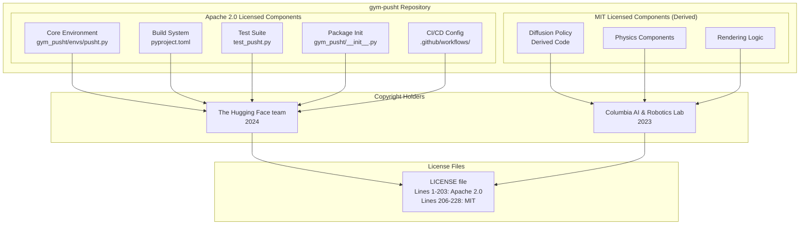
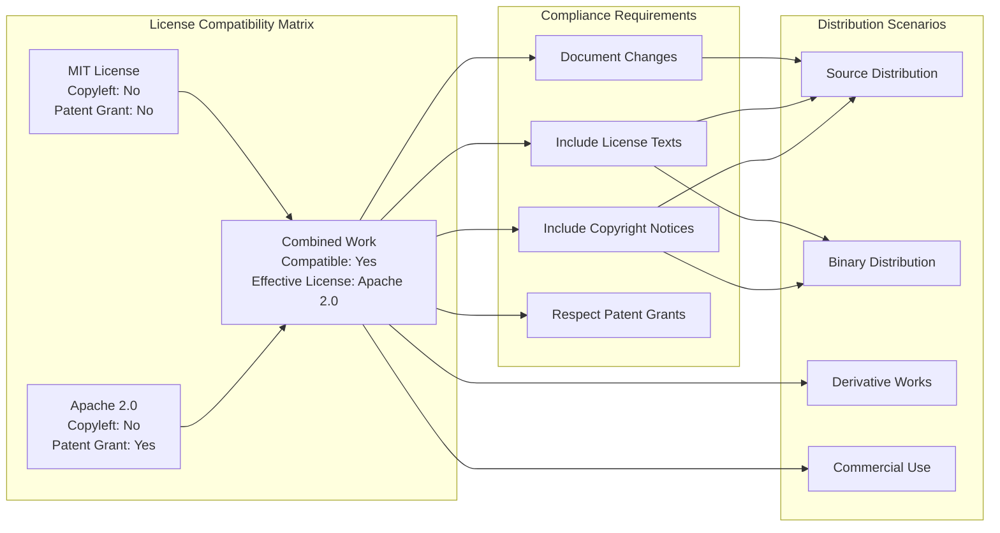
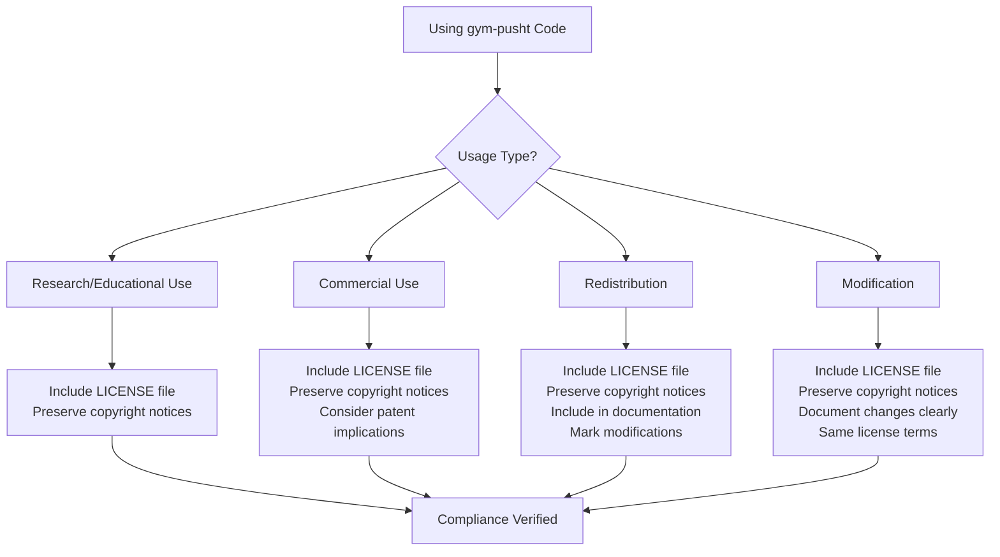

<!-- source: DeepWiki mcp.deepwiki.com · repo huggingface/gym-pusht · page 6 Legal and Licensing · fetched 2026-10-26 -->

# Legal and Licensing

Relevant source files

The following files were used as context for generating this wiki page:

- [LICENSE](LICENSE)

This document outlines the licensing terms and legal requirements for the gym-pusht codebase. The repository operates under a dual-license structure combining Apache 2.0 and MIT licenses, with specific portions derived from external projects. This page provides essential information for users, contributors, and distributors to ensure proper legal compliance.

For information about development setup and contribution guidelines, see [Development Setup](#3).

## License Structure Overview

The gym-pusht repository operates under a dual-license model with two distinct licensing components:

### Primary License: Apache 2.0
The main codebase is licensed under Apache License 2.0, owned by The Hugging Face team. This covers the core environment implementation, build configuration, and original development work.

**License Details:**
- **License Type**: Apache License, Version 2.0
- **Copyright Holder**: The Hugging Face team
- **Year**: 2024
- **License Location**: [LICENSE:1-203]()

**Key Permissions:**
- Commercial use
- Distribution  
- Modification
- Patent use
- Private use

**Key Conditions:**
- License and copyright notice inclusion
- State changes documentation
- Same license for derivative works

### Derived Code License: MIT
Portions of the codebase derived from the Diffusion Policy project are subject to MIT License terms.

**License Details:**
- **License Type**: MIT License  
- **Copyright Holder**: Columbia Artificial Intelligence and Robotics Lab
- **Year**: 2023
- **License Location**: [LICENSE:206-228]()

**Key Permissions:**
- Commercial use
- Distribution
- Modification  
- Private use

**Key Conditions:**
- License and copyright notice inclusion

Sources: [LICENSE:1-228]()

## Licensing Architecture

Sources: [LICENSE:1-228]()

## Copyright Attribution

The dual-license structure creates specific copyright attribution requirements:

| Component | Copyright Holder | Year | License |
|-----------|------------------|------|---------|
| Original gym-pusht code | The Hugging Face team | 2024 | Apache 2.0 |
| Diffusion Policy derived code | Columbia Artificial Intelligence and Robotics Lab | 2023 | MIT |

**Attribution Requirements:**

1. **Apache 2.0 Components**: Must include Apache license notice and Hugging Face copyright
2. **MIT Components**: Must include MIT license notice and Columbia AI & Robotics Lab copyright  
3. **Combined Works**: Must include both license notices as provided in the LICENSE file

Sources: [LICENSE:1](), [LICENSE:210]()

## License Compatibility and Compliance

Sources: [LICENSE:68-89](), [LICENSE:208-228]()

## Redistribution Requirements

### Source Code Distribution
When distributing source code, you must:

1. **Include Complete License File**: Preserve the entire [LICENSE]() file containing both Apache 2.0 and MIT license texts
2. **Maintain Copyright Notices**: Keep all copyright notices intact [LICENSE:1](), [LICENSE:210]()
3. **Document Modifications**: Clearly mark any changes made to the original code [LICENSE:99-101]()
4. **Preserve Attribution**: Include attribution notices for both license components

### Binary Distribution  
For compiled or packaged distributions:

1. **Include License Copy**: Provide copy of LICENSE file with the distribution
2. **Copyright Attribution**: Include copyright notices in documentation or about dialogs
3. **Patent License Notice**: Inform users of patent license grants under Apache 2.0 [LICENSE:75-89]()

### Derivative Works
When creating derivative works:

1. **License Inheritance**: Derivative works must comply with Apache 2.0 terms for Apache-licensed portions
2. **MIT Compatibility**: MIT-licensed portions can be incorporated under Apache 2.0 terms
3. **Attribution Preservation**: Maintain attribution to both original copyright holders
4. **License Notice**: Include appropriate license notices in derivative work documentation

Sources: [LICENSE:91-131](), [LICENSE:214-221]()

## Compliance Workflow

Sources: [LICENSE:91-131](), [LICENSE:132-138]()

## Patent Considerations

The Apache 2.0 license includes explicit patent grants that users should understand:

**Patent License Grant**: Contributors grant patent licenses for their contributions [LICENSE:75-89]()

**Patent Retaliation Clause**: Patent licenses terminate if you initiate patent litigation against the project [LICENSE:83-89]()

**MIT License**: The MIT-licensed portions do not include explicit patent grants [LICENSE:208-228]()

## Disclaimer and Warranties

Both licenses include important disclaimers:

**Apache 2.0 Disclaimer**: Software provided "AS IS" without warranties [LICENSE:145-153]()

**MIT Disclaimer**: Software provided "AS IS" without warranty of any kind [LICENSE:222-225]()

**Limitation of Liability**: Contributors not liable for damages under either license [LICENSE:155-165](), [LICENSE:225-228]()

Sources: [LICENSE:145-165](), [LICENSE:222-228]()

## Contact and Additional Information

For licensing questions or clarification:
- **Primary License Holder**: The Hugging Face team
- **Derived Code License Holder**: Columbia Artificial Intelligence and Robotics Lab  
- **License References**: Full license texts available in [LICENSE]() file

Users are advised to consult with legal counsel for specific compliance questions or commercial licensing arrangements.

Sources: [LICENSE:1-228]()