# Page: Overview

# Overview

<details>
<summary>Relevant source files</summary>

The following files were used as context for generating this wiki page:

- [README.md](README.md)
- [gym_pusht/envs/pusht.py](gym_pusht/envs/pusht.py)

</details>


This document provides a high-level introduction to the gym-pusht codebase, explaining the system architecture, core components, and key features of the PushT reinforcement learning environment. For detailed information about the environment's API and configuration options, see [Environment API](#2.1). For installation and development setup instructions, see [Installation and Configuration](#3.1).

## What is PushT?

PushT is a 2D robotic manipulation environment implemented as a Gymnasium-compatible reinforcement learning environment. The task involves a circular agent (robot end-effector) pushing a T-shaped block into a designated goal zone within a bounded workspace.

```mermaid
graph TD
    subgraph "PushT Task"
        AGENT[Agent<br/>"Circular robot end-effector"]
        BLOCK[Block<br/>"T-shaped object"]
        GOAL[Goal<br/>"Target zone for block"]
        WORKSPACE[Workspace<br/>"512x512 bounded area"]
    end
    
    subgraph "Objective"
        PUSH["Push block into goal zone"]
        SUCCESS["95% block coverage = success"]
        REWARD["Reward = coverage percentage"]
    end
    
    AGENT --> PUSH
    BLOCK --> PUSH
    PUSH --> GOAL
    PUSH --> SUCCESS
    PUSH --> REWARD
    
    WORKSPACE --> AGENT
    WORKSPACE --> BLOCK
    WORKSPACE --> GOAL
```

**Task Objective**: Achieve at least 95% coverage of the T-shaped block within the goal zone through strategic pushing actions.

Sources: [gym_pusht/envs/pusht.py:40-82](), [README.md:42-80]()

## System Architecture

The gym-pusht system integrates multiple technologies to create a physics-based reinforcement learning environment with flexible observation modes and robust development infrastructure.

```mermaid
graph TB
    subgraph "RL_Interface" ["Reinforcement Learning Interface"]
        GYM_ENV["gym.Env"]
        PUSHT_ENV["PushTEnv"]
        REGISTRATION["Environment Registration"]
    end
    
    subgraph "Physics_Engine" ["Physics Simulation"]
        PYMUNK_SPACE["pymunk.Space"]
        BODIES["Body objects"]
        PD_CONTROL["PD Controller"]
        COLLISION["Collision Detection"]
    end
    
    subgraph "Rendering_System" ["Rendering & Visualization"]
        PYGAME_SURFACE["pygame.Surface"]
        DRAW_OPTIONS["DrawOptions"]
        IMAGE_PROCESSING["cv2 + numpy"]
    end
    
    subgraph "Geometry_Engine" ["Geometric Operations"]
        SHAPELY_GEOM["shapely.geometry"]
        COVERAGE_CALC["Coverage Calculation"]
        KEYPOINT_EXTRACT["Keypoint Extraction"]
    end
    
    subgraph "Observation_Types" ["Multi-Modal Observations"]
        STATE_OBS["state: 5D vector"]
        PIXEL_OBS["pixels: 96x96 RGB"]
        ENV_STATE_OBS["environment_state_agent_pos"]
        PIXEL_AGENT_OBS["pixels_agent_pos"]
    end
    
    GYM_ENV --> PUSHT_ENV
    PUSHT_ENV --> REGISTRATION
    
    PUSHT_ENV --> PYMUNK_SPACE
    PYMUNK_SPACE --> BODIES
    PYMUNK_SPACE --> PD_CONTROL
    PYMUNK_SPACE --> COLLISION
    
    PUSHT_ENV --> PYGAME_SURFACE
    PYGAME_SURFACE --> DRAW_OPTIONS
    PYGAME_SURFACE --> IMAGE_PROCESSING
    
    PUSHT_ENV --> SHAPELY_GEOM
    SHAPELY_GEOM --> COVERAGE_CALC
    SHAPELY_GEOM --> KEYPOINT_EXTRACT
    
    PUSHT_ENV --> STATE_OBS
    PUSHT_ENV --> PIXEL_OBS
    PUSHT_ENV --> ENV_STATE_OBS
    PUSHT_ENV --> PIXEL_AGENT_OBS
```

Sources: [gym_pusht/envs/pusht.py:1-20](), [gym_pusht/__init__.py]()

## Core Components and Code Mapping

This section maps the system's conceptual components to their implementation in the codebase.

### Environment Implementation

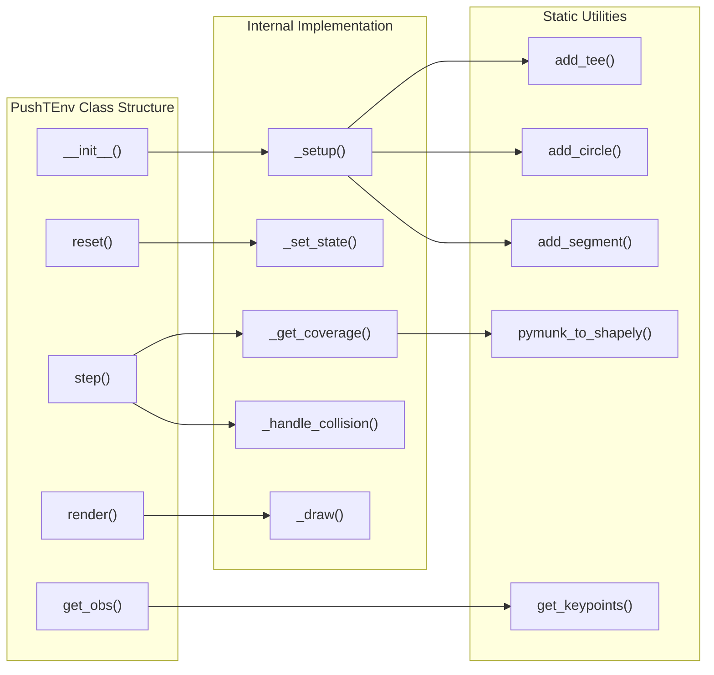

**Key Implementation Details**:
- `PushTEnv` class extends `gym.Env` and implements the standard Gymnasium interface
- Physics simulation runs at 100 Hz with PD control for smooth agent movement
- Four observation modes supported through conditional logic in `get_obs()`
- Collision detection integrated with pymunk's collision handler system

Sources: [gym_pusht/envs/pusht.py:40-542]()

### Technology Stack Integration

```mermaid
graph TD
    subgraph "Dependencies" ["External Dependencies"]
        GYMNASIUM["gymnasium"]
        PYMUNK["pymunk"]
        PYGAME["pygame"]
        SHAPELY["shapely"]
        OPENCV["cv2"]
        NUMPY["numpy"]
    end
    
    subgraph "Core_Functions" ["Core Functionality"]
        ENV_INTERFACE["Environment Interface"]
        PHYSICS_SIM["Physics Simulation"]
        RENDERING["Rendering Pipeline"]
        GEOMETRY["Geometric Operations"]
        IMAGE_PROC["Image Processing"]
        MATH_OPS["Mathematical Operations"]
    end
    
    GYMNASIUM --> ENV_INTERFACE
    PYMUNK --> PHYSICS_SIM
    PYGAME --> RENDERING
    SHAPELY --> GEOMETRY
    OPENCV --> IMAGE_PROC
    NUMPY --> MATH_OPS
    
    ENV_INTERFACE --> "gym.Env inheritance"
    PHYSICS_SIM --> "pymunk.Space + Bodies"
    RENDERING --> "pygame.Surface + DrawOptions"
    GEOMETRY --> "shapely.geometry operations"
    IMAGE_PROC --> "cv2.resize + markers"
    MATH_OPS --> "Array operations"
```

Sources: [gym_pusht/envs/pusht.py:5-18]()

## Key Features

### Multi-Modal Observation Support

The environment provides four distinct observation types to support different RL algorithm requirements:

| Observation Type | Dimensions | Description | Use Case |
|------------------|------------|-------------|----------|
| `state` | 5D vector | `[agent_x, agent_y, block_x, block_y, block_angle]` | State-based RL algorithms |
| `pixels` | 96x96x3 RGB | Rendered environment image | Vision-based deep RL |
| `environment_state_agent_pos` | Dict: 16D + 2D | T-shape keypoints + agent position | Hybrid approaches |
| `pixels_agent_pos` | Dict: 96x96x3 + 2D | Image + agent position | Multi-modal learning |

Sources: [gym_pusht/envs/pusht.py:183-230](), [gym_pusht/envs/pusht.py:383-403]()

### Physics-Based Simulation

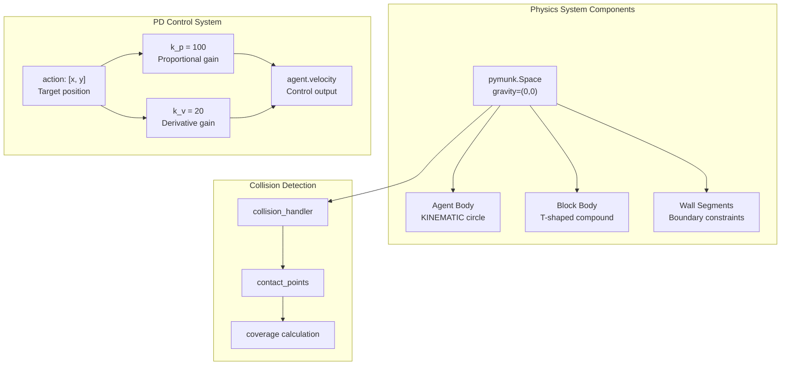

**PD Control Implementation**: The agent uses proportional-derivative control with gains `k_p=100` and `k_v=20` for smooth, responsive movement to target positions.

Sources: [gym_pusht/envs/pusht.py:164-167](), [gym_pusht/envs/pusht.py:240-254](), [gym_pusht/envs/pusht.py:431-456]()

### Reward and Success Criteria

The environment uses geometric intersection to calculate precise coverage metrics:

1. **Coverage Calculation**: Uses `shapely.geometry` to compute intersection area between block and goal zone
2. **Reward Function**: `reward = clip(coverage / 0.95, 0.0, 1.0)`
3. **Success Threshold**: Episode terminates when coverage ≥ 95%
4. **Geometric Precision**: `pymunk_to_shapely()` function converts physics shapes for accurate area calculations

Sources: [gym_pusht/envs/pusht.py:232-238](), [gym_pusht/envs/pusht.py:255-266](), [gym_pusht/envs/pusht.py:27-37]()

## Package Structure and Registration

The gym-pusht package follows standard Gymnasium environment registration patterns:

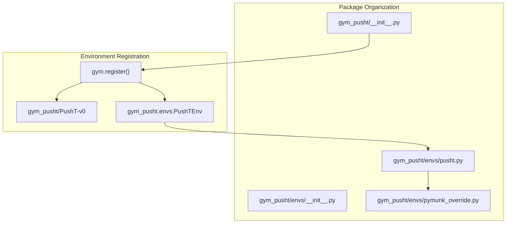

**Environment Access**: Users instantiate the environment via `gym.make("gym_pusht/PushT-v0")` which resolves to the `PushTEnv` class through Gymnasium's registration system.

Sources: [gym_pusht/__init__.py](), [gym_pusht/envs/__init__.py]()

This architecture provides a robust, extensible foundation for reinforcement learning research in robotic manipulation tasks, with comprehensive observation modalities and physics-based realism.

---

# Page: PushT Environment

# PushT Environment

<details>
<summary>Relevant source files</summary>

The following files were used as context for generating this wiki page:

- [gym_pusht/__init__.py](gym_pusht/__init__.py)
- [gym_pusht/envs/pusht.py](gym_pusht/envs/pusht.py)

</details>


This document provides comprehensive technical documentation for the PushT environment implementation, covering its architecture, components, and core functionality. The PushT environment is a 2D robotic manipulation task where an agent must push a T-shaped block into a goal zone using physics-based simulation.

For information about the public API interface and usage examples, see [Environment API](#2.1). For details about the underlying physics engine integration, see [Physics Simulation](#2.2). For information about different observation modalities, see [Observation Types](#2.3).

## Core Architecture Overview

The PushT environment is implemented as a single `PushTEnv` class that integrates multiple subsystems to create a complete robotic manipulation simulation. The environment follows the Gymnasium API standard while providing multiple observation modalities and physics-based dynamics.

### System Architecture

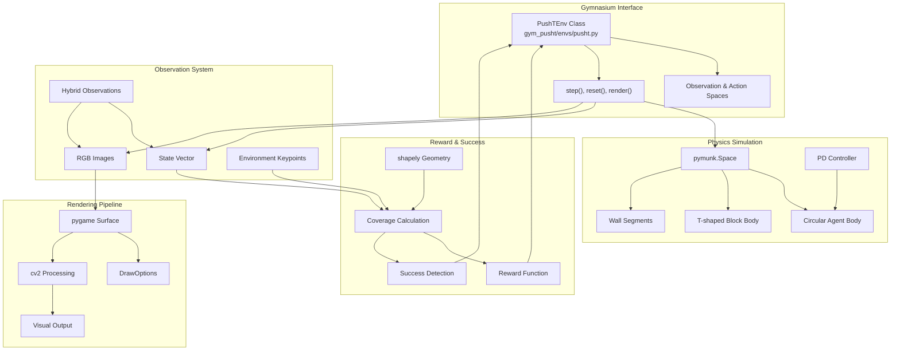

Sources: [gym_pusht/envs/pusht.py:40-542]()

### Component Integration Flow

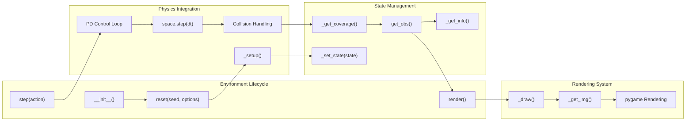

Sources: [gym_pusht/envs/pusht.py:137-467]()

## Environment Components

### Core Class Structure

The `PushTEnv` class inherits from `gym.Env` and implements all required Gymnasium interface methods. The class manages multiple subsystems through carefully orchestrated initialization and update cycles.

| Component | Type | Purpose | Key Methods |
|-----------|------|---------|-------------|
| `obs_type` | str | Observation modality selection | `_initialize_observation_space()` |
| `space` | `pymunk.Space` | Physics simulation container | `_setup()` |
| `agent` | `pymunk.Body` | Circular robot agent | `add_circle()` |
| `block` | `pymunk.Body` | T-shaped manipulation target | `add_tee()` |
| `goal_pose` | `np.ndarray` | Target configuration | `get_goal_pose_body()` |

The environment supports four distinct observation types: `state`, `pixels`, `environment_state_agent_pos`, and `pixels_agent_pos`, each providing different information modalities for reinforcement learning algorithms.

Sources: [gym_pusht/envs/pusht.py:137-181](), [gym_pusht/envs/pusht.py:183-230]()

### Physics Object Configuration

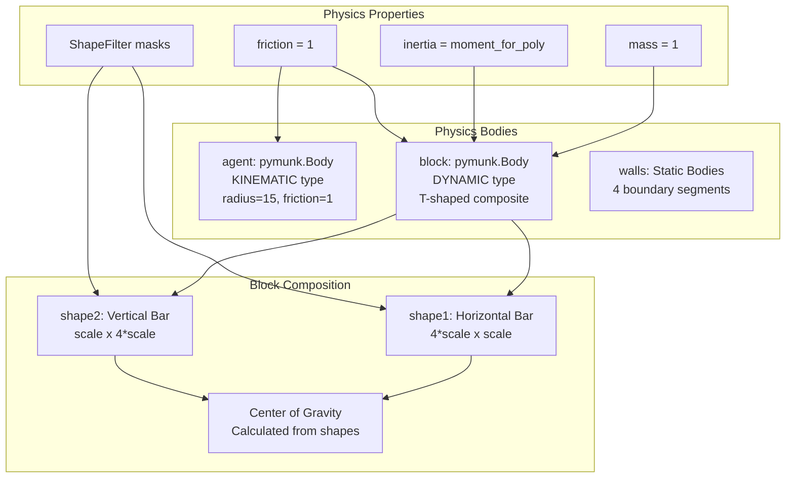

Sources: [gym_pusht/envs/pusht.py:477-518](), [gym_pusht/envs/pusht.py:431-456]()

## Control System Architecture

### PD Control Implementation

The environment implements a Proportional-Derivative (PD) controller to manage agent movement. The controller converts discrete target positions into smooth velocity commands applied to the physics simulation.

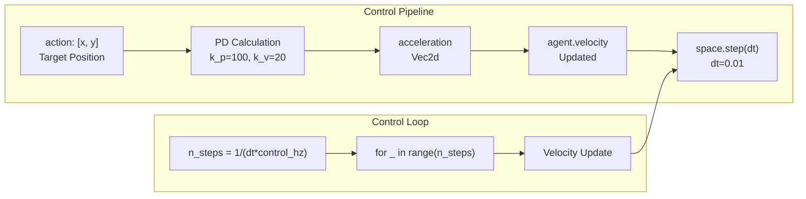

The PD controller equation implemented in the step method:
- `acceleration = k_p * (action - agent.position) + k_v * (Vec2d(0, 0) - agent.velocity)`
- `agent.velocity += acceleration * dt`

Sources: [gym_pusht/envs/pusht.py:240-253](), [gym_pusht/envs/pusht.py:164-166]()

### Collision Detection and Response

The environment implements collision detection through pymunk's built-in collision system with custom handling for contact point tracking.

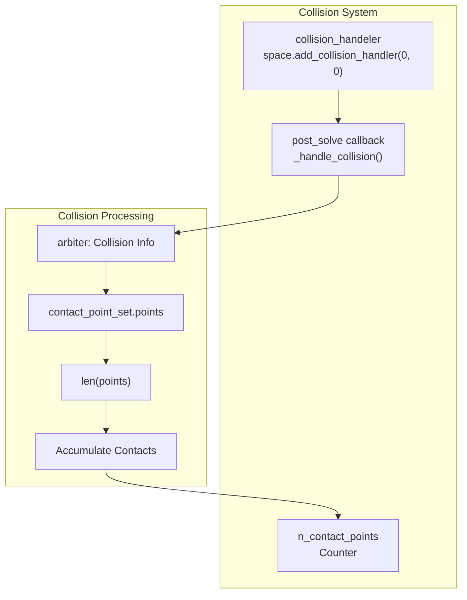

Sources: [gym_pusht/envs/pusht.py:428-430](), [gym_pusht/envs/pusht.py:453-456]()

## Reward and Success Computation

### Coverage-Based Reward System

The environment uses geometric intersection calculations to determine reward based on how much of the T-shaped block overlaps with the goal zone.

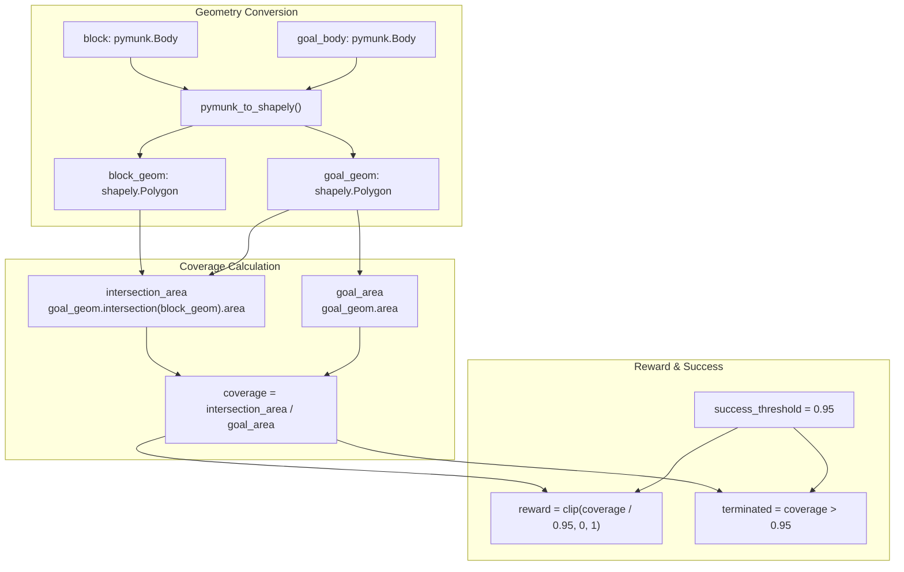

The `pymunk_to_shapely()` function converts pymunk polygon shapes to shapely geometries for precise intersection calculations.

Sources: [gym_pusht/envs/pusht.py:232-238](), [gym_pusht/envs/pusht.py:27-37](), [gym_pusht/envs/pusht.py:255-258](), [gym_pusht/envs/pusht.py:181]()

## State Management and Initialization

### Environment Setup Process

The environment initialization follows a structured setup process that creates the physics world and populates it with the necessary objects.

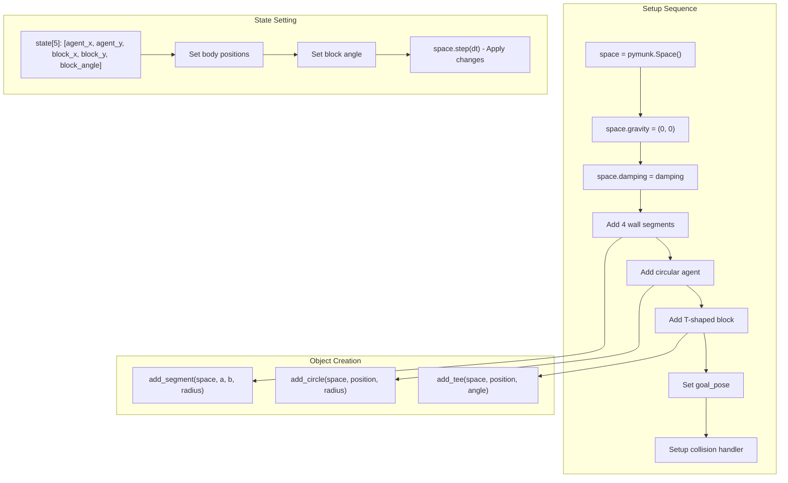

Sources: [gym_pusht/envs/pusht.py:431-456](), [gym_pusht/envs/pusht.py:458-467](), [gym_pusht/envs/pusht.py:469-518]()

### Random State Generation

The reset method generates random initial states using controlled randomization to ensure reproducible episodes while maintaining task diversity.

| Parameter | Range | Purpose |
|-----------|-------|---------|
| `agent_x` | [50, 450] | Agent horizontal position |
| `agent_y` | [50, 450] | Agent vertical position |
| `block_x` | [100, 400] | Block horizontal position |
| `block_y` | [100, 400] | Block vertical position |
| `block_angle` | [-π, π] | Block rotation angle |

The environment also supports deterministic state setting through the `reset_to_state` option, enabling reproducible evaluation scenarios.

Sources: [gym_pusht/envs/pusht.py:268-296](), [gym_pusht/envs/pusht.py:272-287]()

---

# Page: Environment API

# Environment API

<details>
<summary>Relevant source files</summary>

The following files were used as context for generating this wiki page:

- [README.md](README.md)
- [gym_pusht/envs/pusht.py](gym_pusht/envs/pusht.py)
- [tests/test_env.py](tests/test_env.py)

</details>


This page documents the public interface of the PushT environment, including instantiation, action and observation spaces, core methods, and configuration options. This covers the standard Gymnasium API implementation in the `PushTEnv` class.

For information about the internal physics simulation mechanics, see [Physics Simulation](#2.2). For details about the different observation types and their data structures, see [Observation Types](#2.3).

## Environment Instantiation

The PushT environment is registered with Gymnasium and instantiated using the standard `gym.make()` interface:

```python
import gymnasium as gym
import gym_pusht

env = gym.make("gym_pusht/PushT-v0", obs_type="state", render_mode="rgb_array")
```

The environment identifier is `"gym_pusht/PushT-v0"` and supports various configuration parameters passed as keyword arguments to `gym.make()`.

**Sources:** [gym_pusht/envs/pusht.py:88-91](), [README.md:85-90]()

## Action Space Structure

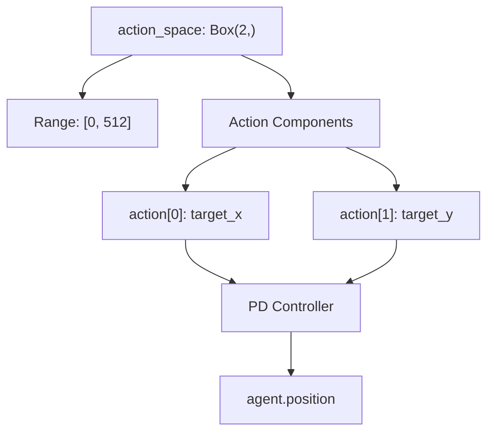

The action space is a continuous 2D Box space representing target positions for the agent. The PD controller moves the agent toward these target coordinates.

| Property | Value | Description |
|----------|--------|-------------|
| Type | `spaces.Box` | Continuous action space |
| Shape | `(2,)` | Two-dimensional [x, y] coordinates |
| Range | `[0, 512]` | Valid coordinate range |
| Data Type | `np.float32` | Floating point actions |

**Sources:** [gym_pusht/envs/pusht.py:161](), [gym_pusht/envs/pusht.py:50-51]()

## Observation Space Types

The environment supports four distinct observation types, each with different space structures:

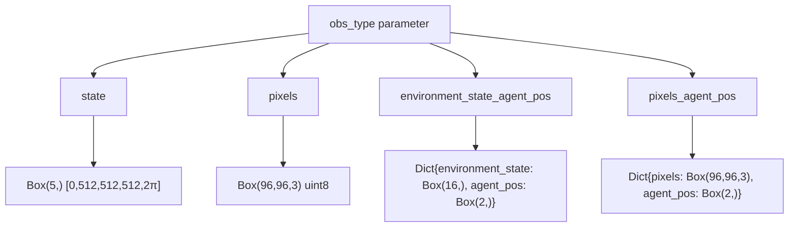

### State Observation
- **Type:** `spaces.Box(low=[0,0,0,0,0], high=[512,512,512,512,2π])`
- **Data:** `[agent_x, agent_y, block_x, block_y, block_angle]`
- **Usage:** Direct state-based RL algorithms

### Pixels Observation  
- **Type:** `spaces.Box(low=0, high=255, shape=(96,96,3), dtype=uint8)`
- **Data:** RGB image of environment
- **Usage:** Vision-based RL algorithms

### Environment State + Agent Position
- **Type:** `spaces.Dict` with two components:
  - `environment_state`: 16D keypoint coordinates of T-block
  - `agent_pos`: 2D agent position
- **Usage:** Hybrid state representation

### Pixels + Agent Position
- **Type:** `spaces.Dict` with two components:
  - `pixels`: 96x96 RGB image  
  - `agent_pos`: 2D agent position
- **Usage:** Vision algorithms with explicit agent position

**Sources:** [gym_pusht/envs/pusht.py:183-230](), [gym_pusht/envs/pusht.py:55-66]()

## Core Gymnasium Methods

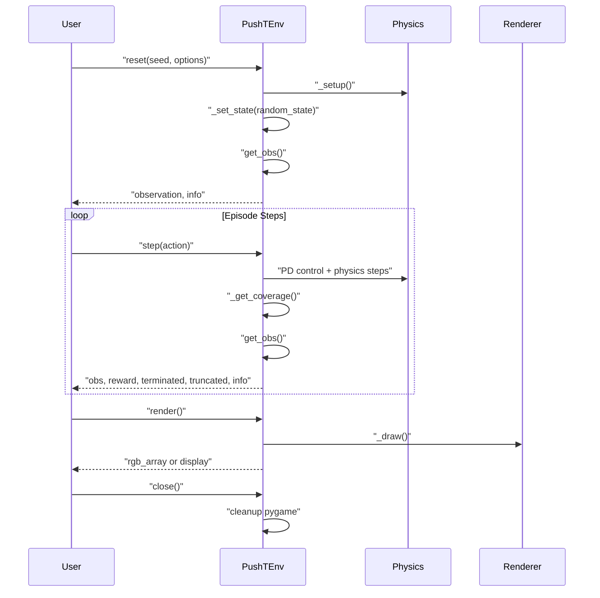

### reset(seed=None, options=None)

Resets the environment to initial state. Returns `(observation, info)`.

**Special Options:**
- `options["reset_to_state"]`: Reset to specific state vector instead of random initialization

```python
# Random reset
obs, info = env.reset()

# Reset to specific state  
obs, info = env.reset(options={"reset_to_state": [100, 200, 300, 400, 1.5]})
```

### step(action)

Executes one environment step with the given action. Returns `(observation, reward, terminated, truncated, info)`.

**Step Process:**
1. Apply PD control for multiple physics substeps
2. Calculate coverage-based reward
3. Check termination condition (≥95% coverage)
4. Generate observation
5. Return step results

### render()

Generates visual representation of current environment state.

**Modes:**
- `"rgb_array"`: Returns numpy array image
- `"human"`: Displays in pygame window

### close()

Cleanup method that closes pygame display and releases resources.

**Sources:** [gym_pusht/envs/pusht.py:240-266](), [gym_pusht/envs/pusht.py:268-296](), [gym_pusht/envs/pusht.py:335-364](), [gym_pusht/envs/pusht.py:365-368]()

## Configuration Parameters

The `PushTEnv` constructor accepts the following parameters:

| Parameter | Type | Default | Description |
|-----------|------|---------|-------------|
| `obs_type` | str | `"state"` | Observation type: `"state"`, `"pixels"`, `"environment_state_agent_pos"`, `"pixels_agent_pos"` |
| `render_mode` | str | `"rgb_array"` | Rendering mode: `"rgb_array"` or `"human"` |
| `block_cog` | tuple | `None` | Custom center of gravity for T-block |
| `damping` | float | `None` | Physics damping factor (0 if None) |
| `observation_width` | int | 96 | Width of observation images |
| `observation_height` | int | 96 | Height of observation images |
| `visualization_width` | int | 680 | Width of visualization images |
| `visualization_height` | int | 680 | Height of visualization images |

**Physics Parameters:**
- `k_p = 100`: PD controller proportional gain
- `k_v = 20`: PD controller derivative gain  
- `dt = 0.01`: Physics timestep
- `control_hz = 10`: Control frequency
- `success_threshold = 0.95`: Coverage threshold for success

**Sources:** [gym_pusht/envs/pusht.py:137-148](), [gym_pusht/envs/pusht.py:164-181]()

## Reward and Termination System

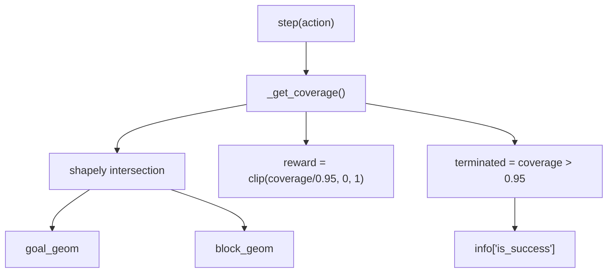

### Reward Calculation

The reward is based on the coverage percentage of the T-block within the goal zone:

1. **Geometric Intersection:** Uses Shapely library to compute intersection area between block and goal geometries
2. **Coverage Ratio:** `intersection_area / goal_area`  
3. **Reward Scaling:** `reward = np.clip(coverage / success_threshold, 0.0, 1.0)`

### Termination Conditions

- **Success Termination:** Episode terminates when block coverage ≥ 95% of goal zone
- **No Time Limit:** Environment has no built-in time limit (handled by Gymnasium wrappers)
- **No Failure Conditions:** Agent cannot fail the task

### Info Dictionary

The `info` dict returned by `step()` contains:

| Key | Type | Description |
|-----|------|-------------|
| `pos_agent` | np.array(2,) | Agent position |
| `vel_agent` | np.array(2,) | Agent velocity |
| `block_pose` | np.array(3,) | Block [x, y, angle] |
| `goal_pose` | np.array(3,) | Goal [x, y, angle] |
| `n_contacts` | int | Contact points per step |
| `is_success` | bool | Whether success threshold met |
| `coverage` | float | Current coverage percentage |

**Sources:** [gym_pusht/envs/pusht.py:232-238](), [gym_pusht/envs/pusht.py:255-264](), [gym_pusht/envs/pusht.py:416-426]()

---

# Page: Physics Simulation

# Physics Simulation

<details>
<summary>Relevant source files</summary>

The following files were used as context for generating this wiki page:

- [gym_pusht/envs/pusht.py](gym_pusht/envs/pusht.py)
- [gym_pusht/envs/pymunk_override.py](gym_pusht/envs/pymunk_override.py)

</details>


This document covers the physics simulation engine that powers the PushT environment, including the 2D physics implementation, object dynamics, control systems, and collision detection. The physics simulation is responsible for realistic agent movement, block manipulation, and environmental interactions.

For information about the rendering and visualization of the physics simulation, see [Rendering System](#2.4). For details about the broader environment structure, see [Environment API](#2.1).

## Physics Engine Architecture

The PushT environment uses `pymunk` as its core 2D physics engine, providing rigid body simulation with realistic collision detection and response. The physics system operates in a 512x512 coordinate space with no gravity, creating a tabletop-like manipulation environment.

### Physics Engine Core Components

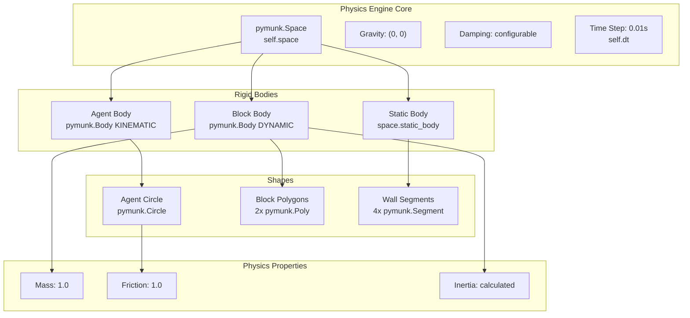

**Sources:** [gym_pusht/envs/pusht.py:432-434](), [gym_pusht/envs/pusht.py:166](), [gym_pusht/envs/pusht.py:447-449]()

The physics space is initialized with zero gravity and configurable damping, creating a frictionless air hockey-like environment where objects maintain momentum until acted upon by forces.

## Object Dynamics and Bodies

The simulation contains three primary object types: the circular agent, the T-shaped block, and static boundary walls. Each object has distinct physical properties and behaviors.

### Physical Object Specifications

| Object | Body Type | Shape | Mass | Friction | Inertia |
|--------|-----------|-------|------|----------|---------|
| Agent | KINEMATIC | Circle (radius=15) | N/A | 1.0 | N/A |
| Block | DYNAMIC | 2x Polygon (T-shape) | 1.0 | 1.0 | Calculated |
| Walls | STATIC | 4x Segment | Infinite | Default | Infinite |

### Agent Body Implementation

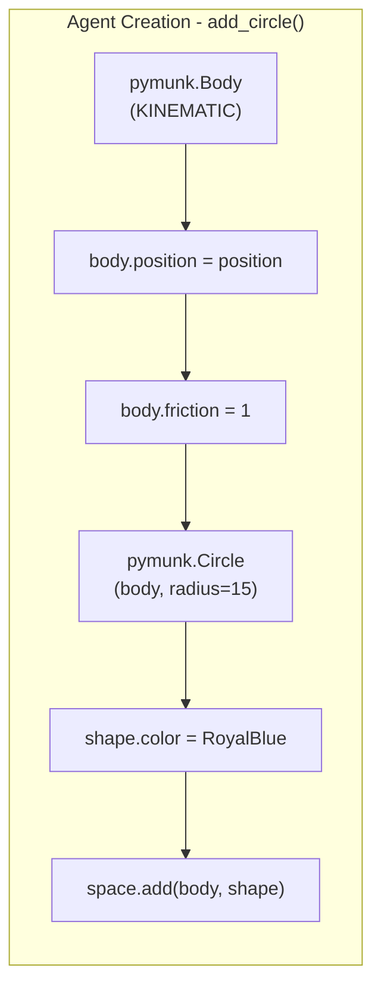

**Sources:** [gym_pusht/envs/pusht.py:477-484]()

The agent uses a `KINEMATIC` body type, meaning its motion is controlled directly rather than by forces, enabling precise PD control.

### Block Body Implementation

The T-shaped block consists of two rectangular polygons forming a T-shape, with calculated center of mass and moment of inertia.

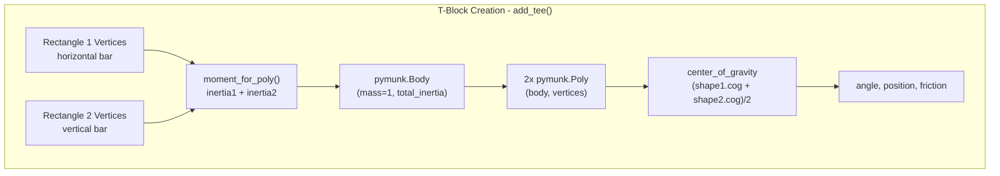

**Sources:** [gym_pusht/envs/pusht.py:487-518]()

The T-block vertices are defined as scaled coordinates creating a symmetric T-shape with configurable size and color.

## PD Control System

The agent movement uses a Proportional-Derivative (PD) controller that provides smooth, stable motion toward target positions while maintaining realistic dynamics.

### PD Controller Architecture

```mermaid
graph LR
    subgraph "PD Control Loop"
        ACTION["Action Input<br/>[target_x, target_y]"]
        POSITION_ERROR["Position Error<br/>action - agent.position"]
        VELOCITY_ERROR["Velocity Error<br/>Vec2d(0,0) - agent.velocity"]
        P_TERM["Proportional Term<br/>k_p * pos_error"]
        D_TERM["Derivative Term<br/>k_v * vel_error"]
        ACCELERATION["Total Acceleration<br/>P_term + D_term"]
        UPDATE_VELOCITY["agent.velocity +=<br/>acceleration * dt"]
    end
    
    ACTION --> POSITION_ERROR
    ACTION --> VELOCITY_ERROR
    POSITION_ERROR --> P_TERM
    VELOCITY_ERROR --> D_TERM
    P_TERM --> ACCELERATION
    D_TERM --> ACCELERATION
    ACCELERATION --> UPDATE_VELOCITY
```

**Sources:** [gym_pusht/envs/pusht.py:164-165](), [gym_pusht/envs/pusht.py:246-250]()

### Control Parameters

The PD controller uses the following tuned parameters:
- `k_p = 100`: Proportional gain for position error
- `k_v = 20`: Derivative gain for velocity damping  
- `dt = 0.01`: Time step for integration
- `control_hz = 10`: Control frequency from render FPS

The control loop executes multiple physics steps per action to ensure smooth motion: `n_steps = int(1 / (dt * control_hz))` results in 10 physics steps per control update.

## Collision Detection and Handling

The physics system implements comprehensive collision detection between all objects, tracking contact points for reward calculation and debugging.

### Collision System Implementation

```mermaid
graph TB
    subgraph "Collision Handler Setup"
        CREATE_HANDLER["space.add_collision_handler(0, 0)"]
        SET_CALLBACK["handler.post_solve =<br/>_handle_collision"]
        CONTACT_COUNTER["self.n_contact_points = 0"]
    end
    
    subgraph "Collision Processing"
        DETECT_COLLISION["Collision Detected"]
        GET_CONTACTS["arbiter.contact_point_set.points"]
        COUNT_CONTACTS["n_contact_points +=<br/>len(contact_points)"]
        CALC_PER_STEP["contacts_per_step =<br/>ceil(total / n_steps)"]
    end
    
    CREATE_HANDLER --> SET_CALLBACK
    SET_CALLBACK --> CONTACT_COUNTER
    DETECT_COLLISION --> GET_CONTACTS
    GET_CONTACTS --> COUNT_CONTACTS
    COUNT_CONTACTS --> CALC_PER_STEP
```

**Sources:** [gym_pusht/envs/pusht.py:454-456](), [gym_pusht/envs/pusht.py:428-430](), [gym_pusht/envs/pusht.py:417-418]()

The collision handler accumulates contact points throughout the physics step cycle, providing metrics for environment analysis and debugging.

## Geometric Operations and Coverage Calculation

The physics simulation integrates with `shapely` geometry library to perform precise coverage calculations for reward computation, converting between pymunk physics objects and shapely geometric representations.

### Geometry Conversion Pipeline

```mermaid
graph LR
    subgraph "pymunk_to_shapely Conversion"
        PYMUNK_BODY["pymunk.Body"]
        PYMUNK_SHAPES["List[pymunk.Shape]"]
        GET_VERTICES["shape.get_vertices()"]
        TRANSFORM_VERTICES["body.local_to_world(v)"]
        CREATE_POLYGON["sg.Polygon(world_verts)"]
        MULTI_POLYGON["sg.MultiPolygon(geoms)"]
    end
    
    subgraph "Coverage Calculation"
        GOAL_GEOM["Goal Zone Geometry"]
        BLOCK_GEOM["Block Geometry"]
        INTERSECTION["goal_geom.intersection<br/>(block_geom)"]
        COVERAGE_RATIO["intersection.area /<br/>goal_geom.area"]
    end
    
    PYMUNK_BODY --> GET_VERTICES
    PYMUNK_SHAPES --> GET_VERTICES
    GET_VERTICES --> TRANSFORM_VERTICES
    TRANSFORM_VERTICES --> CREATE_POLYGON
    CREATE_POLYGON --> MULTI_POLYGON
    
    MULTI_POLYGON --> GOAL_GEOM
    MULTI_POLYGON --> BLOCK_GEOM
    GOAL_GEOM --> INTERSECTION
    BLOCK_GEOM --> INTERSECTION
    INTERSECTION --> COVERAGE_RATIO
```

**Sources:** [gym_pusht/envs/pusht.py:27-37](), [gym_pusht/envs/pusht.py:232-238]()

### Goal Pose Body Creation

The goal zone is represented as a physics body positioned at the target location, enabling precise geometric calculations:

```mermaid
graph LR
    subgraph "get_goal_pose_body()"
        GOAL_POSE["Goal Pose<br/>[x, y, theta]"]
        CALC_INERTIA["moment_for_box<br/>(mass=1, size=(50,100))"]
        CREATE_BODY["pymunk.Body<br/>(mass=1, inertia)"]
        SET_POSITION["body.position = pose[:2]"]
        SET_ANGLE["body.angle = pose[2]"]
    end
    
    GOAL_POSE --> CALC_INERTIA
    CALC_INERTIA --> CREATE_BODY
    CREATE_BODY --> SET_POSITION
    SET_POSITION --> SET_ANGLE
```

**Sources:** [gym_pusht/envs/pusht.py:406-414]()

## Physics Integration with Environment

The physics simulation integrates seamlessly with the broader environment system, providing state information, handling resets, and supporting multiple observation modes.

### Physics Step Integration

The `step()` method coordinates physics simulation with environment logic:

1. **Reset Contact Counter**: `self.n_contact_points = 0`
2. **Calculate Step Count**: `n_steps = int(1 / (dt * control_hz))`
3. **Execute Control Loop**: Multiple PD control + physics steps
4. **Calculate Coverage**: Geometric intersection for reward
5. **Check Termination**: Success threshold at 95% coverage

### State Management

The physics system supports direct state setting for environment resets and reproducibility:

```mermaid
graph LR
    subgraph "_set_state() Implementation"
        INPUT_STATE["State Array<br/>[agent_x, agent_y, block_x, block_y, block_angle]"]
        SET_AGENT["agent.position = state[:2]"]
        SET_BLOCK_POS["block.position = state[2:4]"]
        SET_BLOCK_ANGLE["block.angle = state[4]"]
        PHYSICS_STEP["space.step(dt)<br/>to take effect"]
    end
    
    INPUT_STATE --> SET_AGENT
    INPUT_STATE --> SET_BLOCK_POS
    INPUT_STATE --> SET_BLOCK_ANGLE
    SET_AGENT --> PHYSICS_STEP
    SET_BLOCK_POS --> PHYSICS_STEP
    SET_BLOCK_ANGLE --> PHYSICS_STEP
```

**Sources:** [gym_pusht/envs/pusht.py:458-467]()

The physics system maintains consistency between different observation types by providing both direct state access and geometric keypoint extraction through the `get_keypoints()` method.

**Sources:** [gym_pusht/envs/pusht.py:521-541]()

---

# Page: Observation Types

# Observation Types

<details>
<summary>Relevant source files</summary>

The following files were used as context for generating this wiki page:

- [README.md](README.md)
- [gym_pusht/envs/pusht.py](gym_pusht/envs/pusht.py)

</details>


This document details the four observation types supported by the PushT environment and their implementation. It covers the data structures, value ranges, and generation methods for each observation mode.

For information about the environment's action space and reward system, see [Environment API](#2.1). For details about the rendering pipeline that generates pixel observations, see [Rendering System](#2.4).

## Overview

The PushT environment supports four distinct observation types through the `obs_type` parameter, each designed for different reinforcement learning approaches:

| Observation Type | Description | Use Case |
|------------------|-------------|----------|
| `state` | 5D state vector | State-based RL algorithms |
| `environment_state_agent_pos` | Keypoints + agent position | Structured state representation |
| `pixels` | RGB image | Vision-based RL algorithms |
| `pixels_agent_pos` | Image + agent position | Hybrid vision-position methods |

The observation type is configured during environment initialization and determines both the observation space definition and the data returned by `get_obs()`.

**Observation System Architecture**

```mermaid
graph TD
    INIT["PushTEnv.__init__()"] --> OBS_TYPE["obs_type parameter"]
    OBS_TYPE --> INIT_SPACE["_initialize_observation_space()"]
    
    subgraph "Observation Space Definition"
        INIT_SPACE --> STATE_SPACE["state: Box(5,)"]
        INIT_SPACE --> ENV_STATE_SPACE["environment_state_agent_pos: Dict"]
        INIT_SPACE --> PIXELS_SPACE["pixels: Box(96,96,3)"]
        INIT_SPACE --> PIXELS_AGENT_SPACE["pixels_agent_pos: Dict"]
    end
    
    STEP["step()"] --> GET_OBS["get_obs()"]
    RESET["reset()"] --> GET_OBS
    
    subgraph "Observation Generation"
        GET_OBS --> STATE_GEN["State Vector Generation"]
        GET_OBS --> KEYPOINTS_GEN["get_keypoints()"]
        GET_OBS --> RENDER_GEN["_render()"]
        
        STATE_GEN --> AGENT_POS["self.agent.position"]
        STATE_GEN --> BLOCK_POS["self.block.position"]
        STATE_GEN --> BLOCK_ANGLE["self.block.angle"]
        
        KEYPOINTS_GEN --> VERTICES["shape.get_vertices()"]
        KEYPOINTS_GEN --> TRANSFORM["body.angle + body.position"]
        
        RENDER_GEN --> DRAW["_draw()"]
        RENDER_GEN --> IMG_PROCESS["_get_img()"]
    end
    
    GET_OBS --> OBSERVATION["observation"]
```

Sources: [gym_pusht/envs/pusht.py:137-162](), [gym_pusht/envs/pusht.py:183-230](), [gym_pusht/envs/pusht.py:383-403]()

## State Observation Type

The `state` observation type provides a compact 5-dimensional vector representation of the environment state.

### Data Structure

| Component | Index | Range | Description |
|-----------|-------|-------|-------------|
| `agent_x` | 0 | [0, 512] | Agent X coordinate |
| `agent_y` | 1 | [0, 512] | Agent Y coordinate |
| `block_x` | 2 | [0, 512] | Block center X coordinate |
| `block_y` | 3 | [0, 512] | Block center Y coordinate |
| `block_angle` | 4 | [0, 2π] | Block rotation angle |

### Implementation

The state observation is generated by concatenating the agent position, block position, and normalized block angle:

```python
# From get_obs() method
agent_position = np.array(self.agent.position)
block_position = np.array(self.block.position)
block_angle = self.block.angle % (2 * np.pi)
return np.concatenate([agent_position, block_position, [block_angle]], dtype=np.float64)
```

The observation space is defined as a `Box` with appropriate bounds for each component.

Sources: [gym_pusht/envs/pusht.py:184-190](), [gym_pusht/envs/pusht.py:384-388]()

## Environment State Agent Position Type

The `environment_state_agent_pos` observation type returns a dictionary containing structured keypoint data and agent position.

### Data Structure

```python
{
    "environment_state": np.array(16,),  # Flattened keypoint coordinates
    "agent_pos": np.array(2,)            # Agent position [x, y]
}
```

### Keypoint System

The T-shaped block is represented by 8 keypoints forming the vertices of two overlapping rectangles:

**T-Shape Keypoint Layout**

```mermaid
graph TB
    subgraph "T-Shape Keypoints"
        P0["0"] --- P1["1"]
        P0 --- P3["3"]
        P1 --- P2["2"]
        P3 --- P4["4"]
        P4 --- P5["5"]
        P5 --- P2
        P4 --- P7["7"]
        P5 --- P6["6"]
        P7 --- P6
    end
    
    subgraph "Coordinate Mapping"
        FLAT["Flattened Array: [x0,y0,x1,y1,x2,y2,x3,y3,x4,y4,x5,y5,x6,y6,x7,y7]"]
    end
    
    P0 --> FLAT
    P1 --> FLAT
    P2 --> FLAT
    P3 --> FLAT
    P4 --> FLAT
    P5 --> FLAT
    P6 --> FLAT
    P7 --> FLAT
```

The keypoints are extracted using `get_keypoints()`, which transforms each vertex from local shape coordinates to world coordinates:

```python
# Transformation process for each vertex
v = v.rotated(shape.body.angle)  # Apply rotation
v = v + shape.body.position      # Apply translation
```

Sources: [gym_pusht/envs/pusht.py:191-205](), [gym_pusht/envs/pusht.py:390-394](), [gym_pusht/envs/pusht.py:521-541]()

## Pixels Observation Type

The `pixels` observation type provides a visual representation of the environment as an RGB image.

### Image Specifications

| Property | Value | Description |
|----------|-------|-------------|
| Dimensions | 96×96 | Default observation size |
| Channels | 3 | RGB color channels |
| Data Type | `np.uint8` | 8-bit unsigned integers |
| Value Range | [0, 255] | Standard RGB range |

### Generation Pipeline

**Pixel Observation Generation**

```mermaid
graph LR
    subgraph "Rendering Pipeline"
        DRAW["_draw()"] --> SCREEN["pygame.Surface(512x512)"]
        SCREEN --> GOAL["Draw Goal Zone"]
        SCREEN --> OBJECTS["Draw Agent & Block"]
        GOAL --> OBJECTS
    end
    
    subgraph "Image Processing"
        OBJECTS --> SURF_ARRAY["pygame.surfarray.pixels3d()"]
        SURF_ARRAY --> TRANSPOSE["np.transpose(axes=(1,0,2))"]
        TRANSPOSE --> RESIZE["cv2.resize(96x96)"]
        RESIZE --> OUTPUT["RGB Array"]
    end
    
    GET_OBS["get_obs()"] --> RENDER_CALL["_render()"]
    RENDER_CALL --> DRAW
```

The rendering process creates a 512×512 internal surface, draws all environment elements, then resizes to the target observation dimensions.

Sources: [gym_pusht/envs/pusht.py:206-209](), [gym_pusht/envs/pusht.py:396-398](), [gym_pusht/envs/pusht.py:298-314](), [gym_pusht/envs/pusht.py:316-333]()

## Pixels Agent Position Type

The `pixels_agent_pos` observation type combines visual information with explicit agent position data.

### Data Structure

```python
{
    "pixels": np.array((96, 96, 3), dtype=np.uint8),  # RGB image
    "agent_pos": np.array(2, dtype=np.float64)        # Agent coordinates [x, y]
}
```

This hybrid approach enables algorithms that benefit from both visual context and precise positional information. The pixel component is generated using the same pipeline as the `pixels` type, while the agent position is extracted directly from the physics simulation.

### Use Cases

- **Hybrid RL Algorithms**: Methods that process visual features while maintaining access to precise position data
- **Multi-Modal Learning**: Approaches that fuse different types of sensory information
- **Debugging and Analysis**: Scenarios where both visual and numerical data are needed

Sources: [gym_pusht/envs/pusht.py:210-225](), [gym_pusht/envs/pusht.py:399-403]()

## Configuration and Customization

### Observation Space Initialization

The observation spaces are configured in `_initialize_observation_space()` based on the `obs_type` parameter. Invalid observation types raise a `ValueError` with supported options.

### Image Dimensions

Pixel-based observations support customizable dimensions through constructor parameters:

- `observation_width`: Width for observation images (default: 96)
- `observation_height`: Height for observation images (default: 96)
- `visualization_width`: Width for human rendering (default: 680)
- `visualization_height`: Height for human rendering (default: 680)

### Value Ranges and Coordinate System

All spatial coordinates use the environment's 512×512 coordinate system, with the origin at the bottom-left corner following pygame conventions. The block angle is normalized to the range [0, 2π] using modulo arithmetic.

Sources: [gym_pusht/envs/pusht.py:183-230](), [gym_pusht/envs/pusht.py:137-162](), [gym_pusht/envs/pusht.py:226-230]()

---

# Page: Rendering System

# Rendering System

<details>
<summary>Relevant source files</summary>

The following files were used as context for generating this wiki page:

- [gym_pusht/envs/pusht.py](gym_pusht/envs/pusht.py)
- [gym_pusht/envs/pymunk_override.py](gym_pusht/envs/pymunk_override.py)

</details>


The rendering system in gym-pusht provides visualization capabilities for the PushT environment, converting the physical simulation state into visual representations. This system handles both human-readable displays for debugging and RGB array outputs for computer vision-based reinforcement learning algorithms.

For information about the underlying physics simulation that drives the rendered content, see [Physics Simulation](#2.2). For details about how rendered images are used in different observation types, see [Observation Types](#2.3).

## Rendering Pipeline Overview

The rendering system follows a multi-stage pipeline that converts physics simulation state into visual output through pygame surfaces and optional image processing:

```mermaid
graph TD
    subgraph "Render Request"
        RENDER_CALL["render()"]
        INTERNAL_RENDER["_render()"]
        GET_OBS["get_obs()"]
    end
    
    subgraph "Drawing Stage"
        DRAW_METHOD["_draw()"]
        PYGAME_SURFACE["pygame.Surface(512x512)"]
        DRAW_OPTIONS["DrawOptions"]
        SPACE_DEBUG["space.debug_draw()"]
    end
    
    subgraph "Visual Elements"
        GOAL_POLYGON["Goal Zone Polygon"]
        AGENT_CIRCLE["Agent Circle"]
        BLOCK_TEE["T-shaped Block"]
        WALLS["Wall Segments"]
    end
    
    subgraph "Output Processing"
        GET_IMG["_get_img()"]
        CV2_RESIZE["cv2.resize()"]
        ACTION_MARKER["cv2.drawMarker()"]
        ARRAY_CONVERT["np.array conversion"]
    end
    
    subgraph "Output Modes"
        RGB_ARRAY["rgb_array mode"]
        HUMAN_MODE["human mode"]
        PYGAME_WINDOW["pygame.display window"]
    end
    
    RENDER_CALL --> INTERNAL_RENDER
    GET_OBS --> INTERNAL_RENDER
    INTERNAL_RENDER --> DRAW_METHOD
    
    DRAW_METHOD --> PYGAME_SURFACE
    DRAW_METHOD --> DRAW_OPTIONS
    PYGAME_SURFACE --> DRAW_OPTIONS
    DRAW_OPTIONS --> SPACE_DEBUG
    
    DRAW_METHOD --> GOAL_POLYGON
    SPACE_DEBUG --> AGENT_CIRCLE
    SPACE_DEBUG --> BLOCK_TEE
    SPACE_DEBUG --> WALLS
    
    PYGAME_SURFACE --> GET_IMG
    GET_IMG --> CV2_RESIZE
    GET_IMG --> ACTION_MARKER
    GET_IMG --> ARRAY_CONVERT
    
    INTERNAL_RENDER --> RGB_ARRAY
    INTERNAL_RENDER --> HUMAN_MODE
    HUMAN_MODE --> PYGAME_WINDOW
```

Sources: [gym_pusht/envs/pusht.py:298-364](), [gym_pusht/envs/pusht.py:335-347]()

## Render Modes and Configuration

The PushT environment supports two primary render modes with configurable dimensions:

| Render Mode | Purpose | Output Type | Window Management |
|------------|---------|-------------|-------------------|
| `rgb_array` | RL training and pixel observations | numpy array | None |
| `human` | Interactive debugging and visualization | pygame window | Automatic |

The environment maintains separate dimensions for different use cases:

```mermaid
graph LR
    subgraph "Dimension Configuration"
        OBS_WIDTH["observation_width: 96"]
        OBS_HEIGHT["observation_height: 96"]
        VIS_WIDTH["visualization_width: 680"]
        VIS_HEIGHT["visualization_height: 680"]
        NATIVE_SIZE["Native Surface: 512x512"]
    end
    
    subgraph "Usage Context"
        PIXEL_OBS["Pixel Observations"]
        HUMAN_VIS["Human Visualization"]
        INTERNAL_DRAW["Internal Drawing"]
    end
    
    OBS_WIDTH --> PIXEL_OBS
    OBS_HEIGHT --> PIXEL_OBS
    VIS_WIDTH --> HUMAN_VIS
    VIS_HEIGHT --> HUMAN_VIS
    NATIVE_SIZE --> INTERNAL_DRAW
    
    PIXEL_OBS --> CV2_RESIZE_1["cv2.resize(96x96)"]
    HUMAN_VIS --> CV2_RESIZE_2["cv2.resize(680x680)"]
    INTERNAL_DRAW --> PYGAME_SURF["pygame.Surface"]
```

Sources: [gym_pusht/envs/pusht.py:154-157](), [gym_pusht/envs/pusht.py:338-343]()

## Drawing System Architecture

The rendering system uses a custom `DrawOptions` class that overrides pymunk's default drawing behavior to provide enhanced visual styling:

```mermaid
graph TD
    subgraph "Core Drawing Classes"
        PUSHT_ENV["PushTEnv"]
        DRAW_OPTIONS["DrawOptions"]
        PYGAME_SURFACE["pygame.Surface"]
        SPACE_DEBUG["pymunk.Space.debug_draw()"]
    end
    
    subgraph "Custom Drawing Methods"
        DRAW_CIRCLE["draw_circle()"]
        DRAW_POLYGON["draw_polygon()"]
        DRAW_SEGMENT["draw_segment()"]
        DRAW_FAT_SEGMENT["draw_fat_segment()"]
    end
    
    subgraph "Visual Enhancements"
        LIGHT_COLOR["light_color()"]
        COLOR_MAPPING["pygame.Color mapping"]
        ANTI_ALIASING["pygame.draw.aalines()"]
    end
    
    subgraph "Object Rendering"
        AGENT_STYLE["RoyalBlue circle with lighting"]
        BLOCK_STYLE["LightSlateGray polygons"]
        WALL_STYLE["LightGray segments"]
        GOAL_STYLE["LightGreen polygon overlay"]
    end
    
    PUSHT_ENV --> DRAW_OPTIONS
    DRAW_OPTIONS --> PYGAME_SURFACE
    DRAW_OPTIONS --> SPACE_DEBUG
    
    DRAW_OPTIONS --> DRAW_CIRCLE
    DRAW_OPTIONS --> DRAW_POLYGON
    DRAW_OPTIONS --> DRAW_SEGMENT
    DRAW_OPTIONS --> DRAW_FAT_SEGMENT
    
    DRAW_CIRCLE --> LIGHT_COLOR
    DRAW_POLYGON --> LIGHT_COLOR
    COLOR_MAPPING --> LIGHT_COLOR
    DRAW_SEGMENT --> ANTI_ALIASING
    
    DRAW_CIRCLE --> AGENT_STYLE
    DRAW_POLYGON --> BLOCK_STYLE
    DRAW_SEGMENT --> WALL_STYLE
    PUSHT_ENV --> GOAL_STYLE
```

Sources: [gym_pusht/envs/pymunk_override.py:77-244](), [gym_pusht/envs/pusht.py:20](), [gym_pusht/envs/pusht.py:302-314]()

## Visual Elements and Styling

The rendering system draws distinct visual elements with specific styling:

| Element | Shape Type | Color | Drawing Method | Code Location |
|---------|------------|-------|----------------|---------------|
| Agent | Circle (radius 15) | RoyalBlue with lighting | `draw_circle()` | [gym_pusht/envs/pusht.py:482]() |
| T-Block | Two polygons | LightSlateGray | `draw_polygon()` | [gym_pusht/envs/pusht.py:509-510]() |
| Walls | Line segments | LightGray | `draw_segment()` | [gym_pusht/envs/pusht.py:473]() |
| Goal Zone | Polygon outline | LightGreen | `pygame.draw.polygon()` | [gym_pusht/envs/pusht.py:310]() |
| Action Marker | Cross marker | Red (255,0,0) | `cv2.drawMarker()` | [gym_pusht/envs/pusht.py:325-332]() |

The goal zone visualization uses a separate rendering path that transforms the block geometry to the goal pose and draws it as a translucent overlay:

```mermaid
graph LR
    subgraph "Goal Zone Rendering"
        GOAL_POSE["goal_pose: [x, y, theta]"]
        GOAL_BODY["get_goal_pose_body()"]
        BLOCK_SHAPES["block.shapes"]
        LOCAL_TO_WORLD["local_to_world()"]
        PYGAME_POINTS["pygame coordinate conversion"]
        DRAW_POLYGON["pygame.draw.polygon()"]
    end
    
    GOAL_POSE --> GOAL_BODY
    GOAL_BODY --> LOCAL_TO_WORLD
    BLOCK_SHAPES --> LOCAL_TO_WORLD
    LOCAL_TO_WORLD --> PYGAME_POINTS
    PYGAME_POINTS --> DRAW_POLYGON
```

Sources: [gym_pusht/envs/pusht.py:305-310](), [gym_pusht/envs/pusht.py:406-414]()

## Image Processing and Conversion

The rendering system converts pygame surfaces to numpy arrays through a multi-step process that handles coordinate system differences and optional overlays:

```mermaid
graph TD
    subgraph "Image Conversion Pipeline"
        PYGAME_SURF["pygame.Surface (512x512)"]
        SURFARRAY["pygame.surfarray.pixels3d()"]
        TRANSPOSE["np.transpose(axes=(1,0,2))"]
        CV2_RESIZE["cv2.resize(target_size)"]
        ACTION_RENDER["Optional Action Marker"]
        FINAL_ARRAY["Final numpy array"]
    end
    
    subgraph "Coordinate Transformations"
        PYGAME_COORDS["Pygame: (0,0) top-left"]
        NUMPY_COORDS["Numpy: (0,0) top-left, (H,W,C)"]
        ACTION_COORDS["Action: [0-512] → [0-height,width]"]
    end
    
    PYGAME_SURF --> SURFARRAY
    SURFARRAY --> TRANSPOSE
    TRANSPOSE --> CV2_RESIZE
    CV2_RESIZE --> ACTION_RENDER
    ACTION_RENDER --> FINAL_ARRAY
    
    PYGAME_COORDS --> SURFARRAY
    TRANSPOSE --> NUMPY_COORDS
    ACTION_COORDS --> ACTION_RENDER
```

The action marker rendering provides visual feedback for debugging by overlaying the last action as a red cross:

| Parameter | Value | Formula |
|-----------|-------|---------|
| Marker Size | Scaled to image | `int(8 / 96 * render_size)` |
| Line Thickness | Scaled to image | `int(1 / 96 * render_size)` |
| Coordinate Mapping | Action space to pixel | `(action / 512 * [height, width])` |
| Marker Type | Cross | `cv2.MARKER_CROSS` |

Sources: [gym_pusht/envs/pusht.py:316-333](), [gym_pusht/envs/pusht.py:320-332]()

## Window Management and Human Mode

The human rendering mode uses lazy initialization of pygame components to avoid overhead when not needed:

```mermaid
graph TD
    subgraph "Human Mode Initialization"
        HUMAN_CHECK["render_mode == 'human'"]
        WINDOW_CHECK["self.window is None"]
        PYGAME_INIT["pygame.init()"]
        DISPLAY_INIT["pygame.display.init()"]
        SET_MODE["pygame.display.set_mode((512,512))"]
        CLOCK_INIT["pygame.time.Clock()"]
    end
    
    subgraph "Frame Rendering"
        BLIT_SCREEN["window.blit(screen)"]
        EVENT_PUMP["pygame.event.pump()"]
        CLOCK_TICK["clock.tick(fps)"]
        DISPLAY_UPDATE["pygame.display.update()"]
    end
    
    subgraph "Cleanup"
        CLOSE_METHOD["close()"]
        DISPLAY_QUIT["pygame.display.quit()"]
        PYGAME_QUIT["pygame.quit()"]
    end
    
    HUMAN_CHECK --> WINDOW_CHECK
    WINDOW_CHECK --> PYGAME_INIT
    PYGAME_INIT --> DISPLAY_INIT
    DISPLAY_INIT --> SET_MODE
    SET_MODE --> CLOCK_INIT
    
    SET_MODE --> BLIT_SCREEN
    BLIT_SCREEN --> EVENT_PUMP
    EVENT_PUMP --> CLOCK_TICK
    CLOCK_TICK --> DISPLAY_UPDATE
    
    CLOSE_METHOD --> DISPLAY_QUIT
    DISPLAY_QUIT --> PYGAME_QUIT
```

The frame rate calculation accounts for the physics timestep: `fps = render_fps * int(1 / (dt * control_hz))` where `dt=0.01` and `control_hz=10`.

Sources: [gym_pusht/envs/pusht.py:348-361](), [gym_pusht/envs/pusht.py:365-368](), [gym_pusht/envs/pusht.py:360]()

## Rendering Performance Considerations

The rendering system includes several optimizations:

- **Lazy Window Creation**: Human mode components are only initialized when first used
- **Conditional Action Rendering**: Action markers are only drawn when `render_action=True` and a previous action exists
- **Size-based Scaling**: Visual elements scale appropriately with different output resolutions
- **Surface Reuse**: The core 512x512 surface is created once per render call and reused

The environment variable `MUJOCO_GL != "egl"` controls whether human mode is available, allowing headless operation in server environments.

Sources: [gym_pusht/envs/pusht.py:22-24](), [gym_pusht/envs/pusht.py:349-354](), [gym_pusht/envs/pusht.py:320-321]()

---

# Page: Development Setup

# Development Setup

<details>
<summary>Relevant source files</summary>

The following files were used as context for generating this wiki page:

- [README.md](README.md)
- [poetry.lock](poetry.lock)
- [pyproject.toml](pyproject.toml)

</details>


This document covers the development environment setup for the gym-pusht repository, including installation procedures, dependency management, and development workflow tools. It provides comprehensive guidance for contributors to establish a proper development environment and follow the project's development practices.

For information about the actual environment implementation and API, see [PushT Environment](#2). For testing procedures and infrastructure, see [Testing](#3.3).

## Environment Requirements

The gym-pusht project requires Python 3.10 or higher and uses Poetry for dependency management. The development setup supports multiple platforms including macOS, Linux, and Windows.

**Python Version Requirements:**
- Minimum: Python 3.10
- Recommended: Python 3.10 (as specified in [pyproject.toml:24]())

**Development Environment Setup Flow**

```mermaid
graph TD
    A["Python 3.10 Installation"] --> B["Virtual Environment Creation"]
    B --> C["Poetry Installation"]
    C --> D["Clone Repository"]
    D --> E["poetry install --all-extras"]
    E --> F["pre-commit install"]
    F --> G["Development Ready"]
    
    H["Alternative: pip install"] --> I["Basic Usage Ready"]
    
    style A fill:#f9f9f9
    style G fill:#e8f5e8
    style I fill:#fff2e8
```

Sources: [README.md:10-18](), [README.md:139-145]()

## Installation Methods

### Production Installation

For end users, the package can be installed directly from PyPI:

```bash
pip install gym-pusht
```

### Development Installation

For contributors and developers, use Poetry for full development setup:

1. **Create Virtual Environment:**
   ```bash
   conda create -y -n pusht python=3.10 && conda activate pusht
   ```

2. **Install with Development Dependencies:**
   ```bash
   poetry install --all-extras
   ```

The `--all-extras` flag installs all optional dependency groups defined in [pyproject.toml:37-39]():
- `dev`: Development tools including `pre-commit` and `debugpy`
- `test`: Testing framework with `pytest` and `pytest-cov`

Sources: [README.md:10-18](), [README.md:142-145](), [pyproject.toml:37-39]()

## Poetry Dependency Management

The project uses Poetry for sophisticated dependency management with precise version control and optional dependency groups.

**Poetry Configuration Structure**

```mermaid
graph TB
    subgraph "pyproject.toml Configuration"
        A["[tool.poetry]"] --> B["Project Metadata"]
        A --> C["Core Dependencies"]
        A --> D["Optional Dependencies"]
        A --> E["Build System"]
    end
    
    subgraph "Core Dependencies"
        C --> F["gymnasium>=0.29.1"]
        C --> G["opencv-python>=4.9.0"]
        C --> H["pygame>=2.5.2"]
        C --> I["pymunk>=6.6.0"]
        C --> J["shapely>=2.0.3"]
        C --> K["scikit-image>=0.22.0"]
    end
    
    subgraph "Optional Dependencies"
        D --> L["dev: pre-commit, debugpy"]
        D --> M["test: pytest, pytest-cov"]
    end
    
    subgraph "Lock File"
        N["poetry.lock"] --> O["Exact Versions"]
        O --> P["Transitive Dependencies"]
        P --> Q["Platform-specific Builds"]
    end
```

Sources: [pyproject.toml:23-40](), [poetry.lock:1-1075]()

### Core Dependencies

| Package | Version | Purpose |
|---------|---------|---------|
| `gymnasium` | >=0.29.1 | RL environment framework |
| `opencv-python` | >=4.9.0 | Computer vision operations |
| `pygame` | >=2.5.2 | Rendering and visualization |
| `pymunk` | >=6.6.0 | 2D physics simulation |
| `shapely` | >=2.0.3 | Geometric operations |
| `scikit-image` | >=0.22.0 | Image processing utilities |

Sources: [pyproject.toml:25-30]()

### Development Dependencies

Development dependencies are organized into optional groups:

- **dev**: `pre-commit>=3.7.0`, `debugpy>=1.8.1`
- **test**: `pytest>=8.1.0`, `pytest-cov>=5.0.0`

These can be installed selectively or together using Poetry's extras syntax.

Sources: [pyproject.toml:31-39]()

## Code Quality Tools

The project enforces code quality through automated tools integrated into the development workflow.

### Ruff Configuration

Ruff serves as both linter and formatter with configuration in [pyproject.toml:42-74]():

```toml
[tool.ruff]
line-length = 110
target-version = "py310"
```

**Ruff Rules and Exclusions:**
- **Selected rules**: E4, E7, E9 (syntax errors), F (Pyflakes), I (import sorting), N (naming), B (bugbear), C4 (comprehensions), SIM (simplify)
- **Excluded files**: `example.py`, build directories, virtual environments
- **Line length**: 110 characters
- **Target**: Python 3.10

Sources: [pyproject.toml:42-74]()

### Pre-commit Hooks

Pre-commit hooks ensure code quality before commits:

```bash
# Install pre-commit hooks
pre-commit install

# Run checks manually
pre-commit
```

The pre-commit system integrates with Ruff and other quality checks to maintain consistent code standards across the repository.

Sources: [README.md:149-155]()

## Development Workflow

The development workflow integrates multiple tools for quality assurance and testing.

**Development Tools Integration**

```mermaid
graph LR
    subgraph "Local Development"
        A["Code Changes"] --> B["pre-commit hooks"]
        B --> C["Ruff Linting"]
        B --> D["Format Checking"]
        C --> E["Commit"]
        D --> E
    end
    
    subgraph "Testing"
        E --> F["pytest execution"]
        F --> G["Coverage Report"]
        G --> H["pytest-cov analysis"]
    end
    
    subgraph "CI/CD Pipeline"
        E --> I["GitHub Actions"]
        I --> J["Automated Testing"]
        I --> K["Quality Checks"]
        J --> L["Build Validation"]
        K --> L
    end
    
    style A fill:#f9f9f9
    style E fill:#e8f5e8
    style L fill:#e8f5e8
```

Sources: [README.md:147-155](), [pyproject.toml:31-34]()

### Build System

The project uses Poetry's modern build backend:

```toml
[build-system]
requires = ["poetry-core"]
build-backend = "poetry.core.masonry.api"
```

This configuration enables:
- Modern Python packaging standards
- Consistent builds across environments
- Integration with Poetry's dependency resolution

Sources: [pyproject.toml:76-78]()

## Package Structure and Metadata

The package is configured with comprehensive metadata for distribution:

| Field | Value |
|-------|-------|
| Name | `gym-pusht` |
| Version | `0.1.5` |
| License | `Apache-2.0` |
| Python Requirement | `^3.10` |
| Package Include | `gym_pusht` |

**Development Status**: Alpha (Development Status :: 3 - Alpha)

The package includes proper classifiers for PyPI distribution and targets developers working with reinforcement learning environments.

Sources: [pyproject.toml:1-21]()

## Environment Validation

After setup, validate the installation by running the basic example:

```python
import gymnasium as gym
import gym_pusht

env = gym.make("gym_pusht/PushT-v0", render_mode="human")
observation, info = env.reset()
```

This validates that all core dependencies are properly installed and the environment can be instantiated successfully.

Sources: [README.md:23-40]()

---

# Page: Installation and Configuration

# Installation and Configuration

<details>
<summary>Relevant source files</summary>

The following files were used as context for generating this wiki page:

- [poetry.lock](poetry.lock)
- [pyproject.toml](pyproject.toml)

</details>


This document explains how to install the gym-pusht package, manage its dependencies using Poetry, and configure the development environment. It covers both end-user installation and developer setup workflows.

For information about running tests and validation, see [Testing](#3.3). For details about the development workflow and CI/CD pipeline, see [Development Workflow](#3.2).

## Installation Methods

### End-User Installation

The gym-pusht package can be installed directly from source using pip:

```bash
pip install git+https://github.com/huggingface/gym-pusht.git
```

This installs the package with its core runtime dependencies defined in [pyproject.toml:23-35]().

### Developer Installation

For development work, clone the repository and install with Poetry:

```bash
git clone https://github.com/huggingface/gym-pusht.git
cd gym-pusht
poetry install
```

This installs the package in editable mode with all dependencies locked to the exact versions specified in [poetry.lock:1-1075]().

## Dependency Management with Poetry

### Core Architecture

The project uses Poetry for dependency management, with configuration centralized in `pyproject.toml` and exact versions locked in `poetry.lock`.

```mermaid
graph TD
    pyproject["pyproject.toml<br/>Package Configuration"]
    lock["poetry.lock<br/>Dependency Lock File"]
    core["Core Dependencies"]
    dev["Development Dependencies"]
    test["Test Dependencies"]
    
    pyproject --> core
    pyproject --> dev
    pyproject --> test
    lock --> core
    lock --> dev
    lock --> test
    
    core --> gymnasium["gymnasium>=0.29.1"]
    core --> opencv["opencv-python>=4.9.0"]
    core --> pygame["pygame>=2.5.2"]
    core --> pymunk["pymunk>=6.6.0"]
    core --> shapely["shapely>=2.0.3"]
    core --> scikit["scikit-image>=0.22.0"]
    
    dev --> precommit["pre-commit>=3.7.0"]
    dev --> debugpy["debugpy>=1.8.1"]
    
    test --> pytest["pytest>=8.1.0"]
    test --> pytestcov["pytest-cov>=5.0.0"]
```

**Sources:** [pyproject.toml:23-39](), [poetry.lock:1-1075]()

### Dependency Categories

The project organizes dependencies into three categories defined in [pyproject.toml:37-39]():

| Category | Purpose | Installation Command |
|----------|---------|---------------------|
| Core | Runtime dependencies for the PushT environment | `poetry install` |
| `dev` | Development tools (pre-commit, debugpy) | `poetry install --extras dev` |
| `test` | Testing framework (pytest, coverage) | `poetry install --extras test` |

### Core Dependencies Breakdown

```mermaid
graph LR
    subgraph "RL Framework"
        gymnasium["gymnasium>=0.29.1<br/>Standard RL API"]
    end
    
    subgraph "Physics & Simulation"
        pymunk["pymunk>=6.6.0<br/>2D Physics Engine"]
    end
    
    subgraph "Rendering & Visualization"
        pygame["pygame>=2.5.2<br/>Game Development"]
        opencv["opencv-python>=4.9.0<br/>Computer Vision"]
    end
    
    subgraph "Geometry & Math"
        shapely["shapely>=2.0.3<br/>Geometric Operations"]
        scikit["scikit-image>=0.22.0<br/>Image Processing"]
    end
    
    pusht["PushTEnv"] --> gymnasium
    pusht --> pymunk
    pusht --> pygame
    pusht --> opencv
    pusht --> shapely
    pusht --> scikit
```

**Sources:** [pyproject.toml:25-30]()

## Development Environment Setup

### Poetry Environment Management

Poetry creates isolated virtual environments automatically. The environment setup process follows this workflow:

```mermaid
flowchart TD
    clone["git clone repo"]
    install["poetry install"]
    extras["poetry install --extras dev,test"]
    activate["poetry shell"]
    verify["poetry show"]
    
    clone --> install
    install --> extras
    extras --> activate
    activate --> verify
    
    install --> core_deps["Core Dependencies<br/>gymnasium, pymunk, etc."]
    extras --> dev_deps["Development Tools<br/>pre-commit, debugpy"]
    extras --> test_deps["Testing Framework<br/>pytest, pytest-cov"]
    
    verify --> env_ready["Development Environment Ready"]
```

**Sources:** [pyproject.toml:37-39]()

### Pre-commit Hook Configuration

The development environment includes pre-commit hooks for code quality. After installing with the `dev` extra, initialize pre-commit:

```bash
poetry run pre-commit install
```

This configures automated code quality checks that run before each commit, using the Ruff linter and formatter configured in [pyproject.toml:42-78]().

## Configuration Options

### Build System Configuration

The package uses Poetry's build backend as specified in [pyproject.toml:76-78]():

```toml
[build-system]
requires = ["poetry-core"]
build-backend = "poetry.core.masonry.api"
```

### Code Quality Configuration

Ruff is configured for linting and formatting with the following key settings from [pyproject.toml:42-78]():

| Setting | Value | Purpose |
|---------|--------|---------|
| `line-length` | 110 | Maximum line length |
| `target-version` | "py310" | Python version compatibility |
| `select` | ["E4", "E7", "E9", "F", "I", "N", "B", "C4", "SIM"] | Enabled rule categories |

The configuration excludes `example.py` from linting checks to allow for more relaxed code style in example files.

### Package Metadata Configuration

The package metadata in [pyproject.toml:1-20]() defines:

```mermaid
graph LR
    metadata["Package Metadata"]
    
    metadata --> name["name: gym-pusht"]
    metadata --> version["version: 0.1.5"]
    metadata --> license["license: Apache-2.0"]
    metadata --> python["python: ^3.10"]
    metadata --> authors["4 Authors Listed"]
    metadata --> classifiers["Development Status: Alpha"]
```

**Sources:** [pyproject.toml:1-20]()

## Environment Validation

### Dependency Verification

After installation, verify the environment is correctly configured:

```bash
# Check installed packages
poetry show

# Verify core dependencies are available
poetry run python -c "import gym_pusht; print('✓ gym_pusht imported successfully')"
poetry run python -c "import gymnasium; print('✓ gymnasium available')"
poetry run python -c "import pymunk; print('✓ pymunk available')"
```

### Development Tool Verification

For development environments, verify development tools:

```bash
# Check pre-commit is installed
poetry run pre-commit --version

# Verify Ruff configuration
poetry run ruff check --version

# Test pytest setup
poetry run pytest --version
```

**Sources:** [pyproject.toml:31-34](), [pyproject.toml:42-72]()

### Python Version Compatibility

The package requires Python 3.10 or higher as specified in [pyproject.toml:24](). This constraint ensures compatibility with all core dependencies, particularly the newer versions of scientific computing libraries like numpy and scipy that have specific Python version requirements.

**Sources:** [pyproject.toml:24](), [poetry.lock:1-1075]()

---

# Page: Development Workflow

# Development Workflow

<details>
<summary>Relevant source files</summary>

The following files were used as context for generating this wiki page:

- [.github/workflows/quality.yml](.github/workflows/quality.yml)
- [.github/workflows/test.yml](.github/workflows/test.yml)
- [.pre-commit-config.yaml](.pre-commit-config.yaml)

</details>


## Purpose and Scope

This section documents the automated development workflow, CI/CD pipeline, and quality gates used in the gym-pusht repository. It covers the pre-commit hooks, GitHub Actions workflows, and code quality enforcement mechanisms that ensure code consistency and reliability. For information about initial environment setup and dependency management, see [Installation and Configuration](#3.1). For details about running and writing tests, see [Testing](#3.3).

## Pre-commit Hook Configuration

The repository uses pre-commit hooks to enforce code quality before commits reach the remote repository. The configuration is defined in [.pre-commit-config.yaml:1-34]() and includes multiple validation stages:

### File and Code Quality Checks

| Hook | Repository | Purpose |
|------|------------|---------|
| `check-added-large-files` | pre-commit-hooks | Prevents large files from being committed |
| `debug-statements` | pre-commit-hooks | Detects debug statements left in code |
| `check-merge-conflict` | pre-commit-hooks | Identifies unresolved merge conflicts |
| `check-case-conflict` | pre-commit-hooks | Prevents case-sensitive filename conflicts |
| `check-yaml` | pre-commit-hooks | Validates YAML syntax |
| `check-toml` | pre-commit-hooks | Validates TOML syntax |
| `end-of-file-fixer` | pre-commit-hooks | Ensures files end with newlines |
| `trailing-whitespace` | pre-commit-hooks | Removes trailing whitespace |

### Code Modernization and Formatting

The workflow includes `pyupgrade` [.pre-commit-config.yaml:16-19]() to automatically upgrade Python syntax to modern standards, and Ruff for both linting and formatting [.pre-commit-config.yaml:20-25]().

### Dependency Management Validation

Poetry hooks ensure dependency consistency:
- `poetry-check`: Validates `pyproject.toml` structure
- `poetry-lock`: Ensures lockfile is synchronized with dependencies [.pre-commit-config.yaml:26-33]()

**Sources:** [.pre-commit-config.yaml:1-34]()

## CI/CD Pipeline Architecture

### Test Workflow Pipeline

```mermaid
flowchart TD
    trigger["GitHub Event Trigger"]
    paths_check["Path-Based Filtering"]
    setup["Ubuntu Environment Setup"]
    egl_install["EGL Installation"]
    poetry_setup["Poetry Installation & Config"]
    python_setup["Python 3.10 Setup"]
    deps_install["Poetry Dependencies Install"]
    pytest_run["Pytest Execution with Coverage"]
    
    trigger --> paths_check
    paths_check --> setup
    setup --> egl_install
    egl_install --> poetry_setup
    poetry_setup --> python_setup
    python_setup --> deps_install
    deps_install --> pytest_run
    
    paths_check -. "gym_pusht/**, tests/**, examples.py" .-> setup
    pytest_run -. "pytest tests -v --cov=./gym_pusht" .-> pytest_run
```

The test workflow [.github/workflows/test.yml:1-54]() triggers on pull requests and pushes to main, but only when relevant paths are modified [.github/workflows/test.yml:7-21](). It includes EGL installation for headless rendering [.github/workflows/test.yml:33-34]() and runs comprehensive test coverage analysis [.github/workflows/test.yml:52-53]().

### Quality Workflow Pipeline

```mermaid  
flowchart TD
    quality_trigger["Quality Workflow Trigger"]
    parallel_jobs["Parallel Job Execution"]
    
    subgraph style_job["Style Job"]
        checkout_style["Checkout Repository"] 
        python_setup_style["Python 3.10 Setup"]
        ruff_version["Extract Ruff Version"]
        ruff_install["Install Ruff"]
        ruff_check["ruff check"]
        ruff_format["ruff format --diff"]
    end
    
    subgraph poetry_job["Poetry Job"]
        checkout_poetry["Checkout Repository"]
        poetry_install["Install Poetry"]
        poetry_check["poetry check"]
    end
    
    quality_trigger --> parallel_jobs
    parallel_jobs --> style_job
    parallel_jobs --> poetry_job
    
    checkout_style --> python_setup_style
    python_setup_style --> ruff_version
    ruff_version --> ruff_install  
    ruff_install --> ruff_check
    ruff_check --> ruff_format
    
    checkout_poetry --> poetry_install
    poetry_install --> poetry_check
```

The quality workflow [.github/workflows/quality.yml:1-56]() runs two parallel jobs: style checking with Ruff and dependency validation with Poetry. The Ruff version is dynamically extracted from the pre-commit configuration [.github/workflows/quality.yml:28-32]() to maintain consistency.

**Sources:** [.github/workflows/test.yml:1-54](), [.github/workflows/quality.yml:1-56]()

## Quality Gates and Enforcement

### Multi-Layer Quality Enforcement

```mermaid
flowchart LR
    developer["Developer"]
    local_commit["Local Commit"]
    pre_commit_hooks["Pre-commit Hooks"]
    push_to_remote["Push to Remote"]
    pr_creation["Pull Request Creation"]
    github_actions["GitHub Actions"]
    merge_approval["Merge Approval"]
    
    developer --> local_commit
    local_commit --> pre_commit_hooks
    pre_commit_hooks --> push_to_remote
    push_to_remote --> pr_creation
    pr_creation --> github_actions
    github_actions --> merge_approval
    
    pre_commit_hooks -. "Blocks commit if fails" .-> local_commit
    github_actions -. "Blocks merge if fails" .-> merge_approval
```

### Code Quality Tools Configuration

| Tool | Configuration | Purpose |
|------|---------------|---------|
| `ruff` | [.pre-commit-config.yaml:23-25]() | Linting and formatting with `--fix` auto-correction |
| `pyupgrade` | [.pre-commit-config.yaml:16-19]() | Python syntax modernization |
| `poetry` | [.pre-commit-config.yaml:26-33]() | Dependency management validation |
| `pytest` | [.github/workflows/test.yml:52-53]() | Test execution with coverage reporting |

### Environment Consistency

The workflow ensures environment consistency through:
- Python 3.10 specification [.pre-commit-config.yaml:3](), [.github/workflows/quality.yml:13]()
- Poetry dependency management with lock file validation
- EGL installation for headless rendering support [.github/workflows/test.yml:33-34]()
- Virtual environment isolation [.github/workflows/test.yml:38-39]()

**Sources:** [.pre-commit-config.yaml:1-34](), [.github/workflows/test.yml:33-54](), [.github/workflows/quality.yml:13-56]()

## Workflow Triggers and Path Filtering

### Selective Workflow Execution

The CI/CD system uses intelligent path-based filtering to optimize build times:

```mermaid
flowchart TD
    git_event["Git Event (Push/PR)"]
    path_analysis["Path Analysis"]
    
    subgraph relevant_paths["Relevant Paths"]
        gym_pusht["gym_pusht/**"]
        tests_dir["tests/**"]  
        examples["examples.py"]
        github_dir[".github/**"]
        poetry_lock["poetry.lock"]
    end
    
    subgraph workflows["Triggered Workflows"]
        test_workflow["test.yml"]
        quality_workflow["quality.yml"]
    end
    
    git_event --> path_analysis
    path_analysis --> relevant_paths
    relevant_paths --> workflows
    
    path_analysis -. "No relevant changes" .-> skip["Skip Workflows"]
```

Test workflow triggers [.github/workflows/test.yml:7-21]() and quality workflow triggers [.github/workflows/quality.yml:5-10]() are optimized to run only when code or configuration changes occur, reducing unnecessary CI resource usage.

**Sources:** [.github/workflows/test.yml:7-21](), [.github/workflows/quality.yml:5-10]()

---

# Page: Testing

# Testing

<details>
<summary>Relevant source files</summary>

The following files were used as context for generating this wiki page:

- [.github/workflows/test.yml](.github/workflows/test.yml)
- [tests/test_env.py](tests/test_env.py)

</details>


This document covers the testing infrastructure for the gym-pusht environment, including automated CI/CD testing, local test execution, and the test framework architecture. The testing system ensures environment correctness, validates all observation types, and maintains code quality through continuous integration.

For information about development workflow and code quality checks, see [Development Workflow](#3.2). For details about the environment's observation types being tested, see [Observation Types](#2.3).

## Test Infrastructure and CI/CD Pipeline

The gym-pusht repository uses GitHub Actions for automated testing on every pull request and push to the main branch. The test pipeline is configured to run comprehensive validation of the environment implementation.

### CI/CD Test Pipeline Flow

```mermaid
graph TD
    subgraph "Trigger Conditions"
        PR["Pull Request to main"]
        PUSH["Push to main"]
        PATHS["Modified Paths:<br/>gym_pusht/**<br/>tests/**<br/>examples.py<br/>.github/**<br/>poetry.lock"]
    end
    
    subgraph "GitHub Actions Runner"
        CHECKOUT["actions/checkout@v4"]
        EGL["Install EGL<br/>libegl1-mesa-dev"]
        POETRY_INSTALL["Install Poetry<br/>pipx install poetry"]
        PYTHON_SETUP["Setup Python 3.10<br/>actions/setup-python@v5"]
        VENV["Configure Virtual Environment<br/>poetry config virtualenvs.in-project"]
    end
    
    subgraph "Dependencies and Environment"
        CACHE["Poetry Cache"]
        DEPS["poetry install --all-extras"]
        ENV_VARS["Environment Variables:<br/>DATA_DIR=tests/data<br/>MUJOCO_GL=egl"]
    end
    
    subgraph "Test Execution"
        PYTEST_CMD["pytest tests -v --cov=./gym_pusht --durations=0"]
        TEST_RESULTS["Test Results & Coverage Report"]
    end
    
    PR --> CHECKOUT
    PUSH --> CHECKOUT
    PATHS --> CHECKOUT
    
    CHECKOUT --> EGL
    EGL --> POETRY_INSTALL
    POETRY_INSTALL --> PYTHON_SETUP
    PYTHON_SETUP --> VENV
    
    PYTHON_SETUP --> CACHE
    CACHE --> DEPS
    VENV --> DEPS
    
    DEPS --> ENV_VARS
    ENV_VARS --> PYTEST_CMD
    PYTEST_CMD --> TEST_RESULTS
```

Sources: [.github/workflows/test.yml:1-54]()

The CI pipeline includes several key components:

| Component | Purpose | Configuration |
|-----------|---------|---------------|
| **EGL Installation** | Enables headless rendering for visual tests | `libegl1-mesa-dev` package |
| **Poetry Management** | Handles dependency installation and virtual environments | `virtualenvs.in-project true` |
| **Python Environment** | Standardized Python 3.10 runtime | Cached poetry dependencies |
| **Environment Variables** | Configures test data location and rendering backend | `DATA_DIR=tests/data`, `MUJOCO_GL=egl` |

## Test Framework Architecture

The testing system is built on pytest with parametrized testing to validate all environment configurations systematically.

### Test Structure and Execution Flow

```mermaid
graph TD
    subgraph "Test Entry Point"
        PYTEST["pytest Command"]
        DISCOVERY["Test Discovery<br/>tests/ directory"]
    end
    
    subgraph "test_env.py Structure"
        IMPORTS["Import Statements:<br/>gymnasium as gym<br/>pytest<br/>gymnasium.utils.env_checker<br/>gym_pusht"]
        PARAMETRIZE["@pytest.mark.parametrize<br/>env_task, obs_type"]
        TEST_FUNC["test_env function"]
    end
    
    subgraph "Test Parameters"
        ENV_TASK["env_task: 'PushT-v0'"]
        OBS_TYPES["obs_type:<br/>'state'<br/>'pixels'<br/>'pixels_agent_pos'<br/>'environment_state_agent_pos'"]
    end
    
    subgraph "Test Execution Steps"
        MAKE_ENV["gym.make(f'gym_pusht/{env_task}', obs_type=obs_type)"]
        CHECK_ENV["check_env(env.unwrapped)"]
        VALIDATION["Environment Validation<br/>Action/Observation Spaces<br/>Reset/Step Functions<br/>Rendering Capabilities"]
    end
    
    subgraph "Coverage and Reporting"
        COVERAGE["--cov=./gym_pusht"]
        VERBOSE["--verbose output"]
        DURATIONS["--durations=0<br/>Performance timing"]
    end
    
    PYTEST --> DISCOVERY
    DISCOVERY --> IMPORTS
    IMPORTS --> PARAMETRIZE
    PARAMETRIZE --> TEST_FUNC
    
    ENV_TASK --> TEST_FUNC
    OBS_TYPES --> TEST_FUNC
    
    TEST_FUNC --> MAKE_ENV
    MAKE_ENV --> CHECK_ENV
    CHECK_ENV --> VALIDATION
    
    PYTEST --> COVERAGE
    PYTEST --> VERBOSE
    PYTEST --> DURATIONS
```

Sources: [tests/test_env.py:1-20](), [.github/workflows/test.yml:51-53]()

## Test Coverage and Validation

The current test suite provides comprehensive validation of the PushT environment through systematic testing of all supported observation types.

### Environment Validation Matrix

| Test Parameter | Values | Validation Purpose |
|----------------|--------|--------------------|
| **env_task** | `"PushT-v0"` | Core environment functionality |
| **obs_type** | `"state"` | 5D state vector observation |
| | `"pixels"` | 96x96 RGB image observation |
| | `"pixels_agent_pos"` | Image + agent position hybrid |
| | `"environment_state_agent_pos"` | 16D keypoints + agent position |

The `test_env` function [tests/test_env.py:17-19]() performs the following validations for each parameter combination:

1. **Environment Instantiation**: Verifies `gym.make()` can create the environment with specified parameters
2. **Gymnasium Compliance**: Uses `check_env()` to validate adherence to Gymnasium API standards
3. **Action/Observation Space Consistency**: Ensures spaces are properly defined and compatible
4. **Reset/Step Functionality**: Validates core environment methods work correctly

### Test Execution Command Structure

The pytest execution includes several important flags:

```bash
pytest tests -v --cov=./gym_pusht --durations=0
```

| Flag | Purpose |
|------|---------|
| `tests` | Target directory for test discovery |
| `-v` | Verbose output showing individual test results |
| `--cov=./gym_pusht` | Generate code coverage report for the main package |
| `--durations=0` | Show execution time for all tests |

Sources: [.github/workflows/test.yml:53]()

## Running Tests Locally

To execute the test suite in a local development environment:

### Prerequisites Setup

1. **Install Dependencies**: Use Poetry to install all dependencies including test extras
2. **Environment Configuration**: Set appropriate environment variables for headless testing
3. **Graphics Backend**: Ensure EGL or appropriate OpenGL context is available

### Local Test Execution

The same pytest command used in CI can be run locally:

```bash
pytest tests -v --cov=./gym_pusht --durations=0
```

For specific test subsets or debugging, pytest supports various filtering options:

- Test specific observation types: `pytest tests -k "state"`
- Run with detailed output: `pytest tests -v -s`
- Generate HTML coverage report: `pytest tests --cov=./gym_pusht --cov-report=html`

Sources: [.github/workflows/test.yml:48-53]()

## Writing New Tests

The current test structure provides a foundation for extending test coverage. New tests should follow the established patterns:

### Test Organization Principles

1. **Parametrized Testing**: Use `@pytest.mark.parametrize` for testing multiple configurations
2. **Environment Validation**: Leverage `gymnasium.utils.env_checker.check_env()` for standard compliance
3. **Import Structure**: Follow the established import pattern with proper noqa annotations
4. **Test Naming**: Use descriptive function names that clearly indicate test purpose

### Extending Test Coverage

Future test additions might include:

- **Performance Testing**: Validate environment step execution time
- **Reward Function Testing**: Verify reward calculation correctness
- **Physics Validation**: Test collision detection and object dynamics
- **Rendering Testing**: Validate visual output consistency
- **Edge Case Handling**: Test boundary conditions and error handling

The modular test structure in [tests/test_env.py:8-16]() demonstrates how to efficiently test multiple environment configurations while maintaining clear, readable test code.

Sources: [tests/test_env.py:1-20]()

---

# Page: Architecture and Implementation

# Architecture and Implementation

<details>
<summary>Relevant source files</summary>

The following files were used as context for generating this wiki page:

- [gym_pusht/__init__.py](gym_pusht/__init__.py)
- [gym_pusht/envs/__init__.py](gym_pusht/envs/__init__.py)
- [gym_pusht/envs/pusht.py](gym_pusht/envs/pusht.py)

</details>


This page provides technical details about the codebase structure, design patterns, and implementation decisions of the gym-pusht environment. It covers the internal architecture, component relationships, and key implementation choices that enable the 2D physics-based reinforcement learning environment.

For information about using the environment APIs, see [Environment API](#2.1). For details about the physics simulation mechanics, see [Physics Simulation](#2.2).

## Core Architecture Overview

The gym-pusht codebase implements a modular architecture centered around the `PushTEnv` class, which integrates multiple subsystems for physics simulation, rendering, and reinforcement learning. The architecture follows the Gymnasium environment pattern while incorporating specialized components for 2D physics and multi-modal observations.

### High-Level System Architecture

```mermaid
graph TB
    subgraph "Gymnasium Integration Layer"
        REG["register()"] 
        ENTRY["entry_point"]
        WRAPPER["TimeLimit + Wrappers"]
    end
    
    subgraph "PushTEnv Core"
        ENV["PushTEnv"]
        INIT["__init__()"]
        STEP["step()"]
        RESET["reset()"]
        RENDER["render()"]
        GETOBS["get_obs()"]
    end
    
    subgraph "Physics Subsystem"
        SPACE["pymunk.Space"]
        AGENT["agent: pymunk.Body"]
        BLOCK["block: pymunk.Body"]
        COLLISION["collision_handler"]
        PD["PD Controller"]
    end
    
    subgraph "Rendering Subsystem"
        PYGAME["pygame.Surface"]
        DRAW["_draw()"]
        GETIMG["_get_img()"]
        DRAWOPTS["DrawOptions"]
    end
    
    subgraph "Geometry Subsystem"
        SHAPELY["shapely.geometry"]
        PYMUNKSHAPELY["pymunk_to_shapely()"]
        COVERAGE["_get_coverage()"]
        KEYPOINTS["get_keypoints()"]
    end
    
    subgraph "Observation Generation"
        STATE["state obs"]
        PIXELS["pixels obs"]
        ENVSTATE["environment_state_agent_pos"]
        PIXELSAGENT["pixels_agent_pos"]
    end
    
    REG --> ENV
    ENV --> INIT
    ENV --> STEP
    ENV --> RESET
    ENV --> RENDER
    ENV --> GETOBS
    
    STEP --> PD
    STEP --> SPACE
    STEP --> COLLISION
    
    RENDER --> DRAW
    DRAW --> PYGAME
    RENDER --> GETIMG
    
    GETOBS --> STATE
    GETOBS --> PIXELS
    GETOBS --> ENVSTATE
    GETOBS --> PIXELSAGENT
    
    COVERAGE --> SHAPELY
    COVERAGE --> PYMUNKSHAPELY
    KEYPOINTS --> SHAPELY
    
    SPACE --> AGENT
    SPACE --> BLOCK
```

**Sources:** [gym_pusht/envs/pusht.py:1-542](), [gym_pusht/__init__.py:1-9]()

## Class Structure and Implementation

### Primary Classes and Components

The implementation centers around a single main class with supporting utility functions and external library integrations:

| Component | Type | Location | Responsibility |
|-----------|------|----------|----------------|
| `PushTEnv` | Class | [gym_pusht/envs/pusht.py:40-542]() | Main environment implementation |
| `pymunk_to_shapely` | Function | [gym_pusht/envs/pusht.py:27-37]() | Geometry conversion utility |
| `DrawOptions` | Class | [gym_pusht/envs/pymunk_override.py]() | Custom rendering options |

### PushTEnv Class Architecture

```mermaid
graph TB
    subgraph "PushTEnv Class Structure"
        CLASS["PushTEnv(gym.Env)"]
        
        subgraph "Initialization Methods"
            INIT["__init__()"]
            INITOBS["_initialize_observation_space()"]
            SETUP["_setup()"]
        end
        
        subgraph "Core RL Interface"
            STEP["step(action)"]
            RESET["reset(seed, options)"]
            GETOBS["get_obs()"]
            GETINFO["_get_info()"]
        end
        
        subgraph "Rendering Pipeline"
            RENDER["render()"]
            RENDERINT["_render(visualize)"]
            DRAW["_draw()"]
            GETIMG["_get_img()"]
        end
        
        subgraph "Physics Management"
            SETSTATE["_set_state(state)"]
            GETCOVERAGE["_get_coverage()"]
            HANDLECOLLISION["_handle_collision()"]
        end
        
        subgraph "Static Utility Methods"
            ADDSEGMENT["add_segment()"]
            ADDCIRCLE["add_circle()"]
            ADDTEE["add_tee()"]
            GETKEYPOINTS["get_keypoints()"]
            GETGOALPOSE["get_goal_pose_body()"]
        end
        
        subgraph "Instance Attributes"
            OBSTYPE["obs_type"]
            RENDERMODE["render_mode"]
            SPACE["space: pymunk.Space"]
            AGENT["agent: pymunk.Body"]
            BLOCK["block: pymunk.Body"]
            GOALPOSE["goal_pose: ndarray"]
        end
    end
    
    CLASS --> INIT
    CLASS --> STEP
    CLASS --> RESET
    CLASS --> RENDER
    
    INIT --> INITOBS
    INIT --> OBSTYPE
    INIT --> RENDERMODE
    
    RESET --> SETUP
    RESET --> SETSTATE
    
    STEP --> GETCOVERAGE
    STEP --> GETOBS
    STEP --> GETINFO
    
    RENDER --> RENDERINT
    RENDERINT --> DRAW
    RENDERINT --> GETIMG
    
    SETUP --> ADDCIRCLE
    SETUP --> ADDTEE
    SETUP --> ADDSEGMENT
    SETUP --> SPACE
    SETUP --> AGENT
    SETUP --> BLOCK
    SETUP --> GOALPOSE
```

**Sources:** [gym_pusht/envs/pusht.py:40-542]()

## Data Flow and Processing Pipeline

### Environment Step Execution Flow

The environment processes actions through a multi-stage pipeline involving physics simulation, reward calculation, and observation generation:

```mermaid
graph TD
    subgraph "Input Processing"
        ACTION["action: [x, y]"]
        NSTEPS["n_steps = 1/(dt * control_hz)"]
    end
    
    subgraph "Physics Loop"
        PDCONTROL["PD Controller"]
        ACCELERATION["acceleration = k_p*(action - position) + k_v*(0 - velocity)"]
        VELOCITY["agent.velocity += acceleration * dt"]
        PHYSICS["space.step(dt)"]
    end
    
    subgraph "Reward Calculation"
        GETGOAL["get_goal_pose_body()"]
        GOALGEOM["goal_geom = pymunk_to_shapely()"]
        BLOCKGEOM["block_geom = pymunk_to_shapely()"]
        INTERSECTION["intersection_area = goal_geom.intersection(block_geom).area"]
        COVERAGE["coverage = intersection_area / goal_area"]
        REWARD["reward = clip(coverage / success_threshold, 0, 1)"]
    end
    
    subgraph "Observation Generation"
        OBSTYPE{"obs_type?"}
        STATE["state: [agent_x, agent_y, block_x, block_y, block_angle]"]
        PIXELS["pixels: _render()"]
        ENVSTATE["environment_state: get_keypoints().flatten()"]
        AGENTPOS["agent_pos: agent.position"]
    end
    
    subgraph "Termination Check"
        SUCCESS["is_success = coverage > success_threshold"]
        TERMINATED["terminated = is_success"]
    end
    
    ACTION --> NSTEPS
    NSTEPS --> PDCONTROL
    PDCONTROL --> ACCELERATION
    ACCELERATION --> VELOCITY
    VELOCITY --> PHYSICS
    
    PHYSICS --> GETGOAL
    GETGOAL --> GOALGEOM
    PHYSICS --> BLOCKGEOM
    GOALGEOM --> INTERSECTION
    BLOCKGEOM --> INTERSECTION
    INTERSECTION --> COVERAGE
    COVERAGE --> REWARD
    
    PHYSICS --> OBSTYPE
    OBSTYPE --> STATE
    OBSTYPE --> PIXELS
    OBSTYPE --> ENVSTATE
    ENVSTATE --> AGENTPOS
    
    COVERAGE --> SUCCESS
    SUCCESS --> TERMINATED
```

**Sources:** [gym_pusht/envs/pusht.py:240-266](), [gym_pusht/envs/pusht.py:383-403](), [gym_pusht/envs/pusht.py:232-238]()

## Design Patterns and Implementation Decisions

### Multi-Modal Observation Pattern

The environment implements a flexible observation system supporting four distinct observation types through conditional logic in `get_obs()`:

| Observation Type | Structure | Use Case |
|------------------|-----------|----------|
| `"state"` | `[agent_x, agent_y, block_x, block_y, block_angle]` | State-based RL algorithms |
| `"pixels"` | `(96, 96, 3)` RGB array | Vision-based RL algorithms |
| `"environment_state_agent_pos"` | Dict with `environment_state` + `agent_pos` | Keypoint-based methods |
| `"pixels_agent_pos"` | Dict with `pixels` + `agent_pos` | Hybrid vision + position methods |

**Sources:** [gym_pusht/envs/pusht.py:183-230](), [gym_pusht/envs/pusht.py:383-403]()

### Physics Integration Pattern

The implementation uses pymunk as the primary physics engine with custom integration points:

```mermaid
graph LR
    subgraph "Physics Setup"
        SPACE["pymunk.Space"]
        GRAVITY["gravity = (0, 0)"]
        DAMPING["damping = 0.0"]
    end
    
    subgraph "Body Creation"
        ADDCIRCLE["add_circle()"]
        ADDTEE["add_tee()"]
        ADDSEGMENT["add_segment()"]
    end
    
    subgraph "Control System"
        PDPARAMS["k_p=100, k_v=20"]
        CONTROLHZ["control_hz=10"]
        DT["dt=0.01"]
    end
    
    subgraph "Collision Handling"
        COLLISIONHANDLER["collision_handler"]
        HANDLECOLLISION["_handle_collision()"]
        NCONTACTS["n_contact_points"]
    end
    
    SPACE --> ADDCIRCLE
    SPACE --> ADDTEE
    SPACE --> ADDSEGMENT
    
    PDPARAMS --> CONTROLHZ
    CONTROLHZ --> DT
    
    SPACE --> COLLISIONHANDLER
    COLLISIONHANDLER --> HANDLECOLLISION
    HANDLECOLLISION --> NCONTACTS
```

**Sources:** [gym_pusht/envs/pusht.py:431-456](), [gym_pusht/envs/pusht.py:164-168](), [gym_pusht/envs/pusht.py:476-518]()

### Geometry Processing Pattern

The codebase implements a geometry processing pipeline that bridges pymunk physics bodies with shapely geometric operations:

1. **Conversion Layer**: `pymunk_to_shapely()` converts pymunk shapes to shapely polygons
2. **Coverage Calculation**: Uses shapely intersection operations for precise coverage measurement
3. **Keypoint Extraction**: `get_keypoints()` extracts T-shaped block vertices for observation

**Sources:** [gym_pusht/envs/pusht.py:27-37](), [gym_pusht/envs/pusht.py:232-238](), [gym_pusht/envs/pusht.py:520-541]()

### Rendering Pipeline Architecture

The rendering system implements a multi-stage pipeline supporting both human visualization and pixel observations:

```mermaid
graph TD
    subgraph "Rendering Entry Points"
        RENDER["render()"]
        RENDERINT["_render(visualize)"]
    end
    
    subgraph "Surface Generation"
        DRAW["_draw()"]
        SCREEN["pygame.Surface(512, 512)"]
        DRAWOPTIONS["DrawOptions(screen)"]
    end
    
    subgraph "Content Drawing"
        GOALPOSE["Draw goal_pose (LightGreen)"]
        DEBUGDRAW["space.debug_draw(draw_options)"]
    end
    
    subgraph "Image Processing"
        GETIMG["_get_img()"]
        TRANSPOSE["np.transpose()"]
        RESIZE["cv2.resize()"]
        ACTION_MARKER["cv2.drawMarker() (optional)"]
    end
    
    subgraph "Output Modes"
        RGBARRAY["rgb_array mode"]
        HUMAN["human mode"]
        WINDOW["pygame.display window"]
    end
    
    RENDER --> RENDERINT
    RENDERINT --> DRAW
    DRAW --> SCREEN
    SCREEN --> DRAWOPTIONS
    
    DRAW --> GOALPOSE
    DRAW --> DEBUGDRAW
    
    RENDERINT --> GETIMG
    GETIMG --> TRANSPOSE
    TRANSPOSE --> RESIZE
    RESIZE --> ACTION_MARKER
    
    GETIMG --> RGBARRAY
    RENDERINT --> HUMAN
    HUMAN --> WINDOW
```

**Sources:** [gym_pusht/envs/pusht.py:298-364](), [gym_pusht/envs/pusht.py:316-333]()

## Component Integration and Dependencies

### External Library Integration

The environment integrates multiple external libraries through well-defined interfaces:

| Library | Usage | Integration Point |
|---------|-------|-------------------|
| `pymunk` | 2D physics simulation | [gym_pusht/envs/pusht.py:14](), physics bodies and space |
| `pygame` | Rendering and visualization | [gym_pusht/envs/pusht.py:12](), surface and drawing operations |
| `shapely` | Geometric operations | [gym_pusht/envs/pusht.py:16](), coverage calculations |
| `gymnasium` | RL environment interface | [gym_pusht/envs/pusht.py:6](), base class and spaces |
| `opencv-python` | Image processing | [gym_pusht/envs/pusht.py:5](), image resizing and marker drawing |
| `numpy` | Numerical operations | [gym_pusht/envs/pusht.py:7](), array operations throughout |

### Environment Registration Pattern

The environment follows the standard gymnasium registration pattern with custom configuration:

```python
register(
    id="gym_pusht/PushT-v0",
    entry_point="gym_pusht.envs:PushTEnv",
    max_episode_steps=300,
    kwargs={"obs_type": "state"},
)
```

This registration enables instantiation via `gym.make("gym_pusht/PushT-v0")` with automatic wrapper application.

**Sources:** [gym_pusht/__init__.py:3-8](), [gym_pusht/envs/__init__.py:1-3]()

---

# Page: Package Structure

# Package Structure

<details>
<summary>Relevant source files</summary>

The following files were used as context for generating this wiki page:

- [.gitignore](.gitignore)
- [gym_pusht/__init__.py](gym_pusht/__init__.py)
- [gym_pusht/envs/__init__.py](gym_pusht/envs/__init__.py)

</details>


This document explains the organization of the `gym-pusht` Python package, its module hierarchy, and how the package integrates with the Gymnasium framework. This covers the physical file organization, import structure, and entry point registration system that makes the PushT environment discoverable and usable.

For details about the internal implementation of the environment itself, see [Environment API](#2.1). For information about dependencies and external libraries, see [Dependencies and Technology Stack](#4.2).

## Package Organization

The `gym-pusht` package follows a standard Python package structure with clear separation between the main package interface and environment implementations.

### Top-Level Package Structure

```mermaid
graph TD
    ROOT["gym-pusht/ (repository root)"]
    PACKAGE["gym_pusht/ (main package)"]
    ENVS["gym_pusht/envs/ (environment subpackage)"]
    
    INIT_MAIN["__init__.py (package entry point)"]
    INIT_ENVS["__init__.py (envs module)"]
    PUSHT_ENV["pusht.py (PushTEnv implementation)"]
    
    ROOT --> PACKAGE
    PACKAGE --> INIT_MAIN
    PACKAGE --> ENVS
    ENVS --> INIT_ENVS
    ENVS --> PUSHT_ENV
    
    INIT_MAIN --> |"registers environment"| GYMNASIUM["Gymnasium Registry"]
    INIT_ENVS --> |"exports PushTEnv"| PUSHT_ENV
```

**Sources:** [gym_pusht/__init__.py:1-9](), [gym_pusht/envs/__init__.py:1-4]()

### Module Hierarchy and Responsibilities

| Module | Purpose | Key Exports |
|--------|---------|-------------|
| `gym_pusht` | Package entry point and environment registration | Environment registration with Gymnasium |
| `gym_pusht.envs` | Environment implementations subpackage | `PushTEnv` class |
| `gym_pusht.envs.pusht` | Core PushT environment implementation | `PushTEnv` class definition |

## Environment Registration System

The package uses Gymnasium's registration system to make the PushT environment discoverable through the standard `gym.make()` interface.

### Registration Flow

```mermaid
graph LR
    IMPORT["import gym_pusht"]
    REGISTER["register() call"]
    REGISTRY["Gymnasium Registry"]
    MAKE["gym.make('gym_pusht/PushT-v0')"]
    INSTANCE["PushTEnv instance"]
    
    IMPORT --> REGISTER
    REGISTER --> |"id: 'gym_pusht/PushT-v0'"| REGISTRY
    REGISTER --> |"entry_point: 'gym_pusht.envs:PushTEnv'"| REGISTRY
    REGISTER --> |"max_episode_steps: 300"| REGISTRY
    REGISTER --> |"kwargs: {'obs_type': 'state'}"| REGISTRY
    
    REGISTRY --> MAKE
    MAKE --> INSTANCE
```

**Sources:** [gym_pusht/__init__.py:3-8]()

The registration occurs automatically when the package is imported and configures:
- **Environment ID**: `"gym_pusht/PushT-v0"`
- **Entry Point**: `"gym_pusht.envs:PushTEnv"`
- **Episode Limit**: `300` steps maximum
- **Default Parameters**: `obs_type="state"`

## Import Structure

The package uses a layered import system that provides clean separation between public interfaces and implementation details.

### Import Chain

```mermaid
graph TD
    USER["User Code"]
    MAKE["gym.make()"]
    REGISTRY["Gymnasium Registry"]
    ENTRY_POINT["gym_pusht.envs:PushTEnv"]
    ENVS_INIT["gym_pusht/envs/__init__.py"]
    PUSHT_MODULE["gym_pusht.envs.pusht"]
    PUSHT_CLASS["PushTEnv class"]
    
    USER --> |"import gym_pusht"| PACKAGE_INIT["gym_pusht/__init__.py"]
    PACKAGE_INIT --> |"register() call"| REGISTRY
    
    USER --> MAKE
    MAKE --> REGISTRY
    REGISTRY --> |"resolves entry_point"| ENTRY_POINT
    ENTRY_POINT --> ENVS_INIT
    ENVS_INIT --> |"from gym_pusht.envs.pusht import PushTEnv"| PUSHT_MODULE
    PUSHT_MODULE --> PUSHT_CLASS
    PUSHT_CLASS --> USER
```

**Sources:** [gym_pusht/__init__.py:1-9](), [gym_pusht/envs/__init__.py:1-4]()

### Public API Surface

The package exposes a minimal public API through the Gymnasium registration system:

```python
# Primary usage pattern
import gym_pusht  # Triggers registration
env = gym.make("gym_pusht/PushT-v0")

# Direct import (less common)
from gym_pusht.envs import PushTEnv
env = PushTEnv()
```

The `__all__` declaration in [gym_pusht/envs/__init__.py:3]() explicitly controls which symbols are exported from the envs subpackage, ensuring only `PushTEnv` is publicly available.

## File Organization Patterns

The package follows Python packaging best practices:

- **Namespace Package**: Uses the `gym_pusht` namespace to avoid conflicts
- **Subpackage Structure**: Separates environments into dedicated `envs` subpackage
- **Clean Exports**: Uses `__all__` declarations to control public interfaces
- **Entry Point Registration**: Leverages Gymnasium's plugin system for discovery

**Sources:** [gym_pusht/__init__.py:1-9](), [gym_pusht/envs/__init__.py:1-4]()

---

# Page: Dependencies and Technology Stack

# Dependencies and Technology Stack

<details>
<summary>Relevant source files</summary>

The following files were used as context for generating this wiki page:

- [poetry.lock](poetry.lock)
- [pyproject.toml](pyproject.toml)

</details>


This document provides a comprehensive overview of the external libraries, frameworks, and tools that comprise the technology stack for the gym-pusht repository. It covers the core runtime dependencies, development tools, build system configuration, and how these components integrate to create the PushT reinforcement learning environment.

For package structure and organization details, see [Package Structure](#4.1). For development workflow and CI/CD pipeline information, see [Development Workflow](#3.2).

## Core Technology Stack

The gym-pusht package is built on a multi-layered technology stack that combines reinforcement learning frameworks, 2D physics simulation, computer vision, and game development libraries.

```mermaid
graph TB
    subgraph "Application Layer"
        PushTEnv["PushTEnv Class<br/>gym_pusht.envs.pusht"]
        EnvReg["Environment Registration<br/>gym_pusht.__init__"]
    end
    
    subgraph "RL Framework Layer"
        Gymnasium["gymnasium>=0.29.1<br/>Standard RL API"]
        CloudPickle["cloudpickle>=1.2.0<br/>Serialization Support"]
        FaramaNotif["farama-notifications>=0.0.1<br/>Framework Notifications"]
    end
    
    subgraph "Physics & Simulation Layer"
        Pymunk["pymunk>=6.6.0<br/>2D Physics Engine"]
        CFFI["cffi>=1.15.0<br/>C Bindings"]
        PycParser["pycparser>=3.8<br/>C Parser"]
    end
    
    subgraph "Graphics & Vision Layer"
        Pygame["pygame>=2.5.2<br/>Rendering & Display"]
        OpenCV["opencv-python>=4.9.0<br/>Computer Vision"]
        ScikitImage["scikit-image>=0.22.0<br/>Image Processing"]
        Pillow["pillow>=8.3.2<br/>PIL Image Support"]
        ImageIO["imageio>=2.14.1<br/>Image I/O"]
    end
    
    subgraph "Numerical Foundation"
        NumPy["numpy>=1.21.0<br/>Array Operations"]
        SciPy["scipy>=1.7.3<br/>Scientific Computing"]
        Shapely["shapely>=2.0.3<br/>Geometric Operations"]
        NetworkX["networkx>=2.8<br/>Graph Algorithms"]
    end
    
    PushTEnv --> Gymnasium
    PushTEnv --> Pymunk
    PushTEnv --> Pygame
    PushTEnv --> OpenCV
    PushTEnv --> Shapely
    
    Gymnasium --> CloudPickle
    Gymnasium --> FaramaNotif
    Gymnasium --> NumPy
    
    Pymunk --> CFFI
    CFFI --> PycParser
    
    OpenCV --> NumPy
    ScikitImage --> NumPy
    ScikitImage --> SciPy
    ScikitImage --> ImageIO
    ScikitImage --> Pillow
    ScikitImage --> NetworkX
    
    Shapely --> NumPy
    
    style PushTEnv fill:#f9f9f9,stroke:#333,stroke-width:2px
    style Gymnasium fill:#e1f5fe,stroke:#333,stroke-width:1px
    style Pymunk fill:#f3e5f5,stroke:#333,stroke-width:1px
    style NumPy fill:#fff3e0,stroke:#333,stroke-width:2px
```

**Technology Stack Overview**
Sources: [pyproject.toml:23-35](), [poetry.lock:1-1075]()

## Core Runtime Dependencies

### Reinforcement Learning Framework

| Package | Version | Role | Key Features |
|---------|---------|------|-------------|
| `gymnasium` | ≥0.29.1 | RL Environment API | Standard interface, observation/action spaces, environment lifecycle |
| `cloudpickle` | ≥1.2.0 | Serialization | Environment state pickling, cross-process communication |
| `farama-notifications` | ≥0.0.1 | Framework Integration | Compatibility notifications, version warnings |
| `typing-extensions` | ≥4.3.0 | Type Support | Enhanced type hints for environment interfaces |

The `PushTEnv` class in [gym_pusht/envs/pusht.py]() inherits from `gymnasium.Env` and implements the standard RL interface methods (`reset()`, `step()`, `render()`).

Sources: [pyproject.toml:25](), [poetry.lock:251-279]()

### Physics Simulation Engine

```mermaid
graph LR
    subgraph "Physics Engine Stack"
        PushTPhysics["PushTEnv Physics Methods<br/>_get_obs(), step()"]
        PymunkSpace["pymunk.Space<br/>Physics World"]
        PymunkBodies["pymunk.Body & Shape<br/>Agent, Block, Goal"]
        CFFFILayer["cffi C Bindings<br/>chipmunk2d integration"]
        ChipmunkC["Chipmunk2D C Library<br/>Low-level physics"]
    end
    
    PushTPhysics --> PymunkSpace
    PymunkSpace --> PymunkBodies
    PymunkBodies --> CFFFILayer
    CFFFILayer --> ChipmunkC
```

| Package | Version | Role | C Dependencies |
|---------|---------|------|----------------|
| `pymunk` | ≥6.6.0 | 2D Physics Engine | Chipmunk2D physics library |
| `cffi` | ≥1.15.0 | C Foreign Function Interface | Python-C bindings for pymunk |
| `pycparser` | - | C Code Parsing | CFFI dependency for C header parsing |

Sources: [pyproject.toml:28](), [poetry.lock:681-750]()

### Graphics and Visualization

The rendering system combines multiple libraries for different aspects of visual output:

| Package | Version | Primary Use | Integration Point |
|---------|---------|-------------|------------------|
| `pygame` | ≥2.5.2 | Real-time rendering, window management | `render()` method, display surfaces |
| `opencv-python` | ≥4.9.0 | Image array operations, color conversion | Observation processing pipeline |
| `scikit-image` | ≥0.22.0 | Advanced image processing | Image transformations, filtering |
| `pillow` | ≥8.3.2 | Image format support | File I/O, format conversions |
| `imageio` | ≥2.14.1 | Image and video I/O | Data loading utilities |

The custom rendering pipeline likely uses [gym_pusht/pymunk_override.py]() to extend pygame's drawing capabilities for pymunk objects.

Sources: [pyproject.toml:26-27,30](), [poetry.lock:615-679,434-456,851-892]()

### Geometric and Numerical Operations

```mermaid
graph TB
    subgraph "Geometric Operations Flow"
        PushTGeometry["PushT Collision Detection<br/>Block-Goal Intersection"]
        ShapelyOps["shapely.geometry<br/>Polygon Operations"]
        ShapelyIntersect["intersection(), area()<br/>Coverage Calculation"]
        NumPyArrays["numpy arrays<br/>Coordinate Data"]
    end
    
    subgraph "Scientific Computing"
        SciPyOps["scipy algorithms<br/>Advanced Computations"]
        NetworkXGraph["networkx graphs<br/>Spatial Relationships"]
    end
    
    PushTGeometry --> ShapelyOps
    ShapelyOps --> ShapelyIntersect
    ShapelyOps --> NumPyArrays
    ShapelyIntersect --> NumPyArrays
    
    ScikitImageOps --> SciPyOps
    ScikitImageOps --> NetworkXGraph
```

| Package | Version | Role | Key Algorithms |
|---------|---------|------|----------------|
| `numpy` | ≥1.21.0 | Numerical foundation | Array operations, linear algebra |
| `scipy` | ≥1.9.0 | Scientific computing | Advanced mathematical functions |
| `shapely` | ≥2.0.3 | Geometric operations | Polygon intersection, area calculation |
| `networkx` | ≥2.8 | Graph algorithms | Spatial graph operations (via scikit-image) |

Sources: [pyproject.toml:29](), [poetry.lock:389-431,894-934,952-1007,357-373]()

## Development and Build Infrastructure

### Build System Configuration

The project uses Poetry for dependency management with a pyproject.toml-based configuration:

```mermaid
graph LR
    subgraph "Build System"
        PyProjectTOML["pyproject.toml<br/>Project Metadata"]
        PoetryLock["poetry.lock<br/>Locked Dependencies"]
        PoetryCore["poetry-core<br/>Build Backend"]
        
        PyProjectTOML --> PoetryLock
        PyProjectTOML --> PoetryCore
    end
    
    subgraph "Dependency Groups"
        CoreDeps["Core Dependencies<br/>Runtime Requirements"]
        DevDeps["dev = [pre-commit, debugpy]<br/>Development Tools"]
        TestDeps["test = [pytest, pytest-cov]<br/>Testing Framework"]
    end
    
    PoetryLock --> CoreDeps
    PoetryLock --> DevDeps
    PoetryLock --> TestDeps
```

**Build Configuration Details:**
- **Build Backend:** `poetry.core.masonry.api`
- **Python Version:** `^3.10` (Python 3.10+)
- **Package Name:** `gym-pusht`
- **License:** Apache-2.0

Sources: [pyproject.toml:1-22,76-78]()

### Development Dependencies

| Extra Group | Packages | Purpose |
|-------------|----------|---------|
| `dev` | `pre-commit`, `debugpy` | Code quality, debugging |
| `test` | `pytest`, `pytest-cov` | Testing, coverage reporting |

**Pre-commit Integration:**
The `pre-commit` framework integrates with Ruff for code formatting and linting:

```mermaid
graph LR
    subgraph "Code Quality Pipeline"
        PreCommit["pre-commit hooks<br/>.pre-commit-config.yaml"]
        RuffLint["ruff lint<br/>Code Analysis"]
        RuffFormat["ruff format<br/>Code Formatting"]
        
        PreCommit --> RuffLint
        PreCommit --> RuffFormat
    end
    
    subgraph "Ruff Configuration"
        RuffConfig["tool.ruff in pyproject.toml<br/>Line length: 110<br/>Target: py310"]
        RuffRules["Select: E4,E7,E9,F,I,N,B,C4,SIM<br/>Linting Rules"]
        
        RuffConfig --> RuffRules
    end
```

**Ruff Configuration Highlights:**
- **Line Length:** 110 characters
- **Target Version:** Python 3.10
- **Selected Rules:** Error detection, import sorting, naming conventions, bugbear, comprehensions, simplification

Sources: [pyproject.toml:31-39,42-73](), [poetry.lock:586-602]()

### Testing Infrastructure

| Package | Version | Role | Features |
|---------|---------|------|----------|
| `pytest` | ≥8.1.0 | Testing framework | Test discovery, fixtures, parameterization |
| `pytest-cov` | ≥5.0.0 | Coverage reporting | Line coverage analysis, reporting |
| `coverage` | ≥5.2.1 | Coverage measurement | Core coverage engine |

**Supporting Test Dependencies:**
- `iniconfig` - Configuration file parsing
- `pluggy` - Plugin architecture for pytest
- `exceptiongroup` - Exception handling (Python <3.11)
- `colorama` - Colored terminal output (Windows)

Sources: [pyproject.toml:33-34](), [poetry.lock:752-790]()

## Python Version and Platform Compatibility

### Version Requirements

```mermaid
graph TB
    subgraph "Python Version Matrix"
        Python310["Python 3.10+<br/>Primary Target"]
        Python311["Python 3.11<br/>Supported"]
        Python312["Python 3.12<br/>Supported"]
    end
    
    subgraph "Platform Support"
        Windows["Windows<br/>win32, win_amd64"]
        MacOS["macOS<br/>x86_64, arm64"]
        Linux["Linux<br/>x86_64, aarch64"]
    end
    
    subgraph "Key Constraints"
        PyMunkCompat["pymunk C bindings<br/>Platform-specific wheels"]
        OpenCVCompat["OpenCV binary<br/>Platform distributions"]
        PygameCompat["pygame native<br/>SDL dependencies"]
    end
    
    Python310 --> Windows
    Python310 --> MacOS
    Python310 --> Linux
    
    Windows --> PyMunkCompat
    MacOS --> PyMunkCompat
    Linux --> PyMunkCompat
```

**Platform-Specific Considerations:**
- **Windows:** Requires Visual C++ runtime for native extensions
- **macOS:** Universal2 wheels for Intel/ARM compatibility  
- **Linux:** manylinux wheels for broad distribution compatibility

Sources: [pyproject.toml:24](), [poetry.lock:686-744,621-678,434-447]()

## Dependency Integration Patterns

### Physics-Graphics Integration

The environment integrates physics simulation with real-time rendering through several key patterns:

```mermaid
graph TB
    subgraph "Integration Architecture"
        PushTStep["PushTEnv.step()<br/>Physics Update"]
        PymunkUpdate["pymunk.Space.step()<br/>Physics Simulation"]
        PushTRender["PushTEnv.render()<br/>Visual Output"]
        PygameRender["pygame rendering<br/>Screen Drawing"]
        
        PushTStep --> PymunkUpdate
        PushTRender --> PygameRender
        PymunkUpdate -.-> PushTRender
    end
    
    subgraph "Data Flow"
        PhysicsState["Physics Bodies<br/>Position & Rotation"]
        RenderState["Visual Elements<br/>Sprites & Surfaces"]
        ObservationData["Environment State<br/>Arrays & Images"]
        
        PhysicsState --> RenderState
        PhysicsState --> ObservationData
        RenderState --> ObservationData
    end
```

**Key Integration Points:**
1. **Physics-to-Graphics:** pymunk body positions → pygame sprite coordinates
2. **Graphics-to-Observation:** pygame surface → numpy array → opencv processing
3. **Geometry-to-Physics:** shapely polygons → pymunk collision shapes

Sources: Inferred from dependency relationships and typical physics engine patterns

This dependency architecture enables the PushT environment to provide realistic 2D physics simulation, multi-modal observations (visual and state-based), and flexible rendering capabilities while maintaining compatibility with the standard gymnasium RL interface.

---

# Page: Utilities and Supporting Modules

# Utilities and Supporting Modules

<details>
<summary>Relevant source files</summary>

The following files were used as context for generating this wiki page:

- [gym_pusht/envs/__init__.py](gym_pusht/envs/__init__.py)
- [gym_pusht/envs/pymunk_override.py](gym_pusht/envs/pymunk_override.py)

</details>


This page documents the utility modules and supporting components that enable the PushT environment's functionality. These modules provide essential services like custom rendering, coordinate transformations, and package organization that support the core environment implementation.

For information about the core environment implementation, see [PushT Environment](#2). For details about the overall architecture, see [Architecture and Implementation](#4).

## Overview

The supporting modules in gym-pusht provide specialized functionality that extends and enhances the core environment capabilities. The primary utility module is the custom pygame rendering system that overrides default pymunk drawing behavior to provide enhanced visualization capabilities.

## Rendering Utilities

### Custom Pymunk Drawing System

The `pymunk_override.py` module provides a customized drawing system that extends pymunk's default pygame integration with enhanced visual capabilities and coordinate system handling.

```mermaid
graph TD
    subgraph "Rendering Pipeline"
        PushTEnv["PushTEnv.render()"]
        DrawOptions["DrawOptions"]
        Surface["pygame.Surface"]
        SpaceDebug["space.debug_draw()"]
    end
    
    subgraph "Drawing Methods"
        DrawCircle["draw_circle()"]
        DrawSegment["draw_segment()"]
        DrawFatSegment["draw_fat_segment()"]
        DrawPolygon["draw_polygon()"]
        DrawDot["draw_dot()"]
    end
    
    subgraph "Coordinate Utilities"
        ToPygame["to_pygame()"]
        FromPygame["from_pygame()"]
        GetMouse["get_mouse_pos()"]
        PositiveY["positive_y_is_up"]
    end
    
    subgraph "Visual Enhancements"
        LightColor["light_color()"]
        ColorInt["color.as_int()"]
        AALines["pygame.draw.aalines()"]
    end
    
    PushTEnv --> DrawOptions
    DrawOptions --> Surface
    DrawOptions --> SpaceDebug
    
    SpaceDebug --> DrawCircle
    SpaceDebug --> DrawSegment
    SpaceDebug --> DrawFatSegment
    SpaceDebug --> DrawPolygon
    SpaceDebug --> DrawDot
    
    DrawCircle --> ToPygame
    DrawSegment --> ToPygame
    DrawPolygon --> ToPygame
    
    DrawCircle --> LightColor
    DrawSegment --> AALines
    
    ToPygame --> PositiveY
    FromPygame --> PositiveY
```

**Sources:** [gym_pusht/envs/pymunk_override.py:1-245]()

### DrawOptions Class

The `DrawOptions` class extends `pymunk.SpaceDebugDrawOptions` to provide custom rendering behavior for physics objects in the PushT environment.

| Component | Purpose | Key Methods |
|-----------|---------|-------------|
| `DrawOptions` | Main drawing controller | `__init__()`, `draw_circle()`, `draw_polygon()` |
| Circle rendering | Enhanced circle drawing with lighting effects | `draw_circle()` at [line 127-143]() |
| Polygon rendering | Custom polygon drawing with rounded edges | `draw_polygon()` at [line 191-208]() |
| Segment rendering | Anti-aliased line drawing | `draw_segment()` at [line 145-149]() |

**Key Features:**
- **Enhanced circle rendering**: Applies lighting effects using `light_color()` function [gym_pusht/envs/pymunk_override.py:241-244]()
- **Anti-aliased lines**: Uses `pygame.draw.aalines()` for smooth line rendering [gym_pusht/envs/pymunk_override.py:149]()
- **Coordinate transformation**: Automatic conversion between pymunk and pygame coordinate systems

**Sources:** [gym_pusht/envs/pymunk_override.py:77-213]()

### Coordinate System Management

The module provides utilities for handling coordinate system differences between pymunk (physics) and pygame (rendering) coordinate systems.

```mermaid
graph LR
    subgraph "Pymunk Coordinates"
        PhysicsSpace["Physics Space<br/>(0,0) bottom-left"]
        PyVec["Vec2d(x, y)"]
    end
    
    subgraph "Coordinate Conversion"
        ToPygame["to_pygame(p, surface)"]
        FromPygame["from_pygame(p, surface)"]
        PositiveY["positive_y_is_up: bool"]
    end
    
    subgraph "Pygame Coordinates"
        PygameSpace["Pygame Surface<br/>(0,0) top-left"]
        ScreenPos["(x, y) screen pixels"]
    end
    
    PhysicsSpace --> PyVec
    PyVec --> ToPygame
    ToPygame --> PositiveY
    PositiveY --> ScreenPos
    ScreenPos --> PygameSpace
    
    PygameSpace --> FromPygame
    FromPygame --> PositiveY
```

**Coordinate Functions:**
- `to_pygame()`: Converts pymunk coordinates to pygame surface coordinates [gym_pusht/envs/pymunk_override.py:221-231]()
- `from_pygame()`: Converts pygame coordinates to pymunk coordinates [gym_pusht/envs/pymunk_override.py:234-238]()
- `positive_y_is_up`: Boolean flag controlling coordinate system orientation [gym_pusht/envs/pymunk_override.py:51-74]()

**Sources:** [gym_pusht/envs/pymunk_override.py:51-238]()

### Visual Enhancement Functions

The module includes utility functions for improving the visual appearance of rendered objects:

| Function | Purpose | Implementation |
|----------|---------|----------------|
| `light_color()` | Creates lighter version of colors for shading effects | Multiplies RGB values by 1.2, clamped to 255 |
| `get_mouse_pos()` | Gets mouse position in pymunk coordinates | Converts pygame mouse position using coordinate utilities |

The `light_color()` function enhances visual depth by creating highlighting effects on drawn objects [gym_pusht/envs/pymunk_override.py:241-244]().

**Sources:** [gym_pusht/envs/pymunk_override.py:215-244]()

## Package Organization

### Module Initialization

The `__init__.py` file in the envs package provides clean namespace organization by exposing only the essential `PushTEnv` class.

```mermaid
graph TD
    subgraph "Package Structure"
        EnvsInit["gym_pusht/envs/__init__.py"]
        PushTModule["gym_pusht/envs/pusht.py"]
        OverrideModule["gym_pusht/envs/pymunk_override.py"]
    end
    
    subgraph "Public API"
        PushTEnv["PushTEnv class"]
        AllExports["__all__ = ['PushTEnv']"]
    end
    
    subgraph "Internal Utilities"
        DrawOptions["DrawOptions"]
        CoordUtils["Coordinate utilities"]
        RenderUtils["Rendering functions"]
    end
    
    EnvsInit --> PushTModule
    PushTModule --> PushTEnv
    EnvsInit --> AllExports
    
    OverrideModule --> DrawOptions
    OverrideModule --> CoordUtils
    OverrideModule --> RenderUtils
    
    PushTModule -.-> OverrideModule
```

The `__init__.py` file follows Python best practices by:
- Importing only the main environment class [gym_pusht/envs/__init__.py:1]()
- Explicitly defining public API through `__all__` [gym_pusht/envs/__init__.py:3]()
- Keeping internal utilities hidden from the public interface

**Sources:** [gym_pusht/envs/__init__.py:1-4]()

## Integration with Core Environment

### Rendering Pipeline Integration

The utilities integrate seamlessly with the main PushT environment to provide enhanced visualization capabilities during environment rendering and debugging.

```mermaid
sequenceDiagram
    participant User as "User/Agent"
    participant Env as "PushTEnv"
    participant DrawOpts as "DrawOptions"
    participant Pygame as "pygame.Surface"
    participant Space as "pymunk.Space"
    
    User->>Env: env.render()
    Env->>DrawOpts: DrawOptions(surface)
    Env->>Space: space.debug_draw(options)
    
    loop For each physics object
        Space->>DrawOpts: draw_circle() / draw_polygon()
        DrawOpts->>DrawOpts: to_pygame() coordinate conversion
        DrawOpts->>DrawOpts: light_color() enhancement
        DrawOpts->>Pygame: pygame.draw.* methods
    end
    
    DrawOpts-->>Env: Rendered surface
    Env-->>User: Visual output
```

The rendering utilities support the main environment by:
- Providing enhanced visual feedback during training and debugging
- Handling coordinate system conversions automatically
- Applying visual enhancements like lighting and anti-aliasing
- Maintaining clean separation between physics simulation and visualization

**Sources:** [gym_pusht/envs/pymunk_override.py:77-213](), [gym_pusht/envs/__init__.py:1-4]()

---

# Page: Usage Examples

# Usage Examples

<details>
<summary>Relevant source files</summary>

The following files were used as context for generating this wiki page:

- [README.md](README.md)
- [example.py](example.py)

</details>


This document provides practical examples demonstrating how to use the PushT environment in different contexts and configurations. It covers basic environment interaction patterns, observation type configurations, rendering modes, and advanced usage scenarios.

For detailed information about the environment's internal architecture and implementation, see [PushT Environment](#2). For installation and development setup instructions, see [Development Setup](#3).

## Basic Environment Interaction

The fundamental usage pattern involves creating the environment, running an interaction loop, and properly closing resources. The core API follows the standard Gymnasium interface.

```mermaid
flowchart TD
    START["User Code"] --> MAKE["gym.make()"]
    MAKE --> ENV["PushTEnv Instance"]
    ENV --> RESET["env.reset()"]
    RESET --> OBS1["observation, info"]
    OBS1 --> LOOP["Interaction Loop"]
    LOOP --> ACTION["env.action_space.sample()"]
    ACTION --> STEP["env.step(action)"]
    STEP --> OBS2["observation, reward, terminated, truncated, info"]
    OBS2 --> RENDER["env.render()"]
    RENDER --> CHECK{"terminated or truncated?"}
    CHECK -->|Yes| RESET
    CHECK -->|No| ACTION
    LOOP --> CLOSE["env.close()"]
```

The basic interaction pattern is demonstrated in [example.py:1-16](). This example shows the standard reinforcement learning loop where an agent takes random actions in the environment:

| Step | Method | Purpose |
|------|--------|---------|
| 1 | `gym.make()` | Create environment instance |
| 2 | `env.reset()` | Initialize episode |
| 3 | `env.action_space.sample()` | Generate random action |
| 4 | `env.step(action)` | Execute action in environment |
| 5 | `env.render()` | Visualize current state |
| 6 | Episode termination check | Reset if needed |
| 7 | `env.close()` | Clean up resources |

Sources: [example.py:1-16](), [README.md:23-40]()

## Observation Type Configurations

The PushT environment supports four distinct observation types, each suited for different learning approaches. The observation type is configured through the `obs_type` parameter during environment creation.

```mermaid
graph TD
    MAKE["gym.make('gym_pusht/PushT-v0', obs_type=...)"] --> STATE["obs_type='state'"]
    MAKE --> ENV_STATE["obs_type='environment_state_agent_pos'"]
    MAKE --> PIXELS["obs_type='pixels'"]
    MAKE --> PIXELS_AGENT["obs_type='pixels_agent_pos'"]
    
    STATE --> STATE_OBS["5D vector: [agent_x, agent_y, block_x, block_y, block_angle]"]
    ENV_STATE --> ENV_OBS["Dict: {environment_state: 16D keypoints, agent_pos: 2D position}"]
    PIXELS --> PIXEL_OBS["96x96 RGB image"]
    PIXELS_AGENT --> HYBRID_OBS["Dict: {pixels: 96x96 RGB, agent_pos: 2D position}"]
```

### State-Based Observations

The simplest observation type provides a compact numerical representation of the environment state:

```python
env = gym.make("gym_pusht/PushT-v0", obs_type="state")
observation, info = env.reset()
# observation is a 5D numpy array: [agent_x, agent_y, block_x, block_y, block_angle]
```

This configuration returns a 5-dimensional vector where positions are in the range [0, 512] and the block angle is in [0, 2π].

### Environment State with Agent Position

For keypoint-based approaches, the environment provides T-block keypoint locations:

```python
env = gym.make("gym_pusht/PushT-v0", obs_type="environment_state_agent_pos")
observation, info = env.reset()
# observation["environment_state"]: 16D vector of keypoint coordinates
# observation["agent_pos"]: 2D agent position
```

### Vision-Based Observations

For computer vision approaches, the environment can return RGB images:

```python
env = gym.make("gym_pusht/PushT-v0", obs_type="pixels")
observation, info = env.reset()
# observation is a 96x96x3 RGB image array
```

### Hybrid Observations

Combining visual and positional information for multi-modal learning:

```python
env = gym.make("gym_pusht/PushT-v0", obs_type="pixels_agent_pos")
observation, info = env.reset()
# observation["pixels"]: 96x96x3 RGB image
# observation["agent_pos"]: 2D agent position
```

Sources: [README.md:55-64](), [README.md:59-62](), [README.md:84-92]()

## Rendering Configurations

The environment supports different rendering modes for visualization and debugging purposes. The rendering system can be configured for both observation generation and human visualization.

```mermaid
graph TD
    RENDER_CONFIG["Rendering Configuration"] --> HUMAN["render_mode='human'"]
    RENDER_CONFIG --> RGB["render_mode='rgb_array'"]
    
    HUMAN --> DISPLAY["pygame window display"]
    RGB --> ARRAY["numpy array output"]
    
    RENDER_CONFIG --> OBS_SIZE["Observation Size"]
    RENDER_CONFIG --> VIZ_SIZE["Visualization Size"]
    
    OBS_SIZE --> OBS_W["observation_width=96"]
    OBS_SIZE --> OBS_H["observation_height=96"]
    
    VIZ_SIZE --> VIZ_W["visualization_width=680"]
    VIZ_SIZE --> VIZ_H["visualization_height=680"]
```

### Human-Readable Rendering

For interactive debugging and demonstration:

```python
env = gym.make("gym_pusht/PushT-v0", render_mode="human")
# Creates a pygame window for real-time visualization
```

### Programmatic Rendering

For automated processing and data collection:

```python
env = gym.make("gym_pusht/PushT-v0", render_mode="rgb_array")
image = env.render()  # Returns numpy array
```

### Custom Resolution Configuration

The environment allows separate control of observation and visualization resolutions:

```python
env = gym.make(
    "gym_pusht/PushT-v0",
    observation_width=128,
    observation_height=128,
    visualization_width=1024,
    visualization_height=1024
)
```

Sources: [README.md:98](), [README.md:100-106]()

## Advanced Configuration Options

The PushT environment provides additional configuration parameters for specialized use cases and research applications.

### Physics Configuration

The environment's physics behavior can be modified through damping and center-of-gravity parameters:

```python
env = gym.make(
    "gym_pusht/PushT-v0",
    damping=0.1,           # Add friction/damping to the system
    block_cog=(0.5, 0.3)   # Custom center of gravity for the T-block
)
```

### State Initialization

For reproducible experiments or curriculum learning, the environment can be reset to specific states:

```python
env = gym.make("gym_pusht/PushT-v0")
state, info = env.reset(options={"reset_to_state": [0.0, 10.0, 20.0, 30.0, 1.0]})
# Note: The actual state may differ from the input due to legacy compatibility
```

Sources: [README.md:94-96](), [README.md:110-124]()

## Integration Patterns

Common integration patterns for using PushT in different contexts demonstrate how the environment fits into larger systems.

```mermaid
graph TD
    subgraph "Research Applications"
        RL_AGENT["RL Agent Training"]
        EVAL["Policy Evaluation"]
        BENCHMARK["Benchmarking"]
    end
    
    subgraph "Development Workflows"
        DEBUG["Interactive Debugging"]
        VIZ["Visualization Pipeline"]
        DATA_COL["Data Collection"]
    end
    
    subgraph "Core Environment API"
        PUSHT_ENV["PushTEnv"]
        GYM_MAKE["gym.make()"]
        STEP_FUNC["step()"]
        RESET_FUNC["reset()"]
        RENDER_FUNC["render()"]
    end
    
    RL_AGENT --> GYM_MAKE
    EVAL --> GYM_MAKE
    BENCHMARK --> GYM_MAKE
    DEBUG --> GYM_MAKE
    VIZ --> GYM_MAKE
    DATA_COL --> GYM_MAKE
    
    GYM_MAKE --> PUSHT_ENV
    PUSHT_ENV --> STEP_FUNC
    PUSHT_ENV --> RESET_FUNC
    PUSHT_ENV --> RENDER_FUNC
```

### Training Loop Integration

For reinforcement learning training with proper episode management:

```python
import gymnasium as gym
import gym_pusht

def train_agent(agent, num_episodes=1000):
    env = gym.make("gym_pusht/PushT-v0", obs_type="pixels")
    
    for episode in range(num_episodes):
        observation, info = env.reset()
        total_reward = 0
        
        while True:
            action = agent.select_action(observation)
            observation, reward, terminated, truncated, info = env.step(action)
            agent.update(observation, reward, terminated or truncated)
            total_reward += reward
            
            if terminated or truncated:
                break
    
    env.close()
```

### Evaluation and Benchmarking

For systematic evaluation across multiple episodes:

```python
def evaluate_policy(policy, num_episodes=100):
    env = gym.make("gym_pusht/PushT-v0", obs_type="state")
    success_rate = 0
    
    for _ in range(num_episodes):
        observation, info = env.reset()
        
        while True:
            action = policy.predict(observation)
            observation, reward, terminated, truncated, info = env.step(action)
            
            if terminated:  # Success (95% coverage achieved)
                success_rate += 1
                break
            elif truncated:  # Time limit reached
                break
    
    env.close()
    return success_rate / num_episodes
```

Sources: [README.md:70-72](), [README.md:78-80](), [example.py:1-16]()

---

# Page: Legal and Licensing

# Legal and Licensing

<details>
<summary>Relevant source files</summary>

The following files were used as context for generating this wiki page:

- [LICENSE](LICENSE)

</details>


This document outlines the licensing terms and legal requirements for the gym-pusht codebase. The repository operates under a dual-license structure combining Apache 2.0 and MIT licenses, with specific portions derived from external projects. This page provides essential information for users, contributors, and distributors to ensure proper legal compliance.

For information about development setup and contribution guidelines, see [Development Setup](#3).

## License Structure Overview

The gym-pusht repository operates under a dual-license model with two distinct licensing components:

### Primary License: Apache 2.0
The main codebase is licensed under Apache License 2.0, owned by The Hugging Face team. This covers the core environment implementation, build configuration, and original development work.

**License Details:**
- **License Type**: Apache License, Version 2.0
- **Copyright Holder**: The Hugging Face team
- **Year**: 2024
- **License Location**: [LICENSE:1-203]()

**Key Permissions:**
- Commercial use
- Distribution  
- Modification
- Patent use
- Private use

**Key Conditions:**
- License and copyright notice inclusion
- State changes documentation
- Same license for derivative works

### Derived Code License: MIT
Portions of the codebase derived from the Diffusion Policy project are subject to MIT License terms.

**License Details:**
- **License Type**: MIT License  
- **Copyright Holder**: Columbia Artificial Intelligence and Robotics Lab
- **Year**: 2023
- **License Location**: [LICENSE:206-228]()

**Key Permissions:**
- Commercial use
- Distribution
- Modification  
- Private use

**Key Conditions:**
- License and copyright notice inclusion

Sources: [LICENSE:1-228]()

## Licensing Architecture

```mermaid
graph TB
    subgraph "gym-pusht Repository"
        subgraph "Apache 2.0 Licensed Components"
            CORE["Core Environment<br/>gym_pusht/envs/pusht.py"]
            BUILD["Build System<br/>pyproject.toml"]
            TESTS["Test Suite<br/>test_pusht.py"]
            INIT["Package Init<br/>gym_pusht/__init__.py"]
            CONFIG["CI/CD Config<br/>.github/workflows/"]
        end
        
        subgraph "MIT Licensed Components (Derived)"
            DIFFUSION["Diffusion Policy<br/>Derived Code"]
            PHYSICS["Physics Components"]
            RENDERING["Rendering Logic"]
        end
    end
    
    subgraph "Copyright Holders"
        HF["The Hugging Face team<br/>2024"]
        COLUMBIA["Columbia AI & Robotics Lab<br/>2023"]
    end
    
    subgraph "License Files"
        LICENSE_FILE["LICENSE file<br/>Lines 1-203: Apache 2.0<br/>Lines 206-228: MIT"]
    end
    
    CORE --> HF
    BUILD --> HF  
    TESTS --> HF
    INIT --> HF
    CONFIG --> HF
    
    DIFFUSION --> COLUMBIA
    PHYSICS --> COLUMBIA
    RENDERING --> COLUMBIA
    
    HF --> LICENSE_FILE
    COLUMBIA --> LICENSE_FILE
```

Sources: [LICENSE:1-228]()

## Copyright Attribution

The dual-license structure creates specific copyright attribution requirements:

| Component | Copyright Holder | Year | License |
|-----------|------------------|------|---------|
| Original gym-pusht code | The Hugging Face team | 2024 | Apache 2.0 |
| Diffusion Policy derived code | Columbia Artificial Intelligence and Robotics Lab | 2023 | MIT |

**Attribution Requirements:**

1. **Apache 2.0 Components**: Must include Apache license notice and Hugging Face copyright
2. **MIT Components**: Must include MIT license notice and Columbia AI & Robotics Lab copyright  
3. **Combined Works**: Must include both license notices as provided in the LICENSE file

Sources: [LICENSE:1](), [LICENSE:210]()

## License Compatibility and Compliance

```mermaid
graph LR
    subgraph "License Compatibility Matrix"
        APACHE["Apache 2.0<br/>Copyleft: No<br/>Patent Grant: Yes"]
        MIT["MIT License<br/>Copyleft: No<br/>Patent Grant: No"]
        COMBINED["Combined Work<br/>Compatible: Yes<br/>Effective License: Apache 2.0"]
    end
    
    subgraph "Compliance Requirements"
        COPYRIGHT["Include Copyright Notices"]
        LICENSES["Include License Texts"]  
        CHANGES["Document Changes"]
        PATENTS["Respect Patent Grants"]
    end
    
    subgraph "Distribution Scenarios"
        SOURCE["Source Distribution"]
        BINARY["Binary Distribution"] 
        DERIVATIVE["Derivative Works"]
        COMMERCIAL["Commercial Use"]
    end
    
    APACHE --> COMBINED
    MIT --> COMBINED
    
    COMBINED --> COPYRIGHT
    COMBINED --> LICENSES
    COMBINED --> CHANGES
    COMBINED --> PATENTS
    
    COPYRIGHT --> SOURCE
    LICENSES --> SOURCE
    CHANGES --> SOURCE
    
    COPYRIGHT --> BINARY
    LICENSES --> BINARY
    
    COMBINED --> DERIVATIVE
    COMBINED --> COMMERCIAL
```

Sources: [LICENSE:68-89](), [LICENSE:208-228]()

## Redistribution Requirements

### Source Code Distribution
When distributing source code, you must:

1. **Include Complete License File**: Preserve the entire [LICENSE]() file containing both Apache 2.0 and MIT license texts
2. **Maintain Copyright Notices**: Keep all copyright notices intact [LICENSE:1](), [LICENSE:210]()
3. **Document Modifications**: Clearly mark any changes made to the original code [LICENSE:99-101]()
4. **Preserve Attribution**: Include attribution notices for both license components

### Binary Distribution  
For compiled or packaged distributions:

1. **Include License Copy**: Provide copy of LICENSE file with the distribution
2. **Copyright Attribution**: Include copyright notices in documentation or about dialogs
3. **Patent License Notice**: Inform users of patent license grants under Apache 2.0 [LICENSE:75-89]()

### Derivative Works
When creating derivative works:

1. **License Inheritance**: Derivative works must comply with Apache 2.0 terms for Apache-licensed portions
2. **MIT Compatibility**: MIT-licensed portions can be incorporated under Apache 2.0 terms
3. **Attribution Preservation**: Maintain attribution to both original copyright holders
4. **License Notice**: Include appropriate license notices in derivative work documentation

Sources: [LICENSE:91-131](), [LICENSE:214-221]()

## Compliance Workflow

```mermaid
flowchart TD
    START["Using gym-pusht Code"]
    
    USAGE_TYPE{"Usage Type?"}
    
    RESEARCH["Research/Educational Use"]
    COMMERCIAL["Commercial Use"]
    DISTRIBUTION["Redistribution"]
    MODIFICATION["Modification"]
    
    BASIC_COMPLY["Include LICENSE file<br/>Preserve copyright notices"]
    
    COMMERCIAL_COMPLY["Include LICENSE file<br/>Preserve copyright notices<br/>Consider patent implications"]
    
    DIST_COMPLY["Include LICENSE file<br/>Preserve copyright notices<br/>Include in documentation<br/>Mark modifications"]
    
    MOD_COMPLY["Include LICENSE file<br/>Preserve copyright notices<br/>Document changes clearly<br/>Same license terms"]
    
    COMPLIANCE_CHECK["Compliance Verified"]
    
    START --> USAGE_TYPE
    
    USAGE_TYPE --> RESEARCH
    USAGE_TYPE --> COMMERCIAL  
    USAGE_TYPE --> DISTRIBUTION
    USAGE_TYPE --> MODIFICATION
    
    RESEARCH --> BASIC_COMPLY
    COMMERCIAL --> COMMERCIAL_COMPLY
    DISTRIBUTION --> DIST_COMPLY
    MODIFICATION --> MOD_COMPLY
    
    BASIC_COMPLY --> COMPLIANCE_CHECK
    COMMERCIAL_COMPLY --> COMPLIANCE_CHECK
    DIST_COMPLY --> COMPLIANCE_CHECK
    MOD_COMPLY --> COMPLIANCE_CHECK
```

Sources: [LICENSE:91-131](), [LICENSE:132-138]()

## Patent Considerations

The Apache 2.0 license includes explicit patent grants that users should understand:

**Patent License Grant**: Contributors grant patent licenses for their contributions [LICENSE:75-89]()

**Patent Retaliation Clause**: Patent licenses terminate if you initiate patent litigation against the project [LICENSE:83-89]()

**MIT License**: The MIT-licensed portions do not include explicit patent grants [LICENSE:208-228]()

## Disclaimer and Warranties

Both licenses include important disclaimers:

**Apache 2.0 Disclaimer**: Software provided "AS IS" without warranties [LICENSE:145-153]()

**MIT Disclaimer**: Software provided "AS IS" without warranty of any kind [LICENSE:222-225]()

**Limitation of Liability**: Contributors not liable for damages under either license [LICENSE:155-165](), [LICENSE:225-228]()

Sources: [LICENSE:145-165](), [LICENSE:222-228]()

## Contact and Additional Information

For licensing questions or clarification:
- **Primary License Holder**: The Hugging Face team
- **Derived Code License Holder**: Columbia Artificial Intelligence and Robotics Lab  
- **License References**: Full license texts available in [LICENSE]() file

Users are advised to consult with legal counsel for specific compliance questions or commercial licensing arrangements.

Sources: [LICENSE:1-228]()