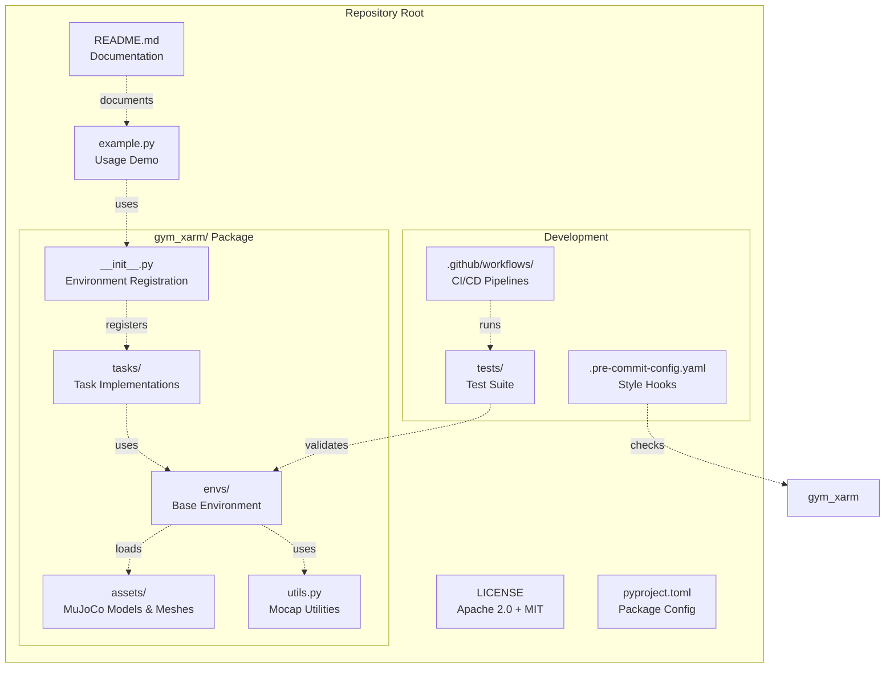
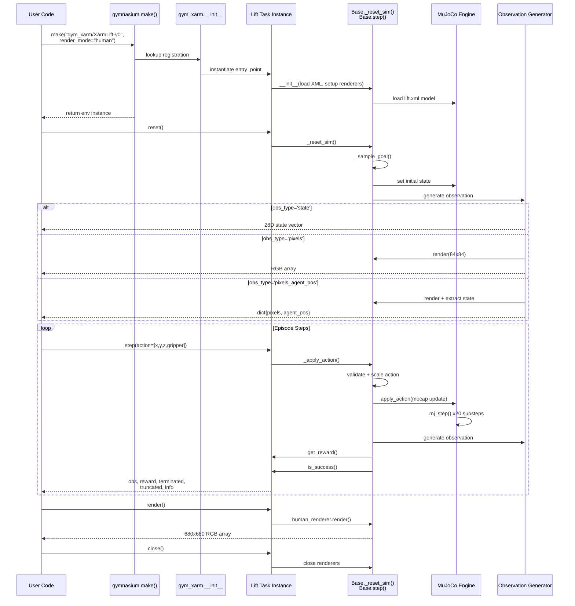
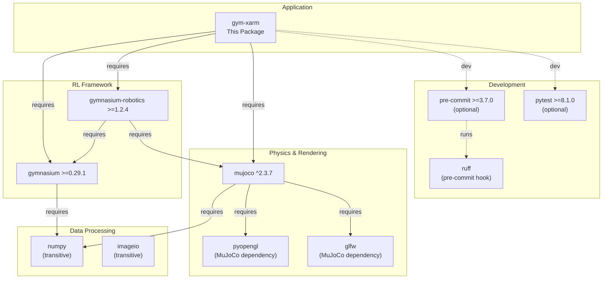

<!-- source: DeepWiki mcp.deepwiki.com · repo huggingface/gym-xarm · page 1 Overview · fetched 2026-10-26 -->

# Overview

<details>
<summary>Relevant source files</summary>

The following files were used as context for generating this wiki page:

- [LICENSE](LICENSE)
- [README.md](README.md)
- [example.py](example.py)
- [gym_xarm/__init__.py](gym_xarm/__init__.py)
- [pyproject.toml](pyproject.toml)

</details>


This document provides a high-level introduction to the **gym-xarm** codebase, explaining its purpose, architecture, and organization. It serves as the entry point for understanding how the system is structured and how its components interact. For installation instructions and basic usage, see [Getting Started](#2). For detailed architecture documentation, see [Core Architecture](#3).

---

## What is gym-xarm?

**gym-xarm** is a Gymnasium-compatible reinforcement learning environment for robotic manipulation research using the xArm robot arm. The environment simulates the robot using the MuJoCo physics engine and provides a standardized interface for training and evaluating RL agents on manipulation tasks.

The package is registered on PyPI as `gym-xarm` and integrates seamlessly with the Gymnasium ecosystem, allowing researchers to use standard RL training frameworks. The primary use case is manipulation research, particularly for lifting tasks where the robot must grasp and elevate objects.

**Key Characteristics:**
- **Standard Gymnasium API**: Fully compatible with `gymnasium.Env` interface
- **MuJoCo-based simulation**: High-fidelity physics simulation with 20 substeps per action
- **Multiple observation modes**: Support for state vectors, pixel observations, or hybrid observations
- **Mocap control**: End-effector position control via motion capture system
- **Research-focused**: Derived from academic work on visual RL and robotics manipulation

**Sources:** [README.md:1-94](), [pyproject.toml:1-77](), [gym_xarm/__init__.py:1-9]()

---

## Repository Structure

The repository follows a standard Python package layout with clear separation between core implementation, assets, testing, and development configuration.



**Directory Purposes:**

| Path | Purpose |
|------|---------|
| `gym_xarm/` | Core package containing all implementation code |
| `gym_xarm/tasks/` | Task-specific implementations (Lift, deprecated tasks) |
| `gym_xarm/envs/` | Base environment class providing core RL infrastructure |
| `gym_xarm/assets/` | MuJoCo XML models and 3D mesh files (`.stl`) |
| `tests/` | Environment validation and compliance tests |
| `.github/workflows/` | Automated testing and quality assurance pipelines |

**Sources:** [README.md:1-94](), [gym_xarm/__init__.py:1-9]()

---

## Core Architecture

The system is built on a layered architecture where the `Base` environment class provides all core functionality, and task-specific classes inherit from it to implement domain logic.

```mermaid
graph TB
    subgraph "User Interface Layer"
        GymAPI["gymnasium.make()<br/>Standard RL API"]
        EnvID["gym_xarm/XarmLift-v0<br/>Registered Environment ID"]
    end
    
    subgraph "gym_xarm Package"
        Registration["gym_xarm.__init__<br/>register() call"]
        
        subgraph "Task Layer"
            LiftTask["gym_xarm.tasks.Lift<br/>entry_point class"]
            DeprecatedTasks["Reach, Push, PegInBox<br/>(deprecated)"]
        end
        
        subgraph "Core Environment Layer"
            BaseEnv["gym_xarm.envs.Base<br/>Core RL Environment"]
            MocapUtils["gym_xarm.utils<br/>apply_action(), reset_mocap2body_xpos()"]
        end
        
        subgraph "Assets"
            LiftXML["assets/xarm/lift.xml<br/>Scene Description"]
            XarmXML["assets/xarm/xarm.xml<br/>Robot Model"]
            Meshes["assets/xarm/*.stl<br/>3D Geometry"]
        end
    end
    
    subgraph "External Dependencies"
        Gymnasium["gymnasium >=0.29.1<br/>RL Framework"]
        GymnasiumRobotics["gymnasium-robotics >=1.2.4<br/>Robotics Base Classes"]
        MuJoCo["mujoco ^2.3.7<br/>Physics Engine"]
    end
    
    GymAPI -->|looks up| EnvID
    EnvID -->|configured in| Registration
    Registration -->|entry_point| LiftTask
    
    LiftTask --|inherits| BaseEnv
    DeprecatedTasks -.->|unused| BaseEnv
    
    BaseEnv -->|uses| MocapUtils
    BaseEnv -->|loads| LiftXML
    LiftXML -->|includes| XarmXML
    XarmXML -->|references| Meshes
    
    BaseEnv -->|implements| Gymnasium
    BaseEnv -->|extends| GymnasiumRobotics
    BaseEnv -->|simulates with| MuJoCo
```

**Architectural Layers:**

1. **User Interface**: Standard `gymnasium.make()` API for environment instantiation
2. **Registration**: Maps environment ID `"gym_xarm/XarmLift-v0"` to the `Lift` class
3. **Task Layer**: Task-specific implementations providing reward functions and goal sampling
4. **Core Environment**: `Base` class handles simulation, observation generation, action processing
5. **Utilities**: Mocap control functions for translating actions to physics commands
6. **Assets**: MuJoCo XML models defining robot kinematics and scene layout
7. **Dependencies**: External libraries providing RL framework and physics simulation

**Sources:** [gym_xarm/__init__.py:1-9](), [README.md:1-94](), [pyproject.toml:24-28]()

---

## Key Components Overview

### Base Environment Class
The `Base` class in `gym_xarm/envs/` is the architectural foundation, providing all core RL environment functionality. It handles MuJoCo simulation management, dual rendering systems (84×84 for observations, 680×680 for visualization), observation generation across three modes, and mocap-based action processing. For detailed documentation, see [Base Environment Class](#3.1).

### Task System
Tasks inherit from `Base` and implement task-specific logic through four abstract methods: `_get_obs()`, `_sample_goal()`, `get_reward()`, and `is_success()`. The `Lift` task is the only active implementation, while `Reach`, `Push`, and `PegInBox` are deprecated. For task details, see [Task System](#3.2) and [Tasks Reference](#4).

### MuJoCo Integration
The environment integrates with MuJoCo through XML model loading, 20-substep physics simulation, and mocap-based control. The mocap system allows high-level end-effector control by updating mocap body positions and orientations. For integration details, see [MuJoCo Integration](#3.3).

### Observation System
Three observation modes are supported:
- `"state"`: 28-dimensional state vectors (robot + object states)
- `"pixels"`: 84×84 RGB images from camera
- `"pixels_agent_pos"`: Hybrid combining pixels with robot state

For observation system documentation, see [Observation System](#3.4).

### Action Processing
Actions are 4-dimensional vectors `[x, y, z, w]` representing end-effector target position and gripper control. The system validates, scales, and applies actions through the mocap control system. For details, see [Action Processing and Mocap Control](#3.5).

**Sources:** [README.md:47-63](), [pyproject.toml:1-77]()

---

## Typical Usage Workflow

The following diagram illustrates a complete usage cycle, showing how user code interacts with the environment through the standard Gymnasium API and how data flows through the system components.



**Workflow Phases:**

1. **Instantiation**: `gymnasium.make()` looks up the registered ID and instantiates the `Lift` task
2. **Initialization**: `Base.__init__()` loads MuJoCo models and sets up dual renderers
3. **Reset**: Environment samples initial goal and object positions, returns first observation
4. **Stepping**: Actions are validated, applied via mocap, physics simulated, observations generated
5. **Rendering**: Optional human-viewable rendering at higher resolution (680×680)
6. **Cleanup**: Renderers are properly closed when environment is destroyed

**Sources:** [example.py:1-16](), [gym_xarm/__init__.py:1-9](), [README.md:21-45]()

---

## Technology Stack and Dependencies

The package is built on a carefully selected stack of dependencies that provide robotics RL infrastructure, physics simulation, and development tooling.

### Runtime Dependencies

| Package | Version Constraint | Purpose |
|---------|-------------------|---------|
| `python` | `^3.10` | Base interpreter (3.10+) |
| `gymnasium` | `>=0.29.1` | Standard RL environment API |
| `gymnasium-robotics` | `>=1.2.4` | Robotics-specific extensions and base classes |
| `mujoco` | `^2.3.7` | Physics engine for robot simulation |

### Development Dependencies

| Package | Version Constraint | Purpose |
|---------|-------------------|---------|
| `pre-commit` | `>=3.7.0` | Git hooks for style enforcement |
| `pytest` | `>=8.1.0` | Test framework |
| `pytest-cov` | `>=5.0.0` | Test coverage reporting |
| `debugpy` | `>=1.8.1` | Python debugger for development |

### Dependency Graph



**Version Strategy:**
- **Caret constraints (`^`)**: Used for MuJoCo to allow patch updates but prevent breaking changes
- **Minimum version constraints (`>=`)**: Used for Gymnasium packages to ensure required features are available
- **Optional dependencies**: Development tools are grouped under `[dev]` and `[test]` extras

For comprehensive dependency documentation, see [Dependencies and Requirements](#6).

**Sources:** [pyproject.toml:24-37]()

---

## Development and Quality Assurance

The repository employs a multi-layered quality assurance strategy:

**Local Development:**
- **Poetry** for dependency management and reproducible builds
- **Pre-commit hooks** run Ruff linter/formatter before each commit
- **pyproject.toml** centralizes all tool configuration

**CI/CD Pipelines:**
- **test.yml workflow**: Runs pytest suite on pull requests, validates Gymnasium API compliance
- **quality.yml workflow**: Checks code style with Ruff and dependency integrity with Poetry

For development setup instructions, see [Development Setup](#5.1). For CI/CD details, see [CI/CD Workflows](#5.3).

**Sources:** [pyproject.toml:1-77](), [README.md:65-84]()

---

## Licensing and Attribution

The package is dual-licensed:
- **Apache License 2.0**: Primary license for the gym-xarm implementation
- **MIT License**: Applies to code derived from the simxarm project by Nicklas Hansen and Yanjie Ze

The environment is adapted from research on visual reinforcement learning and robotic manipulation, building on work from multiple academic publications. For complete licensing information and acknowledgments, see [Project Information](#10).

**Sources:** [LICENSE:1-229](), [README.md:86-94]()

---

## Next Steps

To get started with gym-xarm:
1. **Installation**: Follow the guide in [Installation](#2.1) to set up the package
2. **Quick Start**: Work through the [Quick Start Tutorial](#2.2) to create your first environment
3. **Configuration**: Learn about observation types and rendering modes in [Configuration Options](#2.3)
4. **Architecture Deep Dive**: Explore the [Core Architecture](#3) section to understand system internals
5. **Contributing**: Review the [Development Guide](#5) if you want to contribute or extend the package

For task-specific information, see [Tasks Reference](#4). For API documentation, see [API Reference](#8).

---

