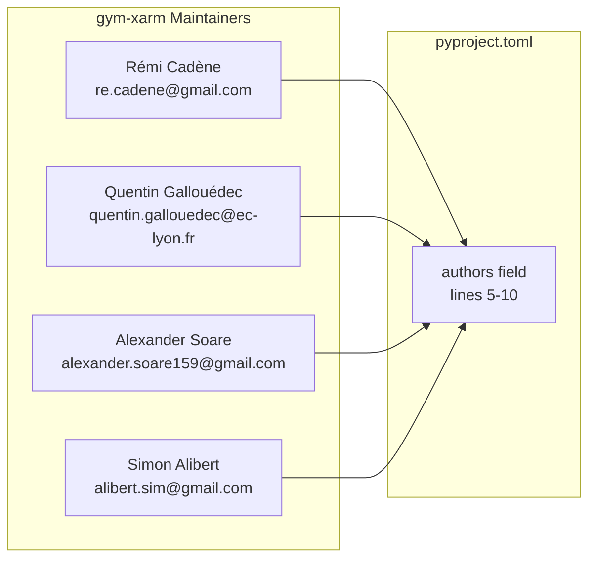
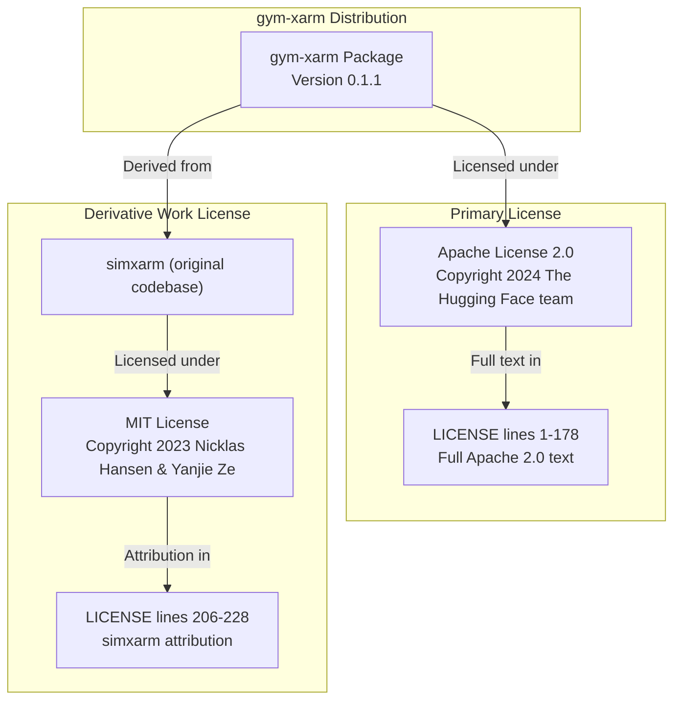
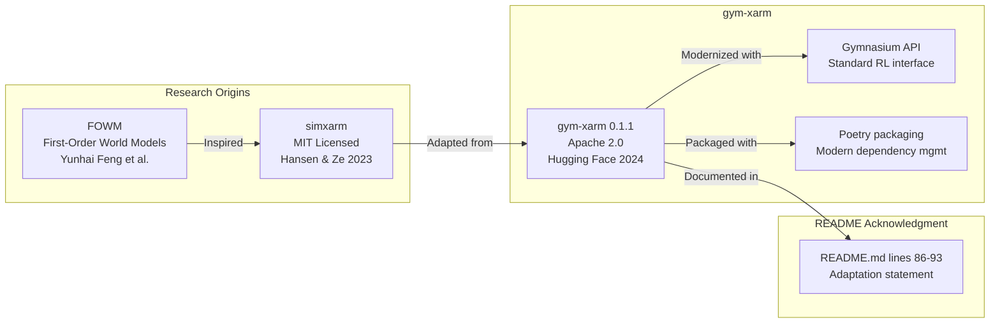
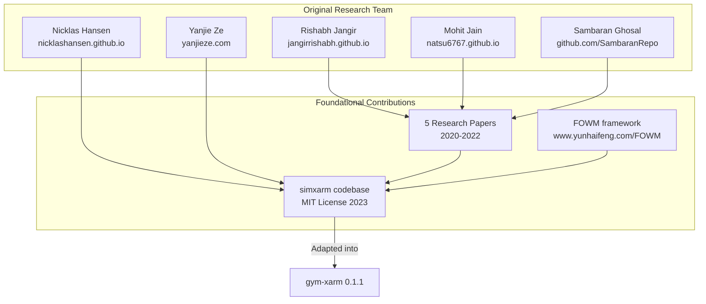

<!-- source: DeepWiki mcp.deepwiki.com · repo huggingface/gym-xarm · page 10 Project Information · fetched 2026-10-26 -->

# Project Information

<details>
<summary>Relevant source files</summary>

The following files were used as context for generating this wiki page:

- [LICENSE](LICENSE)
- [README.md](README.md)
- [example.py](example.py)
- [pyproject.toml](pyproject.toml)

</details>


This page documents the legal, organizational, and historical aspects of the gym-xarm project, including licensing terms, authorship, version information, and acknowledgments of prior work. For technical setup and contribution guidelines, see [Development Guide](#5).

## Overview

gym-xarm is an open-source project maintained by The Hugging Face team, providing a standardized Gymnasium environment for reinforcement learning research with the xArm robotic manipulator. The project is distributed under the Apache License 2.0 and is derived from the simxarm codebase (MIT License).

**Sources:** [pyproject.toml:1-21](), [LICENSE:1-1]()

## Project Metadata

### Package Information

The following table summarizes the core package metadata defined in the project configuration:

| Property | Value | Description |
|----------|-------|-------------|
| **Package Name** | `gym-xarm` | PyPI distribution name |
| **Current Version** | `0.1.1` | Semantic version number |
| **Python Requirement** | `^3.10` | Minimum Python 3.10 required |
| **Development Status** | Alpha | Classified as "Development Status :: 3 - Alpha" |
| **License** | Apache-2.0 | Open source license identifier |

**Sources:** [pyproject.toml:2-12]()

### Classification and Keywords

The package is classified for PyPI with the following metadata:

```toml
keywords = [
    "robotics", "deep", "reinforcement", "learning", "xarm", 
    "environment", "gym", "gymnasium", "mujoco"
]

classifiers = [
    "Development Status :: 3 - Alpha",
    "Intended Audience :: Developers",
    "Topic :: Software Development :: Build Tools",
    "License :: OSI Approved :: Apache Software License",
    "Programming Language :: Python :: 3.10"
]
```

The **Alpha** development status indicates the project is in active development with a stable but evolving API. Users should expect potential breaking changes in minor version updates.

**Sources:** [pyproject.toml:13-20]()

## Authors and Contributors

### Core Maintainers



The project is maintained by four primary contributors as listed in [pyproject.toml:5-10](). These maintainers are responsible for the current Gymnasium-based implementation and ongoing development.

**Sources:** [pyproject.toml:5-10]()

## Licensing

### Dual License Structure

gym-xarm operates under a dual license structure reflecting its derivation from prior work:



### Apache License 2.0

The primary codebase is licensed under **Apache License 2.0** as specified in [LICENSE:1-178](). Key provisions include:

| Provision | Description |
|-----------|-------------|
| **Copyright Holder** | The Hugging Face team (2024) |
| **Grant of Rights** | Perpetual, worldwide, royalty-free use, reproduction, distribution |
| **Patent License** | Irrevocable patent license for contributions |
| **Redistribution** | Allowed with proper attribution and license inclusion |
| **Disclaimer** | Software provided "AS IS" without warranties |

The license explicitly applies to the current gym-xarm implementation as maintained by the Hugging Face team.

**Sources:** [LICENSE:1-178](), [pyproject.toml:12]()

### MIT License (Derivative Work)

The project acknowledges its derivation from **simxarm** under the MIT License:

```
Copyright (c) 2023 Nicklas Hansen & Yanjie Ze
```

This dual licensing structure is documented in [LICENSE:206-228](), which states:

> "gym-xarm code is derived from simxarm, which is subject to the following copyright notice"

The MIT License grants broad permissions for use, modification, and distribution, including incorporation into Apache-licensed projects. Users of gym-xarm must comply with both license terms when distributing derivative works.

**Sources:** [LICENSE:206-228]()

### License Compatibility

The Apache 2.0 and MIT licenses are compatible for derivative works. The Apache 2.0 license can incorporate MIT-licensed code, and the attribution requirements of both licenses are satisfied by the dual notice in the LICENSE file.

**Sources:** [LICENSE:1-228]()

## Acknowledgments and Prior Work

### Project Evolution

gym-xarm represents an evolution of prior research codebases:



The README explicitly states:

> "gym-xarm is adapted from FOWM and is based on work by Nicklas Hansen, Yanjie Ze, Rishabh Jangir, Mohit Jain, and Sambaran Ghosal"

**Sources:** [README.md:86-88]()

### Research Publications

The following academic publications informed the development of the underlying methods and implementations:

| Year | Title | Authors | Contribution |
|------|-------|---------|--------------|
| 2020 | Self-Supervised Policy Adaptation During Deployment | Hansen et al. | Policy adaptation techniques |
| 2020 | Generalization in Reinforcement Learning by Soft Data Augmentation | Hansen et al. | Data augmentation methods |
| 2021 | Stabilizing Deep Q-Learning with ConvNets and Vision Transformers | Jangir et al. | Visual RL stabilization |
| 2022 | Look Closer: Bridging Egocentric and Third-Person Views | Jain et al. | Multi-view manipulation |
| 2022 | Visual Reinforcement Learning with Self-Supervised 3D Representations | Ghosal et al. | 3D representation learning |

Each publication contributed methodological approaches that influenced the design decisions in the original simxarm codebase, which gym-xarm preserves while modernizing the packaging and API.

**Sources:** [README.md:88-93]()

### Research Contributors

The acknowledgment section recognizes the following researchers who contributed to the foundational work:



These researchers developed the core manipulation environment, reward structures, and visual RL techniques that form the foundation of gym-xarm's current implementation.

**Sources:** [README.md:88-93](), [LICENSE:210]()

## Version History

### Current Release: 0.1.1

The current version `0.1.1` represents the second minor release of the package:

- **Initial public release** (0.1.0): Original Gymnasium-based port of simxarm
- **Current release** (0.1.1): Bug fixes and documentation improvements

As an **Alpha** status project, version numbers follow semantic versioning but may introduce breaking changes in minor version increments (0.x.y) until reaching Beta or stable status.

**Sources:** [pyproject.toml:3](), [pyproject.toml:15]()

### Development Roadmap

While no formal roadmap is documented in the repository, the Alpha classification suggests:

1. **Current Focus**: API stabilization and bug fixes
2. **Near-term**: Potential expansion of task variants beyond Lift
3. **Long-term**: Graduation to Beta status with API stability guarantees

For contribution opportunities, see [Development Guide](#5).

**Sources:** [pyproject.toml:14-20]()

## Repository Information

### Official Resources

| Resource | Location |
|----------|----------|
| **Source Repository** | https://github.com/huggingface/gym-xarm |
| **PyPI Package** | https://pypi.org/project/gym-xarm/ |
| **Issue Tracker** | GitHub Issues (repository) |
| **Documentation** | README.md + Wiki pages |

### Package Distribution

The package is built and distributed using **Poetry** (modern Python packaging tool) with **poetry-core** as the build backend. This configuration is defined in [pyproject.toml:74-76]().

Distribution to PyPI is handled through Poetry's build and publish commands, ensuring reproducible builds through the lock file mechanism.

**Sources:** [pyproject.toml:74-76](), [pyproject.toml:1-21]()

## Legal Compliance

### Copyright Notice

When redistributing or creating derivative works of gym-xarm, you must:

1. **Include the Apache License 2.0** full text from [LICENSE:1-178]()
2. **Include the MIT License attribution** for simxarm from [LICENSE:206-228]()
3. **Preserve copyright notices** for both Hugging Face (2024) and Hansen & Ze (2023)
4. **Document any modifications** made to the original work

### Attribution Requirements

Proper attribution should reference:
- **Primary License**: "Copyright 2024 The Hugging Face team. Licensed under Apache 2.0."
- **Derivative Work**: "Derived from simxarm, Copyright 2023 Nicklas Hansen & Yanjie Ze. Licensed under MIT."

**Sources:** [LICENSE:1-228]()

## Summary

gym-xarm is an Apache 2.0 licensed project maintained by The Hugging Face team, derived from MIT-licensed simxarm research code. The project acknowledges contributions from multiple researchers across five publications and continues their work by providing a modern, well-packaged Gymnasium environment for xArm manipulation research. Currently in Alpha development status at version 0.1.1, the project balances stability with active development toward API maturity.

**Sources:** [README.md:86-93](), [LICENSE:1-228](), [pyproject.toml:1-21]()