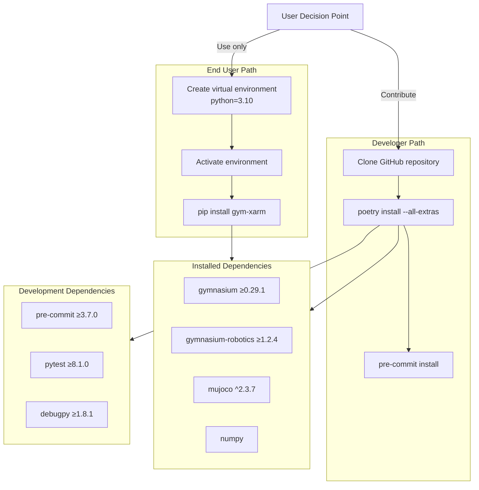
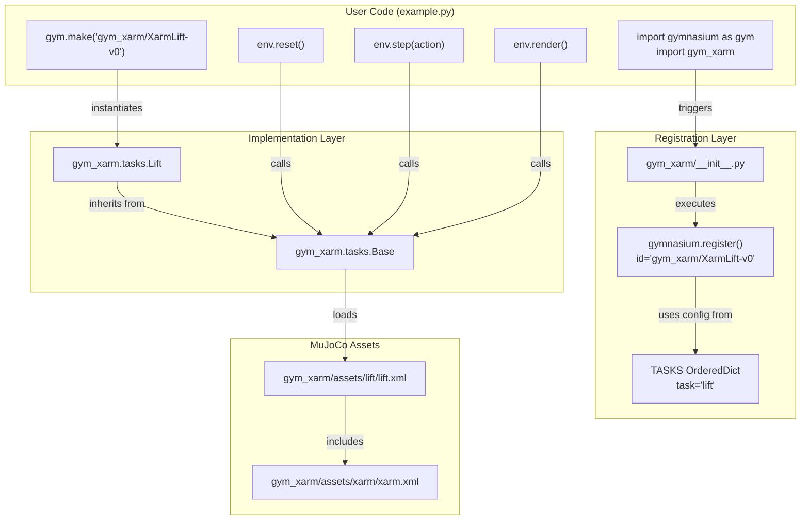
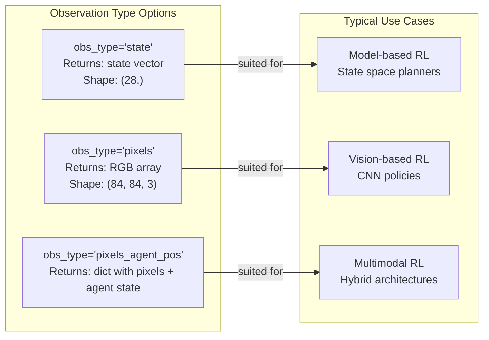
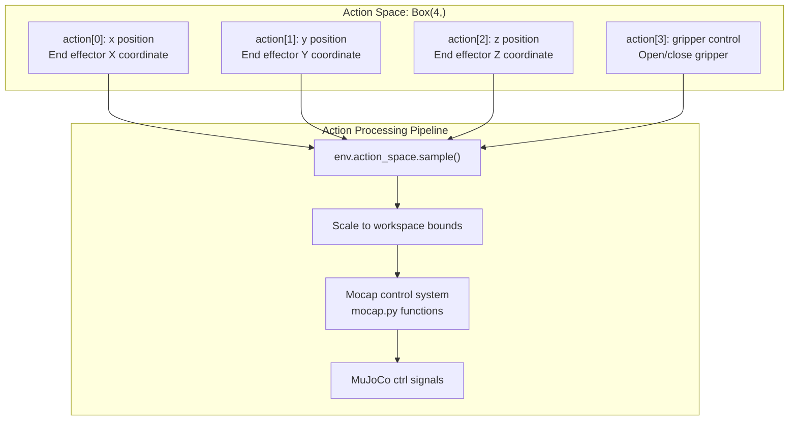

<!-- source: DeepWiki mcp.deepwiki.com · repo huggingface/gym-xarm · page 2 Getting Started · fetched 2026-10-26 -->

# Getting Started

<details>
<summary>Relevant source files</summary>

The following files were used as context for generating this wiki page:

- [README.md](README.md)
- [example.py](example.py)
- [pyproject.toml](pyproject.toml)

</details>


This page provides an overview of the essential steps to install and use gym-xarm. It covers the basic workflow from installation through creating and interacting with environments. For detailed installation instructions, see [Installation](#2.1). For a complete walkthrough with code examples, see [Quick Start Tutorial](#2.2). For detailed configuration parameters, see [Configuration Options](#2.3).

## Prerequisites

gym-xarm requires Python 3.10 or higher. The package depends on MuJoCo physics engine and Gymnasium framework, which will be installed automatically as dependencies.

**Sources:** [pyproject.toml:25](), [README.md:10-13]()

## Installation Overview

There are two installation paths depending on your use case:

| Installation Method | Use Case | Command |
|---------------------|----------|---------|
| **pip** | End users who want to use gym-xarm | `pip install gym-xarm` |
| **Poetry** | Developers contributing to gym-xarm | `poetry install --all-extras` |

The pip installation provides the core package and all runtime dependencies. The Poetry installation additionally includes development tools like pre-commit hooks, pytest, and debugpy for debugging.

**Sources:** [README.md:8-18](), [README.md:66-73](), [pyproject.toml:24-37]()

### Installation Workflow



**Sources:** [README.md:10-18](), [README.md:66-73](), [pyproject.toml:24-37]()

## Basic Usage Pattern

All interaction with gym-xarm follows the standard Gymnasium API pattern. The core workflow involves three steps:

1. **Environment Creation**: Use `gymnasium.make()` with the environment ID `"gym_xarm/XarmLift-v0"`
2. **Episode Loop**: Call `reset()` to initialize, then repeatedly call `step(action)` until termination
3. **Cleanup**: Call `close()` when done

### Code Entity Mapping



**Sources:** [README.md:23-40](), [example.py:1-15]()

## Minimal Working Example

The simplest way to verify your installation is to run a random policy for a few steps:

```python
import gymnasium as gym
import gym_xarm

env = gym.make("gym_xarm/XarmLift-v0")
observation, info = env.reset()

for _ in range(50):
    action = env.action_space.sample()
    observation, reward, terminated, truncated, info = env.step(action)
    
    if terminated or truncated:
        observation, info = env.reset()

env.close()
```

This code creates the Lift task environment, runs random actions, and properly handles episode termination. The environment automatically manages the MuJoCo simulation in the background.

**Sources:** [example.py:1-15](), [README.md:23-40]()

## Environment Configuration

The `gymnasium.make()` function accepts configuration parameters that control observation and rendering behavior:

| Parameter | Options | Default | Purpose |
|-----------|---------|---------|---------|
| `obs_type` | `"state"`, `"pixels"`, `"pixels_agent_pos"` | `"state"` | Determines observation space format |
| `render_mode` | `"rgb_array"`, `"human"` | `None` | Controls rendering output |

### Observation Type Details



**Sources:** [README.md:57-63]()

### Rendering Configuration

When using `render_mode="human"` for visual debugging, the `MUJOCO_GL` environment variable must be set:

```bash
MUJOCO_GL=glfw python your_script.py
```

This configures MuJoCo to use the GLFW backend for OpenGL rendering. Without this setting, human rendering will fail. For programmatic rendering (`render_mode="rgb_array"`), this variable is not required.

**Sources:** [README.md:42-45]()

## Action Space Structure

The environment uses a 4-dimensional continuous action space:



The action values are interpreted as target positions for the end effector and gripper state. The mocap control system translates these high-level commands into low-level physics control signals.

**Sources:** [README.md:51-55]()

## Next Steps

Now that you understand the basics, explore these pages for detailed information:

- **[Installation](#2.1)**: Detailed setup instructions including virtual environment configuration and troubleshooting
- **[Quick Start Tutorial](#2.2)**: Step-by-step tutorial with complete code examples and explanations
- **[Configuration Options](#2.3)**: Comprehensive reference for all environment parameters and settings
- **[Lift Task](#4.1)**: Detailed documentation of the lifting task including reward structure and success criteria
- **[Core Architecture](#3)**: Deep dive into the system's internal architecture and components

For development workflows including testing and contributing, see [Development Guide](#5).

**Sources:** [README.md:1-94](), [pyproject.toml:1-77]()

---

