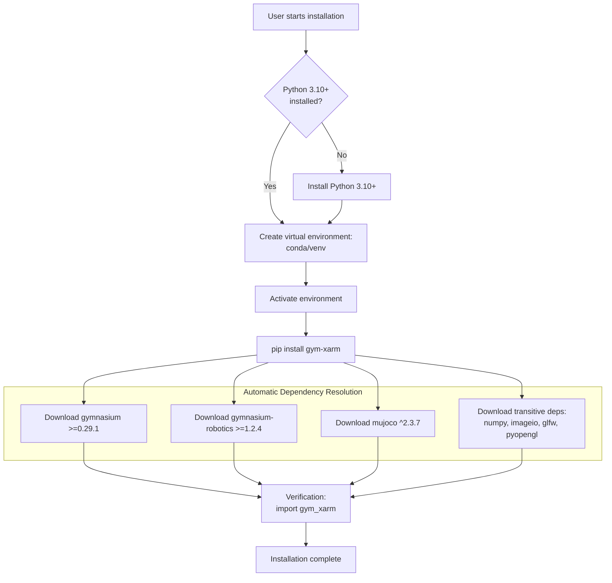
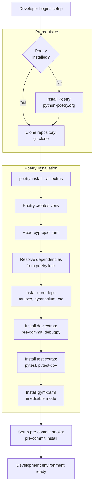
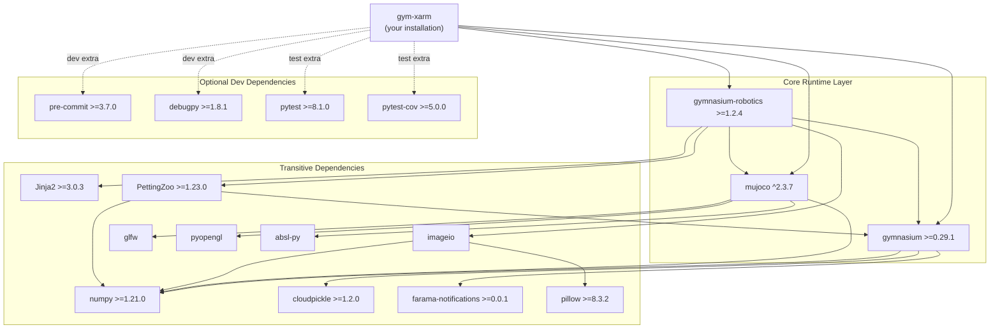

<!-- source: DeepWiki mcp.deepwiki.com · repo huggingface/gym-xarm · page 2.1 Installation · fetched 2026-10-26 -->

# Installation

<details>
<summary>Relevant source files</summary>

The following files were used as context for generating this wiki page:

- [README.md](README.md)
- [example.py](example.py)
- [poetry.lock](poetry.lock)
- [pyproject.toml](pyproject.toml)

</details>


This page covers system requirements and installation procedures for gym-xarm. For basic usage instructions after installation, see [Quick Start Tutorial](#2.2). For detailed development setup including pre-commit hooks and testing, see [Development Setup](#5.1).

## Overview

gym-xarm provides two installation paths:
- **User Installation**: Simple pip-based installation for end users who want to use the environment
- **Developer Installation**: Poetry-based installation for contributors who need development tools and testing infrastructure

Both installation methods require Python 3.10 or higher and will install the MuJoCo physics engine along with required dependencies.

## System Requirements

### Python Version

gym-xarm requires Python 3.10 or higher, as specified in [pyproject.toml:25]().

```toml
python = "^3.10"
```

### Core Runtime Dependencies

The following dependencies are automatically installed with gym-xarm:

| Dependency | Version Constraint | Purpose |
|------------|-------------------|---------|
| `mujoco` | ^2.3.7 | Physics simulation engine |
| `gymnasium` | >=0.29.1 | RL environment API framework |
| `gymnasium-robotics` | >=1.2.4 | Robotics-specific extensions |
| `numpy` | >=1.21.0 | Numerical computation (transitive) |
| `imageio` | * | Image and video I/O (transitive) |
| `glfw` | * | Window management for rendering (transitive) |
| `pyopengl` | * | OpenGL bindings (transitive) |

Sources: [pyproject.toml:24-28](), [poetry.lock:1-446]()

### Optional Development Dependencies

Additional dependencies required for development work:

| Dependency | Version | Extra Group | Purpose |
|------------|---------|-------------|---------|
| `pre-commit` | >=3.7.0 | dev | Code quality hooks |
| `debugpy` | >=1.8.1 | dev | Python debugging |
| `pytest` | >=8.1.0 | test | Testing framework |
| `pytest-cov` | >=5.0.0 | test | Coverage reporting |

Sources: [pyproject.toml:29-37]()

## User Installation

### Step 1: Create Virtual Environment

Create and activate a Python 3.10+ virtual environment. Using conda:

```bash
conda create -y -n xarm python=3.10 && conda activate xarm
```

Alternatively, using venv:

```bash
python3.10 -m venv xarm_env
source xarm_env/bin/activate  # On Linux/Mac
# or
xarm_env\Scripts\activate  # On Windows
```

Sources: [README.md:10-13]()

### Step 2: Install via pip

```bash
pip install gym-xarm
```

This command installs gym-xarm and all required runtime dependencies from PyPI.

Sources: [README.md:15-18]()

### Installation Flow Diagram



Sources: [README.md:8-18](), [pyproject.toml:24-28]()

## Developer Installation

### Step 1: Install Poetry

Poetry is required for development. Install it following the [official instructions](https://python-poetry.org/docs/#installation).

Sources: [README.md:67-68]()

### Step 2: Clone Repository

```bash
git clone https://github.com/huggingface/gym-xarm.git
cd gym-xarm
```

### Step 3: Install with Development Dependencies

```bash
poetry install --all-extras
```

This command:
- Creates a virtual environment automatically (if not already in one)
- Installs gym-xarm in editable mode
- Installs all optional dependency groups (`dev` and `test`)

The `--all-extras` flag installs dependencies from both extras groups defined in [pyproject.toml:35-37]():

```toml
[tool.poetry.extras]
dev = ["pre-commit", "debugpy"]
test = ["pytest", "pytest-cov"]
```

Sources: [README.md:70-73](), [pyproject.toml:35-37]()

### Developer Installation Workflow



Sources: [README.md:65-83](), [pyproject.toml:24-37]()

## Dependency Resolution

### Dependency Tree Structure



Sources: [pyproject.toml:24-37](), [poetry.lock:219-270](), [poetry.lock:415-453]()

### Version Constraint Notation

Poetry uses specific version constraint operators:

| Operator | Example | Meaning |
|----------|---------|---------|
| `^` | `^2.3.7` | Compatible release: `>=2.3.7, <3.0.0` |
| `>=` | `>=0.29.1` | Minimum version: `0.29.1` or higher |
| `*` | `*` | Any version (from transitive deps) |

The caret (`^`) operator allows patch and minor version updates but prevents breaking major version changes.

Sources: [pyproject.toml:24-28]()

## Verification

### Basic Import Test

After installation, verify that gym-xarm can be imported:

```python
import gymnasium as gym
import gym_xarm

# Verify environment registration
env = gym.make("gym_xarm/XarmLift-v0")
print("Installation successful!")
env.close()
```

### Full Verification Script

```python
# verify_installation.py
import sys

def verify_installation():
    """Verify all core components are properly installed."""
    errors = []
    
    # Check Python version
    if sys.version_info < (3, 10):
        errors.append(f"Python 3.10+ required, found {sys.version}")
    
    # Check core imports
    try:
        import gymnasium
        print(f"✓ gymnasium {gymnasium.__version__}")
    except ImportError as e:
        errors.append(f"✗ gymnasium: {e}")
    
    try:
        import gymnasium_robotics
        print(f"✓ gymnasium-robotics")
    except ImportError as e:
        errors.append(f"✗ gymnasium-robotics: {e}")
    
    try:
        import mujoco
        print(f"✓ mujoco {mujoco.__version__}")
    except ImportError as e:
        errors.append(f"✗ mujoco: {e}")
    
    try:
        import gym_xarm
        print(f"✓ gym-xarm")
    except ImportError as e:
        errors.append(f"✗ gym-xarm: {e}")
    
    # Test environment creation
    try:
        import gymnasium as gym
        env = gym.make("gym_xarm/XarmLift-v0")
        print(f"✓ Environment creation successful")
        env.close()
    except Exception as e:
        errors.append(f"✗ Environment creation: {e}")
    
    if errors:
        print("\nErrors found:")
        for error in errors:
            print(f"  {error}")
        return False
    
    print("\nAll verification checks passed!")
    return True

if __name__ == "__main__":
    success = verify_installation()
    sys.exit(0 if success else 1)
```

Sources: [example.py:1-15]()

## Environment Variables

### MUJOCO_GL Configuration

For human rendering mode (`render_mode="human"`), the `MUJOCO_GL` environment variable must be set:

```bash
export MUJOCO_GL=glfw  # Linux/Mac
# or
set MUJOCO_GL=glfw     # Windows
```

This can also be set inline when running scripts:

```bash
MUJOCO_GL=glfw python example.py
```

Without this setting, you may encounter OpenGL context errors when using `render_mode="human"`.

Sources: [README.md:42-45]()

## Troubleshooting

### Common Installation Issues

#### Issue: Python Version Mismatch

**Symptom**: `requires python ^3.10` error during installation

**Solution**: Ensure Python 3.10 or higher is installed and active:
```bash
python --version  # Should show 3.10.x or higher
```

#### Issue: MuJoCo Rendering Errors

**Symptom**: Errors mentioning "GL context" or "rendering" when using `render_mode="human"`

**Solution**: Set the `MUJOCO_GL` environment variable:
```bash
export MUJOCO_GL=glfw
```

#### Issue: Poetry Lock File Conflicts

**Symptom**: `poetry.lock` conflicts during `poetry install`

**Solution**: Update the lock file:
```bash
poetry lock --no-update
poetry install --all-extras
```

#### Issue: Missing Dependencies in Development

**Symptom**: Import errors for `pre-commit` or `pytest`

**Solution**: Ensure you installed with extras:
```bash
poetry install --all-extras
# or for pip
pip install gym-xarm[dev,test]
```

Sources: [README.md:42-45](), [pyproject.toml:24-37]()

## Platform-Specific Notes

### Linux

No special configuration required. Standard installation works on most distributions.

### macOS

- Apple Silicon (M1/M2): Both x86_64 and ARM64 wheels are available for MuJoCo
- OpenGL may require XQuartz for some rendering modes

### Windows

- Ensure Microsoft Visual C++ Redistributable is installed for MuJoCo
- Use `set` instead of `export` for environment variables

Sources: [poetry.lock:421-445]()

## Next Steps

After successful installation:

1. **For users**: See [Quick Start Tutorial](#2.2) to create your first environment
2. **For developers**: See [Development Setup](#5.1) to configure pre-commit hooks and testing
3. **For configuration**: See [Configuration Options](#2.3) to customize environment behavior

Sources: [README.md:8-94]()

---

