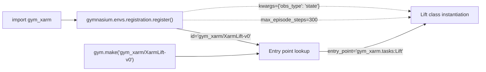
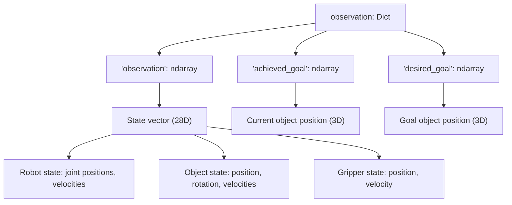

<!-- source: DeepWiki mcp.deepwiki.com · repo huggingface/gym-xarm · page 2.2 Quick Start Tutorial · fetched 2026-10-26 -->

# Quick Start Tutorial

<details>
<summary>Relevant source files</summary>

The following files were used as context for generating this wiki page:

- [README.md](README.md)
- [example.py](example.py)
- [gym_xarm/__init__.py](gym_xarm/__init__.py)

</details>


## Purpose and Scope

This tutorial walks through creating and interacting with a gym-xarm environment. You will learn how to initialize the environment using Gymnasium's standard API, execute the reset-step-render loop, and understand the basic structure of observations, actions, and rewards. This guide assumes you have already completed the installation steps in [Installation](#2.1).

For detailed configuration options like observation types and render modes, see [Configuration Options](#2.3). For understanding the internal architecture, see [Core Architecture](#3).

**Sources:** [README.md:21-45]()

---

## Creating Your First Environment

The gym-xarm package registers environments with Gymnasium using the standard registration mechanism. The primary environment is `gym_xarm/XarmLift-v0`, which implements a cube-lifting manipulation task.

```python
import gymnasium as gym
import gym_xarm

env = gym.make("gym_xarm/XarmLift-v0", render_mode="human")
```

The `import gym_xarm` statement triggers environment registration by executing [gym_xarm/__init__.py:1-8](). The `gym.make()` call instantiates the `Lift` task class, which inherits from the `Base` environment class and implements the Gymnasium API.

### Environment Registration Flow



**Sources:** [gym_xarm/__init__.py:3-8](), [README.md:28]()

---

## The Environment Lifecycle

A typical reinforcement learning interaction follows the reset-step loop pattern. The environment must be reset before the first step, and should be reset whenever an episode terminates.

### Basic Interaction Loop

```python
observation, info = env.reset()

for _ in range(1000):
    action = env.action_space.sample()
    observation, reward, terminated, truncated, info = env.step(action)
    image = env.render()
    
    if terminated or truncated:
        observation, info = env.reset()

env.close()
```

**Sources:** [example.py:5-15](), [README.md:29-39]()

### Method Call Sequence Diagram

```mermaid
sequenceDiagram
    participant User as "User Code"
    participant Env as "gym.Env"
    participant Lift as "gym_xarm.tasks.Lift"
    participant Base as "gym_xarm.tasks.Base"
    participant MuJoCo as "mujoco.MjModel/MjData"
    
    User->>+Env: "gym.make('gym_xarm/XarmLift-v0')"
    Env->>+Lift: "__init__(obs_type='state')"
    Lift->>+Base: "super().__init__()"
    Base->>MuJoCo: "Load lift.xml model"
    Base-->>-Lift: "Environment initialized"
    Lift-->>-Env: "Lift instance"
    Env-->>-User: "env object"
    
    User->>+Env: "reset()"
    Env->>+Lift: "reset()"
    Lift->>Base: "_reset_sim()"
    Base->>Base: "_sample_goal()"
    Base->>MuJoCo: "Set initial state"
    Base->>Base: "get_obs()"
    Base-->>Lift: "observation dict"
    Lift-->>Env: "observation, info"
    Env-->>-User: "observation, info"
    
    loop "Episode steps"
        User->>+Env: "step(action)"
        Env->>+Lift: "step(action)"
        Lift->>Base: "_apply_action(action)"
        Base->>Base: "_limit_gripper()"
        Base->>Base: "apply_action() [mocap]"
        Base->>MuJoCo: "Update mocap_pos, ctrl"
        MuJoCo->>MuJoCo: "mj_step() × 20 substeps"
        Base->>Base: "get_obs()"
        Lift->>Lift: "get_reward()"
        Lift->>Lift: "is_success()"
        Lift-->>Env: "obs, reward, terminated, truncated, info"
        Env-->>-User: "obs, reward, terminated, truncated, info"
        
        User->>+Env: "render()"
        Env->>Base: "render()"
        Base->>MuJoCo: "Render with visualization_renderer"
        Base-->>Env: "rgb_array (680×680×3)"
        Env-->>-User: "image array"
    end
    
    User->>+Env: "close()"
    Env->>Base: "close()"
    Base->>MuJoCo: "Release resources"
    Base-->>-Env: ""
    Env-->>-User: ""
```

**Sources:** [example.py:1-16](), [README.md:23-40]()

---

## Understanding Actions

The action space for the Lift task is a 4-dimensional continuous space: `[x, y, z, gripper]`.

| Action Component | Index | Range | Description |
|-----------------|-------|-------|-------------|
| x-position | 0 | Continuous | End-effector target x-coordinate |
| y-position | 1 | Continuous | End-effector target y-coordinate |
| z-position | 2 | Continuous | End-effector target z-coordinate |
| Gripper control | 3 | Continuous | Gripper open/close command |

```python
# Sample a random action
action = env.action_space.sample()
# Returns array with shape (4,): [x, y, z, gripper]

# Or specify actions manually
import numpy as np
action = np.array([0.1, 0.2, 0.3, 1.0])
```

Actions are processed through the `Base._apply_action()` method, which scales and validates them before passing to the mocap control system. The gripper is constrained by `_limit_gripper()` to prevent invalid configurations.

**Sources:** [README.md:51-55](), [example.py:8]()

---

## Understanding Observations

The default observation type is `"state"`, which provides a state vector containing robot and object information. The observation structure returned by `reset()` and `step()` is a dictionary:

```python
observation, info = env.reset()
# observation is a dict with keys: 'observation', 'achieved_goal', 'desired_goal'
```

### Observation Dictionary Structure



The observation type can be changed during environment creation:

```python
# State-based observations (default)
env = gym.make("gym_xarm/XarmLift-v0", obs_type="state")

# Pixel-based observations (84×84 RGB)
env = gym.make("gym_xarm/XarmLift-v0", obs_type="pixels")

# Hybrid observations (pixels + robot state)
env = gym.make("gym_xarm/XarmLift-v0", obs_type="pixels_agent_pos")
```

**Sources:** [README.md:57-63](), [gym_xarm/__init__.py:7]()

---

## Rendering Configuration

The `render_mode` parameter controls visualization behavior. Two primary modes are available:

- **`"rgb_array"`**: Programmatic rendering that returns image arrays without displaying a window
- **`"human"`**: Interactive visualization that displays a real-time window

```python
# Programmatic rendering (no window)
env = gym.make("gym_xarm/XarmLift-v0", render_mode="rgb_array")
image = env.render()  # Returns numpy array (680, 680, 3)

# Interactive visualization (requires MUJOCO_GL=glfw)
env = gym.make("gym_xarm/XarmLift-v0", render_mode="human")
env.render()  # Displays window, returns image array
```

### Important: MUJOCO_GL Environment Variable

When using `render_mode="human"`, you must set the `MUJOCO_GL` environment variable to specify the OpenGL backend:

```bash
export MUJOCO_GL=glfw
python example.py

# Or inline:
MUJOCO_GL=glfw python example.py
```

Without this configuration, MuJoCo will attempt to use an incompatible rendering backend and may fail with OpenGL-related errors.

**Sources:** [README.md:28](), [README.md:42-45](), [example.py:4](), [example.py:10]()

---

## Episode Termination and Truncation

Episodes terminate under two conditions:

1. **Termination (`terminated=True`)**: Task-specific success condition met. For the Lift task, this occurs when the cube is lifted above the height threshold and `is_success()` returns `True`.

2. **Truncation (`truncated=True`)**: Maximum episode length reached. The environment is registered with `max_episode_steps=300`, meaning episodes truncate after 300 steps if not terminated earlier.

```python
observation, reward, terminated, truncated, info = env.step(action)

if terminated:
    # Success condition met
    print(f"Task succeeded! Success: {info['is_success']}")
elif truncated:
    # Max steps reached without success
    print("Episode truncated at max length")

if terminated or truncated:
    observation, info = env.reset()
```

The `info` dictionary contains additional metadata including the `is_success` flag, which explicitly indicates whether the task goal was achieved.

**Sources:** [example.py:12-13](), [gym_xarm/__init__.py:6]()

---

## Complete Example Walkthrough

Here is the complete example from [example.py](example.py) with annotations:

```python
import gymnasium as gym
import gym_xarm  # Triggers environment registration

# Create environment with human rendering
env = gym.make("gym_xarm/XarmLift-v0", render_mode="human")

# Initialize episode
observation, info = env.reset()
# observation: Dict with 'observation', 'achieved_goal', 'desired_goal'
# info: Dict with episode initialization metadata

# Run 1000 steps (episodes will reset automatically)
for _ in range(1000):
    # Sample random action from action space
    action = env.action_space.sample()  # Shape: (4,)
    
    # Execute action in environment
    observation, reward, terminated, truncated, info = env.step(action)
    # observation: Updated state/image observation
    # reward: Scalar reward value
    # terminated: Bool indicating task success
    # truncated: Bool indicating max steps reached
    # info: Dict with 'is_success' and other metadata
    
    # Render visualization
    image = env.render()  # Returns RGB array (680, 680, 3)
    
    # Reset if episode ended
    if terminated or truncated:
        observation, info = env.reset()

# Clean up resources
env.close()
```

### Key Execution Notes

1. **Import Order**: `import gym_xarm` must occur before `gym.make()` to ensure registration
2. **Reset First**: `env.reset()` must be called before the first `env.step()`
3. **Episode Management**: Check both `terminated` and `truncated` flags for episode completion
4. **Resource Cleanup**: Call `env.close()` when finished to release MuJoCo and rendering resources

**Sources:** [example.py:1-16](), [README.md:23-40]()

---

## Next Steps

Now that you understand the basic interaction loop, you can:

- Explore **[Configuration Options](#2.3)** to customize observation types and rendering settings
- Review **[Lift Task](#4.1)** documentation to understand the reward function and success criteria
- Learn about **[Action Processing and Mocap Control](#3.5)** to understand how actions are translated to robot motion
- Examine **[Core Architecture](#3)** for deeper understanding of the environment implementation

**Sources:** [README.md:1-94]()

---

